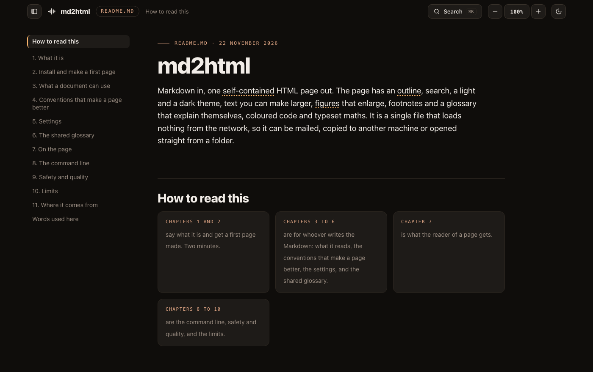

# md2html

Markdown in, one self-contained HTML page out. The page has an outline, search, a light and a dark theme, text you can make larger, figures that enlarge, footnotes and a glossary that explain themselves, coloured code and typeset maths. It is a single file that loads nothing from the network, so it can be mailed, copied to another machine or opened straight from a folder.

## How to read this

- **Chapters 1 and 2** say what it is and get a first page made. Two minutes.
- **Chapters 3 to 6** are for whoever writes the Markdown: what it reads, the conventions that make a page better, the settings, and the shared glossary.
- **Chapter 7** is what the reader of a page gets.
- **Chapters 8 to 10** are the command line, safety and quality, and the limits.

## 1. What it is

A small command-line tool. You give it a Markdown file, or a folder of them; it writes an HTML page beside each.



It is written in Rust with the standard library only: no Markdown crate, nothing to vendor, no runtime dependency. It builds anywhere a Rust toolchain does, into one binary of under a megabyte, and renders a 4,000-line handbook in well under a tenth of a second.

It reads Markdown the way CommonMark does, with GitHub's additions, and passes 640 of the 652 examples of the CommonMark specification. What it does not know stays on the page exactly as written, where you can see it. And it is opinionated: it was made to render handbooks that are pleasant to read, which is why it has an outline, cards, callouts and a glossary.

To see everything at once, render [the showcase](docs/showcase.md): `md2html docs/showcase.md`.

## 2. Install and make a first page

You need Rust 1.85 or newer.

```sh
cargo install --git https://github.com/githubrobbi/md2html
```

Then:

```sh
md2html notes.md                 # writes notes.html beside it
md2html notes.md out.html        # a chosen output path
md2html docs/                    # every .md under docs/, each beside itself
md2html docs/ -o site/ --nav     # into site/, linked with previous and next
md2html notes.md --check         # write nothing; say what to fix
md2html notes.md --watch         # render again on every save
cat notes.md | md2html - > notes.html
```

md2html refuses to write over its input or over another Markdown file.

> **Tip:** try it on something real: `md2html README.md`.

## 3. What a document can use

Everything CommonMark has, and what GitHub adds to it:

| You write | You get |
|---|---|
| `# Title` | the page title; the paragraph after it becomes the lead |
| `## Chapter`, `### Section` | chapters and sections, listed in the outline |
| `#### Smaller` to `######` | smaller headings, not in the outline |
| `**bold**`, `*italic*`, `***both***`, `~~struck~~`, `` `code` `` | bold, italic, both, struck, inline code |
| `[text](url "title")`, `[text][ref]`, `<https://…>`, a bare `https://…` | links |
| `- item`, `1. item`, nested by indenting | lists, as deep as you like |
| `- [ ] open`, `- [x] done` | a task list |
| `> quoted text` | a quotation |
| `> [!NOTE]`, `> [!TIP]`, `> [!IMPORTANT]`, `> [!WARNING]`, `> [!CAUTION]` | a callout of that kind, as on GitHub |
| `> **Note:**`, `> **Tip:**`, `> **Warning:**` | the same callouts, the older way |
| a pipe table, `:--`, `:-:` and `--:` in its rule | a table with its columns aligned; a wide one scrolls sideways |
| a fenced code block with a language | code, coloured, with a copy button |
| `$x^2$`, `$$ \frac{a}{b} $$`, a ` ```math ` block | maths, typeset as MathML |
| `text[^1]` and `[^1]: the note` | a footnote: the number explains itself on hover |
| a line that is only `` | a figure with its caption, enlarged over the page on a click |
| `{width=50%}` | the same at a chosen width |
| `` inside a sentence | an image on the line |
| `<kbd>`, `<sub>`, `<sup>`, `<details>`, `<br>` and other harmless tags | those tags |
| `---` on a line of its own | a rule |
| a `---` block of `key: value` lines at the very top | settings for the page (chapter 5) |

Code is coloured for Rust, Python, JavaScript and TypeScript, Go, C and C++, Java, Kotlin, Swift and C#, shell and shell sessions, SQL, Ruby, Lua, PHP, CSS, HTML and XML, JSON, YAML, TOML and INI, Dockerfiles and diffs. Any other language is shown plain.

> **Note:** a construct the renderer does not know is not dropped and not guessed at. It appears verbatim, which is how you notice it. `--check` lists every such place.

## 4. Conventions that make a page better

None of these is required. Each one is ordinary Markdown that also reads well as plain text.

**The lead.** The first paragraph after the `# Title` is set larger, as the opening of the page. Write it as the one paragraph a reader needs if they read nothing else. It is also the page's description for link previews.

**The reading guide.** A chapter called `How to read this` turns its bullets into cards. Start each bullet with a bold phrase that names chapters by number, as this README does, and the card links to the first chapter it names.

**Numbered chapters.** A chapter heading such as `## 3. What a document can use` is what a card's number points at. The numbers are yours; the renderer does not renumber anything.

**The glossary.** A chapter whose title has `Glossary` in it holds the page's words, as a table of term and meaning (a third column, `Also`, names other spellings the prose uses). It is not printed where it stands. Instead:

- the first mention of each term in every chapter becomes a dotted link that explains itself on hover;
- a click jumps to the entry at the foot of the page, and every entry has a way back to the line you were reading;
- the entries are searchable, so searching for a term finds its meaning.

**Several top-level headings.** A document that uses `#` for its chapters gets the first one as its title and the others as chapters.

**Lines that are skipped.** HTML comments and a chapter called `Contents` are left out: the outline is the contents.

## 5. Settings

Front matter at the very top of the Markdown sets the page. The same settings work on the command line, as `--set key=value` or as the flags in chapter 8; the command line wins.

```yaml
---
title: The plans
lang: de
brand: Maplewood ADU
kicker: plans
footer: Working drawings. Schematic, not for construction.
description: The drawings of each version, to compare.
---
```

| Setting | What it does |
|---|---|
| `title` | the page's title, instead of its first heading |
| `lang` | the page's language; `de` also puts the page's own words (search, glossary, callouts, dates) in German |
| `brand`, `brand_link` | the name in the bar instead of md2html, and where it leads |
| `kicker` | the tag beside the name, instead of the file name |
| `eyebrow` | the line above the title, instead of file name and date |
| `date`, `version` | the date shown (`2026-11-21` is written out in the page's language), and a version beside it |
| `description`, `author` | the page's meta description and author |
| `footer` | the fine print at the foot; Markdown allowed |
| `css`, `head` | a stylesheet, or HTML for the head, from a file next to the Markdown |
| `large` | larger type, for a page read at half a screen |
| `embed` | put the images inside the page too, so it is truly one file |
| `toc` | `false` for no outline |
| `math` | `false` to read `$` as a dollar sign |
| `glossary` | `false` to leave the shared glossary out |
| `html` | `true` to trust the Markdown's raw HTML (chapter 9) |
| `csp` | `true` for a Content-Security-Policy (chapter 9) |
| `index` | `true` to let search engines index the page; pages say `noindex` by default |

`SOURCE_DATE_EPOCH` fixes the date, so the same Markdown renders to the same bytes.

## 6. The shared glossary

Words that come up on many pages can be explained once.

Put a Markdown page with a `Glossary` chapter at `~/.config/md2html/glossary.md`, or name one with the environment variable `MD2HTML_GLOSSARY`. From then on its terms link on every page you render, exactly like the page's own.

- A page lists only the shared terms its prose actually uses.
- Each of those has an **all terms** link to the full list. That is the shared page's twin, so render the shared page itself once. To point somewhere else, set `MD2HTML_GLOSSARY_URL`.
- A term the page defines itself wins over the shared one.
- `--no-glossary` renders a page without it.

## 7. On the page

What the reader of a rendered page can do:

| To | Do this |
|---|---|
| Find something | **Search** in the bar, Command (Control) with K, or `/`; the words found are lit where you land |
| See where you are | the outline marks the chapter you are reading, and the bar names it |
| Hide the outline | the switch at the left of the bar, or Command (Control) with backslash |
| Bring it back for a moment | rest the pointer on the rail at the left edge, or click it: the outline opens as a drawer |
| Make the text larger or smaller | **−** and **+** in the bar, from 85 to 200 percent; the number between them returns to 100 |
| Change the theme | the button at the right of the bar: light, dark, or whatever the system uses |
| Enlarge a figure | click it: it fills the window. Two more clicks bring it closer, and the image follows the pointer. The next click, or Escape, puts it back |
| Read a footnote | rest on its number; click to go to it, and **back** returns |
| See what a dotted word means | rest on it; click to go to its entry |
| Copy a code block | **copy** on the block |
| Link to a section | the **#** that appears beside a heading |
| Print it | the controls drop away, links print their addresses, and nothing is cut across a page |

The outline, the text size and the theme are remembered by the browser, per reader. Every control works from the keyboard, and the page follows the system's reduced-motion and high-contrast settings.

## 8. The command line

```text
md2html [options] <input>...      a file, a folder, or - for stdin
md2html <in.md> <out.html>

  -o, --out <path>   the page, a folder for several, or - for stdout
  --title, --lang, --brand, --footer <text>
  --css <file>, --head <file>, --set key=value
  --large, --embed, --no-glossary, --no-toc, --no-math, --index
  --html, --csp
  --nav              link the pages of one run with previous and next
  --fragment         only the HTML of the Markdown, no page around it
  --check            write nothing; list what to fix; exit 1 if anything
  --watch            render again whenever an input changes
  -q, --quiet
```

A link to another Markdown file that exists beside the page, `[setup](setup.md#install)`, is written as a link to its page, `setup.html#install`, so a folder of Markdown becomes a folder of linked pages.

Every render reports what an author should look at, with the line: a link to an anchor that is not on the page, a file that is not there, a footnote without its note, raw HTML shown as text, an unknown setting. `--check` does only that and exits 1 when there is anything, which makes it a check for a build or an agent's last step.

## 9. Safety and quality

A page can be rendered from Markdown you did not write.

- **No script from the text.** Raw HTML is shown as text, except a short list of harmless tags (`<kbd>`, `<sub>`, `<details>` and the like) that pass without any attribute that could run code. `--html` lets everything through, for Markdown you trust.
- **No script links.** A `javascript:`, `vbscript:` or `data:` link is not written, however it is spelled or escaped; only its text remains.
- **A Content-Security-Policy, when asked.** `--csp` adds a policy that lets exactly the page's own scripts and styles run, by their hashes, and forbids every connection out.
- **Nothing pathological.** Hostile input, thousands of brackets or asterisks or deeply nested quotes, renders in bounded time and size.

The tests render whole pages and read them back: structure, security, the settings, the glossary, footnotes, the build scripts that post-process md2html's pages, and the CommonMark specification's 652 examples, of which the count passing may rise but never fall (`cargo test`).

The pages are also checked in Chrome (`tests/browser`): an accessibility audit with axe-core against WCAG 2.2 AA, in both themes and at phone width, finds nothing; and a click-through uses every control the way a reader would, by mouse and by keyboard, with no script error. The CI runs all of it on every push, on macOS and Ubuntu and on the oldest supported Rust, with clippy's pedantic lints as errors.

## 10. Limits

- **Twelve CommonMark examples fail**, all corner cases: tabs inside list markers, link definitions spread over several lines, and named entities beyond the common ones (those are left for the browser to show).
- **Two deliberate departures** for pages, to keep what authors mean: `---` straight under a paragraph is a rule unless the paragraph is a single heading-like line, and a numbered list may follow a line that ends in a colon whatever its first number. `--fragment` and the tests read strictly.
- **Maths is a subset of TeX**: the everyday commands, Greek, accents, matrices and cases. A formula it cannot read is shown as its TeX.
- **Diagrams are not drawn.** A `mermaid` block is shown as code.
- **Images are linked, not embedded**, unless you ask with `--embed`. Copy them along otherwise.
- **The page's own words** are in English and German.

## 11. Where it comes from

md2html began as the renderer of the docenta handbook, was carried over to render the handbook of iv, and was then made general so that any Markdown page could use it. All three have the same owner. Version 0.4 replaced the handbook subset with a full CommonMark reader.

Licensed MIT OR Apache-2.0, at your option. See `LICENSE-MIT` and `LICENSE-APACHE`. The CommonMark examples in `tests/commonmark` are the specification's, under CC BY-SA 4.0.

## Glossary

| Term | Meaning | Also |
|---|---|---|
| self-contained | Everything the page needs is inside the one HTML file: styles, scripts, the search index. Only an image file is outside it, unless embedded. | |
| outline | The list of chapters and sections at the left of the page, made from the headings. | |
| drawer | The outline sliding out over the page while it is hidden, and closing again when you are done with it. | |
| lead | The first paragraph after the title, set larger as the opening of the page. | |
| reading guide | The chapter called "How to read this", whose bullets become cards that link to chapters. | |
| callout | A boxed aside: a note, a tip, something important, a warning or a caution. | callouts |
| figure | An image with its caption, from a line that holds nothing else. | figures |
| front matter | The block of settings between two `---` lines at the very top of a Markdown file. | |
| shared glossary | One glossary page whose terms link on every page you render. | |
| twin | The HTML page rendered from a Markdown file, beside it and with the same name. | |
| CommonMark | The specification of Markdown that most tools now follow, with a test for every rule. | |
