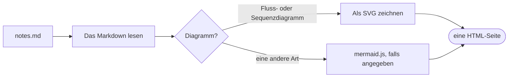
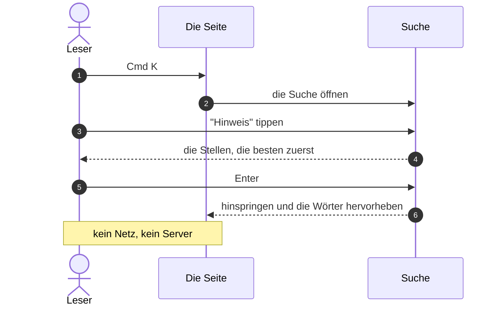
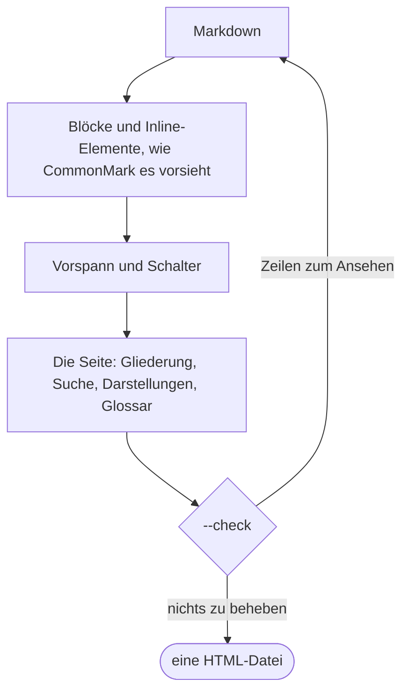

# md2html, alles, was es kann

md2html macht aus einer Markdown-Datei eine Webseite, die sonst nichts braucht: keinen Server, kein Netz, keine Schriften oder Skripte von irgendwoher. Die Seite bringt ihre eigene Gliederung mit, die Suche, eine helle und eine dunkle Darstellung, die Textgröße, das Glossar, Fußnoten, Abbildungen, die sich vergrößern lassen, farbigen Code, gesetzte Formeln und Diagramme. Diese Seite wurde in Markdown geschrieben und von md2html gerendert, und so ist alles, was sie beschreibt, an ihr selbst am Werk, während man sie liest.

## Wie diese Seite zu lesen ist

- **Kapitel 1** sagt, wo md2html läuft und wie man es installiert.
- **Kapitel 2** ist alles in einer Tabelle.
- **Kapitel 3 bis 9** zeigen, was man beim Lesen bekommt und was man beim Schreiben dafür tippt.
- **Kapitel 10 bis 12** sind die Einstellungen, die Kommandozeile sowie Sicherheit und Qualität.

---

## 1. Wo es läuft

| | Wo |
|:--|:--|
| Das Werkzeug md2html | macOS (Apple Silicon und Intel), Linux und Windows, aus einem einzigen Rust-Programm ohne Abhängigkeiten außer der Standardbibliothek; bei jeder Änderung auf allen dreien getestet |
| Die Seiten, die es macht | aktuelle Versionen von Chrome, Edge, Firefox und Safari, auf Rechnern, Tablets und Telefonen, online oder offline; durchgehend mit Screenreader und Tastatur bedienbar |
| Geöffnet von | einem Webserver, einem geteilten Ordner, einem E-Mail-Anhang oder direkt von der Festplatte: die Seite ist eine einzige Datei |
| Gedruckt oder als PDF gesichert | aus jedem Browser, mit einem eigenen Drucklayout; `--pdf` macht das PDF selbst, mit dem Chrome, Chromium oder Edge, das schon auf dem Rechner ist |
| E-Reader | `--epub` macht ein EPUB 3, das übliche Format für E-Books |
| Sprachen der Seite | siebzehn, auch von rechts nach links (Kapitel 8) |

Installiert wird mit dem eigenen Installer von Rust, aus dem Quellcode:

```console
$ cargo install --git https://github.com/githubrobbi/md2html --tag v0.8.0 md2html --locked
$ md2html notes.md
md2html: notes.md -> notes.html (68504 bytes, 9 glossary terms, 0 of them shared)
```

## 2. Auf einen Blick

| | md2html |
|:--|:--|
| Markdown | ganz CommonMark 0.31.2 (**652 seiner 652** Testbeispiele bestehen), dazu Tabellen, Aufgabenlisten, Durchstreichen, automatische Links, Fußnoten und Hinweiskästen von GitHub |
| Ausgabe | **eine HTML-Datei**, nichts wird nachgeladen, nichts muss man zum Lesen installieren |
| Lesen | Gliederung, Suche, helle und dunkle Darstellung, Textgröße, Glossar, Fußnoten, Abbildungen, die sich vergrößern lassen |
| Code, Formeln, Diagramme | Code farbig in rund zwanzig Sprachen, Formeln als MathML, Mermaid-Flussdiagramme und -Sequenzdiagramme als SVG gezeichnet, **alles ohne Skriptbibliothek** |
| Teilen | ein Link zu jedem Kapitel, jeder Tabellenzeile, jeder Abbildung, jedem Diagramm, jedem Codeblock oder einer markierten Stelle |
| Sprachen | die eigenen Wörter der Seite in **17 Sprachen**, Übersetzungen über einen Umschalter verbunden, von rechts nach links für Hebräisch, Jiddisch und Arabisch |
| Aufbewahren | die Seite selbst, ein **PDF** mit Lesezeichen, ein **EPUB** für E-Reader |
| Live | Seiten, die neu laden, wenn sich ihr Markdown ändert, und die Stelle behalten, an der man liest |
| Sicherheit | nie ein Skript aus dem Text; keine Datei wird außerhalb des Ordners des Dokuments gelesen |
| Barrierefreiheit | keine Befunde gegen WCAG 2.2 AA, in beiden Darstellungen und in Telefonbreite |
| Geschwindigkeit | ein Dokument mit 4.000 Zeilen, Diagramme und Formeln eingeschlossen, in **weniger als einer Zehntelsekunde** |
| Abhängigkeiten | **keine**: die Standardbibliothek von Rust und md2html |

## 3. Die Seite

Die Seite hat drei Teile: eine Leiste oben, die Gliederung links und den Text.

{width=100%}

Die dunkle Darstellung folgt dem System oder der Wahl der Lesenden und wird gespeichert:

{width=100%}

Auf dem Telefon klappt die Gliederung hinter den Schalter in der Leiste weg, und nichts scrollt seitwärts:

{width=34%}

Was man beim Lesen tun kann:

| Ziel | So geht es |
|:--|:--|
| Etwas finden | **Suchen** in der Leiste, <kbd>⌘</kbd> <kbd>K</kbd> (<kbd>Strg</kbd> <kbd>K</kbd>) oder <kbd>/</kbd> |
| Die Gliederung aus- oder einblenden | der Schalter links in der Leiste, oder <kbd>⌘</kbd> <kbd>\\</kbd> |
| Die Textgröße ändern | **Aa** in der Leiste, dann **−** und **+**; oder <kbd>⌘</kbd> <kbd>+</kbd> und <kbd>⌘</kbd> <kbd>−</kbd>, von 85 bis 200 Prozent |
| Die Darstellung wechseln | **Aa**, dann System, Hell oder Dunkel |
| Eine Abbildung vergrößern | anklicken; zwei weitere Klicks holen sie näher heran; <kbd>Esc</kbd> stellt sie zurück |
| Eine Fußnote oder ein gepunktetes Wort lesen | mit dem Zeiger darauf ruhen; ein Klick springt hin, und **zurück** führt zurück |
| Ein Kapitel, eine Tabellenzeile, eine Abbildung, ein Diagramm, einen Codeblock oder eine Stelle teilen | das Teilen-Symbol rechts neben einer Überschrift, am Ende der Tabellenzeile unter dem Zeiger oder in der Ecke der Abbildung, des Diagramms oder des Codeblocks, auf dem er ruht, kopiert ihren Link (ein Telefon öffnet sein Teilen-Menü); Wörter markieren, und ein Link genau zu ihnen wird angeboten |
| Aufbewahren | der Download-Knopf am Ende der Leiste: die Seite selbst (sie lässt sich offline lesen), drucken oder als PDF sichern, oder das PDF und das EPUB, wo sie erstellt wurden |

Textgröße und Darstellung liegen zusammen hinter **Aa**; das Aufbewahren der Seite hat einen eigenen Knopf:

{width=60%}

## 4. Schreiben

Gewöhnliches Markdown, und jedes Konstrukt liest sich auch als reiner Text gut. Was man schreibt, steht zuerst, in einem Codeblock; was man bekommt, folgt danach.

### Hervorhebung und Links

```markdown
**Fett**, *kursiv*, ***beides***, ~~durchgestrichen~~ und `Code`.
Ein [Link](https://commonmark.org "CommonMark"), ein nackter,
https://spec.commonmark.org/0.31.2/, und Zeichen wie [V], die bleiben, wie sie geschrieben sind.
```

**Fett**, *kursiv*, ***beides***, ~~durchgestrichen~~ und `Code`. Ein [Link](https://commonmark.org "CommonMark"), ein nackter, https://spec.commonmark.org/0.31.2/, und Zeichen wie [V], die bleiben, wie sie geschrieben sind.

### Listen in Listen

```markdown
1. Erstens, mit einer verschachtelten Liste:
   - ein Punkt
   - noch einer, mit einer eigenen:
     1. tiefer
2. Zweitens.
- [x] eine erledigte Aufgabe
- [ ] eine offene Aufgabe
```

1. Erstens, mit einer verschachtelten Liste:
   - ein Punkt
   - noch einer, mit einer eigenen:
     1. tiefer
2. Zweitens.

- [x] eine erledigte Aufgabe
- [ ] eine offene Aufgabe

### Zitate und Hinweiskästen

```markdown
> Ein einfaches Zitat bleibt ein Zitat.

> [!TIP]
> Die Hinweiskästen von GitHub funktionieren: NOTE, TIP, IMPORTANT, WARNING, CAUTION.

> **Hinweis:** Auch die ältere Form wird ein Hinweiskasten: ein fettes Wort und ein Doppelpunkt.
```

> Ein einfaches Zitat bleibt ein Zitat.

> [!TIP]
> Die Hinweiskästen von GitHub funktionieren: NOTE, TIP, IMPORTANT, WARNING, CAUTION.

> **Hinweis:** Auch die ältere Form wird ein Hinweiskasten: ein fettes Wort und ein Doppelpunkt.

### Tabellen

```markdown
| Raum       | Etage        | Fläche (sq ft) |
|:-----------|:------------:|---------------:|
| Wohnzimmer | Erdgeschoss  |            312 |
| Dachboden  | Obergeschoss |            205 |
```

| Raum | Etage | Fläche (sq ft) |
|:-------|:------:|-------------:|
| Wohnzimmer | Erdgeschoss | 312 |
| Dachboden | Obergeschoss | 205 |

Eine Tabelle, die breiter ist als die Spalte, scrollt in ihr, und die Seite tut es nie.

### Fußnoten

```markdown
Eine Behauptung, die eine Quelle braucht.[^1]

[^1]: Die Quelle. Mit dem Zeiger auf der Zahl ruhen, um sie dort zu lesen.
```

Eine Behauptung, die eine Quelle braucht.[^source]

[^source]: Die Quelle. Mit dem Zeiger auf der Zahl ruhen, um sie dort zu lesen; ein Klick darauf führt hierher, und zurück führt wieder zurück.

### Abbildungen und Bilder

```markdown
{width=60%}

Ein Symbol {width=18} mitten im Satz.
```

{width=60%}

Ein Symbol {width=18} mitten im Satz.

### Kleinigkeiten

```markdown
Drücken Sie <kbd>Strg</kbd>+<kbd>K</kbd>. Wasser ist H<sub>2</sub>O, der Raum 9 m<sup>2</sup>.
Eine Zeile, die auf einem Backslash endet,\
bricht dort um.
```

Drücken Sie <kbd>Strg</kbd>+<kbd>K</kbd>. Wasser ist H<sub>2</sub>O, der Raum 9 m<sup>2</sup>. Eine Zeile, die auf einem Backslash endet,\
bricht dort um.

<details>
<summary>Ein Abschnitt, der sich per Klick öffnet</summary>

Geschrieben als `<details>` mit einem `<summary>`, mit gewöhnlichem Markdown darin: **fett**, eine Liste,

- eins
- zwei

</details>

#### Eine Überschrift der vierten Ebene

Überschriften unterhalb der dritten Ebene bleiben aus der Gliederung heraus, so wie diese hier.

## 5. Code, Formeln und Diagramme

Code wird farbig dargestellt für Rust, Python, JavaScript und TypeScript, Go, C und C++, Java, Kotlin, Swift, C#, die Shell, SQL, Ruby, Lua, PHP, CSS, HTML, JSON, YAML, TOML, Dockerfiles und Diffs, und jeder Block hat einen Knopf zum Kopieren.

```rust
/// The whole page from one Markdown text.
fn main() {
    let page = md2html::render("# Hello\n\nWorld.", &Settings::default());
    println!("{} bytes, nothing to fetch", page.len()); // one file
}
```

```python
@cache
def area(w: float, h: float) -> float:
    """The area of a room."""
    return w * h  # square feet
```

```diff
- every quotation a note
+ a quotation is a quotation; a bold first word makes it a note
```

Formeln setzt der Browser selbst, als MathML, ohne Skript und ohne Schrift zum Herunterladen. Im Fließtext lautet der Satz des Pythagoras $a^2 + b^2 = c^2$, und die eulersche Identität ist $e^{i\pi} + 1 = 0$; ein Geldbetrag wie $5 oder $10 bleibt Geld. Abgesetzt:

$$
\int_0^1 x^2 \, dx = \frac{1}{3} \qquad \sum_{k=1}^{n} k = \frac{n(n+1)}{2} \qquad \sqrt[3]{27} = 3
$$

$$
\begin{pmatrix} a & b \\ c & d \end{pmatrix}
\begin{pmatrix} x \\ y \end{pmatrix}
=
\begin{pmatrix} ax + by \\ cx + dy \end{pmatrix}
\qquad
|x| = \begin{cases} x & x \ge 0 \\ -x & x < 0 \end{cases}
$$

### Diagramme

Ein Mermaid-Flussdiagramm oder -Sequenzdiagramm zeichnet md2html selbst, als SVG in der Seite: kein Skript, nichts zum Herunterladen, die eigenen Farben der Seite in beiden Darstellungen, und seine Wörter bleiben Wörter, die die Suche findet. Das ist das Markdown:

````markdown

````

Und das wird daraus:


Ein Sequenzdiagramm, nummeriert, mit einer Notiz:



Andere Arten (Tortendiagramme, Gantt-Diagramme, Klassendiagramme) zeichnet mermaid.js, wenn man md2html auf eine Kopie davon verweist (`--mermaid-js FILE`); das Skript kommt dann nur in diese eine Seite. Ohne sie bleiben sie Code, und `--check` sagt das.

## 6. Glossar, Fußnoten, Suche und Abbildungen

Ein Kapitel namens Glossar enthält die Wörter der Seite als Tabelle. Es wird nicht dort gedruckt, wo es steht: Stattdessen wird die erste Erwähnung jedes Begriffs in jedem Kapitel zu einem gepunkteten Wort, das sich selbst erklärt, wenn der Zeiger darauf ruht, und ein Klick darauf springt zum Eintrag am Fuß der Seite, der zurück zu der Zeile führt, die man gerade gelesen hat.

{width=70%}

Fußnoten funktionieren genauso: Die Zahl erklärt sich selbst, wenn der Zeiger darauf ruht.

{width=70%}

> [!NOTE]
> Ein Glossar lässt sich über mehrere Seiten hinweg teilen: eine Datei unter `~/.config/md2html/glossary.md`, deren Wörter dann auf jeder Seite verlinkt werden, die auf diesem Rechner aus einer Datei gerendert wird.

Die Suche umfasst jedes Wort auf der Seite, das Glossar eingeschlossen. Die Treffer zeigen, wo jedes Wort steht; der gewählte wird dort hervorgehoben, wo die Suche landet.

{width=80%}

{width=80%}

Eine Abbildung vergrößert sich über der Seite, ohne sie zu verlassen. Ist sie größer als das Fenster, folgt sie dem Zeiger, sodass man auf das zeigt, was man sehen will.

## 7. Teilen und Live-Seiten

Jede Überschrift trägt rechts ein Teilen-Symbol; jede Tabellenzeile, jede Abbildung, jedes Diagramm und jeder Codeblock zeigt eines, wenn der Zeiger darauf ruht. Ein Klick kopiert einen Link genau zu dieser Stelle und sagt das; auf dem Telefon öffnet sich stattdessen das Teilen-Menü des Systems. Markiert man ein paar Wörter, bietet die Seite einen Link genau zu ihnen an, der die Seite bei dieser Stelle öffnet, hervorgehoben.

{width=80%}

Eine Seite kann sich auch selbst aktuell halten. `md2html --serve` zeigt die Seiten auf diesem Rechner, während sie geschrieben werden, und jede offene Seite lädt neu, sobald ihr Markdown gespeichert wird. Eine veröffentlichte Seite, die mit `--live` gemacht wurde, hat ihre eigene Lebensdauer: Läuft sie ab, fragt die Seite ihren Server nach ihrem ersten Kilobyte, wo ihr Fingerabdruck steht, und lädt nur neu, wenn sich dieser geändert hat. So oder so bleibt man beim Lesen, wo man war: beim selben Absatz auf derselben Höhe oder, wenn er weg ist, beim Kapitel davor; der Wechsel in eine andere Sprache behält die Stelle auf dieselbe Weise. Der Server ist allein für diesen Rechner da: Er beantwortet nur Anfragen, die an ihn gerichtet sind, liefert nur den Ordner des Dokuments aus und beantwortet eine Anfrage, die er nicht ganz lesen kann, mit dem Status, der sagt, warum.

## 8. Sprachen

Die eigenen Wörter der Seite (die Suche, die Hinweiskästen, das Glossar, die Daten, jeder Knopf) gibt es in siebzehn Sprachen: Englisch, Deutsch, Hebräisch, Indonesisch, Niederländisch, Javanisch, Jiddisch, Plattdeutsch, Französisch, Italienisch, Spanisch, Japanisch in drei Schreibweisen (in Kanji und Kana, nur in Kana und in Rōmaji), Mandarin-Chinesisch in vereinfachten und in traditionellen Schriftzeichen, und Kantonesisch. `lang: de` im Vorspann ist alles, was es braucht. Hebräisch und Jiddisch werden von rechts nach links gesetzt, die Gliederung rechts, und ebenso Arabisch, mit englischen Wörtern.

Eine Übersetzung ist einfach eine weitere Markdown-Datei neben dem Original, benannt nach ihrer Sprache: `capabilities.de.md` ist das deutsche `capabilities.md`. md2html findet die vorhandenen Fassungen, verbindet sie mit einem Umschalter in der Leiste (dem Globus), teilt das Browsern und Suchmaschinen mit `hreflang` mit und gibt jeder die Wörter ihrer eigenen Oberfläche. Diese Seite gibt es in allen siebzehn; der Globus wechselt zwischen ihnen, und die Seite öffnet sich bei dem Absatz, den man gerade gelesen hat.

Jede Übersetzung nennt ihr Original und hält den Fingerabdruck des Originals fest, sodass die Seite sagen kann, welche Fassung maßgeblich ist, und `--check` bemerkt, wenn sich das Original seit der Übersetzung geändert hat:

```yaml
translated_from: capabilities.md
source_sha256: 5b0c...e1
```

Für eine Sprache, in die noch niemand eine Seite übersetzt hat, kann der Browser der Lesenden sie übersetzen, wo er das kann (der eingebaute Übersetzer von Chrome): auf dem Gerät selbst, sodass nichts es verlässt, als maschinelle Übersetzung gekennzeichnet, mit einem Weg zurück zum Original.

## 9. Eine Seite aufbewahren

Der Download-Knopf in der Leiste bietet an, was es aufzubewahren gibt. Die Seite selbst lässt sich offline lesen, wenn ihre Bilder in ihr stecken (`embed: true`). Der Druck bekommt ein eigenes Layout: Die Bedienelemente fallen weg, jeder Link druckt seine Adresse, nichts wird über eine Seitengrenze hinweg zerschnitten, und die Seiten tragen den Titel und ihre Nummer.

{width=55%}

`--pdf` druckt die Seite mit dem Chrome, das schon auf dem Rechner ist: mit ihrem eigenen Drucklayout, den Überschriften als Lesezeichen des PDF, dem Titel oben auf jeder Seite und ihrer Nummer unten. `--epub` macht aus derselben Seite ein Buch für E-Reader, mit Inhaltsverzeichnis, Bildern, Diagrammen und Formeln, und mit Fußnoten, die sich dort öffnen, wo sie erwähnt werden; md2html schreibt es selbst. Beim Lesen findet man beides unter dem Download-Knopf.

## 10. Einstellungen

Der Anfang der Markdown-Datei des englischen Originals dieser Seite lautet:

```yaml
---
title: md2html, everything it does
description: md2html turns Markdown into one complete, self-contained web page ...
brand: md2html
kicker: Capabilities
version: 0.8.0
date: 2026-11-23
footer: Written in Markdown and rendered by **md2html 0.8.0** itself ...
csp: true      # only this page's own code may run
embed: true    # the screenshots are inside the page
---
```

| Einstellung | Was sie bewirkt |
|:--|:--|
| `title`, `description`, `author` | der Titel, und die Meta-Tags für Linkvorschauen |
| `lang` | die Sprache: die eigenen Wörter und die Daten der Seite in jeder der siebzehn (`ja-Hira` ist Japanisch in Kana, `zh-Hant` Chinesisch in traditionellen Schriftzeichen, `yue` Kantonesisch) |
| `translated_from`, `source_sha256` | für eine Übersetzung: ihr Original, und der Fingerabdruck des Originals zum Zeitpunkt der Übersetzung |
| `brand`, `brand_link`, `kicker`, `eyebrow`, `footer` | die Leiste, die Zeile über dem Titel, das Kleingedruckte |
| `date`, `version` | Datum und Version über dem Titel |
| `embed` | Bilder in der Seite, damit sie eine einzige Datei ist |
| `csp` | eine Content-Security-Policy |
| `pdf`, `epub` | ein PDF und ein EPUB der Seite, daneben |
| `live` | die Lebensdauer der Seite (`true` sind zwei Minuten, sonst eine Zahl von Sekunden): danach lädt sie neu, wenn sie sich geändert hat, und behält die Stelle, an der man liest |
| `large`, `toc`, `math`, `index`, `html`, `css`, `head` | größere Schrift, die Gliederung, Formeln, Suchmaschinen, reichhaltigeres HTML, zusätzlicher Stil und Head |

> [!TIP]
> Mit `lang: de` sagt die Suche „Diese Seite durchsuchen“, die Hinweiskästen sagen „Hinweis“ und „Achtung“, und das Datum lautet „23. November 2026“.

## 11. Die Kommandozeile

```console
$ md2html notes.md
md2html: notes.md -> notes.html (68504 bytes, 9 glossary terms, 0 of them shared)
$ md2html docs/ -o site/ --nav
$ md2html notes.md --check
notes.md:30: `plan.svg` does not exist next to this page
notes.md: a link points at #setup, which is nowhere on the page
md2html: 2 to look at
$ cat notes.md | md2html - > notes.html
$ md2html notes.md --pdf --epub
$ md2html notes.md --serve
```

`--check` schreibt nichts, listet auf, was man sich als Autor ansehen sollte, Zeile für Zeile, wo es eine Zeile gibt, und endet mit 1, wenn es etwas gibt: ein Link auf einen Anker, der nicht auf der Seite steht, eine Datei, die nicht da ist, eine Fußnote ohne ihre Anmerkung, rohes HTML, das als Text gezeigt wird, ein Tag des Autors, das nichts schließt oder nie geschlossen wird, eine Übersetzung, die älter ist als ihr Original. Das macht es zum letzten Schritt eines Builds. `--watch` rendert bei jedem Speichern neu, `--nav` verbindet die Seiten eines Ordners mit Zurück und Weiter, und ein Link auf eine andere Markdown-Datei führt zu deren Seite.

## 12. Sicherheit, Qualität und Barrierefreiheit

> [!WARNING]
> Eine Seite kann aus Markdown gerendert werden, das jemand anderes geschrieben hat. md2html schreibt nie ein Skript aus dem Text: Rohes HTML wird so gezeigt, wie es geschrieben ist, bis auf ein paar harmlose Tags, die innerhalb des Artikels ausbalanciert werden, sodass sie die Seite um ihn herum nicht beschädigen können, und `javascript:`- oder `data:`-Links werden verworfen, wie auch immer sie geschrieben sind. Ein Dokument kann md2html nicht dazu bringen, eine Datei außerhalb seines Ordners zu lesen, und keine Eingabe, wie feindselig auch immer, kann es lahmlegen oder abstürzen lassen.

> [!CAUTION]
> `--html` lässt reichhaltigeres HTML durch (Bilder, Links, Video, SVG, Layout), aber nie etwas, das läuft: kein Skript, kein Event-Handler, kein Frame, kein Formular.

Was bei jeder Änderung geprüft wird, die Tests auf macOS, Linux und Windows und die Prüfungen in Chrome auf Linux:

- die Tests, die ganze Seiten rendern und wieder auslesen, und die, die das Programm selbst ausführen, die Sicherheitsfälle und die pathologischen Fälle eingeschlossen;
- die 652 Beispiele der CommonMark-Spezifikation, bei denen die Zahl der bestandenen steigen, aber nie fallen darf;
- die strengsten Lints von clippy und die älteste Rust-Version, auf der sich das Werkzeug bauen lassen soll;
- eine Prüfung der Barrierefreiheit mit axe-core gegen WCAG 2.2 AA, in beiden Darstellungen und in Telefonbreite;
- ein Durchklicken in Chrome, das jedes Bedienelement so benutzt, wie man es beim Lesen täte, mit Maus und mit Tastatur, in normaler und in größerer Textgröße;
- Live-Seiten, von Anfang bis Ende: ein Neuladen bei einer Änderung, die Stelle, an der man liest, behalten, ein Sprachwechsel, der beim selben Absatz landet.

md2html enthält keinen Code von Dritten, und seine Lieferkette ist festgeschrieben und geprüft: die Werkzeugkette, die CI-Aktionen, die Testwerkzeuge. Jede Seite endet mit einer leisen Zeile: erstellt mit md2html, seine Version und ein Link dorthin, wo md2html zu Hause ist.

Der Weg, den jede Seite nimmt:



---

Das Glossar unten erklärt die Wörter, die diese Seite verwendet; jedes war oben ein gepunktetes Wort.

## Glossar

| Begriff | Bedeutung | Auch |
|---|---|---|
| Markdown | Reiner Text mit leichten Zeichen für Überschriften, Hervorhebung, Listen und Links, lesbar, wie er ist, und in eine Seite umwandelbar. | |
| CommonMark | Die Spezifikation von Markdown, der die meisten Werkzeuge heute folgen, mit einem Test für jede Regel. | |
| Gliederung | Die Liste der Kapitel links auf der Seite, aus ihren Überschriften gebildet. | |
| Hinweiskasten | Ein umrahmter Einschub: ein Hinweis, ein Tipp, etwas Wichtiges, eine Warnung oder ein Aufruf zur Vorsicht. | Hinweiskästen |
| Abbildung | Ein Bild auf einer eigenen Zeile, mit seiner Bildunterschrift darunter, das sich per Klick vergrößert. | Abbildungen |
| Vorspann | Der Block mit Einstellungen zwischen zwei `---`-Zeilen ganz oben in einer Markdown-Datei. | |
| MathML | Die eigene Sprache des Webs für Formeln, vom Browser ohne Skript gezeichnet. | |
| Content-Security-Policy | Eine Regel in der Seite, die dem Browser sagt, welcher Code laufen darf; hier nur der eigene der Seite. | |
| Mermaid | Eine Textsprache für Diagramme, in einem Codeblock geschrieben; md2html zeichnet ihre Flussdiagramme und Sequenzdiagramme. | |
| WCAG | Die Web Content Accessibility Guidelines, die Richtlinien für barrierefreie Webinhalte; Stufe AA ist das übliche Ziel. | |
| Übersetzung | Eine Fassung einer Seite in einer anderen Sprache, eine Markdown-Datei neben dem Original. | Übersetzungen |
| EPUB | Das übliche Format für E-Books, eine verpackte Webseite, die E-Reader selbst setzen. | |
