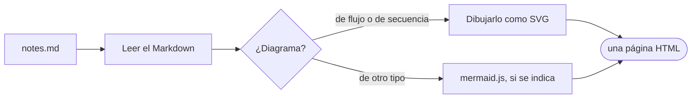
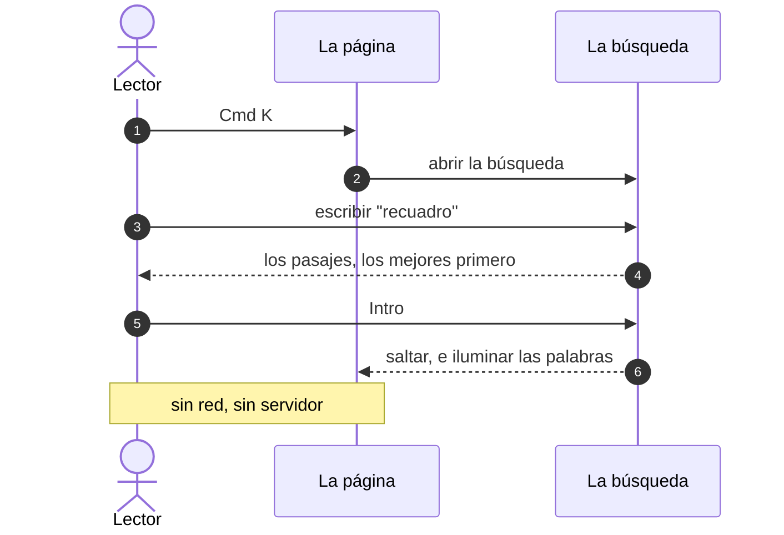
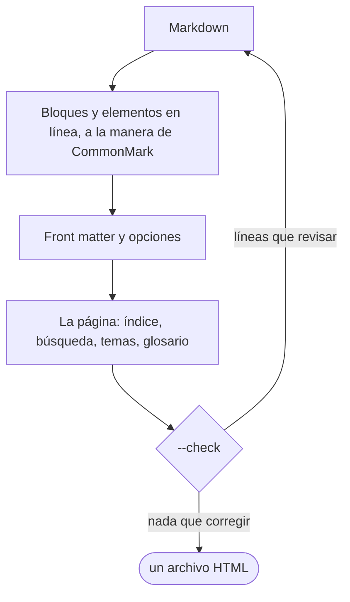

# md2html, todo lo que hace

md2html convierte un archivo Markdown en una sola página web que no necesita nada más: ni servidor, ni red, ni fuentes ni scripts de ninguna parte. La página trae su propio índice, búsqueda, temas claro y oscuro, tamaño del texto, glosario, notas al pie, figuras que se amplían, código coloreado, matemáticas bien compuestas y diagramas. Esta página se escribió en Markdown y la generó md2html, así que todo lo que describe actúa sobre ella mientras usted la lee.

## Cómo leer esto

- **Capítulo 1** es dónde funciona md2html, y cómo instalarlo.
- **Capítulo 2** es todo en una tabla.
- **Capítulos 3 a 9** muestran lo que obtiene quien lee y lo que escribe quien redacta para obtenerlo.
- **Capítulos 10 a 12** son los ajustes, la línea de comandos, y la seguridad y la calidad.

---

## 1. Dónde funciona

| | Dónde |
|:--|:--|
| La herramienta md2html | macOS (Apple silicon e Intel), Linux y Windows, a partir de un solo programa en Rust sin más dependencias que la biblioteca estándar; probada en los tres sistemas en cada cambio |
| Las páginas que genera | las versiones actuales de Chrome, Edge, Firefox y Safari, en ordenadores, tabletas y teléfonos, con o sin conexión; lectores de pantalla y teclado en todo momento |
| Se abren desde | un servidor web, una carpeta compartida, un adjunto de correo, o directamente desde el disco: la página es un solo archivo |
| Impresas o guardadas como PDF | desde cualquier navegador, con un diseño de impresión propio; `--pdf` genera el propio PDF, con el Chrome, Chromium o Edge que ya está en el equipo |
| Lectores electrónicos | `--epub` genera un EPUB 3, el formato estándar de los libros electrónicos |
| Idiomas de la página | diecisiete, de derecha a izquierda incluido (capítulo 8) |

Se instala con el instalador propio de Rust, desde el código fuente:

```console
$ cargo install --git https://github.com/githubrobbi/md2html --tag v0.7.7 md2html --locked
$ md2html notes.md
md2html: notes.md -> notes.html (68504 bytes, 9 glossary terms, 0 of them shared)
```

## 2. De un vistazo

| | md2html |
|:--|:--|
| Markdown | todo CommonMark 0.31.2 (pasan **652 de sus 652** ejemplos de prueba), y las tablas, listas de tareas, tachado, enlaces automáticos, notas al pie y alertas de GitHub |
| Resultado | **un solo archivo HTML**, nada que descargar, nada que instalar para quien lee |
| Lectura | índice, búsqueda, temas claro y oscuro, tamaño del texto, glosario, notas al pie, figuras que se amplían |
| Código, matemáticas, diagramas | código coloreado en una veintena de lenguajes, matemáticas como MathML, diagramas de flujo y de secuencia de Mermaid dibujados como SVG, **todo sin ninguna biblioteca de scripts** |
| Compartir | un enlace a cualquier capítulo, fila de tabla, figura, diagrama, bloque de código o pasaje seleccionado |
| Idiomas | las palabras propias de la página en **17 idiomas**, traducciones enlazadas con un selector, de derecha a izquierda para el hebreo, el ídish y el árabe |
| Para conservar | la propia página, un **PDF** con marcadores, un **EPUB** para lectores electrónicos |
| En vivo | páginas que se recargan cuando cambia su Markdown y conservan el lugar del lector |
| Seguridad | nunca un script a partir del texto; ningún archivo leído fuera de la carpeta del documento |
| Accesibilidad | ningún hallazgo según WCAG 2.2 AA, en ambos temas y con el ancho de un teléfono |
| Velocidad | un documento de 4000 líneas, con diagramas y matemáticas, en **menos de una décima de segundo** |
| Dependencias | **ninguna**: la biblioteca estándar de Rust y md2html |

## 3. La página

La página tiene tres partes: una barra en la parte superior, el índice a la izquierda y el texto.

{width=100%}

El tema oscuro sigue al sistema, o a la elección del lector, y se recuerda:

{width=100%}

En un teléfono, el índice se pliega detrás del interruptor de la barra, y nada se desplaza hacia los lados:

{width=34%}

Lo que puede hacer quien lee:

| Para | Haga esto |
|:--|:--|
| Encontrar algo | **Buscar** en la barra, <kbd>⌘</kbd> <kbd>K</kbd> (<kbd>Ctrl</kbd> <kbd>K</kbd>), o <kbd>/</kbd> |
| Ocultar o mostrar el índice | el interruptor a la izquierda de la barra, o <kbd>⌘</kbd> <kbd>\\</kbd> |
| Cambiar el tamaño del texto | **Aa** en la barra, luego **−** y **+**; o <kbd>⌘</kbd> <kbd>+</kbd> y <kbd>⌘</kbd> <kbd>−</kbd>, del 85 al 200 % |
| Cambiar el tema | **Aa**, luego Sistema, Claro u Oscuro |
| Ampliar una figura | haga clic en ella; dos clics más la acercan; <kbd>Esc</kbd> la devuelve a su sitio |
| Leer una nota al pie o una palabra punteada | pose el puntero sobre ella; haga clic para ir hasta ella, y **volver** lo trae de regreso |
| Compartir un capítulo, una fila de tabla, una figura, un diagrama, un bloque de código o un pasaje | el símbolo de compartir a la derecha de un título, al final de la fila de la tabla bajo el puntero, o en la esquina de la figura, el diagrama o el bloque de código sobre el que está el puntero, copia su enlace (un teléfono abre su menú de compartir); seleccione unas palabras, y se le ofrece un enlace exactamente a ellas |
| Guardarla | el botón de descarga al final de la barra: la propia página (se lee sin conexión), imprimir o guardar como PDF, o el PDF y el EPUB donde se hayan generado |

El tamaño del texto y el tema están juntos detrás de **Aa**; guardar la página tiene su propio botón:

{width=60%}

## 4. Escribir

Markdown corriente, y cada construcción se lee bien también como texto plano. Lo que usted escribe va primero, en un bloque de código; lo que obtiene viene a continuación.

### Énfasis y enlaces

```markdown
**Negrita**, *cursiva*, ***ambas***, ~~tachado~~ y `código`.
Un [enlace](https://commonmark.org "CommonMark"), uno suelto,
https://spec.commonmark.org/0.31.2/, y marcas como [V] que se quedan tal como se escribieron.
```

**Negrita**, *cursiva*, ***ambas***, ~~tachado~~ y `código`. Un [enlace](https://commonmark.org "CommonMark"), uno suelto, https://spec.commonmark.org/0.31.2/, y marcas como [V] que se quedan tal como se escribieron.

### Listas dentro de listas

```markdown
1. Primero, con una lista anidada:
   - una viñeta
   - otra, con la suya propia:
     1. más adentro
2. Segundo.
- [x] una tarea hecha
- [ ] una tarea pendiente
```

1. Primero, con una lista anidada:
   - una viñeta
   - otra, con la suya propia:
     1. más adentro
2. Segundo.

- [x] una tarea hecha
- [ ] una tarea pendiente

### Citas y recuadros

```markdown
> Una cita corriente sigue siendo una cita.

> [!TIP]
> Las alertas de GitHub funcionan: NOTE, TIP, IMPORTANT, WARNING, CAUTION.

> **Nota:** también la forma antigua de recuadro, una palabra en negrita y dos puntos.
```

> Una cita corriente sigue siendo una cita.

> [!TIP]
> Las alertas de GitHub funcionan: NOTE, TIP, IMPORTANT, WARNING, CAUTION.

> **Nota:** también la forma antigua de recuadro, una palabra en negrita y dos puntos.

### Tablas

```markdown
| Habitación | Planta | Área (pies²) |
|:-----------|:------:|-------------:|
| Salón      | baja   |          312 |
| Altillo    | alta   |          205 |
```

| Habitación | Planta | Área (pies²) |
|:-----------|:------:|-------------:|
| Salón | baja | 312 |
| Altillo | alta | 205 |

Una tabla más ancha que la columna se desplaza dentro de ella, y la página nunca lo hace.

### Notas al pie

```markdown
Una afirmación que necesita una fuente.[^1]

[^1]: La fuente. Pose el puntero sobre el número para leerla ahí.
```

Una afirmación que necesita una fuente.[^source]

[^source]: La fuente. Pose el puntero sobre el número para leerla ahí; haga clic en él para venir aquí, y en volver para regresar.

### Figuras e imágenes

```markdown
{width=60%}

Un icono {width=18} dentro de una frase.
```

{width=60%}

Un icono {width=18} dentro de una frase.

### Cosas pequeñas

```markdown
Pulse <kbd>Ctrl</kbd>+<kbd>K</kbd>. El agua es H<sub>2</sub>O, la habitación mide 9 m<sup>2</sup>.
Una línea que termina en barra invertida\
se corta ahí.
```

Pulse <kbd>Ctrl</kbd>+<kbd>K</kbd>. El agua es H<sub>2</sub>O, la habitación mide 9 m<sup>2</sup>. Una línea que termina en barra invertida\
se corta ahí.

<details>
<summary>Una sección que se abre con un clic</summary>

Escrita como `<details>` con un `<summary>`, con Markdown corriente dentro: **negrita**, una lista,

- uno
- dos

</details>

#### Un encabezado de cuarto nivel

Los encabezados por debajo del tercer nivel quedan fuera del índice, como este.

## 5. Código, matemáticas y diagramas

El código se colorea para Rust, Python, JavaScript y TypeScript, Go, C y C++, Java, Kotlin, Swift, C#, el shell, SQL, Ruby, Lua, PHP, CSS, HTML, JSON, YAML, TOML, Dockerfiles y diffs, y cada bloque tiene un botón para copiar.

```rust
/// The whole page from one Markdown text.
fn main() {
    let page = md2html::render("# Hello\n\nWorld.", &Settings::default());
    println!("{} bytes, nothing to fetch", page.len()); // one file
}
```

```python
@cache
def area(w: float, h: float) -> float:
    """The area of a room."""
    return w * h  # square feet
```

```diff
- every quotation a note
+ a quotation is a quotation; a bold first word makes it a note
```

Las matemáticas las compone el propio navegador, como MathML, sin script y sin ninguna fuente que descargar. En línea, el teorema de Pitágoras es $a^2 + b^2 = c^2$, y la identidad de Euler es $e^{i\pi} + 1 = 0$; una cantidad en dólares como $5 o $10 sigue siendo dinero. En bloque:

$$
\int_0^1 x^2 \, dx = \frac{1}{3} \qquad \sum_{k=1}^{n} k = \frac{n(n+1)}{2} \qquad \sqrt[3]{27} = 3
$$

$$
\begin{pmatrix} a & b \\ c & d \end{pmatrix}
\begin{pmatrix} x \\ y \end{pmatrix}
=
\begin{pmatrix} ax + by \\ cx + dy \end{pmatrix}
\qquad
|x| = \begin{cases} x & x \ge 0 \\ -x & x < 0 \end{cases}
$$

### Diagramas

Un diagrama de flujo o de secuencia de Mermaid lo dibuja el propio md2html, como SVG dentro de la página: sin script, sin nada que descargar, con los colores de la página en ambos temas, y sus palabras siguen siendo palabras que la búsqueda encuentra. Este es el Markdown:

````markdown

````

Y esto es en lo que se convierte:


Un diagrama de secuencia, numerado, con una nota:



Otros tipos (gráficos circulares, diagramas de Gantt, diagramas de clases) los dibuja mermaid.js cuando el autor le indica a md2html dónde hay una copia (`--mermaid-js FILE`); el script entra entonces solo en esa página. Sin ella, se quedan como código, y `--check` lo advierte.

## 6. Glosario, notas al pie, búsqueda y figuras

Un capítulo llamado Glosario reúne las palabras de la página en una tabla. No se muestra donde está: en su lugar, la primera mención de cada término en cada capítulo se convierte en una palabra punteada que se explica sola al posar el puntero sobre ella, y un clic en ella salta a la entrada al pie, que lleva de vuelta a la línea que usted estaba leyendo.

{width=70%}

Las notas al pie funcionan igual: el número se explica solo al posar el puntero sobre él.

{width=70%}

> [!NOTE]
> Un glosario puede compartirse entre páginas: un solo archivo en `~/.config/md2html/glossary.md`, cuyas palabras se enlazan entonces en cada página generada a partir de un archivo en ese equipo.

La búsqueda abarca todas las palabras de la página, el glosario incluido. Los resultados muestran dónde está cada palabra; la elegida se ilumina allí donde aterriza la búsqueda.

{width=80%}

{width=80%}

Una figura se amplía sobre la página sin salir de ella. Si es más grande que la ventana, sigue al puntero, de modo que usted señala lo que quiere ver.

## 7. Compartir y páginas en vivo

Cada título lleva un símbolo de compartir a su derecha; cada fila de tabla, figura, diagrama y bloque de código muestra uno bajo el puntero. Un clic copia un enlace exactamente a ese lugar, y lo indica; en un teléfono se abre en su lugar el menú de compartir del sistema. Seleccione unas palabras, y la página ofrece un enlace exactamente a ellas, que abre la página en ese pasaje, resaltado.

{width=80%}

Una página también puede mantenerse al día sola. `md2html --serve` muestra las páginas en este equipo mientras se escriben, y cada página abierta se recarga en cuanto se guarda su Markdown. Una página publicada hecha con `--live` tiene su propio tiempo de vida: cuando se agota, la página pide a su servidor el primer kilobyte de sí misma, donde está su huella, y solo se recarga si esta ha cambiado. En ambos casos el lector se queda donde estaba: en el mismo párrafo a la misma altura o, si ya no está, en el capítulo anterior; cambiar a otro idioma conserva el lugar de la misma manera. El servidor es solo para este equipo: responde únicamente a las peticiones dirigidas a él, sirve solo la carpeta del documento, y a una petición que no puede leer entera responde con el código de estado que dice por qué.

## 8. Idiomas

Las palabras propias de la página (la búsqueda, los recuadros, el glosario, las fechas, cada botón) existen en diecisiete idiomas: inglés, alemán, hebreo, indonesio, neerlandés, javanés, ídish, bajo alemán, francés, italiano, español, japonés escrito de tres maneras (en kanji y kana, solo en kana y en rōmaji), chino mandarín en caracteres simplificados y en caracteres tradicionales, y cantonés. Basta con `lang: de` en el front matter. El hebreo y el ídish se disponen de derecha a izquierda, con el índice a la derecha, y también el árabe, con las palabras propias de la página en inglés.

Una traducción es simplemente otro archivo Markdown junto al original, con el nombre de su idioma: `capabilities.de.md` es el `capabilities.md` en alemán. md2html encuentra las versiones que existen, las enlaza entre sí con un selector en la barra (el globo), se lo indica a los navegadores y a los motores de búsqueda con `hreflang`, y da a cada una las palabras de su propia interfaz. Esta página existe en los diecisiete; el globo cambia de uno a otro, y la página se abre en el párrafo que usted estaba leyendo.

Cada traducción nombra su original y registra la huella de ese original, de modo que la página puede decir cuál es la versión que da fe, y `--check` advierte cuando el original ha cambiado desde que se hizo la traducción:

```yaml
translated_from: capabilities.md
source_sha256: 5b0c...e1
```

Para un idioma al que nadie ha traducido una página, el propio navegador del lector puede traducirla, si tiene esa capacidad (el traductor integrado de Chrome): en el propio dispositivo, para que nada salga de él, y señalada como traducción automática, con una forma de volver al original.

## 9. Guardar una página

El botón de descarga de la barra ofrece lo que hay para guardar. La propia página se lee sin conexión cuando sus imágenes están dentro de ella (`embed: true`). La impresión tiene su propio diseño: los controles desaparecen, cada enlace imprime su dirección, nada queda cortado entre dos páginas y las páginas llevan el título y su número.

{width=55%}

`--pdf` imprime la página con el Chrome que ya está instalado en el equipo: su propio diseño de impresión, los encabezados como marcadores del PDF, el título en la cabecera de cada página y su número al pie. `--epub` hace con la misma página un libro para lectores electrónicos, con su índice, sus imágenes, diagramas y matemáticas, y notas al pie que se abren donde se mencionan; md2html lo escribe por sí mismo. El lector encuentra ambos bajo el botón de descarga.

## 10. Ajustes

La parte superior del archivo Markdown original, en inglés, de esta página dice:

```yaml
---
title: md2html, everything it does
description: md2html turns Markdown into one complete, self-contained web page ...
brand: md2html
kicker: Capabilities
version: 0.7.7
date: 2026-11-23
footer: Written in Markdown and rendered by **md2html 0.7.7** itself ...
csp: true      # only this page's own code may run
embed: true    # the screenshots are inside the page
---
```

| Ajuste | Qué hace |
|:--|:--|
| `title`, `description`, `author` | el título, y las metaetiquetas para las vistas previas de enlaces |
| `lang` | el idioma: las palabras propias de la página y las fechas en cualquiera de los diecisiete (`ja-Hira` es el japonés en kana, `zh-Hant` el chino en caracteres tradicionales, `yue` el cantonés) |
| `translated_from`, `source_sha256` | para una traducción: su original, y la huella del original en el momento de traducirlo |
| `brand`, `brand_link`, `kicker`, `eyebrow`, `footer` | la barra, la línea sobre el título, la letra pequeña |
| `date`, `version` | la fecha y la versión que se muestran sobre el título |
| `embed` | las imágenes dentro de la página, para que sea un solo archivo |
| `csp` | una Content-Security-Policy |
| `pdf`, `epub` | un PDF y un EPUB de la página, junto a ella |
| `live` | el tiempo de vida de la página (`true` son dos minutos, o un número de segundos): después se recarga si ha cambiado, conservando el lugar del lector |
| `large`, `toc`, `math`, `index`, `html`, `css`, `head` | letra más grande, el índice, las matemáticas, los motores de búsqueda, un HTML más rico, estilo y head adicionales |

> [!TIP]
> Con `lang: de` la búsqueda dice "Diese Seite durchsuchen", los recuadros dicen "Hinweis" y "Achtung", y la fecha se lee "23. November 2026".

## 11. La línea de comandos

```console
$ md2html notes.md
md2html: notes.md -> notes.html (68504 bytes, 9 glossary terms, 0 of them shared)
$ md2html docs/ -o site/ --nav
$ md2html notes.md --check
notes.md:30: `plan.svg` does not exist next to this page
notes.md: a link points at #setup, which is nowhere on the page
md2html: 2 to look at
$ cat notes.md | md2html - > notes.html
$ md2html notes.md --pdf --epub
$ md2html notes.md --serve
```

`--check` no escribe nada y enumera, línea por línea donde hay una línea, lo que un autor debería revisar, y termina con el código 1 cuando hay algo: un enlace a un ancla que no está en la página, un archivo que no existe, una nota al pie sin su texto, HTML sin procesar mostrado como texto, una etiqueta del autor que no cierra nada o que nunca se cierra, una traducción más antigua que su original. Eso lo convierte en el último paso de una compilación. `--watch` vuelve a generar la página cada vez que se guarda, `--nav` enlaza las páginas de una carpeta con anterior y siguiente, y un enlace a otro archivo Markdown lleva a su página.

## 12. Seguridad, calidad y accesibilidad

> [!WARNING]
> Una página puede generarse a partir de Markdown que escribió otra persona. md2html nunca escribe un script a partir del texto: el HTML sin procesar se muestra tal como se escribió, salvo unas pocas etiquetas inofensivas, que se equilibran dentro del artículo para que no puedan romper la página que lo rodea, y los enlaces `javascript:` o `data:` se descartan, se escriban como se escriban. Un documento no puede hacer que md2html lea un archivo fuera de su carpeta, y ninguna entrada, por hostil que sea, puede bloquearlo ni hacerlo fallar.

> [!CAUTION]
> `--html` deja pasar un HTML más rico (imágenes, enlaces, vídeo, SVG, maquetación), pero nunca nada que se ejecute: ni scripts, ni manejadores de eventos, ni marcos, ni formularios.

Lo que se comprueba en cada cambio, las pruebas en macOS, Linux y Windows y las comprobaciones en Chrome en Linux:

- las pruebas que generan páginas completas y las vuelven a leer, y las que ejecutan el propio programa, entre ellas los casos de seguridad y los patológicos;
- los 652 ejemplos de la especificación de CommonMark, cuyo número de aprobados puede subir pero nunca bajar;
- los lints más estrictos de clippy, y la versión más antigua de Rust con la que la herramienta promete compilar;
- una auditoría de accesibilidad con axe-core según WCAG 2.2 AA, en ambos temas y con el ancho de un teléfono;
- un recorrido de clics en Chrome que usa cada control como lo haría un lector, con el ratón y con el teclado, con el tamaño de texto normal y con uno mayor;
- las páginas en vivo, de principio a fin: una recarga ante un cambio, el lugar del lector conservado, un cambio de idioma que llega al mismo párrafo.

md2html no contiene código de terceros, y su cadena de suministro está fijada y revisada: la cadena de herramientas, las acciones de la CI, las herramientas de prueba. Cada página termina con una línea discreta: hecho con md2html, su versión y un enlace al lugar donde vive md2html.

El camino que recorre cada página:



---

El glosario de abajo explica las palabras que usa esta página; cada una era una palabra punteada más arriba.

## Glosario

| Término | Significado | También |
|---|---|---|
| Markdown | Texto plano con marcas ligeras para encabezados, énfasis, listas y enlaces, legible tal cual y convertible en una página. | |
| CommonMark | La especificación de Markdown que hoy sigue la mayoría de las herramientas, con una prueba para cada regla. | |
| índice | La lista de capítulos a la izquierda de la página, hecha a partir de sus encabezados. | |
| recuadro | Un aparte enmarcado: una nota, un consejo, algo importante, una advertencia o una precaución. | recuadros, alerta, alertas |
| figura | Una imagen en una línea propia, con su pie debajo, que se amplía con un clic. | figuras |
| front matter | El bloque de ajustes entre dos líneas `---` al principio de un archivo Markdown. | |
| MathML | El lenguaje propio de la web para las matemáticas, que el navegador dibuja sin script. | |
| Content-Security-Policy | Una regla en la página que indica al navegador qué código puede ejecutarse; aquí, solo el de la propia página. | |
| Mermaid | Un lenguaje de texto para diagramas, escrito en un bloque de código; md2html dibuja sus diagramas de flujo y de secuencia. | |
| WCAG | Las pautas de accesibilidad para el contenido web (Web Content Accessibility Guidelines); el nivel AA es el objetivo habitual. | |
| traducción | Una versión de una página en otro idioma, un archivo Markdown junto al original. | traducciones |
| EPUB | El formato estándar de los libros electrónicos, una página web empaquetada que los lectores electrónicos maquetan. | |
