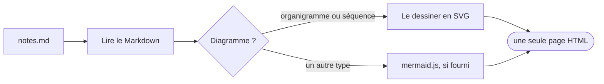
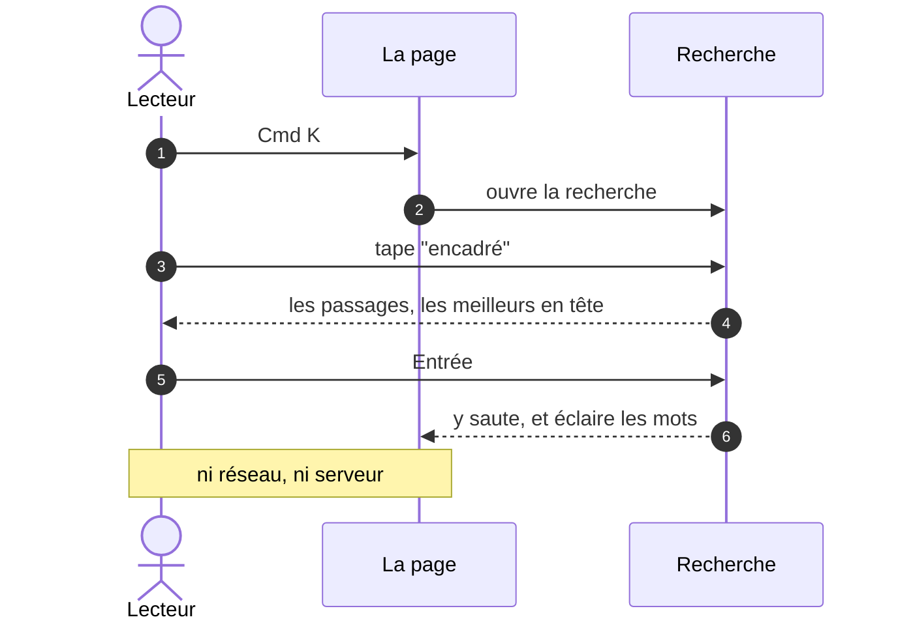
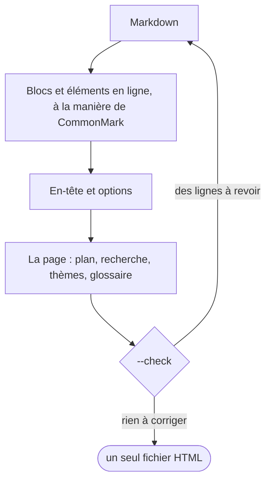

# md2html, tout ce qu'il fait

md2html transforme un fichier Markdown en une seule page web qui n'a besoin de rien d'autre : ni serveur, ni réseau, ni polices ou scripts venus d'ailleurs. La page apporte son propre plan, la recherche, un thème clair et un thème sombre, la taille du texte, un glossaire, des notes de bas de page, des figures qui s'agrandissent, du code coloré, des maths composées et des diagrammes. Cette page a été écrite en Markdown et rendue par md2html, si bien que tout ce qu'elle décrit est à l'œuvre sur elle pendant que vous la lisez.

## Comment lire ceci

- **Chapitre 1** dit où md2html fonctionne, et comment l'installer.
- **Chapitre 2** présente tout en un seul tableau.
- **Chapitres 3 à 9** montrent ce qu'obtient un lecteur, et ce qu'un auteur tape pour l'obtenir.
- **Chapitres 10 à 12** présentent les réglages, la ligne de commande, et la sécurité et la qualité.

---

## 1. Où il fonctionne

| | Où |
|:--|:--|
| L'outil md2html | macOS (Apple silicon et Intel), Linux et Windows, à partir d'un seul programme Rust sans autre dépendance que la bibliothèque standard ; testé sur les trois à chaque modification |
| Les pages qu'il produit | les versions actuelles de Chrome, Edge, Firefox et Safari, sur ordinateurs, tablettes et téléphones, en ligne ou hors ligne ; utilisables partout avec un lecteur d'écran et au clavier |
| Ouvertes depuis | un serveur web, un dossier partagé, une pièce jointe d'e-mail, ou directement depuis le disque : la page est un seul fichier |
| Imprimées ou enregistrées en PDF | depuis n'importe quel navigateur, avec sa propre mise en page d'impression ; `--pdf` produit le PDF lui-même, avec le Chrome, Chromium ou Edge déjà présent sur l'ordinateur |
| Liseuses | `--epub` produit un EPUB 3, le format standard des livres numériques |
| Langues de la page | dix-sept, écriture de droite à gauche comprise (chapitre 8) |

Installez-le avec l'installateur propre à Rust, à partir des sources :

```console
$ cargo install --git https://github.com/githubrobbi/md2html --tag v0.7.7 md2html --locked
$ md2html notes.md
md2html: notes.md -> notes.html (68504 bytes, 9 glossary terms, 0 of them shared)
```

## 2. En un coup d'œil

| | md2html |
|:--|:--|
| Markdown | tout CommonMark 0.31.2 (**652 de ses 652** exemples de test réussis), et les tableaux, listes de tâches, texte barré, liens automatiques, notes de bas de page et alertes de GitHub |
| Sortie | **un seul fichier HTML**, rien n'est récupéré, rien à installer pour le lecteur |
| Lecture | plan, recherche, thèmes clair et sombre, taille du texte, glossaire, notes de bas de page, figures qui s'agrandissent |
| Code, maths, diagrammes | du code coloré dans une vingtaine de langages, les maths en MathML, les organigrammes et les diagrammes de séquence Mermaid dessinés en SVG, **le tout sans bibliothèque de scripts** |
| Partage | un lien vers n'importe quel chapitre, ligne de tableau, figure, diagramme, bloc de code ou passage sélectionné |
| Langues | les mots propres à la page en **17 langues**, des traductions reliées par un sélecteur, de droite à gauche pour l'hébreu, le yiddish et l'arabe |
| Conservation | la page elle-même, un **PDF** avec signets, un **EPUB** pour liseuses |
| En direct | des pages qui se rechargent quand leur Markdown change, en gardant la place du lecteur |
| Sécurité | jamais de script tiré du texte ; aucun fichier lu hors du dossier du document |
| Accessibilité | aucun constat selon WCAG 2.2 AA, dans les deux thèmes et à la largeur d'un téléphone |
| Vitesse | un document de 4 000 lignes, diagrammes et maths compris, en **moins d'un dixième de seconde** |
| Dépendances | **aucune** : la bibliothèque standard de Rust et md2html |

## 3. La page

La page a trois parties : une barre en haut, le plan à gauche, et le texte.

{width=100%}

Le thème sombre suit le système, ou le choix du lecteur, et il est mémorisé :

{width=100%}

Sur un téléphone, le plan se replie derrière l'interrupteur de la barre, et rien ne défile de côté :

{width=34%}

Ce que peut faire un lecteur :

| Pour | Faire ceci |
|:--|:--|
| Trouver quelque chose | **Rechercher** dans la barre, <kbd>⌘</kbd> <kbd>K</kbd> (<kbd>Ctrl</kbd> <kbd>K</kbd>), ou <kbd>/</kbd> |
| Masquer ou afficher le plan | l'interrupteur à gauche de la barre, ou <kbd>⌘</kbd> <kbd>\\</kbd> |
| Changer la taille du texte | **Aa** dans la barre, puis **−** et **+** ; ou <kbd>⌘</kbd> <kbd>+</kbd> et <kbd>⌘</kbd> <kbd>−</kbd>, de 85 à 200 pour cent |
| Changer de thème | **Aa**, puis Système, Clair ou Sombre |
| Agrandir une figure | cliquez dessus ; deux clics de plus la rapprochent ; <kbd>Échap</kbd> la remet en place |
| Lire une note de bas de page ou un mot souligné de pointillés | posez le pointeur dessus ; cliquez pour y aller, et **retour** vous ramène |
| Partager un chapitre, une ligne de tableau, une figure, un diagramme, un bloc de code ou un passage | le symbole de partage à droite d'un titre, au bout de la ligne de tableau sous le pointeur, ou dans le coin de la figure, du diagramme ou du bloc de code qu'il survole, copie son lien (un téléphone ouvre sa feuille de partage) ; sélectionnez des mots, et un lien qui mène exactement à eux est proposé |
| La conserver | le bouton de téléchargement au bout de la barre : la page elle-même (elle se lit hors ligne), imprimer ou enregistrer en PDF, ou le PDF et l'EPUB là où ils ont été produits |

La taille du texte et le thème se trouvent ensemble derrière **Aa** ; conserver la page a son propre bouton :

{width=60%}

## 4. Écrire

Du Markdown ordinaire, et chaque construction se lit bien aussi en texte brut. Ce que vous écrivez vient d'abord, dans un bloc de code ; ce que vous obtenez le suit.

### Emphase et liens

```markdown
**Gras**, *italique*, ***les deux***, ~~barré~~ et `code`.
Un [lien](https://commonmark.org "CommonMark"), un lien nu,
https://spec.commonmark.org/0.31.2/, et des marques comme [V] qui restent telles qu'écrites.
```

**Gras**, *italique*, ***les deux***, ~~barré~~ et `code`. Un [lien](https://commonmark.org "CommonMark"), un lien nu, https://spec.commonmark.org/0.31.2/, et des marques comme [V] qui restent telles qu'écrites.

### Listes dans des listes

```markdown
1. D'abord, avec une liste imbriquée :
   - une puce
   - une autre, avec la sienne :
     1. plus profond
2. Ensuite.
- [x] une tâche faite
- [ ] une tâche ouverte
```

1. D'abord, avec une liste imbriquée :
   - une puce
   - une autre, avec la sienne :
     1. plus profond
2. Ensuite.

- [x] une tâche faite
- [ ] une tâche ouverte

### Citations et encadrés

```markdown
> Une simple citation reste une citation.

> [!TIP]
> Les alertes de GitHub fonctionnent : NOTE, TIP, IMPORTANT, WARNING, CAUTION.

> **Remarque:** l'ancienne forme aussi : un mot en gras suivi de deux-points en fait un encadré.
```

> Une simple citation reste une citation.

> [!TIP]
> Les alertes de GitHub fonctionnent : NOTE, TIP, IMPORTANT, WARNING, CAUTION.

> **Remarque:** l'ancienne forme aussi : un mot en gras suivi de deux-points en fait un encadré.

### Tableaux

```markdown
| Pièce     | Étage           | Surface (pi²) |
|:----------|:---------------:|--------------:|
| Séjour    | rez-de-chaussée |           312 |
| Mezzanine | étage           |           205 |
```

| Pièce | Étage | Surface (pi²) |
|:-------|:------:|-------------:|
| Séjour | rez-de-chaussée | 312 |
| Mezzanine | étage | 205 |

Un tableau plus large que la colonne défile à l'intérieur de celle-ci, et la page, jamais.

### Notes de bas de page

```markdown
Une affirmation qui demande une source.[^1]

[^1]: La source. Posez le pointeur sur le numéro pour la lire sur place.
```

Une affirmation qui demande une source.[^source]

[^source]: La source. Posez le pointeur sur le numéro pour la lire sur place ; cliquez dessus pour venir ici, et retour pour y revenir.

### Figures et images

```markdown
{width=60%}

Une icône {width=18} au milieu d'une phrase.
```

{width=60%}

Une icône {width=18} au milieu d'une phrase.

### Petites choses

```markdown
Appuyez sur <kbd>Ctrl</kbd>+<kbd>K</kbd>. L'eau, c'est H<sub>2</sub>O, la pièce fait 9 m<sup>2</sup>.
Une ligne qui finit par une barre oblique inverse\
s'interrompt là.
```

Appuyez sur <kbd>Ctrl</kbd>+<kbd>K</kbd>. L'eau, c'est H<sub>2</sub>O, la pièce fait 9 m<sup>2</sup>. Une ligne qui finit par une barre oblique inverse\
s'interrompt là.

<details>
<summary>Une section qui s'ouvre d'un clic</summary>

Écrite comme `<details>` avec un `<summary>`, avec du Markdown ordinaire à l'intérieur : du **gras**, une liste,

- un
- deux

</details>

#### Un titre de quatrième niveau

Les titres au-dessous du troisième niveau restent hors du plan, comme celui-ci.

## 5. Code, maths et diagrammes

Le code est coloré pour Rust, Python, JavaScript et TypeScript, Go, C et C++, Java, Kotlin, Swift, C#, le shell, SQL, Ruby, Lua, PHP, CSS, HTML, JSON, YAML, TOML, les Dockerfiles et les diffs, et chaque bloc a un bouton de copie.

```rust
/// The whole page from one Markdown text.
fn main() {
    let page = md2html::render("# Hello\n\nWorld.", &Settings::default());
    println!("{} bytes, nothing to fetch", page.len()); // one file
}
```

```python
@cache
def area(w: float, h: float) -> float:
    """The area of a room."""
    return w * h  # square feet
```

```diff
- every quotation a note
+ a quotation is a quotation; a bold first word makes it a note
```

Les maths sont composées par le navigateur lui-même, en MathML, sans script ni police à télécharger. Dans le texte, le théorème de Pythagore s'écrit $a^2 + b^2 = c^2$, et l'identité d'Euler $e^{i\pi} + 1 = 0$ ; un montant comme $5 ou $10 reste de l'argent. En bloc :

$$
\int_0^1 x^2 \, dx = \frac{1}{3} \qquad \sum_{k=1}^{n} k = \frac{n(n+1)}{2} \qquad \sqrt[3]{27} = 3
$$

$$
\begin{pmatrix} a & b \\ c & d \end{pmatrix}
\begin{pmatrix} x \\ y \end{pmatrix}
=
\begin{pmatrix} ax + by \\ cx + dy \end{pmatrix}
\qquad
|x| = \begin{cases} x & x \ge 0 \\ -x & x < 0 \end{cases}
$$

### Diagrammes

Un organigramme ou un diagramme de séquence Mermaid est dessiné par md2html lui-même, en SVG dans la page : aucun script, rien à télécharger, les couleurs de la page dans les deux thèmes, et ses mots restent des mots que la recherche trouve. Voici le Markdown :

````markdown

````

Et voici ce qu'il devient :


Un diagramme de séquence, numéroté, avec une note :



Les autres types (camemberts, diagrammes de Gantt, diagrammes de classes) sont dessinés par mermaid.js quand l'auteur indique à md2html où en trouver une copie (`--mermaid-js FILE`) ; le script n'entre alors que dans cette page-là. Sans lui, ils restent du code, et `--check` le signale.

## 6. Glossaire, notes de bas de page, recherche et figures

Un chapitre intitulé Glossaire réunit les mots de la page dans un tableau. Il n'apparaît pas là où il est écrit : à la place, la première mention de chaque terme dans chaque chapitre devient un mot souligné de pointillés qui s'explique au survol, et un clic dessus mène à l'entrée en bas de page, qui ramène à la ligne que vous lisiez.

{width=70%}

Les notes de bas de page fonctionnent de la même façon : le numéro s'explique au survol.

{width=70%}

> [!NOTE]
> Un glossaire peut être partagé entre plusieurs pages : un seul fichier, `~/.config/md2html/glossary.md`, dont les mots se lient alors sur chaque page rendue à partir d'un fichier sur cet ordinateur.

La recherche couvre chaque mot de la page, glossaire compris. Les résultats montrent où se trouve chaque mot ; celui qu'on choisit est éclairé là où la recherche arrive.

{width=80%}

{width=80%}

Une figure s'agrandit par-dessus la page sans la quitter. Plus grande que la fenêtre, elle suit le pointeur : on pointe ce qu'on veut voir.

## 7. Partage et pages en direct

Chaque titre porte un symbole de partage à sa droite ; chaque ligne de tableau, figure, diagramme et bloc de code en montre un sous le pointeur. Un clic copie un lien qui mène exactement à cet endroit, et le dit ; sur un téléphone, c'est la feuille de partage du système qui s'ouvre. Sélectionnez quelques mots, et la page propose un lien qui mène exactement à eux : il ouvre la page sur ce passage, surligné.

{width=80%}

Une page peut aussi se tenir à jour d'elle-même. `md2html --serve` montre les pages sur cet ordinateur pendant qu'elles s'écrivent, et chaque page ouverte se recharge dès que son Markdown est enregistré. Une page publiée faite avec `--live` a sa propre durée de vie : quand elle expire, la page demande à son serveur le premier kilooctet d'elle-même, là où se trouve son empreinte, et ne se recharge que si celle-ci a changé. Dans les deux cas, le lecteur reste où il était : au même paragraphe à la même hauteur ou, s'il a disparu, au chapitre qui le précède ; passer à une autre langue garde la place de la même façon. Le serveur est réservé à cet ordinateur : il ne répond qu'aux requêtes qui lui sont adressées, ne sert que le dossier du document, et répond à une requête qu'il ne peut pas lire en entier par le code d'état qui dit pourquoi.

## 8. Langues

Les mots propres à la page (la recherche, les encadrés, le glossaire, les dates, chaque bouton) existent en dix-sept langues : anglais, allemand, hébreu, indonésien, néerlandais, javanais, yiddish, bas allemand, français, italien, espagnol, japonais écrit de trois façons (en kanji et kana, en kana seuls, et en rōmaji), chinois mandarin en caractères simplifiés et en caractères traditionnels, et cantonais. `lang: de` dans l'en-tête suffit. L'hébreu et le yiddish se lisent de droite à gauche, le plan à droite, et l'arabe aussi, avec les mots propres à la page en anglais.

Une traduction est simplement un autre fichier Markdown à côté de l'original, nommé d'après sa langue : `capabilities.de.md` est le `capabilities.md` allemand. md2html trouve les versions présentes, les relie entre elles par un sélecteur dans la barre (le globe), l'indique aux navigateurs et aux moteurs de recherche avec `hreflang`, et donne à chacune les mots de sa propre interface. Cette page existe dans les dix-sept ; le globe passe de l'une à l'autre, et la page s'ouvre au paragraphe que vous lisiez.

Chaque traduction nomme son original et consigne l'empreinte de l'original, si bien que la page peut dire quelle version fait foi, et `--check` remarque quand l'original a changé depuis la traduction :

```yaml
translated_from: capabilities.md
source_sha256: 5b0c...e1
```

Pour une langue dans laquelle personne n'a traduit une page, le navigateur du lecteur peut la traduire lui-même, s'il en a la capacité (le traducteur intégré de Chrome) : sur l'appareil même, pour que rien n'en sorte, avec la mention d'une traduction automatique et un moyen de revenir à l'original.

## 9. Conserver une page

Le bouton de téléchargement de la barre propose ce qu'il y a à conserver. La page elle-même se lit hors ligne quand ses images sont à l'intérieur (`embed: true`). L'impression a sa propre mise en page : les commandes disparaissent, chaque lien imprime son adresse, rien n'est coupé d'une page à l'autre, et les pages portent le titre et leur numéro.

{width=55%}

`--pdf` imprime la page avec le Chrome déjà présent sur l'ordinateur : sa propre mise en page d'impression, les intertitres comme signets du PDF, le titre en tête de chaque page et son numéro en pied de page. `--epub` fait de la même page un livre pour liseuses, avec sa table des matières, ses images, ses diagrammes et ses maths, et des notes de bas de page qui s'ouvrent là où elles sont appelées ; md2html l'écrit lui-même. Le lecteur trouve les deux sous le bouton de téléchargement.

## 10. Réglages

Le haut du fichier Markdown original de cette page, en anglais, se lit ainsi :

```yaml
---
title: md2html, everything it does
description: md2html turns Markdown into one complete, self-contained web page ...
brand: md2html
kicker: Capabilities
version: 0.7.7
date: 2026-11-23
footer: Written in Markdown and rendered by **md2html 0.7.7** itself ...
csp: true      # only this page's own code may run
embed: true    # the screenshots are inside the page
---
```

| Réglage | Ce qu'il fait |
|:--|:--|
| `title`, `description`, `author` | le titre, et les balises meta des aperçus de liens |
| `lang` | la langue : les mots propres à la page et les dates dans chacune des dix-sept (`ja-Hira` est le japonais en kana, `zh-Hant` le chinois en caractères traditionnels, `yue` le cantonais) |
| `translated_from`, `source_sha256` | pour une traduction : son original, et l'empreinte de l'original au moment de la traduction |
| `brand`, `brand_link`, `kicker`, `eyebrow`, `footer` | la barre, la ligne au-dessus du titre, les mentions en petits caractères |
| `date`, `version` | la date et la version affichées au-dessus du titre |
| `embed` | les images dans la page, pour qu'elle tienne en un seul fichier |
| `csp` | une Content-Security-Policy |
| `pdf`, `epub` | un PDF et un EPUB de la page, à côté d'elle |
| `live` | la durée de vie de la page (`true` vaut deux minutes, sinon un nombre de secondes) : ensuite elle se recharge si elle a changé, en gardant la place du lecteur |
| `large`, `toc`, `math`, `index`, `html`, `css`, `head` | des caractères plus grands, le plan, les maths, les moteurs de recherche, un HTML plus riche, du style et un head en plus |

> [!TIP]
> Avec `lang: de`, la recherche dit « Diese Seite durchsuchen », les encadrés disent « Hinweis » et « Achtung », et la date s'écrit « 23. November 2026 ».

## 11. La ligne de commande

```console
$ md2html notes.md
md2html: notes.md -> notes.html (68504 bytes, 9 glossary terms, 0 of them shared)
$ md2html docs/ -o site/ --nav
$ md2html notes.md --check
notes.md:30: `plan.svg` does not exist next to this page
notes.md: a link points at #setup, which is nowhere on the page
md2html: 2 to look at
$ cat notes.md | md2html - > notes.html
$ md2html notes.md --pdf --epub
$ md2html notes.md --serve
```

`--check` n'écrit rien et liste ce qu'un auteur devrait examiner, ligne par ligne là où il y a une ligne, et sort avec le code 1 dès qu'il y a quelque chose : un lien vers une ancre absente de la page, un fichier qui n'est pas là, une note de bas de page sans sa note, du HTML brut affiché comme du texte, une balise de l'auteur qui ne ferme rien ou qui n'est jamais fermée, une traduction plus ancienne que son original. Cela en fait la dernière étape d'une construction. `--watch` refait le rendu à chaque enregistrement, `--nav` relie les pages d'un dossier par précédent et suivant, et un lien vers un autre fichier Markdown mène à sa page.

## 12. Sécurité, qualité et accessibilité

> [!WARNING]
> Une page peut être rendue à partir d'un Markdown écrit par quelqu'un d'autre. md2html n'écrit jamais de script à partir du texte : le HTML brut est affiché tel qu'écrit, à part quelques balises inoffensives, qui sont équilibrées à l'intérieur de l'article pour ne pas pouvoir casser la page qui l'entoure, et les liens `javascript:` ou `data:` sont supprimés, quelle que soit leur graphie. Un document ne peut pas faire lire à md2html un fichier hors de son dossier, et aucune entrée, si hostile soit-elle, ne peut le bloquer ni le faire planter.

> [!CAUTION]
> `--html` laisse passer un HTML plus riche (images, liens, vidéo, SVG, mise en page), mais jamais rien qui s'exécute : ni script, ni gestionnaire d'événements, ni cadre, ni formulaire.

Ce qui est vérifié, à chaque modification, les tests sur macOS, Linux et Windows et les vérifications dans Chrome sur Linux :

- les tests qui rendent des pages entières et les relisent, et ceux qui lancent le programme lui-même, dont les cas de sécurité et les cas pathologiques ;
- les 652 exemples de la spécification CommonMark, dont le nombre de réussites peut monter mais jamais baisser ;
- les lints les plus stricts de clippy, et la plus ancienne version de Rust sur laquelle l'outil promet de compiler ;
- un audit d'accessibilité avec axe-core selon WCAG 2.2 AA, dans les deux thèmes et à la largeur d'un téléphone ;
- un parcours au clic dans Chrome qui utilise chaque commande comme le ferait un lecteur, à la souris et au clavier, à la taille de texte normale et à une taille plus grande ;
- les pages en direct, de bout en bout : un rechargement après une modification, la place du lecteur gardée, un changement de langue qui retombe sur le même paragraphe.

md2html ne contient aucun code tiers, et sa chaîne d'approvisionnement est figée et contrôlée : la chaîne d'outils, les actions de CI, les outils de test. Chaque page se termine par une ligne discrète : réalisé avec md2html, sa version, et un lien vers l'endroit où vit md2html.

Le chemin que suit chaque page :



---

Le glossaire ci-dessous explique les mots qu'emploie cette page ; chacun était plus haut un mot souligné de pointillés.

## Glossaire

| Terme | Sens | Aussi |
|---|---|---|
| Markdown | Du texte brut avec de légères marques pour les titres, l'emphase, les listes et les liens, lisible tel quel et convertible en page. | |
| CommonMark | La spécification de Markdown que suivent aujourd'hui la plupart des outils, avec un test pour chaque règle. | |
| plan | La liste des chapitres à gauche de la page, tirée de ses titres. | |
| encadré | Un aparté dans un cadre : une remarque, un conseil, quelque chose d'important, un avertissement ou une mise en garde. | encadrés, alertes |
| figure | Une image sur une ligne à elle seule, avec sa légende dessous, agrandie d'un clic. | figures |
| en-tête | Le bloc de réglages entre deux lignes `---` tout en haut d'un fichier Markdown. | |
| MathML | Le langage propre au web pour les maths, dessiné par le navigateur sans script. | |
| Content-Security-Policy | Une règle dans la page qui dit au navigateur quel code peut s'exécuter ; ici, seulement celui de la page. | |
| Mermaid | Un langage textuel pour les diagrammes, écrit dans un bloc de code ; md2html dessine ses organigrammes et ses diagrammes de séquence. | |
| WCAG | Les règles pour l'accessibilité des contenus web (Web Content Accessibility Guidelines) ; le niveau AA est la cible habituelle. | |
| traduction | Une version d'une page dans une autre langue, un fichier Markdown à côté de l'original. | traductions |
| EPUB | Le format standard des livres numériques, une page web empaquetée que les liseuses mettent en page. | |
