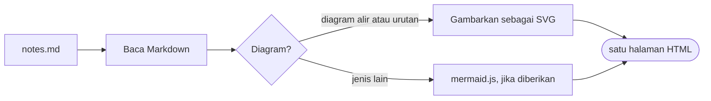
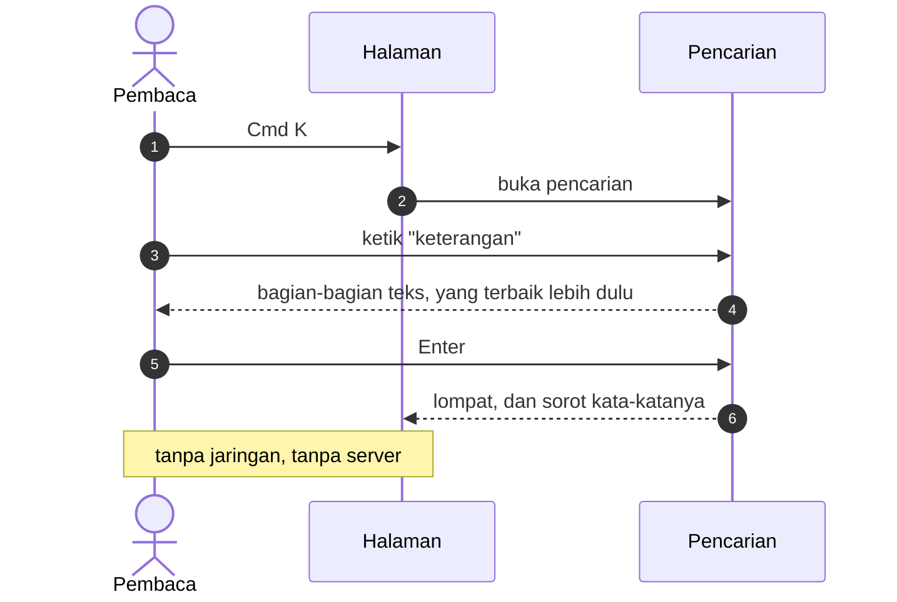
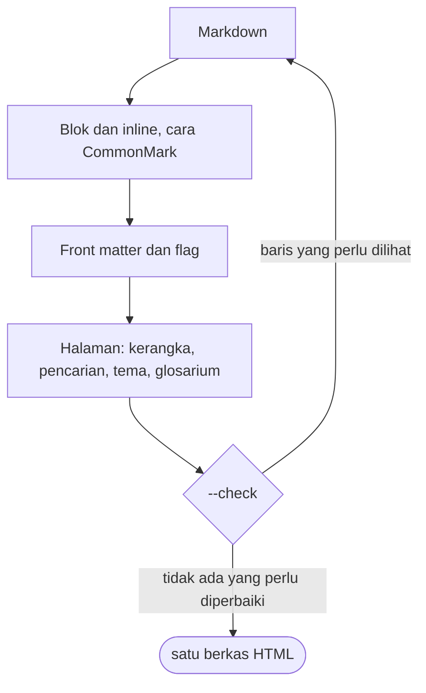

# md2html, semua yang bisa dilakukannya

md2html mengubah sebuah berkas Markdown menjadi satu halaman web yang tidak membutuhkan apa pun lagi: tanpa server, tanpa jaringan, tanpa font atau skrip dari mana pun. Halaman itu membawa sendiri kerangka, pencarian, tema terang dan gelap, ukuran teks, glosarium, catatan kaki, gambar yang bisa diperbesar, kode berwarna, matematika yang tersusun rapi, dan diagram. Halaman ini ditulis dalam Markdown dan dirender oleh md2html, sehingga semua yang dijelaskannya bekerja di sini selagi Anda membaca.

## Cara membaca halaman ini

- **Bab 1** adalah tempat md2html berjalan, dan cara memasangnya.
- **Bab 2** adalah semuanya dalam satu tabel.
- **Bab 3 sampai 9** menunjukkan apa yang didapat pembaca, dan apa yang diketik penulis untuk mendapatkannya.
- **Bab 10 sampai 12** adalah pengaturan, baris perintah, serta keamanan dan mutu.

---

## 1. Di mana md2html berjalan

| | Di mana |
|:--|:--|
| Alat md2html | macOS (Apple silicon dan Intel), Linux, dan Windows, dari satu program Rust tanpa dependensi selain pustaka standar; diuji di ketiganya pada setiap perubahan |
| Halaman yang dibuatnya | Chrome, Edge, Firefox, dan Safari versi terkini, di komputer, tablet, dan ponsel, daring maupun luring; pembaca layar dan papan ketik di seluruh bagiannya |
| Dibuka dari | server web, folder bersama, lampiran surel, atau langsung dari disk: halaman itu hanya satu berkas |
| Dicetak atau disimpan sebagai PDF | dari peramban mana pun, dengan tata letak cetaknya sendiri; `--pdf` membuat PDF-nya sendiri, dengan Chrome, Chromium, atau Edge yang sudah ada di komputer |
| Pembaca e-book | `--epub` membuat EPUB 3, format standar buku elektronik |
| Bahasa halaman | tujuh belas, termasuk bahasa yang ditulis dari kanan ke kiri (bab 8) |

Pasang dengan pemasang milik Rust sendiri, dari kode sumbernya:

```console
$ cargo install --git https://github.com/githubrobbi/md2html --tag v0.8.2 md2html --locked
$ md2html notes.md
md2html: notes.md -> notes.html (68504 bytes, 9 glossary terms, 0 of them shared)
```

## 2. Sekilas

| | md2html |
|:--|:--|
| Markdown | seluruh CommonMark 0.31.2 (**652 dari 652** contoh ujinya lolos), serta tabel, daftar tugas, coretan, tautan otomatis, catatan kaki, dan alert dari GitHub |
| Keluaran | **satu berkas HTML**, tidak ada yang diambil dari luar, tidak ada yang perlu dipasang pembaca |
| Membaca | kerangka, pencarian, tema terang dan gelap, ukuran teks, glosarium, catatan kaki, gambar yang bisa diperbesar |
| Kode, matematika, diagram | kode berwarna dalam sekitar dua puluh bahasa, matematika sebagai MathML, diagram alir dan diagram urutan Mermaid yang digambar sebagai SVG, **semuanya tanpa pustaka skrip** |
| Berbagi | tautan ke bab, baris tabel, gambar, diagram, blok kode, atau bagian teks pilihan mana pun |
| Bahasa | kata-kata halaman itu sendiri dalam **17 bahasa**, terjemahan saling ditautkan dengan pengalih, dari kanan ke kiri untuk Ibrani, Yiddish, dan Arab |
| Menyimpan | halaman itu sendiri, **PDF** dengan penanda, **EPUB** untuk pembaca e-book |
| Halaman hidup | halaman yang dimuat ulang saat Markdown-nya berubah dan menjaga posisi pembaca |
| Keamanan | tidak pernah ada skrip dari teks; tidak ada berkas yang dibaca di luar folder dokumen |
| Aksesibilitas | tidak ada temuan terhadap WCAG 2.2 AA, di kedua tema dan selebar layar ponsel |
| Kecepatan | dokumen 4.000 baris, termasuk diagram dan matematika, dalam **kurang dari sepersepuluh detik** |
| Dependensi | **tidak ada**: pustaka standar Rust dan md2html |

## 3. Halaman

Halaman ini terdiri dari tiga bagian: bilah di sepanjang bagian atas, kerangka di sebelah kiri, dan teks.

{width=100%}

Tema gelap mengikuti sistem, atau pilihan pembaca, dan pilihan itu diingat:

{width=100%}

Di ponsel, kerangka terlipat di balik tombol pengalih di bilah, dan tidak ada yang bergulir ke samping:

{width=34%}

Yang bisa dilakukan pembaca:

| Untuk | Lakukan ini |
|:--|:--|
| Mencari sesuatu | **Cari** di bilah, <kbd>⌘</kbd> <kbd>K</kbd> (<kbd>Ctrl</kbd> <kbd>K</kbd>), atau <kbd>/</kbd> |
| Menyembunyikan atau menampilkan kerangka | tombol pengalih di sebelah kiri bilah, atau <kbd>⌘</kbd> <kbd>\\</kbd> |
| Mengubah ukuran teks | **Aa** di bilah, lalu **−** dan **+**; atau <kbd>⌘</kbd> <kbd>+</kbd> dan <kbd>⌘</kbd> <kbd>−</kbd>, dari 85 sampai 200 persen |
| Mengganti tema | **Aa**, lalu Sistem, Terang, atau Gelap |
| Memperbesar gambar | klik gambarnya; dua klik lagi membawanya lebih dekat; <kbd>Esc</kbd> mengembalikannya |
| Membaca catatan kaki atau kata bergaris titik | arahkan penunjuk ke atasnya; klik untuk menuju ke sana, dan **kembali** membawa Anda ke tempat semula |
| Membagikan bab, baris tabel, gambar, diagram, blok kode, atau bagian teks | simbol bagikan di sebelah kanan judul, di ujung baris tabel di bawah penunjuk, atau di sudut gambar, diagram, atau blok kode di bawah penunjuk, menyalin tautannya (ponsel membuka lembar berbaginya); pilih beberapa kata, dan tautan tepat ke kata-kata itu ditawarkan |
| Menyimpannya | tombol unduh di ujung bilah: halaman itu sendiri (bisa dibaca offline), cetak atau simpan sebagai PDF, atau PDF dan EPUB bila keduanya dibuat |

Ukuran teks dan tema berada bersama di balik **Aa**; menyimpan halaman punya tombolnya sendiri:

{width=60%}

## 4. Menulis

Markdown biasa, dan setiap bentuknya juga enak dibaca sebagai teks polos. Yang Anda tulis tampil lebih dulu, dalam blok kode; hasilnya menyusul di bawahnya.

### Penekanan dan tautan

```markdown
**Tebal**, *miring*, ***keduanya***, ~~dicoret~~ dan `kode`.
Sebuah [tautan](https://commonmark.org "CommonMark"), tautan polos,
https://spec.commonmark.org/0.31.2/, dan tanda seperti [V] yang tetap apa adanya.
```

**Tebal**, *miring*, ***keduanya***, ~~dicoret~~ dan `kode`. Sebuah [tautan](https://commonmark.org "CommonMark"), tautan polos, https://spec.commonmark.org/0.31.2/, dan tanda seperti [V] yang tetap apa adanya.

### Daftar di dalam daftar

```markdown
1. Pertama, dengan daftar bersarang:
   - sebuah butir
   - satu lagi, dengan daftarnya sendiri:
     1. lebih dalam
2. Kedua.
- [x] tugas yang sudah selesai
- [ ] tugas yang masih terbuka
```

1. Pertama, dengan daftar bersarang:
   - sebuah butir
   - satu lagi, dengan daftarnya sendiri:
     1. lebih dalam
2. Kedua.

- [x] tugas yang sudah selesai
- [ ] tugas yang masih terbuka

### Kutipan dan kotak keterangan

```markdown
> Kutipan biasa tetap menjadi kutipan.

> [!TIP]
> Alert GitHub berfungsi: NOTE, TIP, IMPORTANT, WARNING, CAUTION.

> **Catatan:** begitu juga bentuk yang lebih lama, sebuah kata tebal dan titik dua.
```

> Kutipan biasa tetap menjadi kutipan.

> [!TIP]
> Alert GitHub berfungsi: NOTE, TIP, IMPORTANT, WARNING, CAUTION.

> **Catatan:** begitu juga bentuk yang lebih lama, sebuah kata tebal dan titik dua.

### Tabel

```markdown
| Ruang      | Lantai | Luas (kaki persegi) |
|:-----------|:------:|--------------------:|
| Ruang tamu | bawah  |                 312 |
| Loteng     | atas   |                 205 |
```

| Ruang | Lantai | Luas (kaki persegi) |
|:-------|:------:|-------------:|
| Ruang tamu | bawah | 312 |
| Loteng | atas | 205 |

Tabel yang lebih lebar dari kolomnya bergulir di dalam kolom itu, dan halamannya tidak pernah ikut bergulir.

### Catatan kaki

```markdown
Sebuah klaim yang membutuhkan sumber.[^1]

[^1]: Sumbernya. Arahkan penunjuk ke angkanya untuk membacanya di sana.
```

Sebuah klaim yang membutuhkan sumber.[^source]

[^source]: Sumbernya. Arahkan penunjuk ke angkanya untuk membacanya di sana; klik angkanya untuk datang ke sini, dan kembali untuk balik ke teks.

### Gambar dan citra

```markdown
{width=60%}

Sebuah ikon {width=18} di dalam kalimat.
```

{width=60%}

Sebuah ikon {width=18} di dalam kalimat.

### Hal-hal kecil

```markdown
Tekan <kbd>Ctrl</kbd>+<kbd>K</kbd>. Air adalah H<sub>2</sub>O, ruangannya 9 m<sup>2</sup>.
Baris yang diakhiri garis miring terbalik\
terputus di situ.
```

Tekan <kbd>Ctrl</kbd>+<kbd>K</kbd>. Air adalah H<sub>2</sub>O, ruangannya 9 m<sup>2</sup>. Baris yang diakhiri garis miring terbalik\
terputus di situ.

<details>
<summary>Bagian yang terbuka dengan satu klik</summary>

Ditulis sebagai `<details>` dengan `<summary>`, berisi Markdown biasa: **tebal**, sebuah daftar,

- satu
- dua

</details>

#### Judul tingkat keempat

Judul di bawah tingkat ketiga tidak masuk ke kerangka, seperti judul ini.

## 5. Kode, matematika, dan diagram

Kode diberi warna untuk Rust, Python, JavaScript dan TypeScript, Go, C dan C++, Java, Kotlin, Swift, C#, shell, SQL, Ruby, Lua, PHP, CSS, HTML, JSON, YAML, TOML, Dockerfile, dan diff, dan setiap blok punya tombol salin.

```rust
/// The whole page from one Markdown text.
fn main() {
    let page = md2html::render("# Hello\n\nWorld.", &Settings::default());
    println!("{} bytes, nothing to fetch", page.len()); // one file
}
```

```python
@cache
def area(w: float, h: float) -> float:
    """The area of a room."""
    return w * h  # square feet
```

```diff
- every quotation a note
+ a quotation is a quotation; a bold first word makes it a note
```

Matematika disusun oleh peramban itu sendiri, sebagai MathML, tanpa skrip dan tanpa font yang perlu diunduh. Di dalam baris, teorema Pythagoras adalah $a^2 + b^2 = c^2$, dan identitas Euler adalah $e^{i\pi} + 1 = 0$; jumlah uang seperti $5 atau $10 tetap menjadi uang. Ditampilkan tersendiri:

$$
\int_0^1 x^2 \, dx = \frac{1}{3} \qquad \sum_{k=1}^{n} k = \frac{n(n+1)}{2} \qquad \sqrt[3]{27} = 3
$$

$$
\begin{pmatrix} a & b \\ c & d \end{pmatrix}
\begin{pmatrix} x \\ y \end{pmatrix}
=
\begin{pmatrix} ax + by \\ cx + dy \end{pmatrix}
\qquad
|x| = \begin{cases} x & x \ge 0 \\ -x & x < 0 \end{cases}
$$

### Diagram

Diagram alir atau diagram urutan Mermaid digambar oleh md2html sendiri, sebagai SVG di dalam halaman: tanpa skrip, tanpa ada yang perlu diunduh, dengan warna halaman itu sendiri di kedua tema, dan kata-katanya tetap berupa kata yang bisa ditemukan oleh pencarian. Ini Markdown-nya:

````markdown

````

Dan inilah hasilnya:


Sebuah diagram urutan, bernomor, dengan catatan:



Jenis lain (diagram lingkaran, diagram Gantt, diagram kelas) digambar oleh mermaid.js bila penulis mengarahkan md2html ke sebuah salinannya (`--mermaid-js FILE`); skrip itu lalu hanya masuk ke halaman tersebut. Tanpa itu, diagram-diagram tersebut tetap berupa kode, dan `--check` memberitahukannya.

## 6. Glosarium, catatan kaki, pencarian, dan gambar

Bab yang bernama Glosarium memuat kata-kata halaman dalam bentuk tabel. Bab itu tidak dicetak di tempatnya: sebagai gantinya, kemunculan pertama setiap istilah di setiap bab menjadi kata bergaris titik yang menjelaskan dirinya sendiri saat penunjuk berada di atasnya, dan satu klik padanya melompat ke entrinya di bagian bawah, yang membawa Anda kembali ke baris yang sedang Anda baca.

{width=70%}

Catatan kaki bekerja dengan cara yang sama: angkanya menjelaskan dirinya sendiri saat penunjuk berada di atasnya.

{width=70%}

> [!NOTE]
> Glosarium bisa dipakai bersama oleh banyak halaman: satu berkas di `~/.config/md2html/glossary.md`, yang kata-katanya lalu menjadi tautan di setiap halaman yang dirender dari sebuah berkas di komputer itu.

Pencarian mencakup setiap kata di halaman, termasuk glosarium. Hasilnya menunjukkan letak setiap kata; yang dipilih disorot di tempat pencarian mendarat.

{width=80%}

{width=80%}

Gambar membesar di atas halaman tanpa meninggalkannya. Jika lebih besar dari jendela, gambar mengikuti penunjuk, sehingga Anda tinggal menunjuk apa yang ingin Anda lihat.

## 7. Berbagi dan halaman hidup

Setiap judul membawa simbol bagikan di sebelah kanannya; setiap baris tabel, gambar, diagram, dan blok kode menampilkannya saat berada di bawah penunjuk. Satu klik menyalin tautan tepat ke tempat itu, dan memberitahukannya; di ponsel, lembar berbagi milik sistem yang terbuka. Pilih beberapa kata, dan halaman menawarkan tautan tepat ke kata-kata itu, yang membuka halaman di bagian teks tersebut, dalam keadaan disorot.

{width=80%}

Sebuah halaman juga bisa menjaga dirinya tetap terkini. `md2html --serve` menampilkan halaman-halaman di komputer ini selagi ditulis, dan setiap halaman yang terbuka dimuat ulang begitu Markdown-nya disimpan. Halaman yang diterbitkan dengan `--live` punya masa hidupnya sendiri: bila masa itu habis, halaman meminta kilobyte pertama dirinya kepada servernya, tempat sidik jarinya berada, dan hanya dimuat ulang bila sidik jari itu berubah. Dengan cara mana pun, pembaca tetap di tempatnya: di paragraf yang sama pada ketinggian yang sama, atau, bila paragraf itu sudah tidak ada, di bab sebelumnya; berpindah ke bahasa lain menjaga posisi dengan cara yang sama. Server itu hanya untuk komputer ini: ia hanya menjawab permintaan yang ditujukan kepadanya, hanya menyajikan folder dokumen, dan menjawab permintaan yang tidak bisa dibacanya secara utuh dengan status yang menyebutkan alasannya.

## 8. Bahasa

Kata-kata halaman itu sendiri (pencarian, kotak keterangan, glosarium, tanggal, setiap tombol) tersedia dalam tujuh belas bahasa: Inggris, Jerman, Ibrani, Indonesia, Belanda, Jawa, Yiddish, Jerman Rendah, Prancis, Italia, Spanyol, Jepang yang ditulis dengan tiga cara (dengan kanji dan kana, dengan kana saja, dan dengan rōmaji), Mandarin dengan aksara sederhana dan dengan aksara tradisional, dan Kanton. Cukup tulis `lang: de` di front matter. Ibrani dan Yiddish disusun dari kanan ke kiri, dengan kerangka di sebelah kanan, dan begitu pula Arab, dengan kata-kata dalam bahasa Inggris.

Sebuah terjemahan hanyalah berkas Markdown lain di samping aslinya, yang dinamai menurut bahasanya: `capabilities.de.md` adalah `capabilities.md` versi Jerman. md2html menemukan versi-versi yang ada, menautkannya satu sama lain dengan pengalih di bilah (bola dunia), memberi tahu peramban dan mesin pencari dengan `hreflang`, dan memberi masing-masing kata-kata antarmukanya sendiri. Halaman ini ada dalam ketujuh belas bahasa itu; lewat bola dunia Anda berpindah di antaranya, dan halaman terbuka di paragraf yang sedang Anda baca.

Setiap terjemahan menyebut aslinya dan mencatat sidik jari aslinya, sehingga halaman bisa mengatakan versi mana yang berlaku, dan `--check` menyadari bila aslinya sudah berubah sejak terjemahan dibuat:

```yaml
translated_from: capabilities.md
source_sha256: 5b0c...e1
```

Untuk bahasa yang belum memiliki terjemahan halaman itu, peramban milik pembaca sendiri bisa menerjemahkannya, bila peramban itu memiliki kemampuan tersebut (penerjemah bawaan Chrome): di perangkat itu sendiri, sehingga tidak ada apa pun yang keluar darinya, diberi label sebagai terjemahan mesin, dengan jalan kembali ke aslinya.

## 9. Menyimpan halaman

Tombol unduh di bilah menawarkan apa yang bisa disimpan. Halaman itu sendiri bisa dibaca offline bila gambar-gambarnya berada di dalamnya (`embed: true`). Cetakan mendapat tata letaknya sendiri: tombol-tombol menghilang, setiap tautan mencetak alamatnya, tidak ada yang terpotong di antara dua halaman, dan setiap halaman memuat judul dan nomornya.

{width=55%}

`--pdf` mencetak halaman dengan Chrome yang sudah ada di komputer: tata letak cetaknya sendiri, judul-judul bagian sebagai penanda PDF, judul halaman di bagian atas setiap halaman dan nomornya di bagian bawah. `--epub` membuat buku untuk pembaca e-book dari halaman yang sama, dengan daftar isi, gambar, diagram, dan matematikanya, serta catatan kaki yang terbuka di tempat catatan itu disebut; md2html menulisnya sendiri. Pembaca menemukan keduanya di bawah tombol unduh.

## 10. Pengaturan

Bagian atas berkas Markdown asli halaman ini, yang berbahasa Inggris, berbunyi:

```yaml
---
title: md2html, everything it does
description: md2html turns Markdown into one complete, self-contained web page ...
brand: md2html
kicker: Capabilities
version: 0.8.2
date: 2026-11-23
footer: Written in Markdown and rendered by **md2html 0.8.2** itself ...
csp: true      # only this page's own code may run
embed: true    # the screenshots are inside the page
---
```

| Pengaturan | Fungsinya |
|:--|:--|
| `title`, `description`, `author` | judul, dan tag meta untuk pratinjau tautan |
| `lang` | bahasa: kata-kata dan tanggal halaman itu sendiri dalam salah satu dari tujuh belas bahasa (`ja-Hira` adalah bahasa Jepang dalam kana, `zh-Hant` bahasa Tionghoa dalam aksara tradisional, `yue` bahasa Kanton) |
| `translated_from`, `source_sha256` | untuk terjemahan: aslinya, dan sidik jari aslinya saat diterjemahkan |
| `brand`, `brand_link`, `kicker`, `eyebrow`, `footer` | bilah, baris di atas judul, tulisan kecil di bagian bawah |
| `date`, `version` | tanggal dan versi yang tampil di atas judul |
| `embed` | gambar di dalam halaman, sehingga cukup satu berkas |
| `csp` | sebuah Content-Security-Policy |
| `pdf`, `epub` | PDF dan EPUB dari halaman itu, di sampingnya |
| `live` | masa hidup halaman (`true` berarti dua menit, atau sejumlah detik): setelah itu halaman dimuat ulang bila berubah, dan pembaca tetap di tempatnya |
| `large`, `toc`, `math`, `index`, `html`, `css`, `head` | huruf lebih besar, kerangka, matematika, mesin pencari, HTML yang lebih kaya, gaya dan head tambahan |

> [!TIP]
> Dengan `lang: de` pencarian bertuliskan "Diese Seite durchsuchen", kotak keterangan bertuliskan "Hinweis" dan "Achtung", dan tanggal tertulis "23. November 2026".

## 11. Baris perintah

```console
$ md2html notes.md
md2html: notes.md -> notes.html (68504 bytes, 9 glossary terms, 0 of them shared)
$ md2html docs/ -o site/ --nav
$ md2html notes.md --check
notes.md:30: `plan.svg` does not exist next to this page
notes.md: a link points at #setup, which is nowhere on the page
md2html: 2 to look at
$ cat notes.md | md2html - > notes.html
$ md2html notes.md --pdf --epub
$ md2html notes.md --serve
```

`--check` tidak menulis apa pun dan mendaftar apa yang perlu diperhatikan penulis, baris demi baris bila ada barisnya, lalu keluar dengan kode 1 bila ada sesuatu: tautan ke jangkar yang tidak ada di halaman, berkas yang tidak ada, catatan kaki tanpa catatannya, HTML mentah yang ditampilkan sebagai teks, tag milik penulis yang tidak menutup apa pun atau tidak pernah ditutup, terjemahan yang lebih tua dari aslinya. Karena itu `--check` cocok menjadi langkah terakhir sebuah build. `--watch` merender ulang setiap kali berkas disimpan, `--nav` menautkan halaman-halaman dalam satu folder dengan tautan sebelumnya dan berikutnya, dan tautan ke berkas Markdown lain menuju halamannya.

## 12. Keamanan, mutu, dan aksesibilitas

> [!WARNING]
> Sebuah halaman bisa dirender dari Markdown yang ditulis orang lain. md2html tidak pernah menulis skrip dari teksnya: HTML mentah ditampilkan apa adanya kecuali beberapa tag yang tidak berbahaya, yang ditutup dengan seimbang di dalam artikel sehingga tidak bisa merusak halaman di sekitarnya, dan tautan `javascript:` atau `data:` dibuang, bagaimanapun ejaannya. Sebuah dokumen tidak bisa membuat md2html membaca berkas di luar foldernya, dan tidak ada masukan, seberbahaya apa pun, yang bisa membuatnya macet atau mogok.

> [!CAUTION]
> `--html` meloloskan HTML yang lebih kaya (gambar, tautan, video, SVG, tata letak), tetapi tidak pernah meloloskan apa pun yang bisa berjalan: tanpa skrip, tanpa penangan peristiwa, tanpa frame, tanpa formulir.

Yang diperiksa pada setiap perubahan, pengujian di macOS, Linux, dan Windows serta pemeriksaan di Chrome di Linux:

- pengujian yang merender halaman utuh lalu membacanya kembali, dan pengujian yang menjalankan program itu sendiri, termasuk kasus-kasus keamanan dan kasus-kasus patologis;
- 652 contoh dari spesifikasi CommonMark, yang jumlah lolosnya boleh naik tetapi tidak pernah turun;
- lint clippy yang paling ketat, dan versi Rust tertua yang dijamin masih bisa membangun alat ini;
- audit aksesibilitas dengan axe-core terhadap WCAG 2.2 AA, di kedua tema dan selebar layar ponsel;
- uji klik di Chrome yang memakai setiap kontrol seperti yang dilakukan pembaca, dengan tetikus dan dengan papan ketik, pada ukuran teks normal dan yang lebih besar;
- halaman hidup, dari ujung ke ujung: muat ulang saat ada perubahan, posisi pembaca terjaga, pergantian bahasa yang mendarat di paragraf yang sama.

md2html tidak memiliki kode pihak ketiga, dan rantai pasoknya dikunci versinya dan diperiksa: toolchain, aksi CI, alat-alat uji. Setiap halaman diakhiri dengan satu baris yang tidak mencolok: dibuat dengan md2html, versinya, dan tautan ke tempat md2html berada.

Jalur yang ditempuh setiap halaman:



---

Glosarium di bawah ini menjelaskan kata-kata yang dipakai halaman ini; masing-masing tadi adalah kata bergaris titik di atas.

## Glosarium

| Istilah | Arti | Juga |
|---|---|---|
| Markdown | Teks polos dengan tanda-tanda ringan untuk judul, penekanan, daftar, dan tautan, enak dibaca apa adanya dan bisa diubah menjadi halaman. | |
| CommonMark | Spesifikasi Markdown yang kini diikuti sebagian besar alat, dengan pengujian untuk setiap aturan. | |
| kerangka | Daftar bab di sebelah kiri halaman, yang dibuat dari judul-judulnya. | |
| kotak keterangan | Catatan sampingan dalam kotak: catatan, tips, hal yang penting, peringatan, atau imbauan untuk berhati-hati. | alert |
| gambar | Citra di barisnya sendiri, dengan keterangan di bawahnya, yang diperbesar dengan satu klik. | |
| front matter | Blok pengaturan di antara dua baris `---` di bagian paling atas berkas Markdown. | |
| MathML | Bahasa web sendiri untuk matematika, yang digambar oleh peramban tanpa skrip. | |
| Content-Security-Policy | Aturan di dalam halaman yang memberi tahu peramban kode mana yang boleh berjalan; di sini, hanya kode halaman itu sendiri. | |
| Mermaid | Bahasa teks untuk diagram, ditulis dalam blok kode; md2html menggambar diagram alir dan diagram urutannya. | |
| WCAG | Web Content Accessibility Guidelines, pedoman aksesibilitas konten web; level AA adalah target yang lazim. | |
| terjemahan | Versi sebuah halaman dalam bahasa lain, berupa berkas Markdown di samping aslinya. | |
| EPUB | Format standar untuk buku elektronik, sebuah halaman web dalam kemasan yang ditata oleh pembaca e-book. | |
