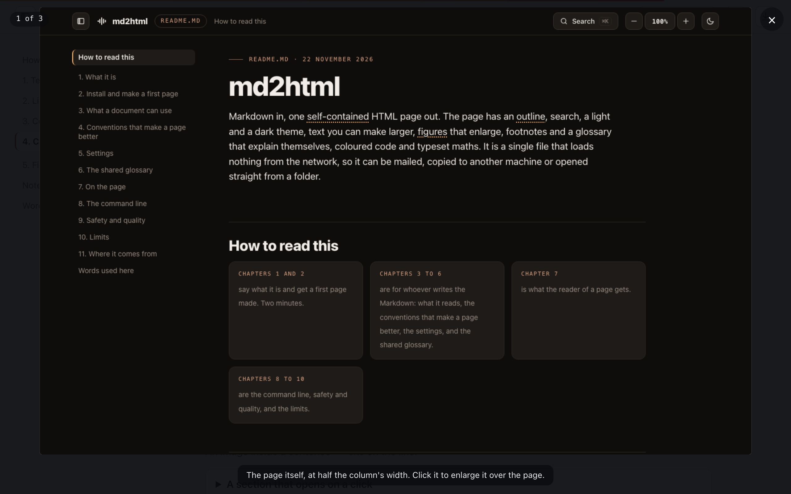
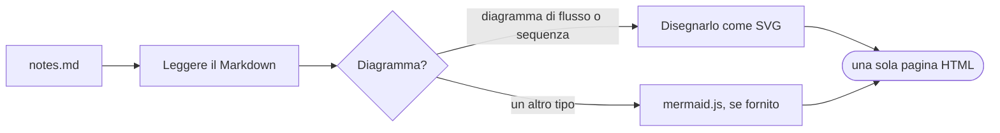
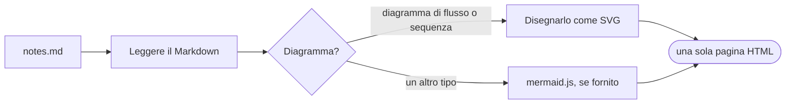
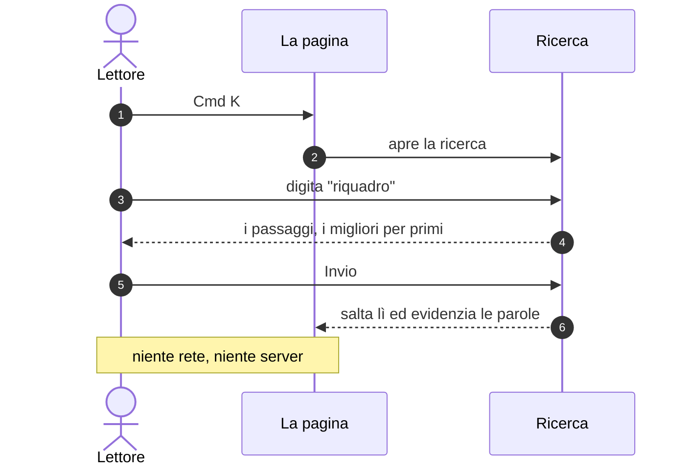
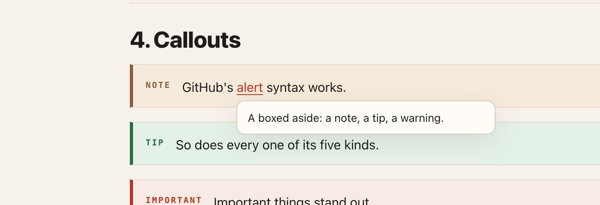
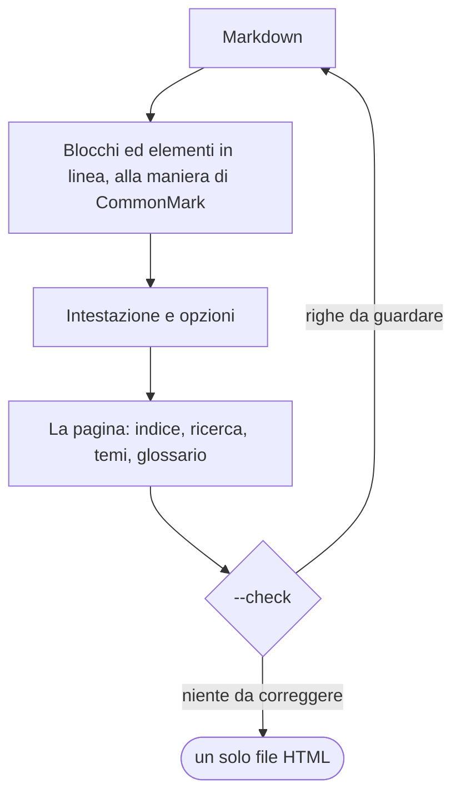

# md2html, tutto ciò che fa

md2html trasforma un file Markdown in una sola pagina web che non ha bisogno d'altro: niente server, niente rete, nessun font o script presi da altrove. La pagina porta con sé il suo indice, la ricerca, i temi chiaro e scuro, la dimensione del testo, il glossario, le note a piè di pagina, le figure che si ingrandiscono, il codice colorato, la matematica composta e i diagrammi. Questa pagina è stata scritta in Markdown e generata da md2html, quindi tutto ciò che descrive è all'opera su di essa mentre la si legge.

## Come leggere questa pagina

- Il **capitolo 1** dice dove funziona md2html e come installarlo.
- Il **capitolo 2** riassume tutto in una tabella.
- I **capitoli da 3 a 9** mostrano cosa ottiene chi legge, e cosa scrive l'autore per ottenerlo.
- I **capitoli da 10 a 12** trattano le impostazioni, la riga di comando, la sicurezza e la qualità.

---

## 1. Dove funziona

| | Dove |
|:--|:--|
| Lo strumento md2html | macOS (Apple silicon e Intel), Linux e Windows, da un solo programma Rust senza dipendenze oltre la libreria standard; testato su tutti e tre a ogni modifica |
| Le pagine che crea | le versioni attuali di Chrome, Edge, Firefox e Safari, su computer, tablet e telefoni, online o offline; lettori di schermo e tastiera ovunque |
| Aperte da | un server web, una cartella condivisa, un allegato email, o direttamente dal disco: la pagina è un solo file |
| Stampate o salvate come PDF | da qualsiasi browser, con un'impaginazione di stampa propria; `--pdf` crea il PDF stesso, con il Chrome, Chromium o Edge già presente sul computer |
| E-reader | `--epub` crea un EPUB 3, il formato standard dei libri elettronici |
| Lingue della pagina | diciassette, scrittura da destra a sinistra compresa (capitolo 8) |

Si installa con l'installatore di Rust, dai sorgenti:

```console
$ cargo install --git https://github.com/githubrobbi/md2html --tag v0.8.6 md2html --locked
$ md2html notes.md
md2html: notes.md -> notes.html (68504 bytes, 9 glossary terms, 0 of them shared)
```

## 2. In breve

| | md2html |
|:--|:--|
| Markdown | tutto CommonMark 0.31.2 (**652 dei suoi 652** esempi di test superati), e le tabelle, gli elenchi di attività, il testo barrato, i link automatici, le note a piè di pagina e gli alert di GitHub |
| Risultato | **un solo file HTML**, nulla da scaricare, nulla da installare per chi legge |
| Lettura | indice, ricerca, temi chiaro e scuro, dimensione del testo, glossario, note a piè di pagina, figure che si ingrandiscono |
| Codice, matematica, diagrammi | codice colorato in una ventina di linguaggi, matematica in MathML, diagrammi di flusso e di sequenza Mermaid disegnati come SVG, **tutto senza una libreria di script** |
| Condivisione | un link a qualsiasi capitolo, riga di tabella, figura, diagramma, blocco di codice o passaggio selezionato |
| Lingue | le parole proprie della pagina in **17 lingue**, traduzioni collegate da un selettore, da destra a sinistra per l'ebraico, lo yiddish e l'arabo |
| Da conservare | la pagina stessa, un **PDF** con segnalibri, un **EPUB** per e-reader |
| Dal vivo | pagine che si ricaricano quando il loro Markdown cambia e mantengono il punto in cui si trova chi legge |
| Sicurezza | mai uno script dal testo; nessun file letto fuori dalla cartella del documento |
| Accessibilità | nessun rilievo rispetto a WCAG 2.2 AA, in entrambi i temi e alla larghezza di un telefono |
| Velocità | un documento di 4.000 righe, diagrammi e matematica compresi, in **meno di un decimo di secondo** |
| Dipendenze | **nessuna**: la libreria standard di Rust e md2html |

## 3. La pagina

La pagina ha tre parti: una barra in alto, l'indice a sinistra e il testo.

{width=100%}

Il tema scuro segue il sistema, o la scelta di chi legge, e viene ricordato:

{width=100%}

Su un telefono l'indice si ripiega dietro il pulsante nella barra, e nulla scorre di lato:

{width=34%}

Cosa può fare chi legge:

| Per | Fare così |
|:--|:--|
| Trovare qualcosa | **Cerca** nella barra, <kbd>⌘</kbd> <kbd>K</kbd> (<kbd>Ctrl</kbd> <kbd>K</kbd>), o <kbd>/</kbd> |
| Nascondere o mostrare l'indice | il pulsante a sinistra della barra, o <kbd>⌘</kbd> <kbd>\\</kbd> |
| Cambiare la dimensione del testo | **Aa** nella barra, poi **−** e **+**; o <kbd>⌘</kbd> <kbd>+</kbd> e <kbd>⌘</kbd> <kbd>−</kbd>, da 85 a 200 per cento |
| Cambiare tema | **Aa**, poi Sistema, Chiaro o Scuro |
| Ingrandire una figura | cliccarla; altri due clic la avvicinano; <kbd>Esc</kbd> la rimette a posto |
| Leggere una nota o una parola sottolineata a puntini | passarci sopra con il puntatore; un clic per andarci, e **indietro** riporta lì |
| Condividere un capitolo, una riga di tabella, una figura, un diagramma, un blocco di codice o un passaggio | il simbolo di condivisione a destra di un titolo, in fondo alla riga di tabella sotto il puntatore, o nell'angolo della figura, del diagramma o del blocco di codice su cui si trova il puntatore, ne copia il link (un telefono apre il suo menu di condivisione); selezionare delle parole, e viene offerto un link proprio a quelle |
| Conservarla | il pulsante di download in fondo alla barra: la pagina stessa (si legge offline), stampa o salva come PDF, oppure il PDF e l'EPUB dove sono stati creati |

La dimensione del testo e il tema stanno insieme dietro **Aa**; conservare la pagina ha un pulsante tutto suo:

{width=60%}

## 4. Scrivere

Markdown ordinario, e ogni costrutto si legge bene anche come testo semplice. Quello che si scrive viene prima, in un blocco di codice; quello che si ottiene lo segue.

### Enfasi e link

```markdown
**Grassetto**, *corsivo*, ***entrambi***, ~~barrato~~ e `code`.
Un [link](https://commonmark.org "CommonMark"), uno scritto per esteso,
https://spec.commonmark.org/0.31.2/, e segni come [V] che restano come sono scritti.
```

**Grassetto**, *corsivo*, ***entrambi***, ~~barrato~~ e `code`. Un [link](https://commonmark.org "CommonMark"), uno scritto per esteso, https://spec.commonmark.org/0.31.2/, e segni come [V] che restano come sono scritti.

### Elenchi dentro elenchi

```markdown
1. Primo, con un elenco annidato:
   - un punto
   - un altro, con il suo:
     1. più in fondo
2. Secondo.
- [x] un'attività fatta
- [ ] un'attività aperta
```

1. Primo, con un elenco annidato:
   - un punto
   - un altro, con il suo:
     1. più in fondo
2. Secondo.

- [x] un'attività fatta
- [ ] un'attività aperta

### Citazioni e riquadri

```markdown
> Una semplice citazione resta una citazione.

> [!TIP]
> Gli alert di GitHub funzionano: NOTE, TIP, IMPORTANT, WARNING, CAUTION.

> **Nota:** anche la forma più vecchia, una parola in grassetto e i due punti, ne fa un riquadro.
```

> Una semplice citazione resta una citazione.

> [!TIP]
> Gli alert di GitHub funzionano: NOTE, TIP, IMPORTANT, WARNING, CAUTION.

> **Nota:** anche la forma più vecchia, una parola in grassetto e i due punti, ne fa un riquadro.

### Tabelle

```markdown
| Stanza    | Piano     | Superficie (ft²) |
|:----------|:---------:|-----------------:|
| Soggiorno | terra     |              312 |
| Soppalco  | superiore |              205 |
```

| Stanza | Piano | Superficie (ft²) |
|:-------|:------:|-------------:|
| Soggiorno | terra | 312 |
| Soppalco | superiore | 205 |

Una tabella più larga della colonna scorre al suo interno, e la pagina non scorre mai.

### Note a piè di pagina

```markdown
Un'affermazione che ha bisogno di una fonte.[^1]

[^1]: La fonte. Passare il puntatore sul numero per leggerla lì.
```

Un'affermazione che ha bisogno di una fonte.[^source]

[^source]: La fonte. Passare il puntatore sul numero per leggerla lì; un clic per venire qui, e indietro per tornare.

### Figure e immagini

```markdown
{width=60%}

Un'icona {width=18} dentro una frase.
```

{width=60%}

Un'icona {width=18} dentro una frase.

### Piccole cose

```markdown
Premere <kbd>Ctrl</kbd>+<kbd>K</kbd>. L'acqua è H<sub>2</sub>O, la stanza misura 9 m<sup>2</sup>.
Una riga che finisce con una barra rovesciata\
va a capo lì.
```

Premere <kbd>Ctrl</kbd>+<kbd>K</kbd>. L'acqua è H<sub>2</sub>O, la stanza misura 9 m<sup>2</sup>. Una riga che finisce con una barra rovesciata\
va a capo lì.

<details>
<summary>Una sezione che si apre con un clic</summary>

Scritta come `<details>` con un `<summary>`, con Markdown ordinario all'interno: **grassetto**, un elenco,

- uno
- due

</details>

#### Un titolo di quarto livello

I titoli sotto il terzo livello restano fuori dall'indice, come questo.

## 5. Codice, matematica e diagrammi

Il codice è colorato per Rust, Python, JavaScript e TypeScript, Go, C e C++, Java, Kotlin, Swift, C#, la shell, SQL, Ruby, Lua, PHP, CSS, HTML, JSON, YAML, TOML, i Dockerfile e i diff, e ogni blocco ha un pulsante per copiarlo.

```rust
/// The whole page from one Markdown text.
fn main() {
    let page = md2html::render("# Hello\n\nWorld.", &Settings::default());
    println!("{} bytes, nothing to fetch", page.len()); // one file
}
```

```python
@cache
def area(w: float, h: float) -> float:
    """The area of a room."""
    return w * h  # square feet
```

```diff
- every quotation a note
+ a quotation is a quotation; a bold first word makes it a note
```

La matematica è composta dal browser stesso, come MathML, senza script e senza font da scaricare. Nel testo, il teorema di Pitagora è $a^2 + b^2 = c^2$, e l'identità di Eulero è $e^{i\pi} + 1 = 0$; una somma in dollari come $5 o $10 resta denaro. Su righe a sé:

$$
\int_0^1 x^2 \, dx = \frac{1}{3} \qquad \sum_{k=1}^{n} k = \frac{n(n+1)}{2} \qquad \sqrt[3]{27} = 3
$$

$$
\begin{pmatrix} a & b \\ c & d \end{pmatrix}
\begin{pmatrix} x \\ y \end{pmatrix}
=
\begin{pmatrix} ax + by \\ cx + dy \end{pmatrix}
\qquad
|x| = \begin{cases} x & x \ge 0 \\ -x & x < 0 \end{cases}
$$

### Diagrammi

Un diagramma di flusso o di sequenza Mermaid è disegnato da md2html stesso, come SVG dentro la pagina: niente script, niente da scaricare, i colori della pagina in entrambi i temi, e le sue parole restano parole che la ricerca trova. Questo è il Markdown:

````markdown

````

E questo è ciò che diventa:



Un diagramma di sequenza, numerato, con una nota:



Gli altri tipi (grafici a torta, diagrammi di Gantt, diagrammi delle classi) sono disegnati da mermaid.js quando l'autore indica a md2html una sua copia (`--mermaid-js FILE`); lo script entra allora solo in quella pagina. Senza, restano codice, e `--check` lo segnala.

## 6. Glossario, note a piè di pagina, ricerca e figure

Un capitolo chiamato Glossario raccoglie le parole della pagina in una tabella. Non compare dove si trova: invece, la prima menzione di ogni termine in ogni capitolo diventa una parola sottolineata a puntini che si spiega al passaggio del puntatore, e un clic su di essa porta alla voce in fondo, che riporta alla riga che si stava leggendo.

{width=70%}

Le note a piè di pagina funzionano allo stesso modo: il numero si spiega al passaggio del puntatore.

{width=70%}

> [!NOTE]
> Un glossario può essere condiviso tra più pagine: un solo file in `~/.config/md2html/glossary.md`, le cui parole diventano allora link in ogni pagina generata da un file su quel computer.

La ricerca copre ogni parola della pagina, glossario compreso. I risultati mostrano dove si trova ogni parola; quella scelta viene evidenziata nel punto in cui arriva la ricerca.

{width=80%}

{width=80%}

Una figura si ingrandisce sopra la pagina senza lasciarla. Se è più grande della finestra, segue il puntatore, così si punta ciò che si vuole vedere.

## 7. Condivisione e pagine dal vivo

Ogni titolo porta un simbolo di condivisione alla sua destra; ogni riga di tabella, figura, diagramma e blocco di codice ne mostra uno sotto il puntatore. Un clic copia un link proprio a quel punto, e lo dice; su un telefono si apre invece il menu di condivisione del sistema. Selezionando alcune parole, la pagina offre un link proprio a quelle, che apre la pagina su quel passaggio, evidenziato.

{width=80%}

Una pagina può anche mantenersi aggiornata da sé. `md2html --serve` mostra le pagine su questo computer mentre vengono scritte, e ogni pagina aperta si ricarica nel momento in cui il suo Markdown viene salvato. Una pagina pubblicata creata con `--live` ha un suo tempo di vita: quando scade, la pagina chiede al suo server il primo kilobyte di sé, dove si trova la sua impronta, e si ricarica solo se questa è cambiata. In entrambi i casi chi legge resta dov'era: allo stesso paragrafo alla stessa altezza o, se non c'è più, al capitolo che lo precede; passare a un'altra lingua mantiene il punto allo stesso modo. Il server è solo per questo computer: risponde soltanto alle richieste indirizzate a lui, serve soltanto la cartella del documento, e a una richiesta che non riesce a leggere per intero risponde con il codice di stato che dice perché.

## 8. Lingue

Le parole proprie della pagina (la ricerca, i riquadri, il glossario, le date, ogni pulsante) esistono in diciassette lingue: inglese, tedesco, ebraico, indonesiano, olandese, giavanese, yiddish, basso tedesco, francese, italiano, spagnolo, giapponese scritto in tre modi (in kanji e kana, solo in kana, e in rōmaji), cinese mandarino in caratteri semplificati e in caratteri tradizionali, e cantonese. Basta `lang: de` nell'intestazione. L'ebraico e lo yiddish sono impaginati da destra a sinistra, con l'indice a destra, e così anche l'arabo, con le parole proprie della pagina in inglese.

Una traduzione è semplicemente un altro file Markdown accanto all'originale, che prende il nome dalla sua lingua: `capabilities.de.md` è il `capabilities.md` tedesco. md2html trova le versioni presenti, le collega tra loro con un selettore nella barra (il globo), lo comunica a browser e motori di ricerca con `hreflang`, e dà a ciascuna le parole della sua interfaccia. Questa pagina esiste in tutte e diciassette; il globo passa dall'una all'altra, e la pagina si apre al paragrafo che si stava leggendo.

Ogni traduzione nomina il suo originale e registra l'impronta dell'originale, così la pagina può dire quale versione fa fede, e `--check` si accorge quando l'originale è cambiato dopo la traduzione:

```yaml
translated_from: capabilities.md
source_sha256: 805e0efdead88f9dfa4a51338d045f6ed91341d15dea9af1e836c2a538387ddc
```

Per una lingua in cui nessuno ha tradotto una pagina, il browser di chi legge può tradurla da sé, se ne è capace (il traduttore integrato di Chrome): sul dispositivo stesso, così che nulla ne esca, con l'indicazione che si tratta di una traduzione automatica e un modo per tornare all'originale.

Una pagina con importi in una valuta può offrirne un'altra al lettore: `currency: JPY` indica la valuta della pagina, e `rates: rates.json` un file con i cambi di un giorno accanto a essa. Un selettore accanto al globo mostra allora ogni importo nella valuta della lingua in cui si legge la pagina, o in qualunque altra dei cambi, finché il lettore non chiede l'originale. La valuta segue la lingua quando è quella di quella lingua: i dollari statunitensi letti in inglese diventano euro quando la pagina si legge in tedesco, mentre gli yen restano yen. I cambi e la loro data sono nella pagina; non si scarica nulla. Solo una pagina che lo chiede ha il selettore.

## 9. Conservare una pagina

Il pulsante di download nella barra offre ciò che c'è da conservare. La pagina stessa si legge offline quando le sue immagini sono al suo interno (`embed: true`). La stampa ha una sua impaginazione: i controlli spariscono, ogni link stampa il suo indirizzo, nulla viene tagliato tra una pagina e l'altra, e le pagine portano il titolo e il loro numero.

{width=55%}

`--pdf` stampa la pagina con il Chrome già presente sul computer: la sua impaginazione di stampa, i titoli come segnalibri del PDF, il titolo in testa a ogni pagina e il suo numero in fondo. `--epub` crea dalla stessa pagina un libro per e-reader, con il suo indice, le immagini, i diagrammi e la matematica, e note a piè di pagina che si aprono dove sono citate; md2html lo scrive da sé. Chi legge li trova entrambi sotto il pulsante di download.

## 10. Impostazioni

L'inizio del file Markdown originale di questa pagina, in inglese, recita:

```yaml
---
title: md2html, everything it does
description: md2html turns Markdown into one complete, self-contained web page ...
brand: md2html
kicker: Capabilities
version: 0.8.6
date: 2026-11-23
footer: Written in Markdown and rendered by **md2html 0.8.6** itself ...
csp: true      # only this page's own code may run
embed: true    # the screenshots are inside the page
---
```

| Impostazione | Cosa fa |
|:--|:--|
| `title`, `description`, `author` | il titolo, e i meta tag per le anteprime dei link |
| `lang` | la lingua: le parole proprie della pagina e le date in una qualsiasi delle diciassette (`ja-Hira` è il giapponese in kana, `zh-Hant` il cinese in caratteri tradizionali, `yue` il cantonese) |
| `translated_from`, `source_sha256` | per una traduzione: il suo originale, e l'impronta dell'originale al momento della traduzione |
| `currency`, `rates` | la valuta degli importi della pagina e un file con i cambi di un giorno: un selettore di valuta nella barra |
| `brand`, `brand_link`, `kicker`, `eyebrow`, `footer` | la barra, la riga sopra il titolo, le note in piccolo |
| `date`, `version` | la data e la versione mostrate sopra il titolo |
| `embed` | le immagini dentro la pagina, così che sia un solo file |
| `csp` | una Content-Security-Policy |
| `pdf`, `epub` | un PDF e un EPUB della pagina, accanto a essa |
| `live` | il tempo di vita della pagina (`true` sono due minuti, oppure un numero di secondi): poi si ricarica se è cambiata, mantenendo il punto in cui si trova chi legge |
| `large`, `toc`, `math`, `index`, `html`, `css`, `head` | caratteri più grandi, l'indice, la matematica, i motori di ricerca, un HTML più ricco, stile e head aggiuntivi |

> [!TIP]
> Con `lang: de` la ricerca dice «Diese Seite durchsuchen», i riquadri dicono «Hinweis» e «Achtung», e la data si legge «23. November 2026».

## 11. La riga di comando

```console
$ md2html notes.md
md2html: notes.md -> notes.html (68504 bytes, 9 glossary terms, 0 of them shared)
$ md2html docs/ -o site/ --nav
$ md2html notes.md --check
notes.md:30: `plan.svg` does not exist next to this page
notes.md: a link points at #setup, which is nowhere on the page
md2html: 2 to look at
$ cat notes.md | md2html - > notes.html
$ md2html notes.md --pdf --epub
$ md2html notes.md --serve
```

`--check` non scrive nulla ed elenca ciò che un autore dovrebbe guardare, riga per riga dove c'è una riga, ed esce con 1 quando c'è qualcosa: un link a un'ancora che non è nella pagina, un file che non c'è, una nota a piè di pagina senza il suo testo, HTML grezzo mostrato come testo, un tag dell'autore che non chiude nulla o che non viene mai chiuso, una traduzione più vecchia del suo originale. Questo ne fa l'ultimo passo di una build. `--watch` rigenera a ogni salvataggio, `--nav` collega le pagine di una cartella con precedente e successiva, e un link a un altro file Markdown porta alla sua pagina.

## 12. Sicurezza, qualità e accessibilità

> [!WARNING]
> Una pagina può essere generata da Markdown scritto da qualcun altro. md2html non scrive mai uno script a partire dal testo: l'HTML grezzo viene mostrato come è scritto, tranne pochi tag innocui, che sono bilanciati dentro l'articolo così da non poter rompere la pagina intorno, e i link `javascript:` o `data:` vengono scartati, comunque siano scritti. Un documento non può far leggere a md2html un file fuori dalla sua cartella, e nessun input, per quanto ostile, può bloccarlo o farlo andare in crash.

> [!CAUTION]
> `--html` lascia passare un HTML più ricco (immagini, link, video, SVG, impaginazione), ma mai nulla che venga eseguito: niente script, niente gestori di eventi, niente frame, niente moduli.

Cosa viene controllato a ogni modifica, i test su macOS, Linux e Windows e i controlli in Chrome su Linux:

- i test che generano pagine intere e le rileggono, e quelli che eseguono il programma stesso, tra cui i casi di sicurezza e quelli patologici;
- i 652 esempi della specifica CommonMark, il cui numero di esempi superati può salire ma mai scendere;
- i lint più severi di clippy, e la versione più vecchia di Rust su cui lo strumento promette di compilare;
- un audit di accessibilità con axe-core rispetto a WCAG 2.2 AA, in entrambi i temi e alla larghezza di un telefono;
- un test interattivo in Chrome che usa ogni controllo come farebbe chi legge, con il mouse e con la tastiera, alla dimensione del testo normale e a una più grande;
- le pagine dal vivo, da capo a fondo: un ricaricamento a ogni modifica, il punto di chi legge mantenuto, un cambio di lingua che arriva allo stesso paragrafo.

md2html non contiene codice di terze parti, e la sua catena di fornitura è fissata e verificata: la toolchain, le azioni della CI, gli strumenti di test. Ogni pagina termina con una sola riga discreta: realizzato con md2html, la sua versione, e un link al luogo in cui si trova md2html.

Il percorso che fa ogni pagina:



---

Il glossario qui sotto spiega le parole che usa questa pagina; ognuna era più sopra una parola sottolineata a puntini.

## Glossario

| Termine | Significato | Anche |
|---|---|---|
| Markdown | Testo semplice con segni leggeri per titoli, enfasi, elenchi e link, leggibile così com'è e convertibile in una pagina. | |
| CommonMark | La specifica di Markdown che oggi segue la maggior parte degli strumenti, con un test per ogni regola. | |
| indice | L'elenco dei capitoli a sinistra della pagina, ricavato dai suoi titoli. | |
| riquadro | Un inciso incorniciato: una nota, un suggerimento, qualcosa di importante, un avviso o un'avvertenza. | riquadri, alert |
| figura | Un'immagine su una riga a sé, con la didascalia sotto, ingrandita con un clic. | figure |
| intestazione | Il blocco di impostazioni tra due righe `---` in cima a un file Markdown. | |
| MathML | La lingua propria del web per la matematica, disegnata dal browser senza script. | |
| Content-Security-Policy | Una regola nella pagina che dice al browser quale codice può essere eseguito; qui, solo quello della pagina. | |
| Mermaid | Un linguaggio testuale per diagrammi, scritto in un blocco di codice; md2html ne disegna i diagrammi di flusso e di sequenza. | |
| WCAG | Le linee guida per l'accessibilità dei contenuti web (Web Content Accessibility Guidelines); il livello AA è l'obiettivo abituale. | |
| traduzione | Una versione di una pagina in un'altra lingua, un file Markdown accanto all'originale. | traduzioni |
| EPUB | Il formato standard dei libri elettronici, una pagina web impacchettata che gli e-reader impaginano. | |
