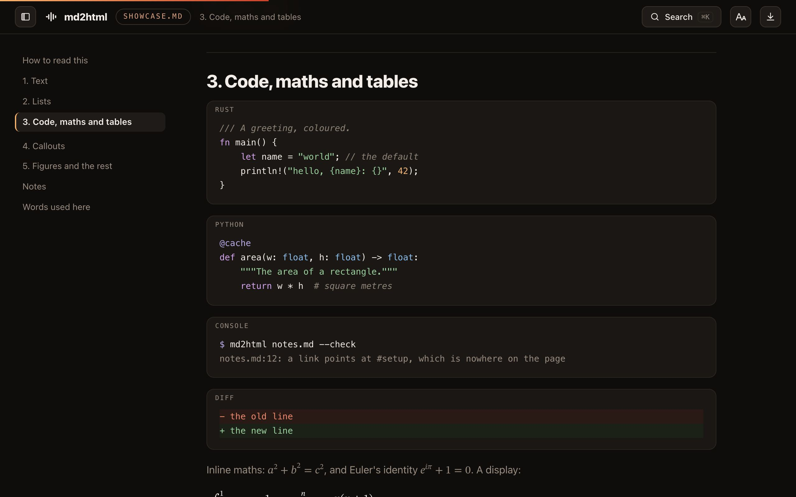
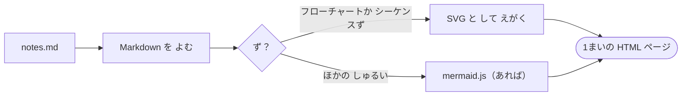
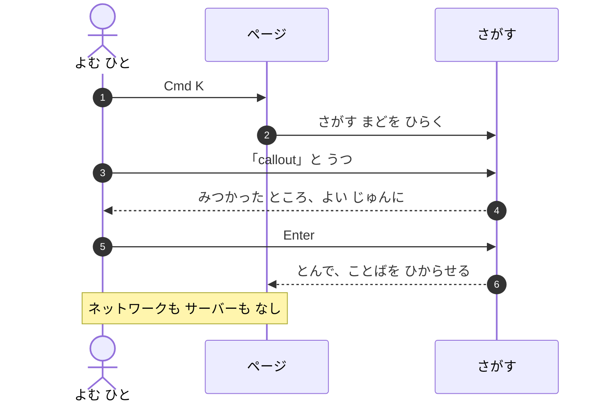
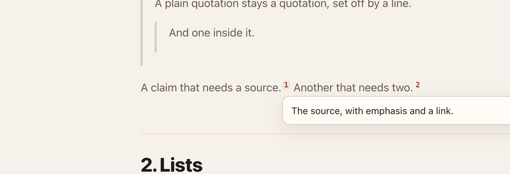
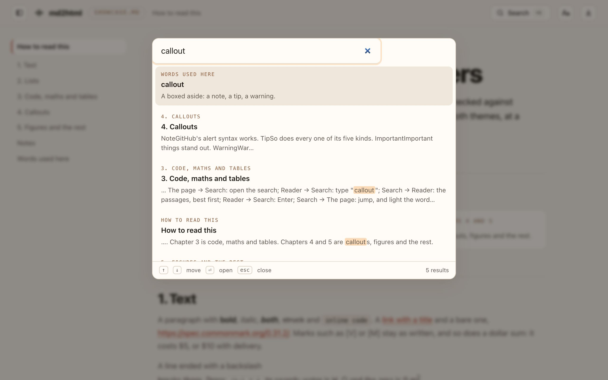
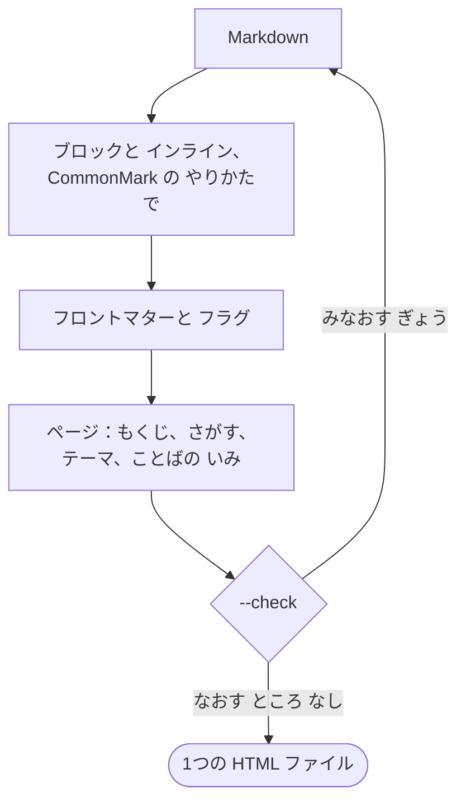

# md2html に できる こと ぜんぶ

md2html は Markdown の ファイルを、ほかに なにも いらない 1まいの ウェブページに かえます。サーバーも ネットワークも いりません。フォントや スクリプトを どこかから もって くる ことも ありません。ページには はじめから、もくじ、さがす しくみ、あかるい テーマと くらい テーマ、もじの おおきさ、ことばの いみ、ちゅう、おおきく できる がぞう、いろの ついた コード、きれいに ならんだ すうしき、ずが ついて います。この ページは Markdown で かいて、md2html で かえたので、ここに かいて ある できる ことは ぜんぶ、いま よんで いる この ページの うえで はたらいて います。

## この ページの よみかた

- **1しょう**は、md2html が うごく ところと、いれかたの はなしです。
- **2しょう**は、ぜんぶを 1つの ひょうに まとめた ものです。
- **3〜9しょう**では、よむ ひとに なにが みえるか、そして かく ひとが その ために なにを かけば よいかを みせます。
- **10〜12しょう**は、せってい、コマンドライン、そして あんぜんと ひんしつの はなしです。

---

## 1. うごく ところ

| | ところ |
|:--|:--|
| md2html と いう どうぐ | macOS（Apple の チップと Intel）、Linux、Windows。ひょうじゅんの ライブラリの ほかには なにも つかわない、1つの Rust の プログラムです。かえる たびに、3つ ぜんぶで テスト して います |
| できあがる ページ | あたらしい Chrome、Edge、Firefox、Safari。コンピューター、タブレット、スマホで、インターネットが あっても なくても よめます。よみあげる ソフトと キーボードでも、どこでも つかえます |
| ひらく ところ | ウェブの サーバー、みんなで つかう フォルダー、メールに つけた ファイル、または ディスクから じかに。ページは 1つの ファイルです |
| いんさつ、または PDF で ほぞん | どの ブラウザからでも、いんさつ ようの レイアウトで。`--pdf` は、コンピューターに もう ある Chrome、Chromium、Edge で PDF そのものを つくります |
| でんし しょせきの きかい | `--epub` は、でんし しょせきの ふつうの かたちの EPUB 3 を つくります |
| ページの げんご | 17。みぎから ひだりへ かく げんごも あります（8しょう） |

Rust じしんの いれる どうぐで、もとの コードから いれます。

```console
$ cargo install --git https://github.com/githubrobbi/md2html --locked
$ md2html notes.md
md2html: notes.md -> notes.html (68504 bytes, 9 glossary terms, 0 of them shared)
```

## 2. ひとめで わかる まとめ

| | md2html |
|:--|:--|
| Markdown | CommonMark 0.31.2 ぜんぶ（テストの れい **652この うち 640こ** が とおります）と、GitHub の ひょう、やること リスト、とりけし せん、じどうの リンク、ちゅう、アラート |
| できあがり | **1つの HTML ファイル**。なにも もって こず、よむ ひとが なにかを いれる ことも ありません |
| よむ | もくじ、さがす しくみ、あかるい テーマと くらい テーマ、もじの おおきさ、ことばの いみ、ちゅう、おおきく できる がぞう |
| コード、すうしき、ず | やく 20の げんごの コードの いろわけ、MathML の すうしき、SVG と して えがく Mermaid の フローチャートと シーケンスず。**どれも スクリプトの ライブラリ なし** |
| ひとに おくる | どの しょう、ひょうの ぎょう、がぞう、ず、コードブロック、えらんだ ぶぶんへの リンクでも |
| げんご | ページ じしんの ことばを **17の げんご** で。ほんやくどうしは きりかえで つながり、ヘブライごと イディッシュごは みぎから ひだりへ |
| とって おく | ページ そのもの、しおり つきの **PDF**、でんし しょせき むけの **EPUB** |
| いつも あたらしい | Markdown が かわると よみこみなおし、よむ ひとの いちを たもつ ページ |
| あんぜん | ほんぶんから スクリプトを つくる ことは けっして なく、ぶんしょうの フォルダーの そとの ファイルを よむ ことも ありません |
| アクセシビリティ | WCAG 2.2 AA に そった もんだいは ゼロ。どちらの テーマでも、スマホの はばでも |
| はやさ | ずと すうしきの はいった 4,000ぎょうの ぶんしょうを **0.1びょう より はやく** |
| ほかの ソフト | **なし**。Rust の ひょうじゅんの ライブラリと md2html だけです |

## 3. ページ

ページは 3つの ぶぶんで できて います。いちばん うえの バー、ひだりの もくじ、そして ほんぶんです。

{width=100%}

くらい テーマは、システムの せっていか、よむ ひとが えらんだ ものに あわせます。えらんだ ものは おぼえて おきます。

{width=100%}

スマホでは、もくじは バーの スイッチの うしろに しまわれます。よこに スクロール する ものは ありません。

{width=34%}

よむ ひとが できる こと：

| したい こと | やりかた |
|:--|:--|
| なにかを さがす | バーの **さがす**、<kbd>⌘</kbd> <kbd>K</kbd>（<kbd>Ctrl</kbd> <kbd>K</kbd>）、または <kbd>/</kbd> |
| もくじを かくす・だす | バーの ひだりに ある スイッチ、または <kbd>⌘</kbd> <kbd>\\</kbd> |
| もじの おおきさを かえる | バーの **Aa** から **−** と **+**。または <kbd>⌘</kbd> <kbd>+</kbd> と <kbd>⌘</kbd> <kbd>−</kbd>。85 から 200 パーセントまで |
| テーマを かえる | **Aa** から、システム、あかるい、くらい |
| がぞうを おおきく する | クリック します。あと 2かい クリック すると もっと ちかく なり、<kbd>Esc</kbd> で もとに もどります |
| ちゅうや てんせんの ついた ことばを よむ | ポインターを のせます。クリック すると そこへ とび、**もどる** で もどります |
| しょう、ひょうの ぎょう、がぞう、ず、コードブロック、ぶんしょうの いちぶを ひとに おくる | みだしの みぎ、ポインターの したに ある ひょうの ぎょうの おわり、または ポインターの したに ある がぞう、ず、コードブロックの すみに ある おくる マークで その リンクを コピー します（スマホでは おくる ための がめんが ひらきます）。ことばを えらぶと、ちょうど そこへの リンクが でて きます |
| とって おく | バーの さいごに ある ダウンロード ボタンから、この ページ その もの（インターネット なしで よめます）、いんさつ または PDF で ほぞん、あるいは つくって あれば PDF と EPUB |

もじの おおきさと テーマは **Aa** の なかに いっしょに あります。ページを とって おく ためには、べつの ボタンが あります。

{width=60%}

## 4. かきかた

ふつうの Markdown です。どの かきかたも、その まま もじと して よんでも よみやすく なって います。まず かく ものを コードブロックで みせ、その あとに できあがりを みせます。

### つよめる もじと リンク

```markdown
**ふとじ**、*ななめ*、***りょうほう***、~~とりけし~~、`コード`。
[リンク](https://commonmark.org "CommonMark")、[V] のように かいた ままの しるし、
そして むきだしの リンク https://spec.commonmark.org/0.31.2/
```

**ふとじ**、*ななめ*、***りょうほう***、~~とりけし~~、`コード`。[リンク](https://commonmark.org "CommonMark")、[V] のように かいた ままの しるし、そして むきだしの リンク https://spec.commonmark.org/0.31.2/

### リストの なかの リスト

```markdown
1. ひとつめ。なかに リストが あります：
   - てんの ついた こうもく
   - もう ひとつ。これにも リストが あります：
     1. もっと おく
2. ふたつめ。
- [x] おわった こと
- [ ] まだの こと
```

1. ひとつめ。なかに リストが あります：
   - てんの ついた こうもく
   - もう ひとつ。これにも リストが あります：
     1. もっと おく
2. ふたつめ。

- [x] おわった こと
- [ ] まだの こと

### いんようと コールアウト

```markdown
> ふつうの いんようは いんようの ままです。

> [!TIP]
> GitHub の アラートが つかえます。NOTE、TIP、IMPORTANT、WARNING、CAUTION。

> **メモ:** ふるい かたち、つまり ふとじの ことばと コロンも つかえます。
```

> ふつうの いんようは いんようの ままです。

> [!TIP]
> GitHub の アラートが つかえます。NOTE、TIP、IMPORTANT、WARNING、CAUTION。

> **メモ:** ふるい かたち、つまり ふとじの ことばと コロンも つかえます。

### ひょう

```markdown
| へや     | かい  | ひろさ（へいほう フィート） |
|:---------|:-----:|----------------------------:|
| リビング | 1かい |                         312 |
| ロフト   | 2かい |                         205 |
```

| へや | かい | ひろさ（へいほう フィート） |
|:-------|:------:|-------------:|
| リビング | 1かい | 312 |
| ロフト | 2かい | 205 |

ほんぶんの はばより ひろい ひょうは、その なかで スクロール します。ページ ぜんたいが よこに うごく ことは ありません。

### ちゅう

```markdown
でどころが ひつような はなしです。[^1]

[^1]: でどころです。ばんごうに ポインターを のせると、そこで よめます。
```

でどころが ひつような はなしです。[^source]

[^source]: でどころです。ばんごうに ポインターを のせると、そこで よめます。クリック すると ここへ きて、「もどる」で もとの ところへ もどります。

### がぞう

```markdown
{width=60%}

ぶんの なかの アイコン {width=18} です。
```

{width=60%}

ぶんの なかの アイコン {width=18} です。

### こまかい こと

```markdown
<kbd>Ctrl</kbd>+<kbd>K</kbd> を おします。みずは H<sub>2</sub>O、へやは 9 m<sup>2</sup>。
バックスラッシュで おわる ぎょうは\
そこで つぎの ぎょうに なります。
```

<kbd>Ctrl</kbd>+<kbd>K</kbd> を おします。みずは H<sub>2</sub>O、へやは 9 m<sup>2</sup>。バックスラッシュで おわる ぎょうは\
そこで つぎの ぎょうに なります。

<details>
<summary>クリック すると ひらく ぶぶん</summary>

`<details>` と `<summary>` で かき、なかは ふつうの Markdown です。**ふとじ**、リスト、

- いち
- に

</details>

#### 4だんめの みだし

3だんめより したの みだしは、この みだしの ように もくじには はいりません。

## 5. コード、すうしき、ず

コードは Rust、Python、JavaScript と TypeScript、Go、C と C++、Java、Kotlin、Swift、C#、シェル、SQL、Ruby、Lua、PHP、CSS、HTML、JSON、YAML、TOML、Dockerfile、diff で いろわけ され、どの ブロックにも コピー ボタンが つきます。

```rust
/// The whole page from one Markdown text.
fn main() {
    let page = md2html::render("# Hello\n\nWorld.", &Settings::default());
    println!("{} bytes, nothing to fetch", page.len()); // one file
}
```

```python
@cache
def area(w: float, h: float) -> float:
    """The area of a room."""
    return w * h  # square feet
```

```diff
- every quotation a note
+ a quotation is a quotation; a bold first word makes it a note
```

すうしきは ブラウザ じしんが MathML と して くみます。スクリプトも、ダウンロード する フォントも いりません。ぶんの なかでは、ピタゴラスの ていりは $a^2 + b^2 = c^2$、オイラーの とうしきは $e^{i\pi} + 1 = 0$ です。$5 や $10 の ような おかねの かずは、おかねの ままです。べつの ぎょうに だすと こう なります。

$$
\int_0^1 x^2 \, dx = \frac{1}{3} \qquad \sum_{k=1}^{n} k = \frac{n(n+1)}{2} \qquad \sqrt[3]{27} = 3
$$

$$
\begin{pmatrix} a & b \\ c & d \end{pmatrix}
\begin{pmatrix} x \\ y \end{pmatrix}
=
\begin{pmatrix} ax + by \\ cx + dy \end{pmatrix}
\qquad
|x| = \begin{cases} x & x \ge 0 \\ -x & x < 0 \end{cases}
$$

### ず

Mermaid の フローチャートや シーケンスずは、md2html じしんが ページの なかに SVG と して えがきます。スクリプトも、ダウンロード する ものも ありません。どちらの テーマでも ページの いろを つかいます。ずの なかの ことばは ことばの ままなので、さがす ことも できます。Markdown は こう かきます。

````markdown

````

そして、こう なります。


ばんごうと メモの ついた シーケンスずです。



ほかの しゅるい（えんグラフ、ガントチャート、クラスず）は、かいた ひとが md2html に mermaid.js の コピーの ばしょを おしえた とき（`--mermaid-js FILE`）に、mermaid.js が えがきます。その とき スクリプトは その ページにだけ はいります。おしえて いなければ コードの まま のこり、`--check` が そう しらせます。

## 6. ことばの いみ、ちゅう、さがす こと、がぞう

「ことばの いみ」と いう なまえの しょうには、この ページの ことばが ひょうに なって います。この ひょうは その ばしょには でません。そのかわり、どの しょうでも、それぞれの ことばが はじめて でて くる ところが てんせんの ついた ことばに なり、ポインターを のせると いみが でます。クリック すると ページの いちばん したの こうもくへ とび、そこから よんで いた ぎょうへ もどれます。

{width=70%}

ちゅうも おなじです。ばんごうに ポインターを のせると、なかみが でます。

{width=70%}

> [!NOTE]
> ことばの いみの ひょうは、いくつかの ページで いっしょに つかえます。`~/.config/md2html/glossary.md` と いう 1つの ファイルに かくと、その ことばは、その コンピューターで つくる すべての ページで リンクに なります。

さがす ときは、ことばの いみの ひょうも ふくめて、ページの すべての ことばが さがす あいてです。けっかには それぞれの ことばが どこに あるかが でて、えらんだ ものは とんだ さきで ひかります。

{width=80%}

{width=80%}

がぞうは、ページを はなれずに ページの うえで おおきく なります。がめんより おおきい ときは ポインターに ついて うごくので、みたい ところを さすだけです。

## 7. ひとに おくる ことと、じぶんで あたらしく なる ページ

どの みだしにも みぎに おくる マークが あり、ひょうの ぎょう、がぞう、ず、コードブロックには、ポインターを のせると おくる マークが でて きます。クリック すると ちょうど その ばしょへの リンクが コピー され、そう しらせて くれます。スマホでは、かわりに システムの おくる ための がめんが ひらきます。ことばを いくつか えらぶと、ちょうど そこへの リンクが でて きます。その リンクを ひらくと、その ぶぶんに いろが ついた かたちで ページが ひらきます。

{width=80%}

ページは じぶんで いつも あたらしく いる ことも できます。`md2html --serve` は、かいて いる あいだ、この コンピューターで ページを みせます。Markdown を ほぞん した しゅんかんに、ひらいて いる ページが ぜんぶ よみこみなおされます。`--live` を つけて こうかい した ページには、ページ じしんの きげんが あります。きげんが きれると、ページは じぶんの サーバーに、フィンガープリントが はいって いる じぶん じしんの さいしょの 1キロバイトを たずね、それが かわって いた ときだけ よみこみなおします。どちらの ばあいも、よむ ひとは いた ところに とどまります。おなじ だんらくが おなじ たかさに くるか、その だんらくが なくなって いれば、その まえの しょうに もどります。べつの げんごに きりかえた ときも、おなじ ように いちが たもたれます。

## 8. げんご

ページ じしんの ことば（さがす ところ、コールアウト、ことばの いみ、ひづけ、すべての ボタン）は、17の げんごで よういされて います。えいご、ドイツご、ヘブライご、インドネシアご、オランダご、ジャワご、イディッシュご、ていち ドイツご、フランスご、イタリアご、スペインご、3とおりに かく にほんご（かんじと かなで、かなだけで、ローマじで）、かんたいじと はんたいじの ちゅうごくご（ふつうわ）、そして カントンごです。フロントマターに `lang: de` と かくだけです。ヘブライごと イディッシュごは みぎから ひだりへ ならび、もくじは みぎに きます。

ほんやくは、もとの ファイルの となりに おいた、げんごの なまえを つけた べつの Markdown ファイルです。`capabilities.de.md` は `capabilities.md` の ドイツごばんです。md2html は そこに ある ばんを みつけて、バーの きりかえ（ちきゅうの しるし）で おたがいに つなぎ、ブラウザと けんさく エンジンには `hreflang` で しらせ、それぞれに その げんごの がめんの ことばを わたします。この ページは 17の げんご ぜんぶで よめます。ちきゅうの しるしで きりかえると、ページは よんで いた だんらくで ひらきます。

それぞれの ほんやくには、もとの ぶんの なまえと、もとの ぶんの フィンガープリントが かいて あります。だから ページは、どれが ただしい もとの ばんかを しめせます。また、ほんやくの あとで もとの ぶんが かわると、`--check` が きづきます。

```yaml
translated_from: capabilities.md
source_sha256: 5b0c...e1
```

まだ だれも ほんやく して いない げんごでも、よむ ひとの ブラウザに その ちからが あれば（Chrome に ついて いる ほんやくの しくみ）、ブラウザが ほんやく できます。ほんやくは その きかいの なかで するので、なにも そとへ でる ことは ありません。きかいが した ほんやくだと わかる ように かかれ、もとの ぶんに もどる ほうほうも つきます。

## 9. ページを とって おく

バーの ダウンロード ボタンには、とって おける ものが ならびます。ページ そのものは、がぞうが なかに はいって いれば（`embed: true`）、インターネット なしで よめます。いんさつには べつの レイアウトが あります。ボタンなどは きえ、すべての リンクは アドレスが いんさつ され、ページの さかいめで きれる ものは なく、どの ページにも だいめいと ページの ばんごうが はいります。

{width=55%}

`--pdf` は、コンピューターに もう ある Chrome で ページを いんさつ します。ページ じしんの いんさつ ようの レイアウトで、みだしは PDF の しおりに なり、どの ページにも うえに だいめい、したに ページの ばんごうが はいります。`--epub` は おなじ ページから でんし しょせき むけの ほんを つくります。しょうの いちらん、え、ず、すうしきが はいり、ちゅうは でて くる ところで ひらきます。EPUB は md2html が じぶんで かきだします。よむ ひとは どちらも ダウンロード ボタンの なかに みつけられます。

## 10. せってい

この ページの、えいごで かいた もとの Markdown ファイルの いちばん うえは、こう なって います。

```yaml
---
title: md2html, everything it does
brand: md2html
kicker: Capabilities
version: 0.7.6
date: 2026-11-22
footer: Written in Markdown and rendered by **md2html 0.7.6** itself ...
csp: true      # only this page's own code may run
embed: true    # the screenshots are inside the page
---
```

| せってい | する こと |
|:--|:--|
| `title`, `description`, `author` | だいめいと、リンクの プレビューの ための メタタグ |
| `lang` | げんご。ページ じしんの ことばと ひづけを、17の げんごの どれにでも します（`ja-Hira` は かなだけの にほんご、`zh-Hant` は はんたいじの ちゅうごくご、`yue` は カントンご） |
| `translated_from`, `source_sha256` | ほんやくの とき、その もとの ぶんと、ほんやく した ときの もとの ぶんの フィンガープリント |
| `brand`, `brand_link`, `kicker`, `eyebrow`, `footer` | バー、だいめいの うえの ぎょう、いちばん したの ちいさな もじ |
| `date`, `version` | だいめいの うえに でる ひづけと バージョン |
| `embed` | えを ページの なかに いれて、1つの ファイルに する |
| `csp` | Content-Security-Policy |
| `pdf`, `epub` | ページの よこに おく、その ページの PDF と EPUB |
| `live` | ページの きげん（`true` は 2ふん、または びょうすう）。それが すぎると、かわって いれば よみこみなおし、よむ ひとの いちは そのまま |
| `large`, `toc`, `math`, `index`, `html`, `css`, `head` | おおきな もじ、もくじ、すうしき、けんさく エンジン、もっと ゆたかな HTML、たす スタイルと head |

> [!TIP]
> `lang: de` に すると、さがす ところには「Diese Seite durchsuchen」、コールアウトには「Hinweis」や「Achtung」と でて、ひづけは「22. November 2026」に なります。

## 11. コマンドライン

```console
$ md2html notes.md
md2html: notes.md -> notes.html (68504 bytes, 9 glossary terms, 0 of them shared)
$ md2html docs/ -o site/ --nav
$ md2html notes.md --check
notes.md:12: a link points at #setup, which is nowhere on the page
notes.md:30: `plan.svg` does not exist next to this page
md2html: 2 to look at
$ cat notes.md | md2html - > notes.html
$ md2html notes.md --pdf --epub
$ md2html notes.md --serve
```

`--check` は なにも かきださず、かいた ひとが みなおす ところを 1ぎょうずつ ならべます。なにか あれば、おわりの ばんごう 1 で おわります。ページに ない アンカーへの リンク、ない ファイル、なかみの ない ちゅう、もじと して でて しまう そのままの HTML、もとの ぶんより ふるい ほんやく などです。だから、ビルドや エージェントの しごとの さいごの ステップに むいて います。`--watch` は ほぞん する たびに つくりなおし、`--nav` は フォルダーの なかの ページを「まえへ」と「つぎへ」で つなぎます。ほかの Markdown ファイルへの リンクは、その ページへの リンクに なります。

## 12. あんぜん、ひんしつ、アクセシビリティ

> [!WARNING]
> ページは、ほかの ひとが かいた Markdown から つくられる ことも あります。md2html が ぶんしょうから スクリプトを つくる ことは ありません。そのままの HTML は、いくつかの あんぜんな タグの ほかは かいた とおりに でます。`javascript:` や `data:` の リンクは、どんな つづりで かいても とりのぞかれます。ぶんしょうが md2html に、その フォルダーの そとに ある ファイルを よませる ことは できません。また、どんなに わるい つもりで つくった にゅうりょくでも、md2html を かためたり おとしたり する ことは できません。

> [!CAUTION]
> `--html` を つけると、もっと ゆたかな HTML（え、リンク、どうが、SVG、レイアウト）が とおります。でも、うごく ものは けっして とおりません。スクリプトも、イベント ハンドラーも、フレームも、フォームも です。

かわる たびに、macOS、Linux、Windows で たしかめて いる こと：

- ページを まるごと つくって よみかえす 79の テスト。あんぜんの ための テストや、とても かわった にゅうりょくの テストも はいって います。
- CommonMark の きまりの 652の れい。とおる かずは ふえる ことは あっても、へる ことは ありません。
- clippy の いちばん きびしい チェックと、この どうぐが ビルド できると やくそく して いる いちばん ふるい Rust。
- axe-core で WCAG 2.2 AA に そって する アクセシビリティの チェック。どちらの テーマでも、スマホの はばでも します。
- Chrome で、よむ ひとと おなじ ように マウスと キーボードで すべての ボタンを つかって みる クリック テスト。ふつうの もじの おおきさと、もっと おおきな もじで します。
- じぶんで あたらしく なる ページの、はじめから おわりまでの テスト。かわった ときの よみこみなおし、よむ ひとの いちを たもつ こと、おなじ だんらくに つく げんごの きりかえです。

md2html には ほかの ひとが つくった コードが はいって いません。どうぐを そろえる みちすじも かためて あり、たしかめて あります。コンパイラー などの どうぐ、CI の アクション、テストの どうぐです。どの ページも、ひかえめな 1ぎょうで おわります。md2html で つくった こと、その バージョン、そして md2html の ある ばしょへの リンクです。

どの ページも とおる みちは こうです。



---

したの ひょうでは、この ページで つかって いる ことばを せつめい します。どれも、うえでは てんせんの ついた ことばでした。

## ことばの いみ

| ことば | いみ | べつめい |
|---|---|---|
| Markdown | みだし、つよめる もじ、リスト、リンクを、かるい しるしで あらわす ただの もじ。その まま よめて、ページに かえる ことも できます。 | |
| CommonMark | いま ほとんどの どうぐが したがって いる Markdown の きまりで、きまり ひとつ ひとつに テストが あります。 | |
| もくじ | ページの ひだりに ある しょうの いちらんで、みだしから つくられます。 | |
| コールアウト | わくで かこんだ ひとこと。メモ、ヒント、たいせつな こと、けいこく、ちゅういの どれかです。 | アラート |
| がぞう | 1ぎょうを まるごと つかう えで、したに せつめいが つき、クリック すると おおきく なります。 | |
| フロントマター | Markdown ファイルの いちばん うえの、2ほんの `---` の ぎょうの あいだに ある せっていの まとまり。 | |
| MathML | ウェブ じしんの すうしきの ことばで、ブラウザが スクリプト なしで えがきます。 | |
| Content-Security-Policy | どの コードを うごかして よいかを ブラウザに つたえる、ページの なかの きまり。ここでは ページ じしんの コードだけです。 | |
| Mermaid | コードブロックに かく、ずの ための もじの ことば。md2html は その フローチャートと シーケンスずを えがきます。 | |
| WCAG | Web Content Accessibility Guidelines（ウェブを だれでも つかえる ように する ための めやす）。ふつうの めあては レベル AA です。 | |
| ほんやく | ページを べつの げんごで かいた ばんで、もとの ファイルの となりに おく Markdown ファイルです。 | |
| EPUB | でんし しょせきの ふつうの かたち。でんし しょせきの きかいが ならべて みせる、ひとつに まとめた ウェブページです。 | |
