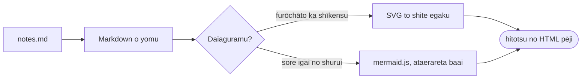
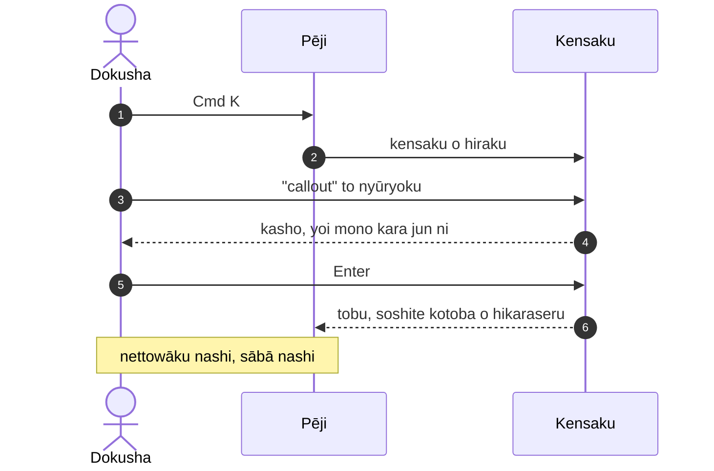
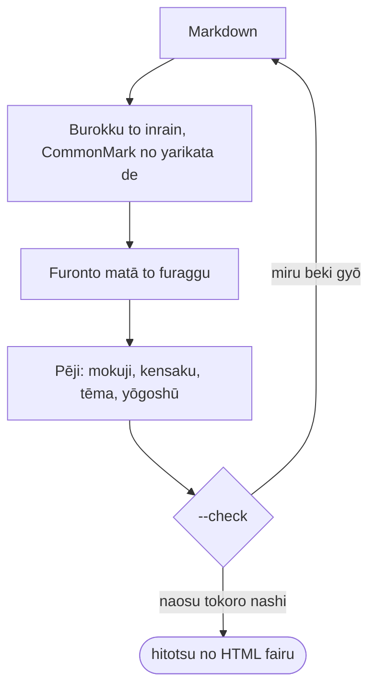

# md2html no dekiru koto subete

md2html wa, Markdown fairu o, hoka ni nani mo iranai hitotsu no web pēji ni shimasu. Sābā mo, nettowāku mo, doko ka kara yomikomu fonto ya sukuriputo mo irimasen. Pēji wa jibun no mokuji, kensaku, raito to dāku no tēma, moji saizu, yōgoshū, kyakuchū, kakudai dekiru zuhan, iro no tsuita kōdo, kumihan sareta sūshiki, soshite daiaguramu o motte imasu. Kono pēji mo Markdown de kakare, md2html de henkan sarete iru no de, koko de setsumei suru koto wa subete, anata ga yonde iru ima mo, kono pēji no ue de hataraite imasu.

## Kono pēji no yomikata

- **Dai 1 shō** wa, md2html ga ugoku basho to, insutōru no shikata desu.
- **Dai 2 shō** wa, subete o hitotsu no hyō ni matomete imasu.
- **Dai 3 shō kara dai 9 shō** de wa, yomu hito ga nani o eru ka, soshite kaku hito ga sono tame ni nani o uchikomu ka o shimeshimasu.
- **Dai 10 shō kara dai 12 shō** wa, settei, komando rain, soshite anzensei to hinshitsu desu.

---

## 1. Ugoku basho

| | Doko de |
|:--|:--|
| md2html no tsūru | macOS (Apple shirikon to Intel), Linux, Windows. Hyōjun raiburari igai ni izon kankei no nai hitotsu no Rust puroguramu de, henkō no tabi ni mittsu subete de tesuto saremasu |
| Tsūru ga tsukuru pēji | saishin no Chrome, Edge, Firefox, Safari. Konpyūtā, taburetto, sumaho de, onrain de mo ofurain de mo. Sukurīn rīdā to kībōdo ni, doko de mo taiō |
| Hirakikata | web sābā, kyōyū forudā, mēru no tenpu fairu, aruiwa disuku kara chokusetsu: pēji wa hitotsu no fairu desu |
| Insatsu, PDF to shite hozon | dono burauza kara de mo, sennyō no insatsu reiauto de. `--pdf` wa, konpyūtā ni sude ni aru Chrome, Chromium, Edge de, PDF sono mono o tsukurimasu |
| Denshi shoseki rīdā | `--epub` wa, denshi shoseki no hyōjun keishiki de aru EPUB 3 o tsukurimasu |
| Pēji no gengo | jūnana. Migi kara hidari no gengo mo fukumimasu (dai 8 shō) |

Rust jishin no insutōrā de, sōsu kara insutōru shimasu:

```console
$ cargo install --git https://github.com/githubrobbi/md2html --tag v0.8.1 md2html --locked
$ md2html notes.md
md2html: notes.md -> notes.html (68504 bytes, 9 glossary terms, 0 of them shared)
```

## 2. Hitome de

| | md2html |
|:--|:--|
| Markdown | CommonMark 0.31.2 no subete (tesuto no rei **652 chū 652** ga tsūka), soshite GitHub no hyō, tasuku risuto, torikeshisen, jidō rinku, kyakuchū, arāto |
| Shutsuryoku | **hitotsu no HTML fairu**. Nani mo yomikomazu, yomu hito wa nani mo insutōru shinakute ii |
| Yomu | mokuji, kensaku, raito to dāku no tēma, moji saizu, yōgoshū, kyakuchū, kakudai dekiru zuhan |
| Kōdo, sūshiki, daiaguramu | yaku nijū no gengo de iro o tsuketa kōdo, MathML no sūshiki, SVG to shite egakareru Mermaid no furōchāto to shīkensu-zu. **Dore mo sukuriputo raiburari nashi** |
| Kyōyū | dono shō, hyō no gyō, zuhan, daiaguramu, kōdo burokku, sentaku shita kasho e mo rinku dekiru |
| Gengo | pēji jitai no kotoba wa **17 no gengo**, hon'yaku wa kirikae de tsunagari, Heburaigo, Idisshugo, Arabiago wa migi kara hidari |
| Nokoshite oku | pēji sono mono, shiori tsuki no **PDF**, denshi shoseki rīdā-yō no **EPUB** |
| Raibu | Markdown ga kawaru to yomikominaoshi, dokusha no ichi o tamotsu pēji |
| Anzensei | honbun kara sukuriputo o tsukuru koto wa kesshite nai. Bunsho no forudā no soto no fairu wa yomanai |
| Akuseshibiriti | WCAG 2.2 AA ni taishite shiteki zero. Ryōhō no tēma to sumaho no haba de |
| Sokudo | daiaguramu to sūshiki o fukumu 4,000 gyō no bunsho ga **0.1 byō miman** |
| Izon kankei | **nashi**: Rust no hyōjun raiburari to md2html dake |

## 3. Pēji

Pēji ni wa mittsu no bubun ga arimasu: ue no bā, hidari no mokuji, soshite honbun desu.

{width=100%}

Dāku tēma wa shisutemu no settei ka, yomu hito no sentaku ni shitagai, sono sentaku wa oboete okaremasu:

{width=100%}

Sumaho de wa, mokuji wa bā no suitchi no ura ni tatamare, yoko ni sukurōru suru mono wa arimasen:

{width=34%}

Yomu hito ga dekiru koto:

| Shitai koto | Yarikata |
|:--|:--|
| Nanika o sagasu | bā no **Kensaku**, <kbd>⌘</kbd> <kbd>K</kbd> (<kbd>Ctrl</kbd> <kbd>K</kbd>), mata wa <kbd>/</kbd> |
| Mokuji o kakusu, mata wa hyōji suru | bā no hidari no suitchi, mata wa <kbd>⌘</kbd> <kbd>\\</kbd> |
| Moji saizu o kaeru | bā no **Aa**, sore kara **−** to **+**. Mata wa <kbd>⌘</kbd> <kbd>+</kbd> to <kbd>⌘</kbd> <kbd>−</kbd>. 85 kara 200 pāsento made |
| Tēma o kaeru | **Aa**, sore kara Shisutemu, Raito, mata wa Dāku |
| Zuhan o kakudai suru | kurikku shimasu. Sara ni ni-kai kurikku suru to, motto chikazukimasu. <kbd>Esc</kbd> de moto ni modorimasu |
| Kyakuchū ya tensen no tsuita go o yomu | pointā o nosemasu. Kurikku suru to soko e idō shi, **modoru** de moto no basho ni modorimasu |
| Shō, hyō no gyō, zuhan, daiaguramu, kōdo burokku, sentaku shita kasho o kyōyū suru | midashi no migi, pointā no shita ni aru hyō no gyō no owari, mata wa pointā no shita ni aru zuhan, daiaguramu, kōdo burokku no sumi no kyōyū kigō de sono rinku ga kopī saremasu (sumaho de wa kyōyū shīto ga hirakimasu). Kotoba o sentaku suru to, chōdo sono bubun e no rinku ga teian saremasu |
| Nokoshite oku | bā no saigo ni aru daunrōdo botan: pēji sono mono (ofurain de mo yomemasu), insatsu mata wa PDF to shite hozon, aruiwa, tsukurarete ireba PDF to EPUB |

Moji saizu to tēma wa, issho ni **Aa** no ura ni arimasu. Pēji o nokoshite oku ni wa, sennyō no botan ga arimasu:

{width=60%}

## 4. Kaku

Futsū no Markdown desu. Dono kakikata mo, purēn tekisuto no mama de mo yoku yomemasu. Kaku mono o saki ni kōdo burokku de shimeshi, dekiagari o sono ato ni shimeshimasu.

### Kyōchō to rinku

```markdown
**Futoji**, *shatai*, ***ryōhō***, ~~torikeshi~~, `kōdo`.
[Rinku](https://commonmark.org "CommonMark"), sono mama kaita rinku
https://spec.commonmark.org/0.31.2/, soshite [V] no yō na shirushi wa kaita tōri ni nokorimasu.
```

**Futoji**, *shatai*, ***ryōhō***, ~~torikeshi~~, `kōdo`. [Rinku](https://commonmark.org "CommonMark"), sono mama kaita rinku https://spec.commonmark.org/0.31.2/, soshite [V] no yō na shirushi wa kaita tōri ni nokorimasu.

### Risuto no naka no risuto

```markdown
1. Hitotsume. Naka ni risuto ga arimasu:
   - kajōgaki
   - mō hitotsu. Kore ni mo naka ni:
     1. sara ni fukaku
2. Futatsume.
- [x] owatta tasuku
- [ ] mada no tasuku
```

1. Hitotsume. Naka ni risuto ga arimasu:
   - kajōgaki
   - mō hitotsu. Kore ni mo naka ni:
     1. sara ni fukaku
2. Futatsume.

- [x] owatta tasuku
- [ ] mada no tasuku

### In'yō to kōruauto

```markdown
> Futsū no in'yō wa, in'yō no mama desu.

> [!TIP]
> GitHub no arāto ga tsukaemasu: NOTE, TIP, IMPORTANT, WARNING, CAUTION.

> **Memo:** furui kakikata, tsumari futoji no go to koron mo tsukaemasu.
```

> Futsū no in'yō wa, in'yō no mama desu.

> [!TIP]
> GitHub no arāto ga tsukaemasu: NOTE, TIP, IMPORTANT, WARNING, CAUTION.

> **Memo:** furui kakikata, tsumari futoji no go to koron mo tsukaemasu.

### Hyō

```markdown
| Heya    | Kai   | Menseki (sq ft) |
|:--------|:-----:|----------------:|
| Ribingu | ikkai |             312 |
| Rofuto  | nikai |             205 |
```

| Heya | Kai | Menseki (sq ft) |
|:--------|:-----:|----------------:|
| Ribingu | ikkai | 312 |
| Rofuto | nikai | 205 |

Honbun no haba yori hiroi hyō wa, sono naka de sukurōru shi, pēji ga sukurōru suru koto wa arimasen.

### Kyakuchū

```markdown
Shutten ga hitsuyō na shuchō.[^1]

[^1]: Shutten. Bangō ni pointā o noseru to, sono ba de yomemasu.
```

Shutten ga hitsuyō na shuchō.[^source]

[^source]: Shutten. Bangō ni pointā o noseru to, sono ba de yomemasu. Kurikku suru to koko ni ki, modoru de moto no basho ni modorimasu.

### Zuhan to gazō

```markdown
{width=60%}

Bun no tochū ni aikon {width=18} ga arimasu.
```

{width=60%}

Bun no tochū ni aikon {width=18} ga arimasu.

### Komakai koto

```markdown
<kbd>Ctrl</kbd>+<kbd>K</kbd> o oshimasu. Mizu wa H<sub>2</sub>O, heya wa 9 m<sup>2</sup>.
Bakkusurasshu de owaru gyō wa\
soko de kaigyō shimasu.
```

<kbd>Ctrl</kbd>+<kbd>K</kbd> o oshimasu. Mizu wa H<sub>2</sub>O, heya wa 9 m<sup>2</sup>. Bakkusurasshu de owaru gyō wa\
soko de kaigyō shimasu.

<details>
<summary>Kurikku suru to hiraku sekushon</summary>

`<details>` to `<summary>` de kakare, naka wa futsū no Markdown desu: **futoji**, risuto,

- hitotsu
- futatsu

</details>

#### Dai yon reberu no midashi

Dai san reberu yori shita no midashi wa, kono midashi no yō ni, mokuji ni wa demasen.

## 5. Kōdo, sūshiki, daiaguramu

Kōdo wa Rust, Python, JavaScript to TypeScript, Go, C to C++, Java, Kotlin, Swift, C#, sheru, SQL, Ruby, Lua, PHP, CSS, HTML, JSON, YAML, TOML, Dockerfile, soshite diff ni iro ga tsuki, dono burokku ni mo kopī botan ga arimasu.

```rust
/// The whole page from one Markdown text.
fn main() {
    let page = md2html::render("# Hello\n\nWorld.", &Settings::default());
    println!("{} bytes, nothing to fetch", page.len()); // one file
}
```

```python
@cache
def area(w: float, h: float) -> float:
    """The area of a room."""
    return w * h  # square feet
```

```diff
- every quotation a note
+ a quotation is a quotation; a bold first word makes it a note
```

Sūshiki wa burauza jishin ga MathML to shite kumihan shimasu. Sukuriputo mo, daunrōdo suru fonto mo irimasen. Bun no naka de wa, Pitagorasu no teiri wa $a^2 + b^2 = c^2$, Ōirā no tōshiki wa $e^{i\pi} + 1 = 0$ desu. $5 ya $10 no yō na kingaku wa okane no mama desu. Betsu no gyō ni hyōji suru to:

$$
\int_0^1 x^2 \, dx = \frac{1}{3} \qquad \sum_{k=1}^{n} k = \frac{n(n+1)}{2} \qquad \sqrt[3]{27} = 3
$$

$$
\begin{pmatrix} a & b \\ c & d \end{pmatrix}
\begin{pmatrix} x \\ y \end{pmatrix}
=
\begin{pmatrix} ax + by \\ cx + dy \end{pmatrix}
\qquad
|x| = \begin{cases} x & x \ge 0 \\ -x & x < 0 \end{cases}
$$

### Daiaguramu

Mermaid no furōchāto ya shīkensu-zu wa, md2html jishin ga pēji no naka no SVG to shite egakimasu. Sukuriputo mo daunrōdo mo irazu, dochira no tēma de mo pēji jishin no iro o tsukai, zu no naka no kotoba wa kensaku de mitsukaru kotoba no mama desu. Markdown wa kō kakimasu:

````markdown

````

Soshite, kō narimasu:



Bangō to memo no tsuita shīkensu-zu:



Sono hoka no shurui (en gurafu, ganto chāto, kurasu-zu) wa, chosha ga md2html ni mermaid.js no kopī no basho o oshieta baai (`--mermaid-js FILE`) ni, mermaid.js ga egakimasu. Sono toki, sukuriputo wa sono pēji ni dake hairimasu. Oshienakereba kōdo no mama de, `--check` ga sō tsutaemasu.

## 6. Yōgoshū, kyakuchū, kensaku, zuhan

Yōgoshū to iu namae no shō ni wa, pēji no kotoba ga hyō to shite naraberaremasu. Kono shō wa, kaita basho ni wa sono mama hyōji saremasen. Kawari ni, kaku shō de sorezore no yōgo ga saisho ni deta tokoro ga tensen no tsuita go ni nari, pointā o noseru to imi o setsumei shimasu. Kurikku suru to pēji no saigo no kōmoku e tobi, soko kara yonde ita gyō e modoremasu.

{width=70%}

Kyakuchū mo onaji shikumi desu. Bangō ni pointā o noseru to, chū no naiyō ga hyōji saremasu.

{width=70%}

> [!NOTE]
> Yōgoshū wa fukusū no pēji de kyōtsū ni dekimasu. `~/.config/md2html/glossary.md` ni fairu o hitotsu oku to, sono kotoba wa, sono konpyūtā de fairu kara henkan suru subete no pēji de rinku ni narimasu.

Kensaku wa pēji no subete no kotoba o taishō ni shi, yōgoshū mo fukumimasu. Kekka ni wa kaku go ga doko ni aru ka ga hyōji sare, eranda kekka wa, kensaku de tobu saki de hikarimasu.

{width=80%}

{width=80%}

Zuhan wa pēji kara hanarezu ni, pēji no ue de kakudai saremasu. Windō yori ōkii toki wa pointā ni tsuite ugoku no de, mitai tokoro o sasu dake desu.

## 7. Kyōyū to raibu pēji

Dono midashi ni mo migi ni kyōyū kigō ga ari, dono hyō no gyō, zuhan, daiaguramu, kōdo burokku ni mo, pointā o noseru to kyōyū kigō ga arawaremasu. Kurikku suru to chōdo sono basho e no rinku ga kopī sare, sō tsutaemasu. Sumaho de wa, kawari ni shisutemu no kyōyū shīto ga hirakimasu. Kotoba o ikutsu ka sentaku suru to, pēji wa chōdo sono bubun e no rinku o teian shimasu. Sono rinku o hiraku to, sono kasho ga kyōchō sareta jōtai de pēji ga hirakimasu.

{width=80%}

Pēji wa jibun de saishin no jōtai o tamotsu koto mo dekimasu. `md2html --serve` wa, kaite iru aida, kono konpyūtā de pēji o hyōji shimasu: Markdown o hozon shita shunkan ni, hiraite iru pēji ga subete yomikominaosaremasu. `--live` o tsukete kōkai shita pēji ni wa, sore jishin no yūkō kikan ga arimasu. Kikan ga kireru to, pēji wa jibun no sābā ni, jibun no fingāpurinto ga aru saisho no ichi kirobaito o toiawase, sore ga kawatte ita toki dake yomikominaoshimasu. Dochira no baai mo, dokusha wa ita basho ni todomarimasu: onaji danraku ga onaji takasa ni kuru ka, sono danraku ga nakunatte ireba, sono mae no shō ni modorimasu. Betsu no gengo ni kirikaete mo, onaji yō ni ichi wa tamotaremasu. Sābā wa kono konpyūtā sennyō desu: jibun ate no rikuesuto ni dake kotae, bunsho no forudā dake o teikyō shi, zentai o yomenai rikuesuto ni wa, sono riyū o shimesu sutētasu de kotaemasu.

## 8. Gengo

Pēji jitai no kotoba (kensaku, kōruauto, yōgoshū, hizuke, subete no botan) wa jūnana no gengo de yōi sarete imasu: Eigo, Doitsugo, Heburaigo, Indoneshiago, Orandago, Jawago, Idisshugo, Teichi Doitsugo, Furansugo, Itariago, Supeingo, mittsu no kakikata no Nihongo (kanji to kana, kana dake, soshite rōmaji), kantaiji to hantaiji no Chūgokugo (futsūwa), soshite Kantongo desu. Furonto matā ni `lang: de` to kaku dake desu. Heburaigo to Idisshugo wa migi kara hidari ni kumareru no de, mokuji wa migi ni narimasu. Arabiago mo onaji de, intāfēsu no kotoba wa Eigo desu.

Hon'yaku wa, genpon no tonari ni oita betsu no Markdown fairu ni suginaku, fairu-mei ni sono gengo ga tsuite imasu: `capabilities.de.md` wa `capabilities.md` no Doitsugo-ban desu. md2html wa soko ni aru han o mitsuke, bā no kirikae (chikyūgi) de tagai ni tsunagi, burauza to kensaku enjin ni wa `hreflang` de tsutae, sorezore ni sono gengo no intāfēsu no kotoba o ataemasu. Kono pēji wa jūnana no gengo subete de yomemasu. Chikyūgi de sono aida o kirikaerare, pēji wa yonde ita danraku de hirakimasu.

Kaku hon'yaku wa jibun no genpon o shimeshi, genpon no fingāpurinto o kiroku shimasu. Sono tame, pēji wa dore ga seishiki na han ka o shimesu koto ga deki, hon'yaku shita ato ni genpon ga kawatta baai wa `--check` ga sore ni kizukimasu:

```yaml
translated_from: capabilities.md
source_sha256: 5b0c...e1
```

Dare mo hon'yaku shite inai gengo no baai wa, yomu hito no burauza ni sono kinō ga areba (Chrome no hyōjun no hon'yaku kinō), burauza ga hon'yaku dekimasu. Tanmatsu no naka de okonawareru no de, nani mo soto ni demasen. Kikai hon'yaku de aru koto ga hyōji sare, genpon ni modoru hōhō mo arimasu.

## 9. Pēji o nokoshite oku

Bā no daunrōdo botan wa, nokoshite okeru mono o shimeshimasu. Pēji sono mono wa, gazō ga naka ni haitte ireba (`embed: true`), ofurain de mo yomemasu. Insatsu ni wa sennyō no reiauto ga arimasu: sōsa botan wa kie, subete no rinku wa adoresu mo insatsu sare, pēji no sakaime de kirete shimau mono wa naku, kaku pēji ni wa taitoru to pēji bangō ga tsukimasu.

{width=55%}

`--pdf` wa, konpyūtā ni sude ni aru Chrome de pēji o insatsu shimasu: pēji jishin no insatsu-yō reiauto de, midashi wa PDF no shiori ni nari, kaku pēji no ue ni wa taitoru, shita ni wa pēji bangō ga tsukimasu. `--epub` wa onaji pēji kara denshi shoseki rīdā-yō no hon o tsukurimasu. Shō no ichiran, gazō, zu, sūshiki ga hairi, kyakuchū wa sore ga dete kuru basho de hirakimasu. md2html ga jibun de kakidashimasu. Dokusha wa dochira mo daunrōdo botan kara nyūshu dekimasu.

## 10. Settei

Kono pēji no Eigo no genpon no Markdown fairu wa, sentō ga kō natte imasu:

```yaml
---
title: md2html, everything it does
description: md2html turns Markdown into one complete, self-contained web page ...
brand: md2html
kicker: Capabilities
version: 0.8.1
date: 2026-11-23
footer: Written in Markdown and rendered by **md2html 0.8.1** itself ...
csp: true      # only this page's own code may run
embed: true    # the screenshots are inside the page
---
```

| Settei | Kinō |
|:--|:--|
| `title`, `description`, `author` | taitoru to, rinku no purebyū-yō no meta tagu |
| `lang` | gengo: pēji jitai no kotoba to hizuke o, jūnana no gengo no dore de mo hyōji (`ja-Hira` wa kana dake de kaita Nihongo, `zh-Hant` wa hantaiji no Chūgokugo, `yue` wa Kantongo) |
| `translated_from`, `source_sha256` | hon'yaku no baai: sono genpon to, hon'yaku shita jiten de no genpon no fingāpurinto |
| `brand`, `brand_link`, `kicker`, `eyebrow`, `footer` | bā, taitoru no ue no gyō, pēji no ichiban shita no komakai moji |
| `date`, `version` | taitoru no ue ni hyōji suru hizuke to bājon |
| `embed` | gazō o pēji no naka ni ire, hitotsu no fairu ni suru |
| `csp` | Content-Security-Policy |
| `pdf`, `epub` | pēji no PDF to EPUB o, sono tonari ni tsukuru |
| `live` | pēji no yūkō kikan (`true` wa ni-fun, mata wa byōsū): sono ato, kawatte ireba yomikominaoshi, dokusha no ichi wa sono mama |
| `large`, `toc`, `math`, `index`, `html`, `css`, `head` | ōkii moji, mokuji, sūshiki, kensaku enjin, yori yutaka na HTML, tsuika no sutairu to head |

> [!TIP]
> `lang: de` ni suru to, kensaku wa "Diese Seite durchsuchen" to hyōji shi, kōruauto wa "Hinweis" ya "Achtung" to nari, hizuke wa "23. November 2026" to narimasu.

## 11. Komando rain

```console
$ md2html notes.md
md2html: notes.md -> notes.html (68504 bytes, 9 glossary terms, 0 of them shared)
$ md2html docs/ -o site/ --nav
$ md2html notes.md --check
notes.md:30: `plan.svg` does not exist next to this page
notes.md: a link points at #setup, which is nowhere on the page
md2html: 2 to look at
$ cat notes.md | md2html - > notes.html
$ md2html notes.md --pdf --epub
$ md2html notes.md --serve
```

`--check` wa nani mo kakidasazu, chosha ga mite oku beki tokoro o, gyō ga aru baai wa gyō goto ni rekkyo shi, nanika areba 1 de shūryō shimasu: pēji ni nai ankā e no rinku, sonzai shinai fairu, chū no nai kyakuchū, tekisuto to shite hyōji sarete shimau nama no HTML, nani mo tojinai ka, saigo made tojirarenai chosha no tagu, genpon yori furui hon'yaku nado desu. Sono tame, birudo no saigo no suteppu ni muite imasu. `--watch` wa hozon suru tabi ni henkan shinaoshi, `--nav` wa forudā no pēji o "mae" to "tsugi" de tsunagi, betsu no Markdown fairu e no rinku wa sono pēji e tsunagarimasu.

## 12. Anzensei, hinshitsu, akuseshibiriti

> [!WARNING]
> Pēji wa, tanin ga kaita Markdown kara henkan sareru koto mo arimasu. md2html wa honbun kara sukuriputo o kesshite tsukurimasen. Nama no HTML wa, ikutsu ka no mugai na tagu o nozoite kaita tōri ni hyōji saremasu. Sorera no tagu wa honbun no naka de hiraki to toji ga soroerareru no de, mawari no pēji o kowasu koto wa arimasen. `javascript:` ya `data:` no rinku wa, donna tsuzuri de kakarete ite mo torinozokaremasu. Bunsho ga md2html ni, sono forudā no soto no fairu o yomaseru koto wa dekimasen. Mata, donna ni akui no aru nyūryoku de mo, md2html o tomeru koto mo, kurasshu saseru koto mo dekimasen.

> [!CAUTION]
> `--html` wa, yori yutaka na HTML (gazō, rinku, bideo, SVG, reiauto) o tōshimasu ga, jikkō sareru mono wa kesshite tōshimasen: sukuriputo mo, ibento handorā mo, furēmu mo, fōmu mo tōrimasen.

Henkō no tabi ni kensa sareru koto (tesuto wa macOS, Linux, Windows de, Chrome de no chekku wa Linux de):

- pēji zentai o henkan shite yomimodosu tesuto to, puroguramu sono mono o ugokasu tesuto. Sekyuriti no kēsu to, kyokutan na kēsu mo fukumimasu;
- CommonMark no shiyō no 652 no rei. Tsūka suru kazu wa fueru koto wa atte mo, kesshite herimasen;
- clippy no mottomo kibishii rinto to, tsūru ga birudo dekiru to yakusoku shite iru mottomo furui Rust;
- WCAG 2.2 AA o kijun ni axe-core de okonau akuseshibiriti kansa. Ryōhō no tēma to sumaho no haba de okonaimasu;
- Chrome de subete no sōsa o, yomu hito to onaji yō ni, mausu to kībōdo de tsukau kurikku tesuto. Hyōjun no moji saizu to, yori ōkii moji saizu de okonaimasu;
- raibu pēji no ittai tesuto: henkō de no yomikominaoshi, tamotareru dokusha no ichi, onaji danraku ni chakuchi suru gengo no kirikae.

md2html ni wa daisansha no kōdo ga naku, sapurai chēn wa koteisare, kakunin sarete imasu: tsūruchēn, CI no akushon, tesuto no tsūru desu. Dono pēji mo, hikaeme na ichigyō de owarimasu: md2html de tsukutta koto, sono bājon, soshite md2html no ibasho e no rinku desu.

Dono pēji mo tadoru michi:



---

Shita no yōgoshū wa, kono pēji de tsukau kotoba o setsumei shimasu. Dore mo, ue de wa tensen no tsuita go deshita.

## Yōgoshū

| Yōgo | Imi | Betsumei |
|---|---|---|
| Markdown | Midashi, kyōchō, risuto, rinku o karui kigō de arawasu purēn tekisuto. Sono mama de yomeru shi, pēji ni henkan mo dekimasu. | |
| CommonMark | Ima no ōku no tsūru ga shitagau Markdown no shiyō de, subete no rūru ni tesuto ga arimasu. | |
| mokuji | Pēji no hidari ni aru shō no ichiran de, midashi kara tsukuraremasu. | |
| kōruauto | Waku de kakonda hosoku: memo, hinto, jūyō na koto, keikoku, chūi no izure ka. | arāto |
| zuhan | Sore dake de hitotsu no gyō ni oita gazō de, shita ni kyapushon ga tsuki, kurikku de kakudai saremasu. | |
| furonto matā | Markdown fairu no ichiban ue no, futatsu no `---` no gyō no aida ni aru settei no burokku. | |
| MathML | Web jishin no sūshiki no gengo de, burauza ga sukuriputo nashi de egakimasu. | |
| Content-Security-Policy | Dono kōdo o jikkō shite yoi ka o burauza ni tsutaeru, pēji no naka no rūru. Koko de wa, pēji jishin no kōdo dake desu. | |
| Mermaid | Kōdo burokku ni kaku, daiaguramu no tame no tekisuto gengo. md2html wa sono furōchāto to shīkensu-zu o egakimasu. | |
| WCAG | Web Content Accessibility Guidelines (web kontentsu no akuseshibiriti no gaidorain). Reberu AA ga futsū no mokuhyō desu. | |
| hon'yaku | Betsu no gengo de kakareta pēji no han de, genpon no tonari ni aru Markdown fairu desu. | |
| EPUB | Denshi shoseki no hyōjun keishiki. Hitotsu ni matomerareta web pēji de, denshi shoseki rīdā ga reiauto shimasu. | |
