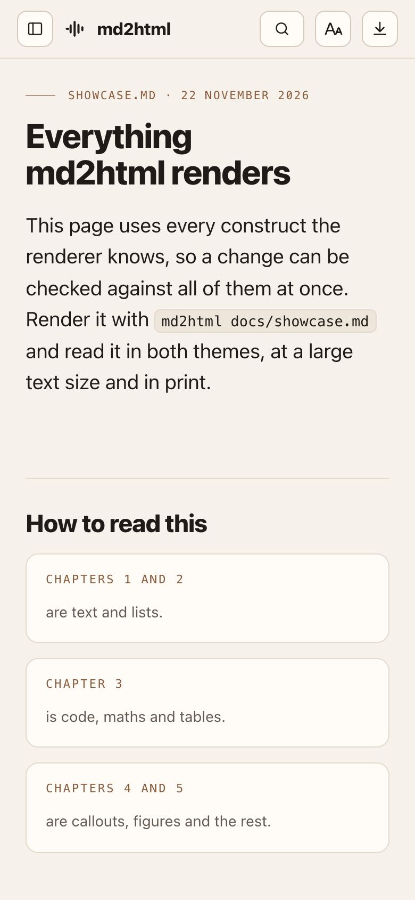
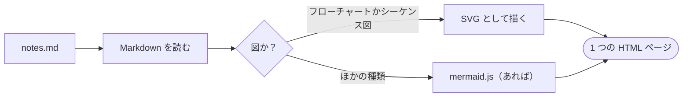
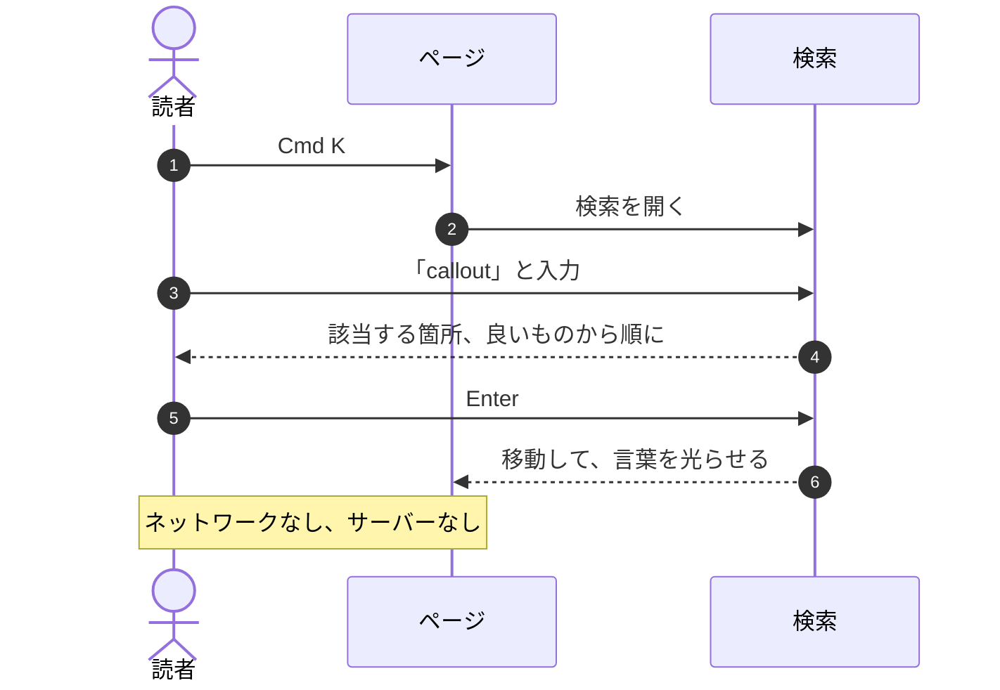
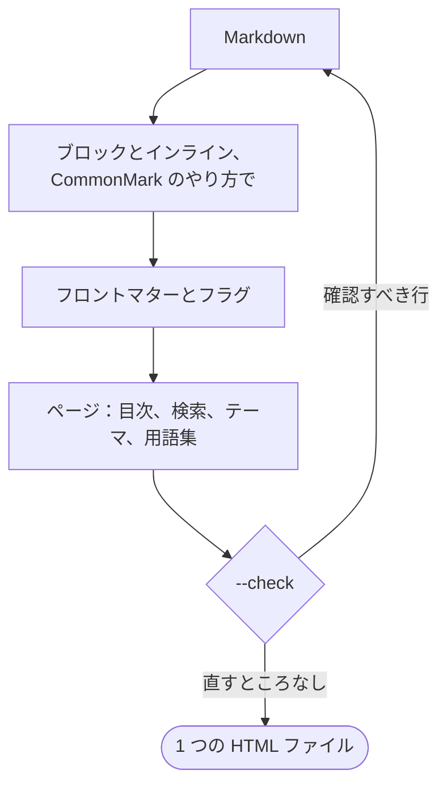

# md2html にできること、そのすべて

md2html は Markdown ファイルを、ほかに何も必要としない 1 つのウェブページに変換します。サーバーもネットワークもいらず、フォントやスクリプトをどこかから読み込むこともありません。ページには、目次、検索、ライトとダークのテーマ、文字の大きさ、用語集、脚注、拡大できる図版、色分けされたコード、組版された数式、ダイアグラムが最初から備わっています。このページは Markdown で書き、md2html で変換したので、ここで説明している機能はすべて、いま読んでいるこのページの上で働いています。

## このページの読み方

- **1 章**は、md2html が動く環境と、そのインストールの方法です。
- **2 章**は、すべてを 1 つの表にまとめたものです。
- **3〜9 章**では、読む人に何が見えるか、そして書く人がそのために何を書けばよいかを示します。
- **10〜12 章**は、設定、コマンドライン、そして安全性と品質です。

---

## 1. 動作環境

| | 環境 |
|:--|:--|
| md2html ツール | macOS（Apple シリコンと Intel）、Linux、Windows。標準ライブラリ以外に依存しない 1 つの Rust プログラムです。変更のたびに 3 つすべてでテストしています |
| 作られるページ | 最新の Chrome、Edge、Firefox、Safari。コンピューター、タブレット、スマートフォンで、オンラインでもオフラインでも使えます。スクリーンリーダーとキーボードにも全体で対応しています |
| 開く場所 | ウェブサーバー、共有フォルダー、メールの添付ファイル、あるいはディスクから直接。ページは 1 つのファイルです |
| 印刷または PDF として保存 | どのブラウザからでも、専用の印刷レイアウトで。`--pdf` は、コンピューターにすでにある Chrome、Chromium、Edge を使って PDF そのものを作ります |
| 電子書籍リーダー | `--epub` は、電子書籍の標準形式である EPUB 3 を作ります |
| ページの言語 | 17 の言語。右から左に書く言語も含みます（8 章） |

Rust 自身のインストーラーで、ソースからインストールします。

```console
$ cargo install --git https://github.com/githubrobbi/md2html md2html --locked
$ md2html notes.md
md2html: notes.md -> notes.html (68504 bytes, 9 glossary terms, 0 of them shared)
```

## 2. 概要

| | md2html |
|:--|:--|
| Markdown | CommonMark 0.31.2 のすべて（テストの例 **652 件中 640 件** に合格）と、GitHub の表、タスクリスト、取り消し線、自動リンク、脚注、アラート |
| 出力 | **1 つの HTML ファイル**。何も読み込まず、読者が何かをインストールする必要もありません |
| 読む | 目次、検索、ライトとダークのテーマ、文字の大きさ、用語集、脚注、拡大できる図版 |
| コード、数式、ダイアグラム | 約 20 の言語のコードの色分け、MathML による数式、SVG として描く Mermaid のフローチャートとシーケンス図。**どれもスクリプトのライブラリなし** |
| 共有 | どの章、表の行、図版、ダイアグラム、コードブロック、選択した一節へのリンクでも |
| 言語 | ページ自身の文言を **17 の言語** で。翻訳どうしは切り替えでつながり、ヘブライ語とイディッシュ語は右から左に組まれます |
| 保存 | ページそのもの、しおり付きの **PDF**、電子書籍リーダー用の **EPUB** |
| ライブ | Markdown が変わると読み込み直し、読者の位置を保つページ |
| 安全性 | 本文からスクリプトを作ることは決してなく、文書のフォルダーの外にあるファイルを読むこともありません |
| アクセシビリティ | WCAG 2.2 AA に対する指摘はゼロ。両方のテーマで、スマートフォンの幅でも |
| 速度 | ダイアグラムと数式を含む 4,000 行の文書を **0.1 秒未満** で |
| 依存関係 | **なし**。Rust の標準ライブラリと md2html だけです |

## 3. ページ

ページは 3 つの部分からなります。上端のバー、左の目次、そして本文です。

{width=100%}

ダークテーマはシステムの設定か読者の選択に従い、その選択は記憶されます。

{width=100%}

スマートフォンでは、目次はバーのスイッチの奥にたたまれ、横にスクロールするものはありません。

{width=34%}

読者ができること:

| したいこと | 操作 |
|:--|:--|
| 何かを探す | バーの **検索**、<kbd>⌘</kbd> <kbd>K</kbd>（<kbd>Ctrl</kbd> <kbd>K</kbd>）、または <kbd>/</kbd> |
| 目次を隠す・表示する | バーの左にあるスイッチ、または <kbd>⌘</kbd> <kbd>\\</kbd> |
| 文字の大きさを変える | バーの **Aa** から **−** と **+**。または <kbd>⌘</kbd> <kbd>+</kbd> と <kbd>⌘</kbd> <kbd>−</kbd>。85 から 200 パーセントまで |
| テーマを変える | **Aa** から、システム、ライト、ダーク |
| 図版を拡大する | クリックします。さらに 2 回クリックすると近づき、<kbd>Esc</kbd> で元に戻ります |
| 脚注や点線付きの語を読む | ポインタを置きます。クリックするとそこへ移動し、**戻る** で戻ります |
| 章、表の行、図版、ダイアグラム、コードブロック、一節を共有する | 見出しの右側、ポインタの下にある表の行の末尾、またはポインタの下にある図版、ダイアグラム、コードブロックの隅の共有記号で、そのリンクをコピーします（スマートフォンでは共有シートが開きます）。語句を選択すると、ちょうどその部分へのリンクが提案されます |
| 保存する | バーの最後にあるダウンロードボタンから、このページそのもの（オフラインで読めます）、印刷または PDF として保存、あるいは作成されていれば PDF と EPUB |

文字の大きさとテーマは **Aa** の奥にまとめてあり、ページの保存には専用のボタンがあります。

{width=60%}

## 4. 書き方

普通の Markdown です。どの書き方も、そのままテキストとして読んでも読みやすくなっています。まず書く内容をコードブロックで示し、その後に結果を示します。

### 強調とリンク

```markdown
**太字**、*斜体*、***両方***、~~取り消し線~~、`コード`。
[リンク](https://commonmark.org "CommonMark")、[V] のように書いたままになる記号、
そしてむき出しのリンク https://spec.commonmark.org/0.31.2/
```

**太字**、*斜体*、***両方***、~~取り消し線~~、`コード`。[リンク](https://commonmark.org "CommonMark")、[V] のように書いたままになる記号、そしてむき出しのリンク https://spec.commonmark.org/0.31.2/

### リストの中のリスト

```markdown
1. 1 つ目。中にリストがあります:
   - 箇条書き
   - もう 1 つ。これにもリストがあります:
     1. さらに深く
2. 2 つ目。
- [x] 済んだタスク
- [ ] 残っているタスク
```

1. 1 つ目。中にリストがあります:
   - 箇条書き
   - もう 1 つ。これにもリストがあります:
     1. さらに深く
2. 2 つ目。

- [x] 済んだタスク
- [ ] 残っているタスク

### 引用とコールアウト

```markdown
> 普通の引用は引用のままです。

> [!TIP]
> GitHub のアラートが使えます。NOTE、TIP、IMPORTANT、WARNING、CAUTION。

> **メモ:** 古い形式、つまり太字の語とコロンも使えます。
```

> 普通の引用は引用のままです。

> [!TIP]
> GitHub のアラートが使えます。NOTE、TIP、IMPORTANT、WARNING、CAUTION。

> **メモ:** 古い形式、つまり太字の語とコロンも使えます。

### 表

```markdown
| 部屋     | 階   | 面積（平方フィート） |
|:---------|:----:|---------------------:|
| リビング | 1 階 |                  312 |
| ロフト   | 2 階 |                  205 |
```

| 部屋 | 階 | 面積（平方フィート） |
|:-------|:------:|-------------:|
| リビング | 1 階 | 312 |
| ロフト | 2 階 | 205 |

本文の幅より広い表はその中でスクロールし、ページ全体が横にスクロールすることはありません。

### 脚注

```markdown
出典が必要な主張です。[^1]

[^1]: 出典です。番号にポインタを置くと、そこで読めます。
```

出典が必要な主張です。[^source]

[^source]: 出典です。番号にポインタを置くと、そこで読めます。クリックするとここへ移動し、「戻る」で元の場所に戻ります。

### 図版と画像

```markdown
{width=60%}

文の中のアイコン {width=18} です。
```

{width=60%}

文の中のアイコン {width=18} です。

### 細かいこと

```markdown
<kbd>Ctrl</kbd>+<kbd>K</kbd> を押します。水は H<sub>2</sub>O、部屋は 9 m<sup>2</sup>。
バックスラッシュで終わる行は\
そこで改行されます。
```

<kbd>Ctrl</kbd>+<kbd>K</kbd> を押します。水は H<sub>2</sub>O、部屋は 9 m<sup>2</sup>。バックスラッシュで終わる行は\
そこで改行されます。

<details>
<summary>クリックすると開くセクション</summary>

`<details>` と `<summary>` で書き、中は普通の Markdown です。**太字**、リスト、

- 1 つ目
- 2 つ目

</details>

#### 第 4 レベルの見出し

第 3 レベルより下の見出しは、この見出しのように目次に入りません。

## 5. コード、数式、ダイアグラム

コードは Rust、Python、JavaScript と TypeScript、Go、C と C++、Java、Kotlin、Swift、C#、シェル、SQL、Ruby、Lua、PHP、CSS、HTML、JSON、YAML、TOML、Dockerfile、diff で色分けされ、どのブロックにもコピーボタンが付きます。

```rust
/// The whole page from one Markdown text.
fn main() {
    let page = md2html::render("# Hello\n\nWorld.", &Settings::default());
    println!("{} bytes, nothing to fetch", page.len()); // one file
}
```

```python
@cache
def area(w: float, h: float) -> float:
    """The area of a room."""
    return w * h  # square feet
```

```diff
- every quotation a note
+ a quotation is a quotation; a bold first word makes it a note
```

数式はブラウザ自身が MathML として組版します。スクリプトも、ダウンロードするフォントもいりません。文中では、ピタゴラスの定理は $a^2 + b^2 = c^2$、オイラーの等式は $e^{i\pi} + 1 = 0$ となります。$5 や $10 のような金額はお金のままです。別の行に立てると次のようになります。

$$
\int_0^1 x^2 \, dx = \frac{1}{3} \qquad \sum_{k=1}^{n} k = \frac{n(n+1)}{2} \qquad \sqrt[3]{27} = 3
$$

$$
\begin{pmatrix} a & b \\ c & d \end{pmatrix}
\begin{pmatrix} x \\ y \end{pmatrix}
=
\begin{pmatrix} ax + by \\ cx + dy \end{pmatrix}
\qquad
|x| = \begin{cases} x & x \ge 0 \\ -x & x < 0 \end{cases}
$$

### ダイアグラム

Mermaid のフローチャートやシーケンス図は、md2html 自身がページの中に SVG として描きます。スクリプトも、ダウンロードするものもなく、どちらのテーマでもページ自身の色を使います。図の中の言葉は言葉のままなので、検索で見つかります。Markdown はこう書きます。

````markdown

````

そして、こうなります。



番号とメモの付いたシーケンス図です。



ほかの種類（円グラフ、ガントチャート、クラス図）は、作者が md2html に mermaid.js のコピーを指定したとき（`--mermaid-js FILE`）に、mermaid.js が描きます。そのとき、スクリプトはそのページにだけ入ります。指定がなければコードのまま残り、`--check` がそれを知らせます。

## 6. 用語集、脚注、検索、図版

「用語集」という名前の章には、ページの言葉が表としてまとめられています。この表はその場所には表示されません。代わりに、各章でそれぞれの用語が最初に出てくるところが点線付きの語になり、ポインタを置くと意味が表示されます。クリックするとページの末尾の項目へ移動し、そこから読んでいた行へ戻れます。

{width=70%}

脚注も同じように働きます。番号にポインタを置くと、内容が表示されます。

{width=70%}

> [!NOTE]
> 用語集は複数のページで共有できます。`~/.config/md2html/glossary.md` という 1 つのファイルに書くと、その言葉は、そのコンピューターで変換するすべてのページでリンクになります。

検索は、用語集も含めてページのすべての言葉が対象です。結果にはそれぞれの言葉がどこにあるかが表示され、選んだ結果は移動した先で光ります。

{width=80%}

{width=80%}

図版は、ページを離れずにページの上で拡大されます。ウィンドウより大きいときはポインタの動きについてくるので、見たいところを指すだけです。

## 7. 共有とライブページ

どの見出しにも右側に共有記号があり、表の行、図版、ダイアグラム、コードブロックには、ポインタを置くと共有記号が現れます。クリックするとちょうどその場所へのリンクがコピーされ、そのことが表示されます。スマートフォンでは、代わりにシステムの共有シートが開きます。いくつかの語句を選択すると、ちょうどその部分へのリンクが提案されます。そのリンクを開くと、その一節が強調された状態でページが開きます。

{width=80%}

ページは自分で最新の状態を保つこともできます。`md2html --serve` は、書いている間、このコンピューター上でページを表示し、Markdown を保存した瞬間に、開いているページがすべて読み込み直されます。`--live` 付きで公開したページには、それ自身の有効期間があります。期間が切れると、ページは自分のサーバーに、フィンガープリントが入っている自分自身の最初の 1 キロバイトを問い合わせ、それが変わっていたときだけ読み込み直します。どちらの場合も、読者はいた場所にとどまります。同じ段落が同じ高さに来るか、その段落がなくなっていれば、その前の章に戻ります。別の言語に切り替えたときも、同じように位置が保たれます。

## 8. 言語

ページ自身の文言（検索、コールアウト、用語集、日付、すべてのボタン）は 17 の言語で用意されています。英語、ドイツ語、ヘブライ語、インドネシア語、オランダ語、ジャワ語、イディッシュ語、低地ドイツ語、フランス語、イタリア語、スペイン語、3 通りの書き方の日本語（漢字かな交じり、かなのみ、ローマ字）、簡体字と繁体字の中国語（普通話）、そして広東語です。フロントマターに `lang: de` と書くだけで切り替わります。ヘブライ語とイディッシュ語は右から左に組まれ、目次は右側に来ます。

翻訳は、原文の隣に置いた、言語の名前を付けた別の Markdown ファイルにすぎません。`capabilities.de.md` は `capabilities.md` のドイツ語版です。md2html はそこにある版を見つけ、バーの切り替え（地球儀）で互いにリンクし、ブラウザと検索エンジンには `hreflang` で知らせ、それぞれにその言語の画面の文言を与えます。このページは 17 の言語すべてで読めます。地球儀で切り替えると、ページは読んでいた段落で開きます。

それぞれの翻訳には原文の名前と原文のフィンガープリントが記録されるので、ページはどの版が正式なものかを示せます。また、翻訳したあとで原文が変わると、`--check` がそれに気づきます。

```yaml
translated_from: capabilities.md
source_sha256: 5b0c...e1
```

まだ誰もページを翻訳していない言語については、読者のブラウザにその機能があれば（Chrome に組み込まれた翻訳機能）、ブラウザが翻訳できます。翻訳は端末の中で行われるので、何も外に出ることはありません。機械翻訳であることが示され、原文に戻る方法も付きます。

## 9. ページの保存

バーのダウンロードボタンには、保存できるものが並びます。ページそのものは、画像が中に入っていれば（`embed: true`）オフラインで読めます。印刷には専用のレイアウトがあります。操作部分は消え、すべてのリンクはアドレスが印刷され、ページの境目で切れるものはなく、各ページにはタイトルとページ番号が入ります。

{width=55%}

`--pdf` は、コンピューターにすでにある Chrome でページを印刷します。ページ自身の印刷用レイアウトで、見出しは PDF のしおりになり、各ページの上にタイトル、下にページ番号が入ります。`--epub` は同じページから電子書籍リーダー用の本を作ります。章の一覧、画像、ダイアグラム、数式が入り、脚注は言及された場所で開きます。EPUB は md2html が自分で書き出します。読者は両方をダウンロードボタンの中に見つけられます。

## 10. 設定

このページの英語の原文の Markdown ファイルは、先頭がこうなっています。

```yaml
---
title: md2html, everything it does
brand: md2html
kicker: Capabilities
version: 0.7.6
date: 2026-11-22
footer: Written in Markdown and rendered by **md2html 0.7.6** itself ...
csp: true      # only this page's own code may run
embed: true    # the screenshots are inside the page
---
```

| 設定 | 働き |
|:--|:--|
| `title`, `description`, `author` | タイトルと、リンクのプレビュー用のメタタグ |
| `lang` | 言語。ページ自身の文言と日付を、17 の言語のどれにでもします（`ja-Hira` はかなだけの日本語、`zh-Hant` は繁体字の中国語、`yue` は広東語） |
| `translated_from`, `source_sha256` | 翻訳の場合に、その原文と、翻訳した時点の原文のフィンガープリント |
| `brand`, `brand_link`, `kicker`, `eyebrow`, `footer` | バー、タイトルの上の行、末尾の小さな文字 |
| `date`, `version` | タイトルの上に表示する日付とバージョン |
| `embed` | 画像をページの中に入れて、1 つのファイルにする |
| `csp` | Content-Security-Policy |
| `pdf`, `epub` | ページの横に置く、そのページの PDF と EPUB |
| `live` | ページの有効期間（`true` は 2 分、または秒数）。期間が過ぎると、変わっていれば読み込み直し、読者の位置はそのまま |
| `large`, `toc`, `math`, `index`, `html`, `css`, `head` | 大きな文字、目次、数式、検索エンジン、より豊かな HTML、追加のスタイルと head |

> [!TIP]
> `lang: de` にすると、検索欄には「Diese Seite durchsuchen」、コールアウトには「Hinweis」や「Achtung」と表示され、日付は「22. November 2026」になります。

## 11. コマンドライン

```console
$ md2html notes.md
md2html: notes.md -> notes.html (68504 bytes, 9 glossary terms, 0 of them shared)
$ md2html docs/ -o site/ --nav
$ md2html notes.md --check
notes.md:12: a link points at #setup, which is nowhere on the page
notes.md:30: `plan.svg` does not exist next to this page
md2html: 2 to look at
$ cat notes.md | md2html - > notes.html
$ md2html notes.md --pdf --epub
$ md2html notes.md --serve
```

`--check` は何も書き出さず、作者が確認すべき点を行ごとに一覧にし、何かあれば終了コード 1 で終わります。ページにないアンカーへのリンク、存在しないファイル、注のない脚注、テキストとして表示されてしまう生の HTML、原文より古い翻訳などです。そのため、ビルドやエージェントの作業の最後の手順に向いています。`--watch` は保存するたびに変換し直し、`--nav` はフォルダーの中のページを「前へ」と「次へ」でつなぎます。別の Markdown ファイルへのリンクは、そのページへのリンクになります。

## 12. 安全性、品質、アクセシビリティ

> [!WARNING]
> ページは、他の人が書いた Markdown から変換されることもあります。md2html が本文からスクリプトを書き出すことはありません。生の HTML は、いくつかの無害なタグを除いて書かれたとおりに表示され、`javascript:` や `data:` のリンクは、どのような綴りで書かれていても取り除かれます。文書が md2html に、そのフォルダーの外にあるファイルを読ませることはできません。また、どれほど悪意のある入力でも、md2html を止めたりクラッシュさせたりすることはできません。

> [!CAUTION]
> `--html` を付けると、より豊かな HTML（画像、リンク、動画、SVG、レイアウト）が通りますが、実行されるものは決して通りません。スクリプトも、イベントハンドラーも、フレームも、フォームも通りません。

変更のたびに、macOS、Linux、Windows で確認していること:

- ページ全体を変換して読み返す 79 のテスト。セキュリティのケースや、極端な入力のケースも含みます。
- CommonMark の仕様にある 652 の例。合格する数は増えることはあっても、減ることはありません。
- clippy の最も厳しい lint と、このツールがビルドできると約束している最も古い Rust。
- axe-core による WCAG 2.2 AA のアクセシビリティの監査。両方のテーマで、スマートフォンの幅でも行います。
- Chrome で、読者と同じようにマウスとキーボードですべての操作を試すクリックテスト。普通の文字の大きさと、より大きな文字の大きさで行います。
- ライブページの端から端までの確認。変更時の読み込み直し、読者の位置の保持、同じ段落に着地する言語の切り替えです。

md2html にはサードパーティーのコードがなく、そのサプライチェーンは固定され、検証されています。ツールチェーン、CI のアクション、テストツールです。どのページも、控えめな 1 行で終わります。md2html で作成したこと、そのバージョン、そして md2html の置き場所へのリンクです。

どのページもたどる道筋はこうです。



---

下の用語集では、このページで使っている言葉を説明します。どれも、上では点線付きの語になっていたものです。

## 用語集

| 用語 | 意味 | 別名 |
|---|---|---|
| Markdown | 見出し、強調、リスト、リンクを軽い記号で表すプレーンテキスト。そのままで読め、ページに変換することもできます。 | |
| CommonMark | 今ではほとんどのツールが従っている Markdown の仕様で、規則ごとにテストがあります。 | |
| 目次 | ページの左にある章の一覧で、見出しから作られます。 | |
| コールアウト | 枠で囲んだ補足。メモ、ヒント、重要なこと、警告、注意のいずれかです。 | アラート |
| 図版 | 1 行を占める画像で、下にキャプションが付き、クリックすると拡大します。 | |
| フロントマター | Markdown ファイルのいちばん上の、2 本の `---` の行の間にある設定のブロック。 | |
| MathML | ウェブ自身の数式の言語で、ブラウザがスクリプトなしで描きます。 | |
| Content-Security-Policy | どのコードの実行を許すかをブラウザに伝える、ページの中の規則。ここではページ自身のコードだけです。 | |
| Mermaid | コードブロックに書く、図のためのテキストの言語。md2html はそのフローチャートとシーケンス図を描きます。 | |
| WCAG | Web Content Accessibility Guidelines（ウェブコンテンツのアクセシビリティのガイドライン）。ふつうの目標はレベル AA です。 | |
| 翻訳 | ページを別の言語で書いた版で、原文の隣に置く Markdown ファイルです。 | |
| EPUB | 電子書籍の標準形式。電子書籍リーダーがレイアウトする、パッケージにまとめたウェブページです。 | |
