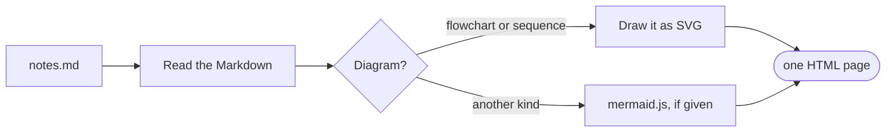
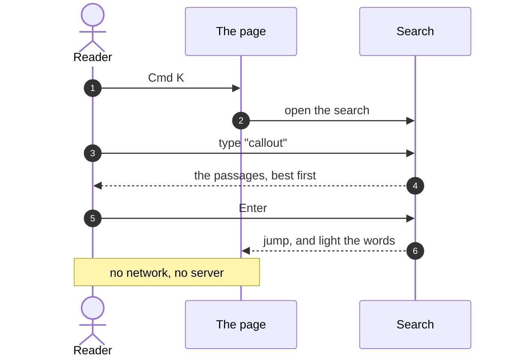
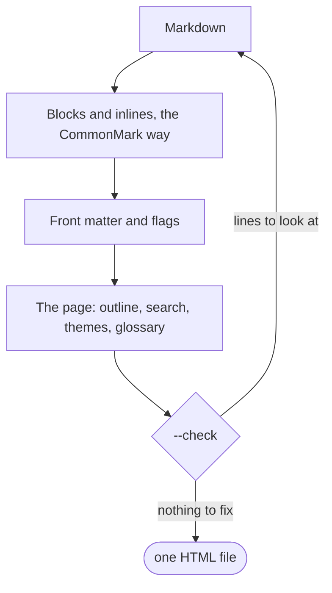

# md2html, everything it does

md2html turns a Markdown file into one web page that needs nothing else: no server, no network, no fonts or scripts from anywhere. The page brings its own outline, search, light and dark themes, text size, glossary, footnotes, figures that enlarge, coloured code, typeset maths and diagrams. This page was written in Markdown and rendered by md2html, so everything it describes is at work on it as you read.

## How to read this

- **Chapter 1** is where md2html runs, and how to install it.
- **Chapter 2** is everything in one table.
- **Chapters 3 to 9** show what a reader gets, and what a writer types to get it.
- **Chapters 10 to 12** are the settings, the command line, and safety and quality.

---

## 1. Where it runs

| | Where |
|:--|:--|
| The md2html tool | macOS (Apple silicon and Intel), Linux and Windows, from one Rust program with no dependencies beyond the standard library; tested on all three on every change |
| The pages it makes | current Chrome, Edge, Firefox and Safari, on computers, tablets and phones, online or offline; screen readers and the keyboard throughout |
| Opened from | a web server, a shared folder, an email attachment, or straight from the disk: the page is one file |
| Printed or saved as PDF | from any browser, with a print layout of its own; `--pdf` makes the PDF itself, with the Chrome, Chromium or Edge already on the computer |
| E-readers | `--epub` makes an EPUB 3, the standard e-book format |
| Languages of the page | seventeen, right to left included (chapter 8) |

Install with Rust's own installer, from the source:

```console
$ cargo install --git https://github.com/githubrobbi/md2html md2html --locked
$ md2html notes.md
md2html: notes.md -> notes.html (68504 bytes, 9 glossary terms, 0 of them shared)
```

## 2. At a glance

| | md2html |
|:--|:--|
| Markdown | all of CommonMark 0.31.2 (**640 of its 652** test examples pass), and GitHub's tables, task lists, strikethrough, autolinks, footnotes and alerts |
| Output | **one HTML file**, nothing fetched, nothing to install for the reader |
| Reading | outline, search, light and dark themes, text size, glossary, footnotes, figures that enlarge |
| Code, maths, diagrams | code coloured in some twenty languages, maths as MathML, Mermaid flowcharts and sequence diagrams drawn as SVG, **all without a script library** |
| Sharing | a link to any chapter, table row, figure, diagram, code block, or selected passage |
| Languages | the page's own words in **17 languages**, translations linked by a switch, right to left for Hebrew and Yiddish |
| Keeping | the page itself, a **PDF** with bookmarks, an **EPUB** for e-readers |
| Live | pages that reload when their Markdown changes and keep the reader's place |
| Safety | no script from the text, ever; no file read outside the document's folder |
| Accessibility | no findings against WCAG 2.2 AA, in both themes and at phone width |
| Speed | a 4,000-line document, diagrams and maths included, in **under a tenth of a second** |
| Dependencies | **none**: the Rust standard library and md2html |

## 3. The page

The page has three parts: a bar along the top, the outline at the left, and the text.

{width=100%}

The dark theme follows the system, or the reader's choice, and is remembered:

{width=100%}

On a phone the outline folds away behind the switch in the bar, and nothing scrolls sideways:

{width=34%}

What a reader can do:

| To | Do this |
|:--|:--|
| Find something | **Search** in the bar, <kbd>⌘</kbd> <kbd>K</kbd> (<kbd>Ctrl</kbd> <kbd>K</kbd>), or <kbd>/</kbd> |
| Hide or show the outline | the switch at the left of the bar, or <kbd>⌘</kbd> <kbd>\\</kbd> |
| Change the text size | **Aa** in the bar, then **−** and **+**; or <kbd>⌘</kbd> <kbd>+</kbd> and <kbd>⌘</kbd> <kbd>−</kbd>, from 85 to 200 percent |
| Change the theme | **Aa**, then System, Light or Dark |
| Enlarge a figure | click it; two more clicks bring it closer; <kbd>Esc</kbd> puts it back |
| Read a footnote or a dotted word | rest on it; click to go to it, and **back** returns |
| Share a chapter, a table row, a figure, a diagram, a code block or a passage | the share symbol to the right of a heading, at the end of the table row under the pointer, or in the corner of the figure, diagram or code block under it, copies its link (a phone opens its share sheet); select words, and a link to exactly them is offered |
| Keep it | the download button at the end of the bar: the page itself (it reads offline), print or save as PDF, or the PDF and the EPUB where they were made |

The text size and the theme sit together behind **Aa**; keeping the page has its own button:

{width=60%}

## 4. Writing

Ordinary Markdown, and each construct reads well as plain text too. What you write comes first, in a code block; what you get follows it.

### Emphasis and links

```markdown
**Bold**, *italic*, ***both***, ~~struck~~ and `code`.
A [link](https://commonmark.org "CommonMark"), a bare one,
https://spec.commonmark.org/0.31.2/, and marks like [V] that stay as written.
```

**Bold**, *italic*, ***both***, ~~struck~~ and `code`. A [link](https://commonmark.org "CommonMark"), a bare one, https://spec.commonmark.org/0.31.2/, and marks like [V] that stay as written.

### Lists inside lists

```markdown
1. First, with a nested list:
   - a bullet
   - another, with its own:
     1. deeper
2. Second.
- [x] a task done
- [ ] a task open
```

1. First, with a nested list:
   - a bullet
   - another, with its own:
     1. deeper
2. Second.

- [x] a task done
- [ ] a task open

### Quotes and callouts

```markdown
> A plain quotation stays a quotation.

> [!TIP]
> GitHub's alerts work: NOTE, TIP, IMPORTANT, WARNING, CAUTION.

> **Note:** so does the older form, a bold word and a colon.
```

> A plain quotation stays a quotation.

> [!TIP]
> GitHub's alerts work: NOTE, TIP, IMPORTANT, WARNING, CAUTION.

> **Note:** so does the older form, a bold word and a colon.

### Tables

```markdown
| Room   | Floor  | Area (sq ft) |
|:-------|:------:|-------------:|
| Living | ground |          312 |
| Loft   | upper  |          205 |
```

| Room | Floor | Area (sq ft) |
|:-------|:------:|-------------:|
| Living | ground | 312 |
| Loft | upper | 205 |

A table wider than the column scrolls inside it, and the page never does.

### Footnotes

```markdown
A claim that needs a source.[^1]

[^1]: The source. Rest on the number to read it there.
```

A claim that needs a source.[^source]

[^source]: The source. Rest on the number to read it there; click it to come here, and back to return.

### Figures and images

```markdown
{width=60%}

An icon {width=18} inside a sentence.
```

{width=60%}

An icon {width=18} inside a sentence.

### Small things

```markdown
Press <kbd>Ctrl</kbd>+<kbd>K</kbd>. Water is H<sub>2</sub>O, the room 9 m<sup>2</sup>.
A line ending in a backslash\
breaks there.
```

Press <kbd>Ctrl</kbd>+<kbd>K</kbd>. Water is H<sub>2</sub>O, the room 9 m<sup>2</sup>. A line ending in a backslash\
breaks there.

<details>
<summary>A section that opens on a click</summary>

Written as `<details>` with a `<summary>`, with ordinary Markdown inside: **bold**, a list,

- one
- two

</details>

#### A fourth-level heading

Headings below the third level stay out of the outline, as this one does.

## 5. Code, maths and diagrams

Code is coloured for Rust, Python, JavaScript and TypeScript, Go, C and C++, Java, Kotlin, Swift, C#, the shell, SQL, Ruby, Lua, PHP, CSS, HTML, JSON, YAML, TOML, Dockerfiles and diffs, and every block has a copy button.

```rust
/// The whole page from one Markdown text.
fn main() {
    let page = md2html::render("# Hello\n\nWorld.", &Settings::default());
    println!("{} bytes, nothing to fetch", page.len()); // one file
}
```

```python
@cache
def area(w: float, h: float) -> float:
    """The area of a room."""
    return w * h  # square feet
```

```diff
- every quotation a note
+ a quotation is a quotation; a bold first word makes it a note
```

Maths is typeset by the browser itself, as MathML, with no script and no font to download. Inline, the theorem of Pythagoras is $a^2 + b^2 = c^2$, and Euler's identity is $e^{i\pi} + 1 = 0$; a dollar amount such as $5 or $10 stays money. Displayed:

$$
\int_0^1 x^2 \, dx = \frac{1}{3} \qquad \sum_{k=1}^{n} k = \frac{n(n+1)}{2} \qquad \sqrt[3]{27} = 3
$$

$$
\begin{pmatrix} a & b \\ c & d \end{pmatrix}
\begin{pmatrix} x \\ y \end{pmatrix}
=
\begin{pmatrix} ax + by \\ cx + dy \end{pmatrix}
\qquad
|x| = \begin{cases} x & x \ge 0 \\ -x & x < 0 \end{cases}
$$

### Diagrams

A Mermaid flowchart or sequence diagram is drawn by md2html itself, as SVG inside the page: no script, nothing to download, the page's own colours in both themes, and its words stay words that search finds. This is the Markdown:

````markdown

````

And this is what it becomes:



A sequence diagram, numbered, with a note:



Other kinds (pie charts, Gantt charts, class diagrams) are drawn by mermaid.js when the author points md2html at a copy of it (`--mermaid-js FILE`); the script then goes into that page only. Without it, they stay as code, and `--check` says so.

## 6. Glossary, footnotes, search and figures

A chapter called Glossary holds the page's words as a table. It is not printed where it stands: instead, the first mention of each term in every chapter becomes a dotted word that explains itself on hover, and a click on it jumps to the entry at the foot, which leads back to the line you were reading.

{width=70%}

Footnotes work the same way: the number explains itself on hover.

{width=70%}

> [!NOTE]
> A glossary can be shared across pages: one file at `~/.config/md2html/glossary.md`, whose words then link on every page rendered on that computer.

Search covers every word on the page, the glossary included. The results show where each word stands; the chosen one is lit where the search lands.

{width=80%}

{width=80%}

A figure enlarges over the page without leaving it. Larger than the window, it follows the pointer, so you point at what you want to see.

## 7. Sharing and live pages

Every heading carries a share symbol to its right; every table row, figure, diagram and code block shows one under the pointer. A click copies a link to exactly that place, and says so; on a phone the system's share sheet opens instead. Select a few words, and the page offers a link to exactly them, which opens the page on that passage, highlighted.

{width=80%}

A page can also keep itself current. `md2html --serve` shows the pages on this computer while they are written, and every open page reloads the moment its Markdown is saved. A published page made with `--live` has its own time to live: when it runs out, the page asks its server for the first kilobyte of itself, where its fingerprint is, and reloads only if that changed. Either way the reader stays where they were: the same paragraph at the same height, or, if it is gone, the chapter before it; switching to another language keeps the place the same way.

## 8. Languages

The page's own words (the search, the callouts, the glossary, the dates, every button) come in seventeen languages: English, German, Hebrew, Indonesian, Dutch, Javanese, Yiddish, Low German, French, Italian, Spanish, Japanese written three ways (in kanji and kana, in kana alone, and in rōmaji), Mandarin Chinese in simplified and in traditional characters, and Cantonese. `lang: de` in the front matter is all it takes. Hebrew and Yiddish are laid out right to left, the outline on the right.

A translation is simply another Markdown file beside the original, named for its language: `capabilities.de.md` is the German `capabilities.md`. md2html finds the versions there are, links them to each other with a switch in the bar (the globe), tells browsers and search engines with `hreflang`, and gives each the words of its own interface. This page exists in all seventeen; the globe switches between them, and the page opens at the paragraph you were reading.

Each translation names its original and records the original's fingerprint, so the page can say which version is the authoritative one, and `--check` notices when the original has changed since the translation was made:

```yaml
translated_from: capabilities.md
source_sha256: 5b0c...e1
```

For a language nobody has translated a page into, the reader's own browser can translate it, where it has that ability (Chrome's built-in translator): on the device itself, so nothing leaves it, labelled as a machine translation, with a way back to the original.

## 9. Keeping a page

The download button in the bar offers what there is to keep. The page itself reads offline when its images are inside it (`embed: true`). Print gets its own layout: the controls drop away, every link prints its address, nothing is cut across a page, and the pages carry the title and their number.

{width=55%}

`--pdf` prints the page with the Chrome already on the computer: its own print layout, the headings as the PDF's bookmarks, the title at the head of each page and its number at the foot. `--epub` makes a book for e-readers from the same page, with its contents, images, diagrams and maths, and footnotes that open where they are mentioned; md2html writes it itself. The reader finds both under the download button.

## 10. Settings

The top of this page's own Markdown file reads:

```yaml
---
title: md2html, everything it does
brand: md2html
kicker: Capabilities
version: 0.7.7
date: 2026-11-22
footer: Written in Markdown and rendered by **md2html 0.7.7** itself ...
csp: true      # only this page's own code may run
embed: true    # the screenshots are inside the page
---
```

| Setting | What it does |
|:--|:--|
| `title`, `description`, `author` | the title, and the meta tags for link previews |
| `lang` | the language: the page's own words and dates in any of the seventeen (`ja-Hira` is Japanese in kana, `zh-Hant` Chinese in traditional characters, `yue` Cantonese) |
| `translated_from`, `source_sha256` | for a translation: its original, and the original's fingerprint when it was translated |
| `brand`, `brand_link`, `kicker`, `eyebrow`, `footer` | the bar, the line above the title, the fine print |
| `date`, `version` | the date and version shown above the title |
| `embed` | images inside the page, so it is one file |
| `csp` | a Content-Security-Policy |
| `pdf`, `epub` | a PDF and an EPUB of the page, beside it |
| `live` | the page's time to live (`true` is two minutes, or a number of seconds): then it reloads if it changed, keeping the reader's place |
| `large`, `toc`, `math`, `index`, `html`, `css`, `head` | larger type, the outline, maths, search engines, richer HTML, extra style and head |

> [!TIP]
> With `lang: de` the search says "Diese Seite durchsuchen", the callouts say "Hinweis" and "Achtung", and the date reads "22. November 2026".

## 11. The command line

```console
$ md2html notes.md
md2html: notes.md -> notes.html (68504 bytes, 9 glossary terms, 0 of them shared)
$ md2html docs/ -o site/ --nav
$ md2html notes.md --check
notes.md:12: a link points at #setup, which is nowhere on the page
notes.md:30: `plan.svg` does not exist next to this page
md2html: 2 to look at
$ cat notes.md | md2html - > notes.html
$ md2html notes.md --pdf --epub
$ md2html notes.md --serve
```

`--check` writes nothing and lists what an author should look at, line by line, and exits 1 when there is anything: a link to an anchor that is not on the page, a file that is not there, a footnote without its note, raw HTML shown as text, a translation older than its original. That makes it the last step of a build, or of an agent's work. `--watch` renders again on every save, `--nav` links the pages of a folder with previous and next, and a link to another Markdown file goes to its page.

## 12. Safety, quality and accessibility

> [!WARNING]
> A page can be rendered from Markdown someone else wrote. md2html never writes a script from the text: raw HTML is shown as written except a few harmless tags, and `javascript:` or `data:` links are dropped, however they are spelled. A document cannot make md2html read a file outside its folder, and no input, however hostile, can stall it or make it crash.

> [!CAUTION]
> `--html` lets richer HTML through (images, links, video, SVG, layout), but never anything that runs: no script, no event handler, no frame, no form.

What is checked on every change, on macOS, Linux and Windows:

- 79 tests that render whole pages and read them back, the security and the pathological cases among them;
- the 652 examples of the CommonMark specification, of which the count passing may rise but never fall;
- clippy's strictest lints, and the oldest Rust the tool promises to build on;
- an accessibility audit with axe-core against WCAG 2.2 AA, in both themes and at phone width;
- a click-through in Chrome that uses every control the way a reader would, by mouse and by keyboard, at the normal and a larger text size;
- live pages, end to end: a reload on a change, the reader's place kept, a language switch that lands on the same paragraph.

md2html has no third-party code, and its supply chain is pinned and vetted: the toolchain, the CI actions, the test tools. Every page ends with one quiet line: made with md2html, its version, and a link to where md2html lives.

The path every page takes:



---

The glossary below explains the words this page uses; each was a dotted word above.

## Glossary

| Term | Meaning | Also |
|---|---|---|
| Markdown | Plain text with light marks for headings, emphasis, lists and links, readable as it is and convertible to a page. | |
| CommonMark | The specification of Markdown that most tools now follow, with a test for every rule. | |
| outline | The list of chapters at the left of the page, made from its headings. | |
| callout | A boxed aside: a note, a tip, something important, a warning or a caution. | callouts, alert, alerts |
| figure | An image on a line of its own, with its caption under it, enlarged on a click. | figures |
| front matter | The block of settings between two `---` lines at the very top of a Markdown file. | |
| MathML | The web's own language for maths, drawn by the browser without a script. | |
| Content-Security-Policy | A rule in the page that tells the browser which code may run; here, only the page's own. | |
| Mermaid | A text language for diagrams, written in a code block; md2html draws its flowcharts and sequence diagrams. | |
| WCAG | The Web Content Accessibility Guidelines; level AA is the usual target. | |
| translation | A version of a page in another language, a Markdown file beside the original. | translations |
| EPUB | The standard format for e-books, a packaged web page that e-readers lay out. | |
