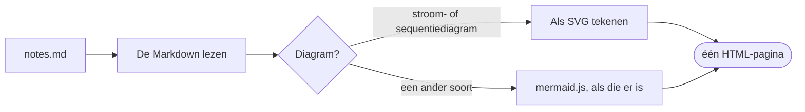
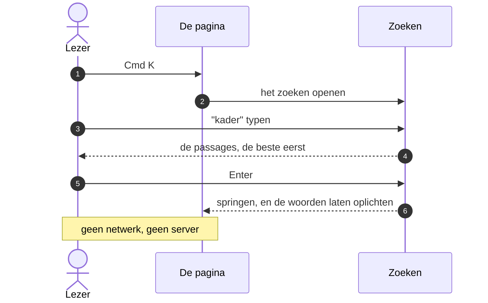
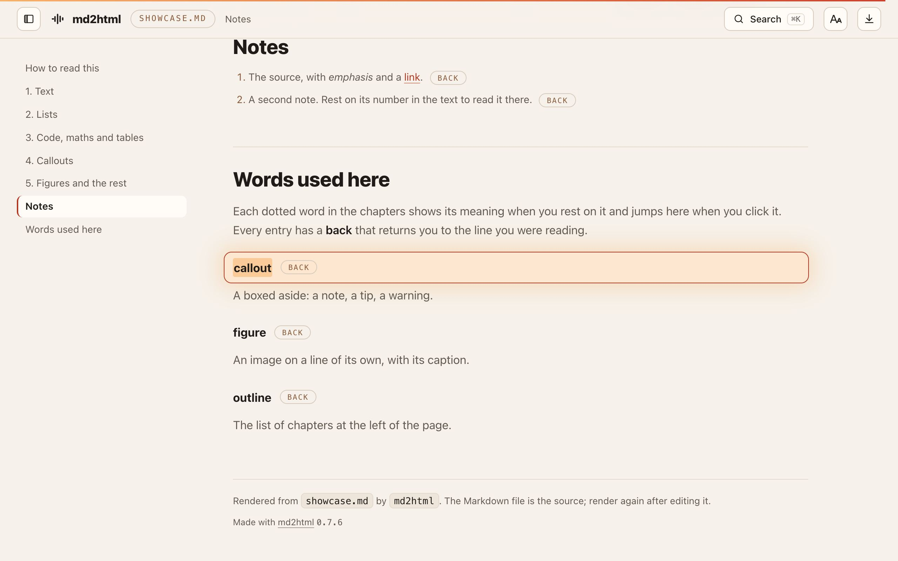
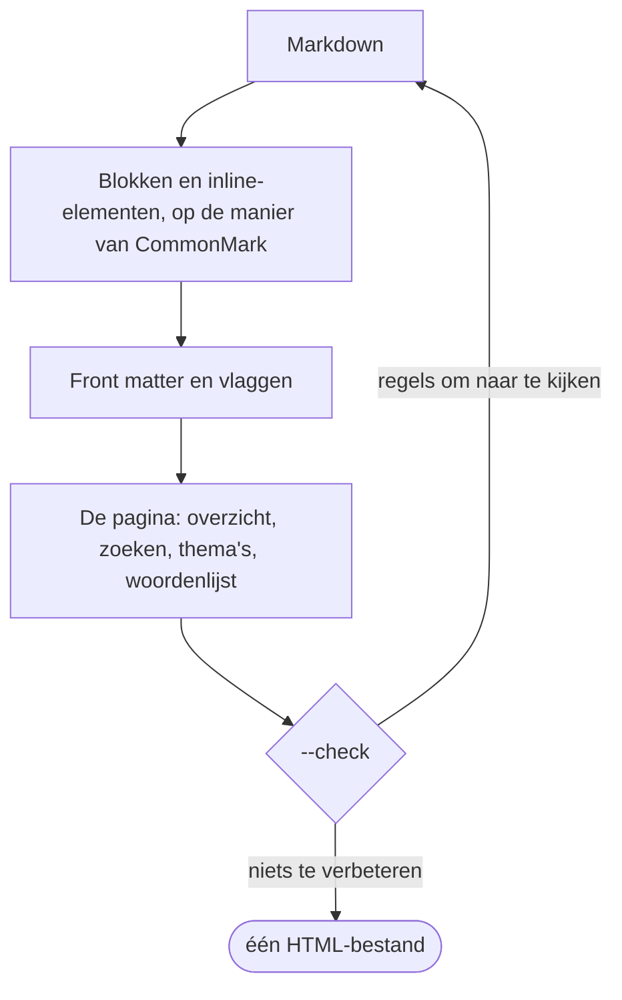

# md2html, alles wat het doet

md2html maakt van een Markdown-bestand één webpagina die verder niets nodig heeft: geen server, geen netwerk, geen lettertypen of scripts van elders. De pagina brengt haar eigen overzicht mee, zoeken, een licht en een donker thema, tekstgrootte, woordenlijst, voetnoten, figuren die groter worden, gekleurde code, netjes gezette wiskunde en diagrammen. Deze pagina is in Markdown geschreven en door md2html omgezet, dus alles wat ze beschrijft, is aan het werk terwijl u leest.

## Hoe u dit leest

- **Hoofdstuk 1** gaat over waar md2html draait, en hoe u het installeert.
- **Hoofdstuk 2** is alles in één tabel.
- **Hoofdstukken 3 tot en met 9** laten zien wat een lezer krijgt, en wat een schrijver typt om dat te krijgen.
- **Hoofdstukken 10 tot en met 12** gaan over de instellingen, de opdrachtregel, en veiligheid en kwaliteit.

---

## 1. Waar het draait

| | Waar |
|:--|:--|
| Het programma md2html | macOS (Apple silicon en Intel), Linux en Windows, vanuit één Rust-programma zonder afhankelijkheden buiten de standaardbibliotheek; bij elke wijziging op alle drie getest |
| De pagina's die het maakt | actuele versies van Chrome, Edge, Firefox en Safari, op computers, tablets en telefoons, online of offline; overal te gebruiken met schermlezers en met het toetsenbord |
| Geopend vanaf | een webserver, een gedeelde map, een e-mailbijlage, of rechtstreeks van de schijf: de pagina is één bestand |
| Afgedrukt of als PDF opgeslagen | vanuit elke browser, met een eigen afdrukopmaak; `--pdf` maakt de PDF zelf, met de Chrome, Chromium of Edge die al op de computer staat |
| E-readers | `--epub` maakt een EPUB 3, het standaardformaat voor e-boeken |
| Talen van de pagina | zeventien, van rechts naar links inbegrepen (hoofdstuk 8) |

Installeer het met het eigen installatieprogramma van Rust, vanuit de broncode:

```console
$ cargo install --git https://github.com/githubrobbi/md2html --tag v0.8.6 md2html --locked
$ md2html notes.md
md2html: notes.md -> notes.html (68504 bytes, 9 glossary terms, 0 of them shared)
```

## 2. In één oogopslag

| | md2html |
|:--|:--|
| Markdown | heel CommonMark 0.31.2 (**652 van de 652** testvoorbeelden slagen), en de tabellen, takenlijsten, doorhalingen, automatische links, voetnoten en meldingen van GitHub |
| Uitvoer | **één HTML-bestand**, niets wordt opgehaald, niets te installeren voor de lezer |
| Lezen | overzicht, zoeken, licht en donker thema, tekstgrootte, woordenlijst, voetnoten, figuren die groter worden |
| Code, wiskunde, diagrammen | code gekleurd in een stuk of twintig talen, wiskunde als MathML, stroomdiagrammen en sequentiediagrammen van Mermaid getekend als SVG, **alles zonder scriptbibliotheek** |
| Delen | een link naar elk hoofdstuk, elke tabelrij, figuur, elk diagram, codeblok of geselecteerde passage |
| Talen | de eigen woorden van de pagina in **17 talen**, vertalingen verbonden door een schakelaar, van rechts naar links voor Hebreeuws, Jiddisch en Arabisch |
| Bewaren | de pagina zelf, een **PDF** met bladwijzers, een **EPUB** voor e-readers |
| Live | pagina's die opnieuw laden als hun Markdown verandert, en de plek van de lezer vasthouden |
| Veiligheid | nooit een script uit de tekst; geen bestand gelezen buiten de map van het document |
| Toegankelijkheid | geen bevindingen volgens WCAG 2.2 AA, in beide thema's en op telefoonbreedte |
| Snelheid | een document van 4.000 regels, diagrammen en wiskunde inbegrepen, in **minder dan een tiende seconde** |
| Afhankelijkheden | **geen**: de standaardbibliotheek van Rust en md2html |

## 3. De pagina

De pagina heeft drie delen: een balk bovenaan, het overzicht links, en de tekst.

{width=100%}

Het donkere thema volgt het systeem, of de keuze van de lezer, en wordt onthouden:

{width=100%}

Op een telefoon klapt het overzicht weg achter de schakelaar in de balk, en schuift niets zijwaarts:

{width=34%}

Wat een lezer kan doen:

| Om | Doe dit |
|:--|:--|
| iets te vinden | **Zoeken** in de balk, <kbd>⌘</kbd> <kbd>K</kbd> (<kbd>Ctrl</kbd> <kbd>K</kbd>), of <kbd>/</kbd> |
| het overzicht te verbergen of te tonen | de schakelaar links in de balk, of <kbd>⌘</kbd> <kbd>\\</kbd> |
| de tekstgrootte te wijzigen | **Aa** in de balk, dan **−** en **+**; of <kbd>⌘</kbd> <kbd>+</kbd> en <kbd>⌘</kbd> <kbd>−</kbd>, van 85 tot 200 procent |
| het thema te wijzigen | **Aa**, dan Systeem, Licht of Donker |
| een figuur te vergroten | klik erop; nog twee klikken brengen hem dichterbij; <kbd>Esc</kbd> zet hem terug |
| een voetnoot of een gestippeld woord te lezen | laat de aanwijzer erop rusten; klik om ernaartoe te gaan, en **terug** brengt u terug |
| een hoofdstuk, een tabelrij, een figuur, een diagram, een codeblok of een passage te delen | het deelsymbool rechts naast een kop, aan het eind van de tabelrij onder de aanwijzer, of in de hoek van de figuur, het diagram of het codeblok waar de aanwijzer op rust, kopieert de link ernaar (een telefoon opent het deelmenu); selecteer woorden, en een link naar precies die woorden wordt aangeboden |
| de pagina te bewaren | de downloadknop aan het eind van de balk: de pagina zelf (die offline te lezen is), afdrukken of als PDF opslaan, of de PDF en de EPUB waar die gemaakt zijn |

De tekstgrootte en het thema zitten samen achter **Aa**; het bewaren van de pagina heeft een eigen knop:

{width=60%}

## 4. Schrijven

Gewone Markdown, en elke constructie leest ook als platte tekst goed. Wat u schrijft staat eerst, in een codeblok; wat u krijgt volgt erna.

### Nadruk en links

```markdown
**Vet**, *cursief*, ***allebei***, ~~doorgehaald~~ en `code`.
Een [link](https://commonmark.org "CommonMark"), een kale,
https://spec.commonmark.org/0.31.2/, en tekens zoals [V] die blijven zoals ze geschreven zijn.
```

**Vet**, *cursief*, ***allebei***, ~~doorgehaald~~ en `code`. Een [link](https://commonmark.org "CommonMark"), een kale, https://spec.commonmark.org/0.31.2/, en tekens zoals [V] die blijven zoals ze geschreven zijn.

### Lijsten in lijsten

```markdown
1. Ten eerste, met een geneste lijst:
   - een punt
   - nog een, met een eigen lijst:
     1. dieper
2. Ten tweede.
- [x] een taak die af is
- [ ] een taak die nog open is
```

1. Ten eerste, met een geneste lijst:
   - een punt
   - nog een, met een eigen lijst:
     1. dieper
2. Ten tweede.

- [x] een taak die af is
- [ ] een taak die nog open is

### Citaten en kaders

```markdown
> Een gewoon citaat blijft een citaat.

> [!TIP]
> De meldingen van GitHub werken: NOTE, TIP, IMPORTANT, WARNING, CAUTION.

> **Opmerking:** de oudere vorm van een kader werkt ook, een vet woord en een dubbele punt.
```

> Een gewoon citaat blijft een citaat.

> [!TIP]
> De meldingen van GitHub werken: NOTE, TIP, IMPORTANT, WARNING, CAUTION.

> **Opmerking:** de oudere vorm van een kader werkt ook, een vet woord en een dubbele punt.

### Tabellen

```markdown
| Ruimte    | Verdieping   | Oppervlakte (ft²) |
|:----------|:------------:|------------------:|
| Woonkamer | begane grond |               312 |
| Zolder    | boven        |               205 |
```

| Ruimte | Verdieping | Oppervlakte (ft²) |
|:----------|:------------:|------------------:|
| Woonkamer | begane grond | 312 |
| Zolder | boven | 205 |

Een tabel die breder is dan de kolom, schuift binnen de kolom, en de pagina schuift nooit.

### Voetnoten

```markdown
Een bewering die een bron nodig heeft.[^1]

[^1]: De bron. Laat de aanwijzer op het nummer rusten om haar daar te lezen.
```

Een bewering die een bron nodig heeft.[^source]

[^source]: De bron. Laat de aanwijzer op het nummer rusten om haar daar te lezen; klik erop om hierheen te komen, en op terug om terug te gaan.

### Figuren en afbeeldingen

```markdown
{width=60%}

Een pictogram {width=18} midden in een zin.
```

{width=60%}

Een pictogram {width=18} midden in een zin.

### Kleine dingen

```markdown
Druk op <kbd>Ctrl</kbd>+<kbd>K</kbd>. Water is H<sub>2</sub>O, de kamer is 9 m<sup>2</sup>.
Een regel die eindigt op een backslash\
breekt daar af.
```

Druk op <kbd>Ctrl</kbd>+<kbd>K</kbd>. Water is H<sub>2</sub>O, de kamer is 9 m<sup>2</sup>. Een regel die eindigt op een backslash\
breekt daar af.

<details>
<summary>Een sectie die met een klik opengaat</summary>

Geschreven als `<details>` met een `<summary>`, met gewone Markdown erin: **vet**, een lijst,

- een
- twee

</details>

#### Een kop van het vierde niveau

Koppen onder het derde niveau blijven buiten het overzicht, zoals deze.

## 5. Code, wiskunde en diagrammen

Code wordt gekleurd voor Rust, Python, JavaScript en TypeScript, Go, C en C++, Java, Kotlin, Swift, C#, de shell, SQL, Ruby, Lua, PHP, CSS, HTML, JSON, YAML, TOML, Dockerfiles en diffs, en elk blok heeft een kopieerknop.

```rust
/// The whole page from one Markdown text.
fn main() {
    let page = md2html::render("# Hello\n\nWorld.", &Settings::default());
    println!("{} bytes, nothing to fetch", page.len()); // one file
}
```

```python
@cache
def area(w: float, h: float) -> float:
    """The area of a room."""
    return w * h  # square feet
```

```diff
- every quotation a note
+ a quotation is a quotation; a bold first word makes it a note
```

Wiskunde wordt door de browser zelf gezet, als MathML, zonder script en zonder lettertype om te downloaden. In de lopende tekst luidt de stelling van Pythagoras $a^2 + b^2 = c^2$, en de identiteit van Euler $e^{i\pi} + 1 = 0$; een bedrag in dollars zoals $5 of $10 blijft geld. Apart weergegeven:

$$
\int_0^1 x^2 \, dx = \frac{1}{3} \qquad \sum_{k=1}^{n} k = \frac{n(n+1)}{2} \qquad \sqrt[3]{27} = 3
$$

$$
\begin{pmatrix} a & b \\ c & d \end{pmatrix}
\begin{pmatrix} x \\ y \end{pmatrix}
=
\begin{pmatrix} ax + by \\ cx + dy \end{pmatrix}
\qquad
|x| = \begin{cases} x & x \ge 0 \\ -x & x < 0 \end{cases}
$$

### Diagrammen

Een stroomdiagram of sequentiediagram van Mermaid tekent md2html zelf, als SVG in de pagina: geen script, niets te downloaden, de eigen kleuren van de pagina in beide thema's, en de woorden blijven woorden die het zoeken vindt. Dit is de Markdown:

````markdown

````

En dit wordt het:



Een sequentiediagram, genummerd, met een notitie:



Andere soorten (cirkeldiagrammen, Gantt-diagrammen, klassendiagrammen) worden door mermaid.js getekend als de auteur md2html naar een kopie ervan verwijst (`--mermaid-js FILE`); het script komt dan alleen in die pagina. Zonder die kopie blijven ze code, en `--check` meldt dat.

## 6. Woordenlijst, voetnoten, zoeken en figuren

Een hoofdstuk met de naam Woordenlijst bevat de woorden van de pagina als tabel. Het wordt niet getoond waar het staat: in plaats daarvan wordt de eerste vermelding van elke term in elk hoofdstuk een gestippeld woord dat zichzelf uitlegt als u de aanwijzer erop laat rusten, en een klik erop springt naar het item onderaan, dat u terugbrengt naar de regel die u aan het lezen was.

{width=70%}

Voetnoten werken net zo: het nummer legt zichzelf uit als u de aanwijzer erop laat rusten.

{width=70%}

> [!NOTE]
> Een woordenlijst kan door meerdere pagina's worden gedeeld: één bestand op `~/.config/md2html/glossary.md`, waarvan de woorden dan een link krijgen op elke pagina die op die computer uit een bestand wordt omgezet.

Het zoeken omvat elk woord op de pagina, de woordenlijst inbegrepen. De resultaten laten zien waar elk woord staat; het gekozen woord licht op waar het zoeken uitkomt.

{width=80%}

{width=80%}

Een figuur wordt groter boven de pagina, zonder die te verlaten. Is hij groter dan het venster, dan volgt hij de aanwijzer, zodat u aanwijst wat u wilt zien.

## 7. Delen en live pagina's

Elke kop heeft rechts een deelsymbool; elke tabelrij, figuur, elk diagram en codeblok toont er een onder de aanwijzer. Een klik kopieert een link naar precies die plek, en meldt dat; op een telefoon opent in plaats daarvan het deelmenu van het systeem. Selecteer een paar woorden, en de pagina biedt een link naar precies die woorden aan, die de pagina op die passage opent, gemarkeerd.

{width=80%}

Een pagina kan zichzelf ook actueel houden. `md2html --serve` toont de pagina's op deze computer terwijl ze geschreven worden, en elke open pagina laadt opnieuw zodra haar Markdown wordt opgeslagen. Een gepubliceerde pagina die met `--live` is gemaakt, heeft haar eigen levensduur: als die verstrijkt, vraagt de pagina haar server om de eerste kilobyte van zichzelf, waar haar vingerafdruk staat, en laadt ze alleen opnieuw als die veranderd is. Hoe dan ook blijft de lezer waar die was: bij dezelfde alinea op dezelfde hoogte, of, als die weg is, bij het hoofdstuk ervoor; wie naar een andere taal overschakelt, behoudt de plek op dezelfde manier. De server is alleen voor deze computer: hij beantwoordt alleen verzoeken die aan hem gericht zijn, levert alleen de map van het document, en beantwoordt een verzoek dat hij niet helemaal kan lezen met de status die zegt waarom.

## 8. Talen

De eigen woorden van de pagina (het zoeken, de kaders, de woordenlijst, de datums, elke knop) zijn er in zeventien talen: Engels, Duits, Hebreeuws, Indonesisch, Nederlands, Javaans, Jiddisch, Nederduits, Frans, Italiaans, Spaans, Japans op drie manieren geschreven (in kanji en kana, alleen in kana, en in rōmaji), Mandarijn-Chinees in vereenvoudigde en in traditionele karakters, en Kantonees. `lang: de` in de front matter is alles wat nodig is. Hebreeuws en Jiddisch worden van rechts naar links opgemaakt, met het overzicht rechts, en Arabisch ook, met Engelse woorden.

Een vertaling is gewoon een ander Markdown-bestand naast het origineel, genoemd naar de taal: `capabilities.de.md` is de Duitse `capabilities.md`. md2html vindt de versies die er zijn, verbindt ze met elkaar via een schakelaar in de balk (de wereldbol), laat het browsers en zoekmachines weten met `hreflang`, en geeft elke versie de woorden van haar eigen interface. Deze pagina bestaat in alle zeventien; de wereldbol wisselt ertussen, en de pagina opent bij de alinea die u aan het lezen was.

Elke vertaling noemt haar origineel en legt de vingerafdruk van dat origineel vast, zodat de pagina kan zeggen welke versie de geldende is, en `--check` merkt het op als het origineel is veranderd sinds de vertaling werd gemaakt:

```yaml
translated_from: capabilities.md
source_sha256: 805e0efdead88f9dfa4a51338d045f6ed91341d15dea9af1e836c2a538387ddc
```

Voor een taal waarin niemand een pagina heeft vertaald, kan de eigen browser van de lezer haar vertalen, als die dat kan (de ingebouwde vertaler van Chrome): op het apparaat zelf, zodat niets het apparaat verlaat, aangeduid als machinevertaling, en met een weg terug naar het origineel.

Een pagina met bedragen in één valuta kan de lezer een andere aanbieden: `currency: JPY` noemt de valuta van de pagina, en `rates: rates.json` een bestand met de wisselkoersen van één dag ernaast. Een schakelaar naast de wereldbol toont dan elk bedrag in de valuta van de taal waarin de pagina wordt gelezen, of in elke andere uit de koersen, tot de lezer om het origineel vraagt. De valuta gaat mee met de taal als het de eigen valuta van die taal is: Amerikaanse dollars in het Engels worden euro's zodra de pagina in het Duits wordt gelezen, terwijl yen yen blijven. De koersen en hun datum staan in de pagina; er wordt niets opgehaald. Alleen een pagina die erom vraagt heeft de schakelaar.

## 9. Een pagina bewaren

De downloadknop in de balk biedt aan wat er te bewaren is. De pagina zelf is offline te lezen als haar afbeeldingen erin zitten (`embed: true`). Afdrukken krijgt een eigen opmaak: de bedieningselementen verdwijnen, elke link drukt zijn adres af, niets wordt over een paginagrens heen doorgesneden, en de pagina's dragen de titel en hun nummer.

{width=55%}

`--pdf` drukt de pagina af met de Chrome die al op de computer staat: in haar eigen afdrukopmaak, met de koppen als bladwijzers van de PDF, de titel boven aan elke pagina en het paginanummer onderaan. `--epub` maakt van dezelfde pagina een boek voor e-readers, met inhoudsopgave, afbeeldingen, diagrammen en wiskunde, en met voetnoten die opengaan waar ze genoemd worden; md2html schrijft het zelf. De lezer vindt beide onder de downloadknop.

## 10. Instellingen

Het begin van het oorspronkelijke, Engelse Markdown-bestand van deze pagina luidt:

```yaml
---
title: md2html, everything it does
description: md2html turns Markdown into one complete, self-contained web page ...
brand: md2html
kicker: Capabilities
version: 0.8.6
date: 2026-11-23
footer: Written in Markdown and rendered by **md2html 0.8.6** itself ...
csp: true      # only this page's own code may run
embed: true    # the screenshots are inside the page
---
```

| Instelling | Wat het doet |
|:--|:--|
| `title`, `description`, `author` | de titel, en de metatags voor linkvoorbeelden |
| `lang` | de taal: de eigen woorden en datums van de pagina in elk van de zeventien (`ja-Hira` is Japans in kana, `zh-Hant` Chinees in traditionele karakters, `yue` Kantonees) |
| `translated_from`, `source_sha256` | voor een vertaling: het origineel, en de vingerafdruk van het origineel op het moment van vertalen |
| `currency`, `rates` | de valuta van de bedragen op de pagina, en een bestand met de wisselkoersen van één dag: een valutaschakelaar in de balk |
| `brand`, `brand_link`, `kicker`, `eyebrow`, `footer` | de balk, de regel boven de titel, de kleine lettertjes |
| `date`, `version` | de datum en de versie boven de titel |
| `embed` | afbeeldingen in de pagina, zodat het één bestand is |
| `csp` | een Content-Security-Policy |
| `pdf`, `epub` | een PDF en een EPUB van de pagina, ernaast |
| `live` | de levensduur van de pagina (`true` is twee minuten, of een aantal seconden): daarna laadt ze opnieuw als ze veranderd is, en houdt ze de plek van de lezer vast |
| `large`, `toc`, `math`, `index`, `html`, `css`, `head` | grotere letters, het overzicht, wiskunde, zoekmachines, rijkere HTML, extra stijl en head |

> [!TIP]
> Met `lang: de` zegt het zoeken "Diese Seite durchsuchen", zeggen de kaders "Hinweis" en "Achtung", en luidt de datum "23. November 2026".

## 11. De opdrachtregel

```console
$ md2html notes.md
md2html: notes.md -> notes.html (68504 bytes, 9 glossary terms, 0 of them shared)
$ md2html docs/ -o site/ --nav
$ md2html notes.md --check
notes.md:30: `plan.svg` does not exist next to this page
notes.md: a link points at #setup, which is nowhere on the page
md2html: 2 to look at
$ cat notes.md | md2html - > notes.html
$ md2html notes.md --pdf --epub
$ md2html notes.md --serve
```

`--check` schrijft niets en somt op waar een auteur naar moet kijken, regel voor regel waar er een regel is, en eindigt met code 1 als er iets is: een link naar een anker dat niet op de pagina staat, een bestand dat er niet is, een voetnoot zonder noot, ruwe HTML die als tekst wordt getoond, een tag van de auteur die niets sluit of nooit wordt gesloten, een vertaling die ouder is dan haar origineel. Daarmee is het de laatste stap van een build. `--watch` zet opnieuw om bij elke keer opslaan, `--nav` verbindt de pagina's van een map met vorige en volgende, en een link naar een ander Markdown-bestand gaat naar de bijbehorende pagina.

## 12. Veiligheid, kwaliteit en toegankelijkheid

> [!WARNING]
> Een pagina kan worden omgezet uit Markdown die iemand anders heeft geschreven. md2html maakt nooit een script van de tekst: ruwe HTML wordt getoond zoals hij geschreven is, op een paar onschuldige tags na, die binnen het artikel gebalanceerd worden zodat ze de pagina eromheen niet kapot kunnen maken, en links met `javascript:` of `data:` vallen weg, hoe ze ook gespeld zijn. Een document kan md2html geen bestand buiten zijn map laten lezen, en geen enkele invoer, hoe vijandig ook, kan het laten vastlopen of laten crashen.

> [!CAUTION]
> `--html` laat rijkere HTML door (afbeeldingen, links, video, SVG, opmaak), maar nooit iets dat draait: geen script, geen event-handler, geen frame, geen formulier.

Wat er bij elke wijziging wordt gecontroleerd, de tests op macOS, Linux en Windows en de controles in Chrome op Linux:

- de tests die hele pagina's omzetten en weer teruglezen, en de tests die het programma zelf uitvoeren, de veiligheidsgevallen en de pathologische gevallen daaronder;
- de 652 voorbeelden van de CommonMark-specificatie, waarvan het aantal geslaagde mag stijgen maar nooit dalen;
- de strengste lints van clippy, en de oudste Rust waarop de tool belooft te bouwen;
- een toegankelijkheidsaudit met axe-core volgens WCAG 2.2 AA, in beide thema's en op telefoonbreedte;
- een doorklikronde in Chrome die elk bedieningselement gebruikt zoals een lezer dat zou doen, met de muis en met het toetsenbord, bij de normale en bij een grotere tekstgrootte;
- live pagina's, van begin tot eind: opnieuw laden bij een wijziging, de plek van de lezer behouden, een taalwissel die bij dezelfde alinea uitkomt.

md2html bevat geen code van derden, en de toeleveringsketen ligt vast en is gecontroleerd: de toolchain, de CI-acties, de testtools. Elke pagina eindigt met één rustige regel: gemaakt met md2html, de versie, en een link naar waar md2html woont.

De weg die elke pagina aflegt:



---

De woordenlijst hieronder legt de woorden uit die deze pagina gebruikt; elk ervan was hierboven een gestippeld woord.

## Woordenlijst

| Term | Betekenis | Ook |
|---|---|---|
| Markdown | Platte tekst met lichte markeringen voor koppen, nadruk, lijsten en links, leesbaar zoals hij is en om te zetten naar een pagina. | |
| CommonMark | De specificatie van Markdown die de meeste tools nu volgen, met een test voor elke regel. | |
| overzicht | De lijst met hoofdstukken links op de pagina, gemaakt uit de koppen. | |
| kader | Een omkaderde kanttekening: een opmerking, een tip, iets belangrijks, een waarschuwing of een let-op. | kaders, melding, meldingen |
| figuur | Een afbeelding op een eigen regel, met het onderschrift eronder, die met een klik groter wordt. | figuren |
| front matter | Het blok instellingen tussen twee `---`-regels helemaal bovenaan een Markdown-bestand. | |
| MathML | De eigen taal van het web voor wiskunde, door de browser getekend zonder script. | |
| Content-Security-Policy | Een regel in de pagina die de browser vertelt welke code mag draaien; hier alleen de eigen code van de pagina. | |
| Mermaid | Een teksttaal voor diagrammen, geschreven in een codeblok; md2html tekent er de stroomdiagrammen en sequentiediagrammen van. | |
| WCAG | De Web Content Accessibility Guidelines, de richtlijnen voor toegankelijke webinhoud; niveau AA is het gebruikelijke doel. | |
| vertaling | Een versie van een pagina in een andere taal, een Markdown-bestand naast het origineel. | vertalingen |
| EPUB | Het standaardformaat voor e-boeken, een verpakte webpagina die e-readers zelf opmaken. | |
