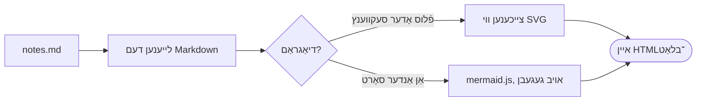
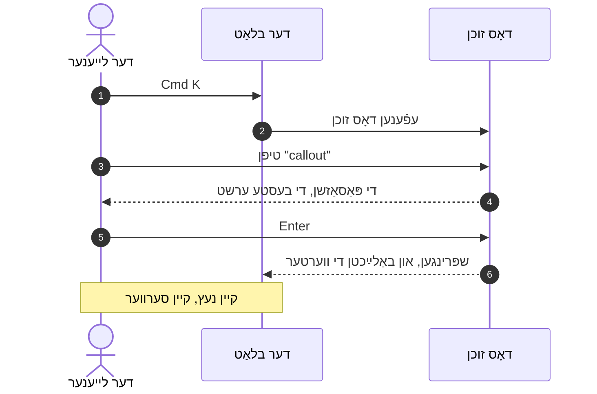
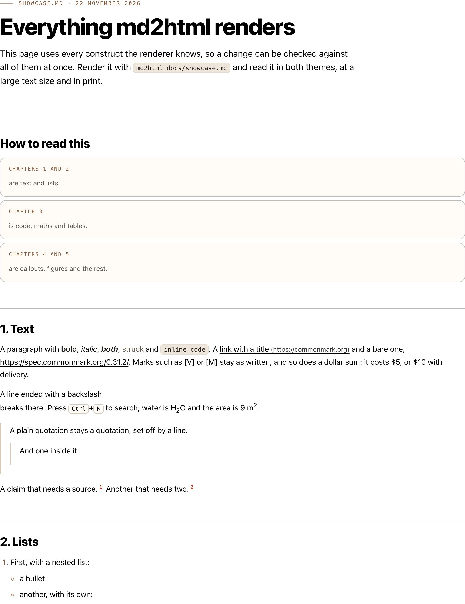
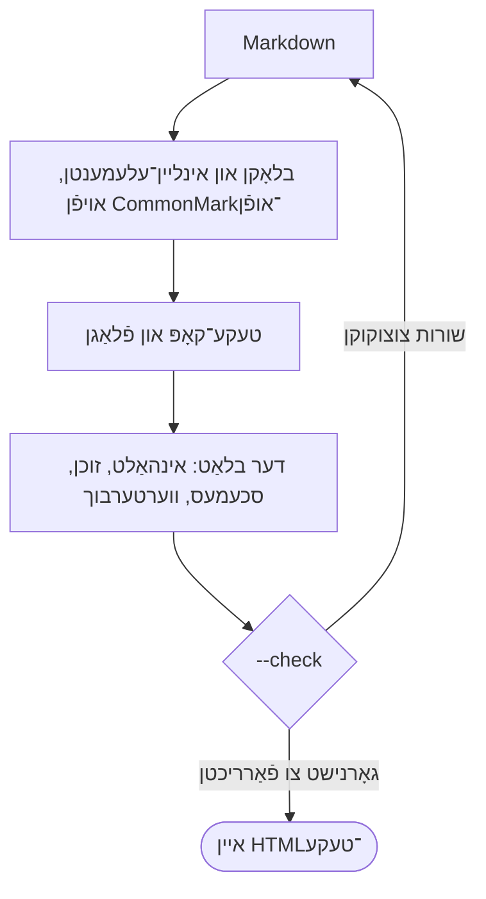

# md2html, אַלץ וואָס עס טוט

md2html מאַכט פֿון אַ Markdown־טעקע איין וועב־בלאַט וואָס דאַרף גאָרנישט מער: קיין סערווער, קיין נעץ, קיין שריפֿטן אָדער סקריפּטן פֿון ערגעץ. דער בלאַט ברענגט מיט זיך זײַן אייגענעם אינהאַלט, זוכן, ליכטיקע און טונקעלע קאָליר־סכעמעס, די גרייס פֿונעם טעקסט, אַ ווערטערבוך, פֿוסנאָטן, אילוסטראַציעס וואָס לאָזן זיך פֿאַרגרעסערן, קאָלירטן קאָד, געזעצטע מאַטעמאַטיק און דיאַגראַמען. דער דאָזיקער בלאַט איז געשריבן אין Markdown און אויסגעשטעלט פֿון md2html, אַזוי אַז אַלץ וואָס ער באַשרײַבט אַרבעט אויף אים בשעת איר לייענט.

## ווי צו לייענען דאָס

- **קאַפּיטל 1** איז וווּ md2html לויפֿט, און ווי אַזוי מע אינסטאַלירט אים.
- **קאַפּיטל 2** איז אַלץ אין איין טאַבעלע.
- **קאַפּיטלען 3 ביז 9** ווײַזן וואָס אַ לייענער באַקומט, און וואָס אַ שרײַבער טיפּט כּדי עס צו באַקומען.
- **קאַפּיטלען 10 ביז 12** זענען די באַשטימונגען, די באַפֿעל־שורה, און זיכערקייט און קוואַליטעט.

---

## 1. וווּ עס לויפֿט

| | וווּ |
|:--|:--|
| דער געצײַג md2html | macOS (Apple silicon און Intel), Linux און Windows, פֿון איין Rust־פּראָגראַם אָן אָפּהענגיקייטן אַחוץ דער סטאַנדאַרט־ביבליאָטעק; געפּרוּווט אויף אַלע דרײַ בײַ יעדער ענדערונג |
| די בלעטער וואָס ער מאַכט | די לעצטע ווערסיעס פֿון Chrome, Edge, Firefox און Safari, אויף קאָמפּיוטערס, טאַבלעטן און טעלעפֿאָנען, מיט אָדער אָן אינטערנעץ; עקראַן־לייענערס און די קלאַוויאַטור אומעטום |
| געעפֿנט פֿון | אַ וועב־סערווער, אַ געמיינזאַמער אָרדנער, אַ בײַלאַגע צו אַ בליצבריוו, אָדער גלײַך פֿונעם דיסק: דער בלאַט איז איין טעקע |
| געדרוקט אָדער אָפּגעהיט ווי PDF | פֿון יעדן בלעטערער, מיט אַן אייגענעם דרוק־אויסלייג; `--pdf` מאַכט דעם PDF אַליין, מיטן Chrome, Chromium אָדער Edge וואָס איז שוין אויפֿן קאָמפּיוטער |
| עלעקטראָנישע לייענערס | `--epub` מאַכט אַן EPUB 3, דעם סטאַנדאַרטן פֿאָרמאַט פֿאַר עלעקטראָנישע ביכער |
| די שפּראַכן פֿונעם בלאַט | זיבעצן, אַרײַנגערעכנט פֿון רעכטס צו לינקס (קאַפּיטל 8) |

מע אינסטאַלירט אים מיט Rusts אייגענעם אינסטאַלירער, פֿונעם מקור־קאָד:

```console
$ cargo install --git https://github.com/githubrobbi/md2html md2html --locked
$ md2html notes.md
md2html: notes.md -> notes.html (68504 bytes, 9 glossary terms, 0 of them shared)
```

## 2. מיט איין בליק

| | md2html |
|:--|:--|
| Markdown | גאַנץ CommonMark 0.31.2 (**652 פֿון זײַנע 652** טעסט־בײַשפּילן גייען דורך), און די טאַבעלעס, אויפֿגאַבע־רשימות, דורכגעשטראָכענער טעקסט, אויטאָמאַטישע לינקען, פֿוסנאָטן און אַלערטן פֿון GitHub |
| רעזולטאַט | **איין HTML־טעקע**, גאָרנישט אָפּגעהאָלט פֿון דרויסן, גאָרנישט צו אינסטאַלירן פֿאַרן לייענער |
| לייענען | אינהאַלט, זוכן, ליכטיקע און טונקעלע סכעמעס, די גרייס פֿונעם טעקסט, ווערטערבוך, פֿוסנאָטן, אילוסטראַציעס וואָס לאָזן זיך פֿאַרגרעסערן |
| קאָד, מאַטעמאַטיק, דיאַגראַמען | קאָד קאָלירט אין אַ צוואַנציק שפּראַכן, מאַטעמאַטיק ווי MathML, Mermaid־פֿלוסדיאַגראַמען און סעקווענץ־דיאַגראַמען געצייכנט ווי SVG, **אַלץ אָן אַ סקריפּט־ביבליאָטעק** |
| טיילן | אַ לינק צו יעדן קאַפּיטל, שורה אין אַ טאַבעלע, אילוסטראַציע, דיאַגראַם, קאָד־בלאָק, אָדער אויסגעקליבענעם פּאַסאַזש |
| שפּראַכן | דעם בלאַטס אייגענע ווערטער אין **17 שפּראַכן**, איבערזעצונגען פֿאַרבונדן מיט אַ שאַלטער, פֿון רעכטס צו לינקס פֿאַר העברעיִש, ייִדיש און אַראַביש |
| אָפּהיטן | דער בלאַט אַליין, אַ **PDF** מיט בוכצייכנס, אַן **EPUB** פֿאַר עלעקטראָנישע לייענערס |
| לעבעדיק | בלעטער וואָס לאָדן זיך איבער ווען זייער Markdown ענדערט זיך, און האַלטן דעם לייענערס אָרט |
| זיכערקייט | קיין מאָל נישט קיין סקריפּט פֿונעם טעקסט; קיין טעקע ווערט נישט געלייענט אַרויס פֿונעם דאָקומענטס אָרדנער |
| צוטריטלעכקייט | קיין פּראָבלעמען קעגן WCAG 2.2 AA, אין ביידע סכעמעס און אין דער ברייט פֿון אַ טעלעפֿאָן |
| גיכקייט | אַ דאָקומענט פֿון 4,000 שורות, מיט דיאַגראַמען און מאַטעמאַטיק, אין **ווייניקער ווי אַ צענטל סעקונדע** |
| אָפּהענגיקייטן | **קיינע**: די סטאַנדאַרט־ביבליאָטעק פֿון Rust און md2html |

## 3. דער בלאַט

דער בלאַט האָט דרײַ טיילן: אַ פּאַס איבערן שפּיץ, דער אינהאַלט אין דער זײַט, און דער טעקסט.

{width=100%}

די טונקעלע סכעמע גייט נאָך דער סיסטעם, אָדער נאָך דעם לייענערס ברירה, און ווערט געדענקט:

{width=100%}

אויף אַ טעלעפֿאָן באַהאַלט זיך דער אינהאַלט הינטערן שאַלטער אינעם פּאַס, און גאָרנישט סקראָלט אין דער זײַט:

{width=34%}

וואָס אַ לייענער קען טאָן:

| כּדי | טוט אַזוי |
|:--|:--|
| געפֿינען עפּעס | **זוכן** אינעם פּאַס, <kbd>⌘</kbd> <kbd>K</kbd> (<kbd>Ctrl</kbd> <kbd>K</kbd>), אָדער <kbd>/</kbd> |
| באַהאַלטן אָדער ווײַזן דעם אינהאַלט | דער שאַלטער בײַם אָנהייב פֿונעם פּאַס, אָדער <kbd>⌘</kbd> <kbd>\\</kbd> |
| ענדערן די גרייס פֿונעם טעקסט | **Aa** אינעם פּאַס, דערנאָך **−** און **+**; אָדער <kbd>⌘</kbd> <kbd>+</kbd> און <kbd>⌘</kbd> <kbd>−</kbd>, פֿון 85 ביז 200 פּראָצענט |
| ענדערן די קאָליר־סכעמע | **Aa**, דערנאָך סיסטעם, ליכטיק אָדער טונקל |
| פֿאַרגרעסערן אַן אילוסטראַציע | קליקט אויף איר; נאָך צוויי קליקן ברענגען זי נעענטער; <kbd>Esc</kbd> שטעלט זי צוריק |
| לייענען אַ פֿוסנאָטע אָדער אַ פּינטלדיק וואָרט | האַלט דעם טײַטל דערויף; קליקט כּדי צו גיין אַהין, און **צוריק** ברענגט צוריק |
| טיילן אַ קאַפּיטל, אַ שורה אין אַ טאַבעלע, אַן אילוסטראַציע, אַ דיאַגראַם, אַ קאָד־בלאָק אָדער אַ פּאַסאַזש | דער טייל־צייכן נאָך אַ קעפּל, בײַם סוף פֿון דער שורה אין דער טאַבעלע אונטערן טײַטל, אָדער אינעם ווינקל פֿון דער אילוסטראַציע, דעם דיאַגראַם אָדער דעם קאָד־בלאָק אונטערן טײַטל, קאָפּירט דעם לינק דערצו (אַ טעלעפֿאָן עפֿנט זײַן טייל־מעניו); קלײַבט אויס ווערטער, און עס ווערט פֿאָרגעלייגט אַ לינק פּונקט צו זיי |
| אָפּהיטן דעם בלאַט | דער אַראָפּלאָד־קנעפּל אויפֿן סוף פֿונעם פּאַס: דער בלאַט אַליין (מע קען אים לייענען אָן אינטערנעץ), דרוקן אָדער אָפּהיטן ווי PDF, אָדער דער PDF און דער EPUB וווּ זיי זענען געמאַכט געוואָרן |

די גרייס פֿונעם טעקסט און די קאָליר־סכעמע זיצן צוזאַמען הינטער **Aa**; דאָס אָפּהיטן פֿונעם בלאַט האָט אַן אייגענעם קנעפּל:

{width=60%}

## 4. שרײַבן

געוויינטלעך Markdown, און יעדע קאָנסטרוקציע לייענט זיך גוט אויך ווי פּשוטער טעקסט. וואָס איר שרײַבט קומט ערשט, אין אַ קאָד־בלאָק; וואָס איר באַקומט קומט דערנאָך.

### באַטאָנונג און לינקען

```markdown
**פֿעט**, *קורסיוו*, ***ביידע***, ~~דורכגעשטראָכן~~ און `קאָד`.
אַ [לינק](https://commonmark.org "CommonMark"), אַ נאַקעטער,
https://spec.commonmark.org/0.31.2/, און צייכנס ווי [V] וואָס בלײַבן ווי געשריבן.
```

**פֿעט**, *קורסיוו*, ***ביידע***, ~~דורכגעשטראָכן~~ און `קאָד`. אַ [לינק](https://commonmark.org "CommonMark"), אַ נאַקעטער, https://spec.commonmark.org/0.31.2/, און צייכנס ווי [V] וואָס בלײַבן ווי געשריבן.

### רשימות אין רשימות

```markdown
1. ערשטנס, מיט אַן אַרײַנגעלייגטער רשימה:
   - אַ פּונקט
   - נאָך איינער, מיט אַן אייגענער:
     1. טיפֿער
2. צווייטנס.
- [x] אַן אויפֿגאַבע געטאָן
- [ ] אַן אויפֿגאַבע אָפֿן
```

1. ערשטנס, מיט אַן אַרײַנגעלייגטער רשימה:
   - אַ פּונקט
   - נאָך איינער, מיט אַן אייגענער:
     1. טיפֿער
2. צווייטנס.

- [x] אַן אויפֿגאַבע געטאָן
- [ ] אַן אויפֿגאַבע אָפֿן

### ציטאַטן און באַמערקונג־קעסטלעך

```markdown
> אַ פּשוטער ציטאַט בלײַבט אַ ציטאַט.

> [!TIP]
> די אַלערטן פֿון GitHub אַרבעטן: NOTE, TIP, IMPORTANT, WARNING, CAUTION.

> **באַמערקונג:** אַזוי אויך די עלטערע פֿאָרם, אַ פֿעט וואָרט מיט אַ צווייפּינטל.
```

> אַ פּשוטער ציטאַט בלײַבט אַ ציטאַט.

> [!TIP]
> די אַלערטן פֿון GitHub אַרבעטן: NOTE, TIP, IMPORTANT, WARNING, CAUTION.

> **באַמערקונג:** אַזוי אויך די עלטערע פֿאָרם, אַ פֿעט וואָרט מיט אַ צווייפּינטל.

### טאַבעלעס

```markdown
| צימער      | שטאָק    | שטח (קוואַדראַט־פֿוס) |
|:-----------|:-------:|---------------------:|
| וווינצימער | פּאַרטער |                  312 |
| בוידעם     | אויבן   |                  205 |
```

| צימער | שטאָק | שטח (קוואַדראַט־פֿוס) |
|:-----------|:-------:|---------------------:|
| וווינצימער | פּאַרטער | 312 |
| בוידעם | אויבן | 205 |

אַ טאַבעלע וואָס איז ברייטער ווי די שפּאַלט סקראָלט זיך אינעווייניק אין איר, און דער בלאַט קיין מאָל נישט.

### פֿוסנאָטן

```markdown
אַ טענה וואָס דאַרף אַ מקור.[^1]

[^1]: דער מקור. האַלט דעם טײַטל אויפֿן נומער כּדי אים דאָרט צו לייענען.
```

אַ טענה וואָס דאַרף אַ מקור.[^source]

[^source]: דער מקור. האַלט דעם טײַטל אויפֿן נומער כּדי אים דאָרט צו לייענען; קליקט אויף אים כּדי צו קומען אַהער, און אויף צוריק כּדי זיך אומצוקערן.

### אילוסטראַציעס און בילדער

```markdown
{width=60%}

אַן איקאָן {width=18} אין מיטן אַ זאַץ.
```

{width=60%}

אַן איקאָן {width=18} אין מיטן אַ זאַץ.

### קליינע זאַכן

```markdown
דריקט <kbd>Ctrl</kbd>+<kbd>K</kbd>. וואַסער איז H<sub>2</sub>O, דער צימער 9 m<sup>2</sup>.
אַ שורה וואָס ענדיקט זיך מיט אַ צוריקשטריך\
ברעכט זיך דאָרט.
```

דריקט <kbd>Ctrl</kbd>+<kbd>K</kbd>. וואַסער איז H<sub>2</sub>O, דער צימער 9 m<sup>2</sup>. אַ שורה וואָס ענדיקט זיך מיט אַ צוריקשטריך\
ברעכט זיך דאָרט.

<details>
<summary>אַן אָפּטייל וואָס עפֿנט זיך מיט אַ קליק</summary>

געשריבן ווי `<details>` מיט אַ `<summary>`, מיט געוויינטלעך Markdown אינעווייניק: **פֿעט**, אַ רשימה,

- איינס
- צוויי

</details>

#### אַ קעפּל אויפֿן פֿערטן ניוואָ

קעפּלעך אונטערן דריטן ניוואָ בלײַבן אַרויס פֿונעם אינהאַלט, ווי דאָס דאָזיקע.

## 5. קאָד, מאַטעמאַטיק און דיאַגראַמען

קאָד ווערט קאָלירט פֿאַר Rust, Python, JavaScript און TypeScript, Go, C און C++, Java, Kotlin, Swift, C#, דעם shell, SQL, Ruby, Lua, PHP, CSS, HTML, JSON, YAML, TOML, Dockerfiles און diffs, און יעדער בלאָק האָט אַ קנעפּל צום קאָפּירן.

```rust
/// The whole page from one Markdown text.
fn main() {
    let page = md2html::render("# Hello\n\nWorld.", &Settings::default());
    println!("{} bytes, nothing to fetch", page.len()); // one file
}
```

```python
@cache
def area(w: float, h: float) -> float:
    """The area of a room."""
    return w * h  # square feet
```

```diff
- every quotation a note
+ a quotation is a quotation; a bold first word makes it a note
```

מאַטעמאַטיק ווערט געזעצט פֿונעם בלעטערער אַליין, ווי MathML, אָן אַ סקריפּט און אָן אַ שריפֿט צום אַראָפּלאָדן. אין דער שורה איז פּיטאַגאָראַסעס טעאָרעם $a^2 + b^2 = c^2$, און אוילערס אידענטיטעט איז $e^{i\pi} + 1 = 0$; אַ סומע דאָלאַרן ווי $5 אָדער $10 בלײַבט געלט. באַזונדער אויסגעשטעלט:

$$
\int_0^1 x^2 \, dx = \frac{1}{3} \qquad \sum_{k=1}^{n} k = \frac{n(n+1)}{2} \qquad \sqrt[3]{27} = 3
$$

$$
\begin{pmatrix} a & b \\ c & d \end{pmatrix}
\begin{pmatrix} x \\ y \end{pmatrix}
=
\begin{pmatrix} ax + by \\ cx + dy \end{pmatrix}
\qquad
|x| = \begin{cases} x & x \ge 0 \\ -x & x < 0 \end{cases}
$$

### דיאַגראַמען

אַ Mermaid־פֿלוסדיאַגראַם אָדער סעקווענץ־דיאַגראַם ווערט געצייכנט פֿון md2html אַליין, ווי SVG אינעם בלאַט: אָן אַ סקריפּט, גאָרנישט צום אַראָפּלאָדן, אין דעם בלאַטס אייגענע קאָלירן אין ביידע סכעמעס, און זײַנע ווערטער בלײַבן ווערטער וואָס דאָס זוכן געפֿינט. דאָס איז דער Markdown:

````markdown

````

און דאָס ווערט דערפֿון:


אַ סעקווענץ־דיאַגראַם, נומערירט, מיט אַ באַמערקונג:



אַנדערע סאָרטן (קרײַז־דיאַגראַמען, גאַנט־דיאַגראַמען, קלאַס־דיאַגראַמען) ווערן געצייכנט פֿון mermaid.js ווען דער מחבר ווײַזט md2html אויף אַ קאָפּיע דערפֿון (`--mermaid-js FILE`); דער סקריפּט קומט דעמאָלט אַרײַן נאָר אין יענעם בלאַט. אָן אים בלײַבן זיי ווי קאָד, און `--check` זאָגט עס.

## 6. דאָס ווערטערבוך, די פֿוסנאָטן, דאָס זוכן און די אילוסטראַציעס

אַ קאַפּיטל מיטן נאָמען „ווערטערבוך“ האַלט די ווערטער פֿונעם בלאַט ווי אַ טאַבעלע. עס ווערט נישט געדרוקט וווּ עס שטייט: אַנשטאָט דעם ווערט די ערשטע דערמאָנונג פֿון יעדן טערמין אין יעדן קאַפּיטל אַ פּינטלדיק וואָרט וואָס דערקלערט זיך אַליין ווען מע האַלט דעם טײַטל דערויף, און אַ קליק דערויף שפּרינגט צום אַרײַנטראָג אונטן, וואָס פֿירט צוריק צו דער שורה וואָס איר האָט געלייענט.

{width=70%}

פֿוסנאָטן אַרבעטן אויפֿן זעלביקן אופֿן: דער נומער דערקלערט זיך אַליין ווען מע האַלט דעם טײַטל דערויף.

{width=70%}

> [!NOTE]
> אַ ווערטערבוך קען זײַן געמיינזאַם פֿאַר עטלעכע בלעטער: איין טעקע אין `~/.config/md2html/glossary.md`, וועמענס ווערטער ווערן דעמאָלט פֿאַרלינקט אויף יעדן בלאַט וואָס ווערט אויסגעשטעלט פֿון אַ טעקע אויף יענעם קאָמפּיוטער.

דאָס זוכן דעקט יעדעס וואָרט אויפֿן בלאַט, אַרײַנגערעכנט דאָס ווערטערבוך. די רעזולטאַטן ווײַזן וווּ יעדעס וואָרט שטייט; דאָס אויסגעקליבענע ווערט באַלויכטן וווּ דאָס זוכן לאַנדט.

{width=80%}

{width=80%}

אַן אילוסטראַציע ווערט פֿאַרגרעסערט איבערן בלאַט אָן אים צו פֿאַרלאָזן. ווען זי איז גרעסער ווי דאָס פֿענצטער, גייט זי נאָך דעם טײַטל, אַזוי אַז איר ווײַזט אויף דעם וואָס איר ווילט זען.

## 7. טיילן און לעבעדיקע בלעטער

יעדעס קעפּל טראָגט אַ טייל־צייכן נאָך זיך; יעדע שורה אין אַ טאַבעלע, אילוסטראַציע, דיאַגראַם און קאָד־בלאָק ווײַזט איינעם ווען דער טײַטל איז דערויף. אַ קליק קאָפּירט אַ לינק פּונקט צו יענעם אָרט, און זאָגט עס; אויף אַ טעלעפֿאָן עפֿנט זיך אַנשטאָט דעם די סיסטעמס טייל־מעניו. קלײַבט אויס עטלעכע ווערטער, און דער בלאַט לייגט פֿאָר אַ לינק פּונקט צו זיי, וואָס עפֿנט דעם בלאַט בײַ יענעם פּאַסאַזש, באַלויכטן.

{width=80%}

אַ בלאַט קען זיך אויך אַליין האַלטן אַקטועל. `md2html --serve` ווײַזט די בלעטער אויף דעם קאָמפּיוטער בשעת מע שרײַבט זיי, און יעדער אָפֿענער בלאַט לאָדט זיך איבער אין דעם מאָמענט וואָס זײַן Markdown ווערט אָפּגעהיט. אַ פֿאַרעפֿנטלעכטער בלאַט געמאַכט מיט `--live` האָט זײַן אייגענע לעבנסצײַט: ווען זי לויפֿט אויס, בעט דער בלאַט בײַ זײַן סערווער דעם ערשטן קילאָבײַט פֿון זיך אַליין, וווּ זײַן פֿינגערדרוק שטייט, און לאָדט זיך איבער נאָר אויב דער פֿינגערדרוק האָט זיך געביטן. סײַ ווי סײַ בלײַבט דער לייענער וווּ ער איז געווען: בײַ דעם זעלביקן פּאַראַגראַף אויף דער זעלביקער הייך, אָדער, אויב ער איז מער נישטאָ, בײַם קאַפּיטל פֿאַר אים; ווען מע שאַלט איבער צו אַן אַנדער שפּראַך, בלײַבט דער אָרט אויפֿן זעלביקן אופֿן. דער סערווער איז נאָר פֿאַר דעם קאָמפּיוטער: ער ענטפֿערט נאָר אויף בקשות וואָס זענען געווענדט צו אים, גיט אַרויס נאָר דעם דאָקומענטס אָרדנער, און ענטפֿערט אויף אַ בקשה וואָס ער קען נישט לייענען אין גאַנצן מיטן סטאַטוס וואָס זאָגט פֿאַר וואָס.

## 8. שפּראַכן

דעם בלאַטס אייגענע ווערטער (דאָס זוכן, די באַמערקונג־קעסטלעך, דאָס ווערטערבוך, די דאַטעס, יעדער קנעפּל) זענען פֿאַראַן אין זיבעצן שפּראַכן: ענגליש, דײַטש, העברעיִש, אינדאָנעזיש, האָלענדיש, יאַוואַניש, ייִדיש, נידערדײַטש, פֿראַנצייזיש, איטאַליעניש, שפּאַניש, יאַפּאַניש געשריבן אויף דרײַ אופֿנים (מיט קאַנדזשי און קאַנאַ, מיט קאַנאַ אַליין, און אין ראָמאַדזשי), מאַנדאַרין־כינעזיש מיט פֿאַרפּשוטע און מיט טראַדיציאָנעלע צייכנס, און קאַנטאָנעזיש. `lang: de` אינעם טעקע־קאָפּ איז אַלץ וואָס מע דאַרף. העברעיִש און ייִדיש ווערן אויסגעלייגט פֿון רעכטס צו לינקס, מיטן אינהאַלט אויף דער רעכטער זײַט, און אַזוי אויך אַראַביש, מיט ענגלישע ווערטער.

אַן איבערזעצונג איז פּשוט נאָך אַ Markdown־טעקע לעבן דעם אָריגינאַל, אָנגערופֿן נאָך איר שפּראַך: `capabilities.de.md` איז דער דײַטשער `capabilities.md`. md2html געפֿינט די ווערסיעס וואָס זענען דאָ, פֿאַרבינדט זיי איינע מיט דער אַנדערער מיט אַ שאַלטער אינעם פּאַס (די ערדקויל), לאָזט וויסן בלעטערערס און זוך־מאַשינען מיט `hreflang`, און גיט יעדער איינער די ווערטער פֿון איר אייגענעם אינטערפֿייס. דער דאָזיקער בלאַט עקזיסטירט אין אַלע זיבעצן; די ערדקויל שאַלט צווישן זיי, און דער בלאַט עפֿנט זיך בײַם פּאַראַגראַף וואָס איר האָט געלייענט.

יעדע איבערזעצונג נעמט אָן איר אָריגינאַל און פֿאַרשרײַבט דעם אָריגינאַלס פֿינגערדרוק, אַזוי אַז דער בלאַט קען זאָגן וועלכע ווערסיע איז די גילטיקע, און `--check` באַמערקט ווען דער אָריגינאַל האָט זיך געביטן זינט די איבערזעצונג איז געמאַכט געוואָרן:

```yaml
translated_from: capabilities.md
source_sha256: 5b0c...e1
```

פֿאַר אַ שפּראַך וואָס קיינער האָט נישט איבערגעזעצט אַ בלאַט אויף איר, קען דער לייענערס אייגענער בלעטערער אים איבערזעצן, וווּ ער האָט די פֿעיִקייט (דער אײַנגעבויטער איבערזעצער פֿון Chrome): אויפֿן אַפּאַראַט גופֿא, אַזוי אַז גאָרנישט גייט פֿון אים אַרויס, באַצייכנט ווי אַ מאַשין־איבערזעצונג, און מיט אַ וועג צוריק צום אָריגינאַל.

## 9. אָפּהיטן אַ בלאַט

דער אַראָפּלאָד־קנעפּל אינעם פּאַס לייגט פֿאָר וואָס עס איז דאָ אָפּצוהיטן. דער בלאַט אַליין לאָזט זיך לייענען אָן אינטערנעץ ווען זײַנע בילדער זענען אינעווייניק (`embed: true`). דרוקן באַקומט אַן אייגענעם אויסלייג: די קנעפּלעך פֿאַלן אַוועק, יעדער לינק דרוקט זײַן אַדרעס, גאָרנישט ווערט צעשניטן צווישן בלעטער, און די בלעטער טראָגן דעם טיטל און זייער נומער.

{width=55%}

`--pdf` דרוקט דעם בלאַט מיטן Chrome וואָס איז שוין אויפֿן קאָמפּיוטער: מיט זײַן אייגענעם דרוק־אויסלייג, די קעפּלעך ווי די בוכצייכנס פֿונעם PDF, דער טיטל אויבן אויף יעדן בלאַט און זײַן נומער אונטן. `--epub` מאַכט פֿון דעם זעלביקן בלאַט אַ בוך פֿאַר עלעקטראָנישע לייענערס, מיט זײַן אינהאַלט, בילדער, דיאַגראַמען און מאַטעמאַטיק, און פֿוסנאָטן וואָס עפֿענען זיך דאָרט וווּ מע דערמאָנט זיי; md2html שרײַבט אים אַליין. דער לייענער געפֿינט ביידע אונטערן אַראָפּלאָד־קנעפּל.

## 10. באַשטימונגען

דער טעקע־קאָפּ פֿון דעם בלאַטס ענגלישן אָריגינאַל, אַ Markdown־טעקע, זעט אויס אַזוי:

```yaml
---
title: md2html, everything it does
description: md2html turns Markdown into one complete, self-contained web page ...
brand: md2html
kicker: Capabilities
version: 0.7.7
date: 2026-11-23
footer: Written in Markdown and rendered by **md2html 0.7.7** itself ...
csp: true      # only this page's own code may run
embed: true    # the screenshots are inside the page
---
```

| באַשטימונג | וואָס זי טוט |
|:--|:--|
| `title`, `description`, `author` | דער טיטל, און די meta־טעגן פֿאַר פֿאָרויסווײַזן פֿון לינקען |
| `lang` | די שפּראַך: דעם בלאַטס אייגענע ווערטער און דאַטעס אויף יעדער פֿון די זיבעצן שפּראַכן (`ja-Hira` איז יאַפּאַניש אין קאַנאַ, `zh-Hant` כינעזיש מיט טראַדיציאָנעלע צייכנס, `yue` קאַנטאָנעזיש) |
| `translated_from`, `source_sha256` | פֿאַר אַן איבערזעצונג: איר אָריגינאַל, און דעם אָריגינאַלס פֿינגערדרוק ווען זי איז איבערגעזעצט געוואָרן |
| `brand`, `brand_link`, `kicker`, `eyebrow`, `footer` | דער פּאַס, די שורה איבערן טיטל, דער קליינער שריפֿט |
| `date`, `version` | די דאַטע און די ווערסיע וואָס ווערן געוויזן איבערן טיטל |
| `embed` | בילדער אינעם בלאַט, אַזוי אַז ער איז איין טעקע |
| `csp` | אַ Content-Security-Policy |
| `pdf`, `epub` | אַ PDF און אַן EPUB פֿונעם בלאַט, לעבן אים |
| `live` | דעם בלאַטס לעבנסצײַט (`true` איז צוויי מינוט, אָדער אַ צאָל סעקונדעס): דערנאָך לאָדט ער זיך איבער אויב ער האָט זיך געביטן, און דער לייענער בלײַבט אויף זײַן אָרט |
| `large`, `toc`, `math`, `index`, `html`, `css`, `head` | גרעסערע אותיות, דער אינהאַלט, מאַטעמאַטיק, זוך־מאַשינען, רײַכערער HTML, עקסטרע סטיל און head |

> [!TIP]
> מיט `lang: de` זאָגט דאָס זוכן "Diese Seite durchsuchen", יעדעס באַמערקונג־קעסטל זאָגט "Hinweis" אָדער "Achtung", און די דאַטע לייענט זיך "23. November 2026".

## 11. די באַפֿעל־שורה

```console
$ md2html notes.md
md2html: notes.md -> notes.html (68504 bytes, 9 glossary terms, 0 of them shared)
$ md2html docs/ -o site/ --nav
$ md2html notes.md --check
notes.md:30: `plan.svg` does not exist next to this page
notes.md: a link points at #setup, which is nowhere on the page
md2html: 2 to look at
$ cat notes.md | md2html - > notes.html
$ md2html notes.md --pdf --epub
$ md2html notes.md --serve
```

`--check` שרײַבט גאָרנישט און רעכנט אויס וואָס אַ מחבר דאַרף זיך צוקוקן, שורה נאָך שורה וווּ עס איז דאָ אַ שורה, און ענדיקט מיט 1 ווען עס איז דאָ עפּעס: אַ לינק צו אַן אַנקער וואָס איז נישטאָ אויפֿן בלאַט, אַ טעקע וואָס איז נישטאָ, אַ פֿוסנאָטע אָן איר הערה, רוי HTML געוויזן ווי טעקסט, אַ טעג פֿונעם מחבר וואָס פֿאַרמאַכט גאָרנישט אָדער ווערט קיין מאָל נישט פֿאַרמאַכט, אַן איבערזעצונג וואָס איז עלטער ווי איר אָריגינאַל. דערמיט ווערט עס דער לעצטער שריט פֿון אַ בוי. `--watch` שטעלט אויס ווידער בײַ יעדן אָפּהיטן, `--nav` פֿאַרבינדט די בלעטער פֿון אַן אָרדנער מיט פֿריִערדיק און קומענדיק, און אַ לינק צו אַן אַנדער Markdown־טעקע פֿירט צו איר בלאַט.

## 12. זיכערקייט, קוואַליטעט און צוטריטלעכקייט

> [!WARNING]
> אַ בלאַט קען ווערן אויסגעשטעלט פֿון Markdown וואָס עמעצער אַנדערש האָט געשריבן. md2html שרײַבט קיין מאָל נישט קיין סקריפּט פֿונעם טעקסט: רוי HTML ווערט געוויזן ווי געשריבן, אַחוץ עטלעכע אומשעדלעכע טעגן, וואָס ווערן באַלאַנסירט אינעם אַרטיקל, אַזוי אַז זיי קענען נישט צעברעכן דעם בלאַט אַרום אים, און לינקען מיט `javascript:` אָדער `data:` ווערן אַוועקגעוואָרפֿן, ווי אַזוי מע זאָל זיי נישט אויסלייגן. אַ דאָקומענט קען נישט מאַכן, אַז md2html זאָל לייענען אַ טעקע אַרויס פֿון זײַן אָרדנער, און קיין שום אַרײַנגאַב, ווי פֿײַנדלעך זי זאָל נישט זײַן, קען אים נישט פֿאַרגליווערן אָדער ברענגען צו אַ קראַך.

> [!CAUTION]
> `--html` לאָזט דורך רײַכער HTML (בילדער, לינקען, ווידעאָ, SVG, אויסלייג), אָבער קיין מאָל נישט עפּעס וואָס לויפֿט: קיין סקריפּט, קיין געשעעניש־באַהאַנדלער, קיין ראַם, קיין פֿאָרמולאַר.

וואָס ווערט געפּרוּווט בײַ יעדער ענדערונג, די טעסטן אויף macOS, Linux און Windows און די קאָנטראָלן אין Chrome אויף Linux:

- די טעסטן וואָס שטעלן אויס גאַנצע בלעטער און לייענען זיי צוריק, און די וואָס לאָזן לויפֿן דעם פּראָגראַם אַליין, צווישן זיי די זיכערקייט־פֿאַלן און די פּאַטאָלאָגישע פֿאַלן;
- די 652 בײַשפּילן פֿון דער CommonMark־ספּעציפֿיקאַציע, פֿון וועלכע די צאָל וואָס גייען דורך מעג שטײַגן אָבער קיין מאָל נישט פֿאַלן;
- די שטרענגסטע lints פֿון clippy, און די עלטסטע Rust וואָס דער געצײַג זאָגט צו זיך צו בויען דערמיט;
- אַ צוטריטלעכקייט־אָפּשאַצונג מיט axe-core קעגן WCAG 2.2 AA, אין ביידע סכעמעס און אין דער ברייט פֿון אַ טעלעפֿאָן;
- אַ דורכקליקן אין Chrome וואָס ניצט יעדן קנעפּל אַזוי ווי אַ לייענער וואָלט עס געניצט, מיט דער מויז און מיט דער קלאַוויאַטור, בײַ דער נאָרמאַלער און בײַ אַ גרעסערער גרייס פֿונעם טעקסט;
- לעבעדיקע בלעטער, פֿון אָנהייב ביז סוף: אַן איבערלאָדן בײַ אַן ענדערונג, דעם לייענערס אָרט אָפּגעהיט, אַן איבערשאַלטן פֿון שפּראַך וואָס לאַנדט בײַם זעלביקן פּאַראַגראַף.

md2html האָט נישט קיין קאָד פֿון דריטע פּאַרטייען, און זײַן אָנשאַפֿונג־קייט איז פֿאַרפֿעסטיקט און געפּרוּווט: דער געצײַג־זאַץ, די CI־אַקציעס, די טעסט־געצײַגן. יעדער בלאַט ענדיקט זיך מיט איין שטילער שורה: געמאַכט מיט md2html, זײַן ווערסיע, און אַ לינק צו דעם אָרט וווּ md2html וווינט.

דער וועג וואָס יעדער בלאַט גייט:



---

דאָס ווערטערבוך אונטן דערקלערט די ווערטער וואָס דער דאָזיקער בלאַט ניצט; יעדעס איז אויבן געווען אַ פּינטלדיק וואָרט.

## ווערטערבוך

| טערמין | באַטײַט | אויך |
|---|---|---|
| Markdown | פּשוטער טעקסט מיט לײַכטע צייכנס פֿאַר קעפּלעך, באַטאָנונג, רשימות און לינקען, וואָס מע קען לייענען ווי ער איז און איבערמאַכן אין אַ בלאַט. | |
| CommonMark | די ספּעציפֿיקאַציע פֿון Markdown וואָס רובֿ געצײַגן פֿאָלגן הײַנט, מיט אַ טעסט פֿאַר יעדן כּלל. | |
| אינהאַלט | די רשימה קאַפּיטלען אין דער זײַט פֿונעם בלאַט, געמאַכט פֿון זײַנע קעפּלעך. | |
| באַמערקונג־קעסטל | אַן אָפּגעראַמטע זײַט־באַמערקונג: אַ באַמערקונג, אַן עצה, עפּעס וויכטיקס, אַ וואָרענונג אָדער אַ ווערטל זיך צו היטן. | באַמערקונג־קעסטלעך, אַלערט, אַלערטן |
| אילוסטראַציע | אַ בילד אויף אַן אייגענער שורה, מיט זײַן אונטערשריפֿט אונטן, וואָס ווערט פֿאַרגרעסערט מיט אַ קליק. | אילוסטראַציעס |
| טעקע־קאָפּ | דער בלאָק באַשטימונגען צווישן צוויי `---`־שורות גאָר אויבן אין אַ Markdown־טעקע. | |
| MathML | דעם וועבס אייגענע שפּראַך פֿאַר מאַטעמאַטיק, געצייכנט פֿונעם בלעטערער אָן אַ סקריפּט. | |
| Content-Security-Policy | אַ כּלל אינעם בלאַט וואָס זאָגט דעם בלעטערער וועלכער קאָד טאָר לויפֿן; דאָ, נאָר דעם בלאַטס אייגענער. | |
| Mermaid | אַ טעקסט־שפּראַך פֿאַר דיאַגראַמען, געשריבן אין אַ קאָד־בלאָק; md2html צייכנט אירע פֿלוסדיאַגראַמען און סעקווענץ־דיאַגראַמען. | |
| WCAG | די Web Content Accessibility Guidelines, די כּללים פֿאַר צוטריטלעכקייט פֿון וועב־אינהאַלט; דער ניוואָ AA איז דער געוויינטלעכער ציל. | |
| איבערזעצונג | אַ ווערסיע פֿון אַ בלאַט אין אַן אַנדער שפּראַך, אַ Markdown־טעקע לעבן דעם אָריגינאַל. | איבערזעצונגען |
| EPUB | דער סטאַנדאַרטער פֿאָרמאַט פֿאַר עלעקטראָנישע ביכער, אַן אײַנגעפּאַקטער וועב־בלאַט וואָס עלעקטראָנישע לייענערס לייגן אויס. | |
