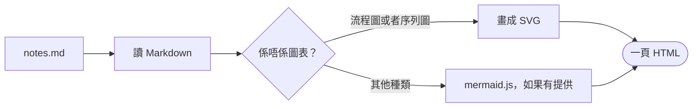
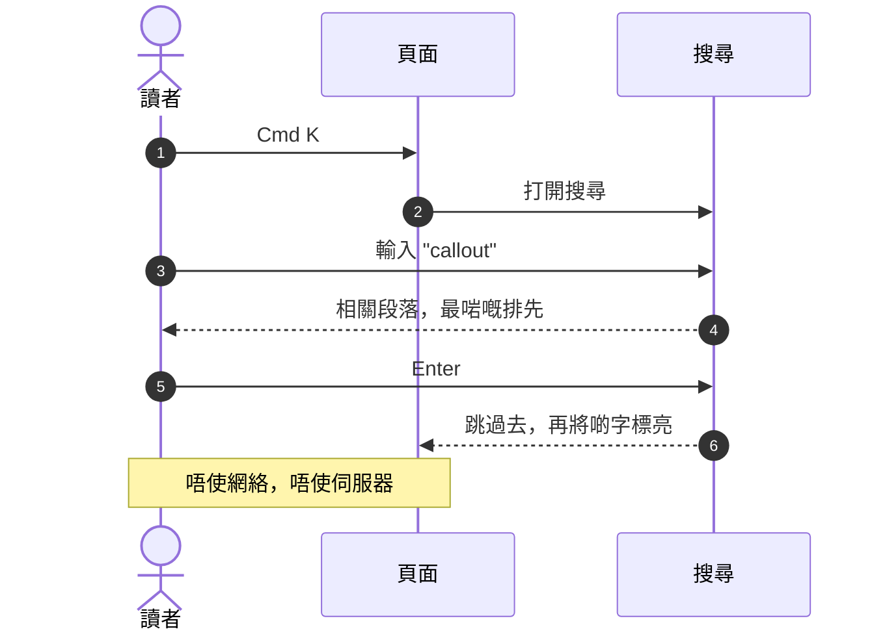
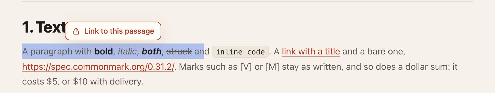
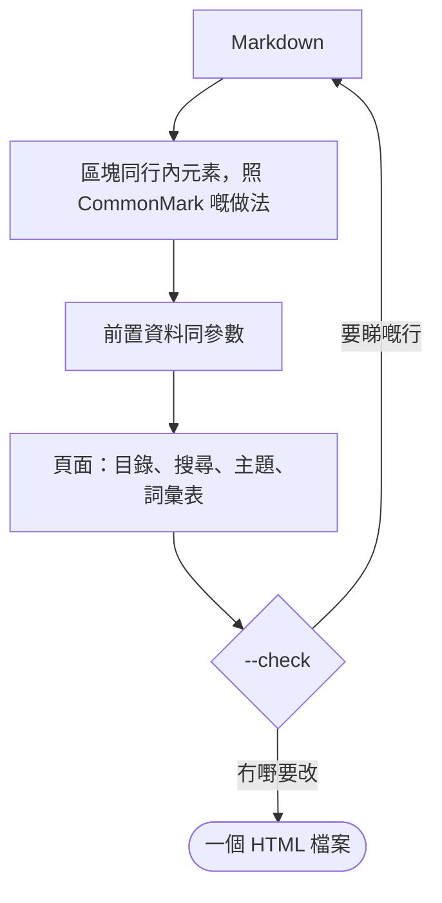

# md2html 識做嘅所有嘢

md2html 會將一個 Markdown 檔案變成一頁乜都唔使再靠嘅網頁：唔使伺服器，唔使上網，亦唔使由任何地方攞字型或者腳本。頁面自己帶齊目錄、搜尋、淺色同深色主題、字體大小、詞彙表、註腳、可以放大嘅插圖、有顏色嘅程式碼、排好版嘅數學式同圖表。呢一頁用 Markdown 寫，由 md2html 轉出嚟，所以佢講嘅每樣嘢，喺你睇緊嘅時候都喺佢自己身上運作緊。

## 點樣睇呢一頁

- **第 1 章** 講 md2html 喺邊度行得，同點樣安裝。
- **第 2 章** 用一個表講晒所有嘢。
- **第 3 至 9 章** 講讀者會見到啲乜，同埋作者要打啲乜先會有。
- **第 10 至 12 章** 係設定、命令列，同埋安全同品質。

---

## 1. 喺邊度行得

| | 喺邊度 |
|:--|:--|
| md2html 呢個工具 | macOS（Apple 晶片同 Intel）、Linux 同 Windows，係一個除咗標準庫之外乜都唔靠嘅 Rust 程式；每次有改動，三個系統都會測試 |
| 佢整出嚟嘅頁面 | 最新嘅 Chrome、Edge、Firefox 同 Safari，喺電腦、平板同手機上面，有冇網都得；由頭到尾都支援螢幕閱讀器同鍵盤 |
| 喺邊度打開 | 網頁伺服器、共用資料夾、電郵附件，或者直接由磁碟打開：成頁只係一個檔案 |
| 列印或者存做 PDF | 任何瀏覽器都得，有自己嘅列印版面；`--pdf` 會用部電腦本身已經有嘅 Chrome、Chromium 或者 Edge 直接整出 PDF |
| 電子書閱讀器 | `--epub` 會整出 EPUB 3，即係標準嘅電子書格式 |
| 頁面嘅語言 | 十七種，包括由右至左嘅語言（第 8 章） |

用 Rust 自己嘅安裝工具，由原始碼安裝：

```console
$ cargo install --git https://github.com/githubrobbi/md2html --tag v0.8.1 md2html --locked
$ md2html notes.md
md2html: notes.md -> notes.html (68504 bytes, 9 glossary terms, 0 of them shared)
```

## 2. 一眼睇晒

| | md2html |
|:--|:--|
| Markdown | 全部 CommonMark 0.31.2（**652 個**測試例子入面通過 **652 個**），加埋 GitHub 嘅表格、任務清單、刪除線、自動連結、註腳同提示框 |
| 輸出 | **一個 HTML 檔案**，乜都唔使下載，讀者乜都唔使安裝 |
| 閱讀 | 目錄、搜尋、淺色同深色主題、字體大小、詞彙表、註腳、可以放大嘅插圖 |
| 程式碼、數學式、圖表 | 大約二十種語言嘅程式碼上色、用 MathML 排嘅數學式、畫成 SVG 嘅 Mermaid 流程圖同序列圖，**全部唔使腳本庫** |
| 分享 | 連去任何一章、表格嘅一行、插圖、圖表、程式碼區塊，或者揀咗嘅一段 |
| 語言 | 頁面自己嘅字眼有 **17 種語言**，譯本之間用切換掣連住，希伯來文、意第緒文同阿拉伯文由右至左 |
| 留低 | 呢一頁本身、有書籤嘅 **PDF**、電子書閱讀器用嘅 **EPUB** |
| 即時更新 | Markdown 一改就重新載入、讀者睇到邊度都留喺度嘅頁面 |
| 安全 | 永遠唔會由內文整出腳本；唔會讀文件資料夾以外嘅檔案 |
| 無障礙 | 對照 WCAG 2.2 AA 冇任何問題，兩款主題同手機闊度都係 |
| 速度 | 一份 4,000 行嘅文件，連圖表同數學式，**唔使十分一秒** |
| 依賴 | **冇**：淨係 Rust 標準庫同 md2html |

## 3. 頁面

頁面有三部分：頂部嘅工具列、左邊嘅目錄，同埋正文。

{width=100%}

深色主題會跟系統，或者跟讀者自己揀，而且會記住：

{width=100%}

喺手機上面，目錄會收埋喺工具列個掣後面，冇嘢要左右碌：

{width=34%}

讀者可以做嘅嘢：

| 想 | 咁做 |
|:--|:--|
| 搵嘢 | 工具列嘅 **搵**、<kbd>⌘</kbd> <kbd>K</kbd>（<kbd>Ctrl</kbd> <kbd>K</kbd>），或者 <kbd>/</kbd> |
| 收埋或者顯示目錄 | 工具列左邊嘅掣，或者 <kbd>⌘</kbd> <kbd>\\</kbd> |
| 改字體大小 | 工具列嘅 **Aa**，再撳 **−** 同 **+**；或者 <kbd>⌘</kbd> <kbd>+</kbd> 同 <kbd>⌘</kbd> <kbd>−</kbd>，由 85% 到 200% |
| 轉主題 | **Aa**，再揀跟系統、淺色或者深色 |
| 放大插圖 | 撳一下；再撳兩下會再近啲；<kbd>Esc</kbd> 就還原 |
| 睇註腳或者有虛線嘅詞 | 將滑鼠停喺上面；撳一下就跳過去，撳 **返回** 就返嚟 |
| 分享一章、表格嘅一行、一幅插圖、一個圖表、一個程式碼區塊或者一段 | 標題右邊嘅分享符號，滑鼠指住嗰行表格最尾嘅分享符號，或者滑鼠指住嘅插圖、圖表或者程式碼區塊角落嘅分享符號，會複製佢嘅連結（手機就會打開分享選單）；揀幾個字，就會俾你一條啱啱好連去嗰幾個字嘅連結 |
| 留低 | 工具列尾嘅下載掣：呢一頁本身（離線都睇得）、列印或者存做 PDF，或者有整到嘅話就係 PDF 同 EPUB |

字體大小同主題一齊收喺 **Aa** 後面；留低呢一頁就有自己嘅掣：

{width=60%}

## 4. 寫法

普通嘅 Markdown，而每種寫法當純文字睇都一樣好睇。先喺程式碼區塊顯示你寫嘅嘢，跟住就係你得到嘅結果。

### 強調同連結

```markdown
**粗體**、*斜體*、***兩樣都有***、~~刪除~~ 同 `程式碼`。
一個[連結](https://commonmark.org "CommonMark")，一個直接寫出嚟嘅網址
https://spec.commonmark.org/0.31.2/ ，仲有好似 [V] 噉嘅記號會照原樣保留。
```

**粗體**、*斜體*、***兩樣都有***、~~刪除~~ 同 `程式碼`。
一個[連結](https://commonmark.org "CommonMark")，一個直接寫出嚟嘅網址
https://spec.commonmark.org/0.31.2/ ，仲有好似 [V] 噉嘅記號會照原樣保留。

### 清單入面嘅清單

```markdown
1. 第一項，入面有個清單：
   - 一點
   - 另一點，有自己嘅清單：
     1. 再深一層
2. 第二項。
- [x] 做完嘅任務
- [ ] 未做嘅任務
```

1. 第一項，入面有個清單：
   - 一點
   - 另一點，有自己嘅清單：
     1. 再深一層
2. 第二項。

- [x] 做完嘅任務
- [ ] 未做嘅任務

### 引文同提示框

```markdown
> 普通嘅引文仍然係引文。

> [!TIP]
> GitHub 嘅提示框用得：NOTE、TIP、IMPORTANT、WARNING、CAUTION。

> **說明:** 舊式寫法都得，即係一個粗體字加一個冒號。
```

> 普通嘅引文仍然係引文。

> [!TIP]
> GitHub 嘅提示框用得：NOTE、TIP、IMPORTANT、WARNING、CAUTION。

> **說明:** 舊式寫法都得，即係一個粗體字加一個冒號。

### 表格

```markdown
| 房間   | 樓層   | 面積（平方呎） |
|:-------|:------:|--------------:|
| 客廳   | 地下   |           312 |
| 閣樓   | 樓上   |           205 |
```

| 房間 | 樓層 | 面積（平方呎） |
|:-------|:------:|--------------:|
| 客廳 | 地下 | 312 |
| 閣樓 | 樓上 | 205 |

比欄闊仲闊嘅表格會喺自己入面碌，成頁永遠唔會左右碌。

### 註腳

```markdown
一個需要出處嘅說法。[^1]

[^1]: 出處。滑鼠停喺個數字上面，就可以喺嗰度睇到。
```

一個需要出處嘅說法。[^source]

[^source]: 出處。滑鼠停喺個數字上面，就可以喺嗰度睇到；撳佢就會嚟到呢度，撳返回就返去。

### 插圖同圖片

```markdown
{width=60%}

一個圖示 {width=18} 喺句子中間。
```

{width=60%}

一個圖示 {width=18} 喺句子中間。

### 細節

```markdown
撳 <kbd>Ctrl</kbd>+<kbd>K</kbd>。水係 H<sub>2</sub>O，間房 9 m<sup>2</sup>。
一行用反斜線結尾\
就會喺嗰度斷行。
```

撳 <kbd>Ctrl</kbd>+<kbd>K</kbd>。水係 H<sub>2</sub>O，間房 9 m<sup>2</sup>。
一行用反斜線結尾\
就會喺嗰度斷行。

<details>
<summary>撳一下先會打開嘅一節</summary>

用 `<details>` 加 `<summary>` 寫，入面係普通 Markdown：**粗體**、一個清單，

- 一
- 二

</details>

#### 第四級標題

第三級以下嘅標題唔會出現喺目錄，好似呢個噉。

## 5. 程式碼、數學式同圖表

程式碼會為 Rust、Python、JavaScript 同 TypeScript、Go、C 同 C++、Java、Kotlin、Swift、C#、shell、SQL、Ruby、Lua、PHP、CSS、HTML、JSON、YAML、TOML、Dockerfile 同 diff 上色，每個區塊都有複製掣。

```rust
/// The whole page from one Markdown text.
fn main() {
    let page = md2html::render("# Hello\n\nWorld.", &Settings::default());
    println!("{} bytes, nothing to fetch", page.len()); // one file
}
```

```python
@cache
def area(w: float, h: float) -> float:
    """The area of a room."""
    return w * h  # square feet
```

```diff
- every quotation a note
+ a quotation is a quotation; a bold first word makes it a note
```

數學式由瀏覽器自己用 MathML 排版，唔使腳本，亦唔使下載字型。喺句子入面，畢氏定理係 $a^2 + b^2 = c^2$ ，歐拉恆等式係 $e^{i\pi} + 1 = 0$ ；好似 $5 或者 $10 噉嘅金額仍然係錢。獨立一行顯示：

$$
\int_0^1 x^2 \, dx = \frac{1}{3} \qquad \sum_{k=1}^{n} k = \frac{n(n+1)}{2} \qquad \sqrt[3]{27} = 3
$$

$$
\begin{pmatrix} a & b \\ c & d \end{pmatrix}
\begin{pmatrix} x \\ y \end{pmatrix}
=
\begin{pmatrix} ax + by \\ cx + dy \end{pmatrix}
\qquad
|x| = \begin{cases} x & x \ge 0 \\ -x & x < 0 \end{cases}
$$

### 圖表

Mermaid 流程圖或者序列圖由 md2html 自己畫，變成頁面入面嘅 SVG：唔使腳本，唔使下載任何嘢，兩款主題都用頁面自己嘅顏色，而圖入面嘅字仍然係字，搜尋搵得到。Markdown 係噉寫：

````markdown

````

跟住就會變成噉：



一個有編號、有備註嘅序列圖：



其他種類（圓餅圖、甘特圖、類別圖）如果作者將 md2html 指向一份 mermaid.js（`--mermaid-js FILE`），就會由 mermaid.js 畫；個腳本只會放入嗰一頁。冇嘅話，佢哋會保持程式碼，`--check` 亦會講出嚟。

## 6. 詞彙表、註腳、搜尋同插圖

一個叫「詞彙表」嘅章節，用表格列出呢頁嘅詞。佢唔會喺原本嘅位置顯示出嚟：反而每個詞喺每一章第一次出現嘅地方，都會變成有虛線嘅詞，滑鼠停喺上面就會解釋自己，撳一下就跳去頁底嘅條目，條目再帶你返去你啱啱睇緊嗰行。

{width=70%}

註腳都係一樣：滑鼠停喺個數字上面，就會顯示解釋。

{width=70%}

> [!NOTE]
> 詞彙表可以喺唔同頁面之間共用：喺 `~/.config/md2html/glossary.md` 放一個檔案，入面嘅詞就會喺嗰部機由檔案轉出嚟嘅每一頁都變成連結。

搜尋包括頁面上每一個字，連詞彙表都計埋。結果會顯示每個字喺邊度；揀咗嗰個，會喺搜尋跳到嘅位置標亮。

{width=80%}

{width=80%}

插圖會喺頁面上面放大，唔使離開頁面。如果比視窗仲大，佢會跟住滑鼠指標郁，你指住想睇嘅地方就得。

## 7. 分享同即時更新嘅頁面

每個標題右邊都有一個分享符號；每行表格、每幅插圖、每個圖表同每個程式碼區塊，滑鼠指住嗰陣都會顯示一個。撳一下就會複製一條啱啱好連去嗰個位置嘅連結，仲會話你知；喺手機上面就會打開系統嘅分享選單。揀幾個字，頁面就會俾你一條啱啱好連去嗰幾個字嘅連結，打開嗰陣會去到嗰段，並且標亮。

{width=80%}

頁面亦可以自己保持最新。`md2html --serve` 喺寫緊嘅時候就喺呢部電腦度顯示啲頁面：Markdown 一儲存，每個打開咗嘅頁面即刻重新載入。用 `--live` 發佈嘅頁面有自己嘅有效期；到期嗰陣，佢會問自己個伺服器攞自己開頭嗰 1 KB，指紋就喺嗰度，淨係嗰部分改咗先重新載入。無論邊種，讀者都留喺原本嘅位置：同一段喺同一個高度；如果嗰段冇咗，就去返佢前面嗰章。轉去另一種語言，都係噉樣留喺原本嘅位置。呢個伺服器淨係俾呢部電腦用：佢只會回應指明搵佢嘅請求，只會提供份文件嘅資料夾，如果有個請求佢冇辦法成個讀晒，就會用講明原因嘅狀態碼回覆。

## 8. 語言

頁面自己嘅字眼（搜尋、提示框、詞彙表、日期、每一個掣）有十七種語言：英文、德文、希伯來文、印尼文、荷蘭文、爪哇文、意第緒文、低地德文、法文、意大利文、西班牙文、三種寫法嘅日文（漢字加假名、淨係假名、羅馬字）、簡體字同繁體字嘅普通話中文，同埋粵語。喺前置資料寫 `lang: de` 就得。希伯來文同意第緒文會由右至左排版，目錄喺右邊；阿拉伯文都係噉，介面用英文字眼。

譯本其實只係原文旁邊另一個 Markdown 檔案，用佢嘅語言命名：`capabilities.de.md` 就係德文嘅 `capabilities.md`。md2html 會搵出嗰度有嘅版本，用工具列入面嘅切換掣（地球儀）將佢哋互相連結，用 `hreflang` 話俾瀏覽器同搜尋引擎知，再俾每個版本用返自己語言嘅介面字眼。呢一頁十七種語言都有；用地球儀就可以喺佢哋之間切換，而且頁面會喺你睇緊嗰段打開。

每份譯本都會寫明佢嘅原文，並記錄原文嘅指紋，所以頁面可以講明邊個先係正式版本；而原文喺翻譯之後有改動嘅話，`--check` 會察覺到：

```yaml
translated_from: capabilities.md
source_sha256: 5b0c...e1
```

如果一種語言未有人翻譯過，讀者自己嘅瀏覽器有呢個功能嘅話（Chrome 內置嘅翻譯功能），就可以幫手翻譯：喺部裝置本身做，所以一啲嘢都唔會離開部裝置，而且會標明係機器翻譯，亦可以返去原文。

## 9. 留低一頁

工具列嘅下載掣會列出可以留低嘅嘢。圖片喺頁面入面嘅話（`embed: true`），呢一頁本身離線都睇得。列印有自己嘅版面：控制掣會消失，每條連結都會印埋佢嘅網址，冇嘢會喺跨頁嘅地方被切開，而且每頁都有標題同頁數。

{width=55%}

`--pdf` 用部電腦本身已經有嘅 Chrome 列印頁面：用頁面自己嘅列印版面，標題變成 PDF 嘅書籤，每頁頂有標題，底有頁數。`--epub` 用同一頁整一本電子書閱讀器用嘅書，有目錄、圖片、圖表同數學式，註腳喺提到佢嘅地方打開；係 md2html 自己寫出嚟嘅。讀者喺下載掣入面兩樣都搵到。

## 10. 設定

呢一頁英文原文嘅 Markdown 檔案，開頭係噉寫：

```yaml
---
title: md2html, everything it does
description: md2html turns Markdown into one complete, self-contained web page ...
brand: md2html
kicker: Capabilities
version: 0.8.1
date: 2026-11-23
footer: Written in Markdown and rendered by **md2html 0.8.1** itself ...
csp: true      # only this page's own code may run
embed: true    # the screenshots are inside the page
---
```

| 設定 | 作用 |
|:--|:--|
| `title`、`description`、`author` | 標題，同埋連結預覽用嘅 meta 標籤 |
| `lang` | 語言：頁面自己嘅字眼同日期，可以係十七種語言入面任何一種（`ja-Hira` 係淨係用假名寫嘅日文，`zh-Hant` 係繁體字中文，`yue` 係粵語） |
| `translated_from`、`source_sha256` | 用喺譯本：佢嘅原文，同埋翻譯嗰陣原文嘅指紋 |
| `brand`、`brand_link`、`kicker`、`eyebrow`、`footer` | 工具列、標題上面嗰行、頁底嘅細字 |
| `date`、`version` | 標題上面顯示嘅日期同版本 |
| `embed` | 將圖片放入頁面，等成頁只係一個檔案 |
| `csp` | 一個 Content-Security-Policy |
| `pdf`、`epub` | 喺頁面隔籬整埋佢嘅 PDF 同 EPUB |
| `live` | 頁面嘅有效期（`true` 係兩分鐘，或者一個秒數）：到期之後如果頁面改咗就重新載入，讀者睇到邊度都留喺度 |
| `large`、`toc`、`math`、`index`、`html`、`css`、`head` | 大啲嘅字、目錄、數學式、搜尋引擎、更豐富嘅 HTML、額外樣式同 head |

> [!TIP]
> 用 `lang: de` 嘅話，搜尋會寫「Diese Seite durchsuchen」，提示框會寫「Hinweis」同「Achtung」，日期會係「23. November 2026」。

## 11. 命令列

```console
$ md2html notes.md
md2html: notes.md -> notes.html (68504 bytes, 9 glossary terms, 0 of them shared)
$ md2html docs/ -o site/ --nav
$ md2html notes.md --check
notes.md:30: `plan.svg` does not exist next to this page
notes.md: a link points at #setup, which is nowhere on the page
md2html: 2 to look at
$ cat notes.md | md2html - > notes.html
$ md2html notes.md --pdf --epub
$ md2html notes.md --serve
```

`--check` 唔會寫出任何檔案，只會列出作者要睇嘅地方，有行號嘅就逐行列，有嘢嘅話就以 1 結束：一個連去頁面上冇嘅錨點嘅連結、一個唔存在嘅檔案、一個冇註文嘅註腳、顯示成文字嘅原始 HTML、一個作者寫嘅標籤乜都冇閂到或者一直冇閂、一份比原文舊嘅譯本。所以佢啱做 build 嘅最後一步。`--watch` 每次儲存都會重新轉換，`--nav` 用上一頁同下一頁將一個資料夾入面嘅頁面連埋一齊，而連去另一個 Markdown 檔案嘅連結會去到佢嘅頁面。

## 12. 安全、品質同無障礙

> [!WARNING]
> 頁面可能係由其他人寫嘅 Markdown 轉出嚟。md2html 永遠唔會由內文寫出腳本：除咗幾個無害嘅標籤，原始 HTML 會照寫法顯示，嗰幾個標籤會喺內文入面開閂配對好，所以整唔爛周圍嘅頁面；`javascript:` 或者 `data:` 連結無論點拼都會被刪走。份文件冇辦法令 md2html 讀佢個資料夾以外嘅檔案；無論幾惡意嘅輸入，都冇辦法令佢卡死或者當機。

> [!CAUTION]
> `--html` 會俾更豐富嘅 HTML 通過（圖片、連結、影片、SVG、版面），但係任何會執行嘅嘢都唔會俾過：冇腳本、冇事件處理器、冇框架、冇表單。

每次有改動都會檢查，測試喺 macOS、Linux 同 Windows 上面行，Chrome 嘅檢查喺 Linux 上面行：

- 轉出成頁再讀返嘅測試，同埋直接行個程式本身嘅測試，包括安全方面同極端嘅情況；
- CommonMark 規格嘅 652 個例子，通過嘅數目可以升，但永遠唔可以跌；
- clippy 最嚴格嘅 lint，同埋呢個工具承諾可以用嚟 build 嘅最舊 Rust 版本；
- 用 axe-core 按 WCAG 2.2 AA 做嘅無障礙審核，兩款主題同手機闊度都做；
- 喺 Chrome 逐個掣撳嘅測試，好似讀者噉用晒每個控制項，用滑鼠同鍵盤，喺正常同較大嘅字體大小都做；
- 即時更新嘅頁面，由頭到尾測一次：一改就重新載入、讀者嘅位置留住、轉語言之後落喺同一段。

md2html 冇任何第三方程式碼，佢嘅供應鏈亦都鎖定同審核過：工具鏈、CI 動作、測試工具。每一頁最尾都有一行唔起眼嘅字：用 md2html 整、佢嘅版本，同埋一條連去 md2html 所在地方嘅連結。

每一頁行嘅路：



---

下面嘅詞彙表解釋呢一頁用到嘅詞；每個詞喺上面都係有虛線嘅詞。

## 詞彙表

| 詞彙 | 意思 | 又稱 |
|---|---|---|
| Markdown | 用簡單記號標示標題、強調、清單同連結嘅純文字，照原樣都睇得明，亦可以轉成網頁。 | |
| CommonMark | 而家大部分工具都跟從嘅 Markdown 規格，每條規則都有測試。 | |
| 目錄 | 頁面左邊嘅章節清單，由頁面嘅標題整出嚟。 | |
| 提示框 | 一個加咗框嘅旁注：說明、貼士、重要事項、警告或者注意。 | |
| 插圖 | 自己佔一行嘅圖片，下面有說明文字，撳一下就會放大。 | |
| 前置資料 | Markdown 檔案最頂、兩行 `---` 之間嘅設定區塊。 | |
| MathML | 網頁本身用嚟寫數學嘅語言，由瀏覽器直接畫，唔使腳本。 | |
| Content-Security-Policy | 頁面入面嘅一條規則，話俾瀏覽器知邊啲程式碼可以執行；喺呢度，只有頁面自己嘅。 | |
| Mermaid | 一種用文字畫圖表嘅語言，寫喺程式碼區塊入面；md2html 會畫佢嘅流程圖同序列圖。 | |
| WCAG | Web Content Accessibility Guidelines（網頁內容無障礙指引）；AA 級係通常嘅目標。 | |
| 譯本 | 一頁喺另一種語言嘅版本，係原文旁邊嘅一個 Markdown 檔案。 | |
| EPUB | 電子書嘅標準格式，係一個打包好嘅網頁，由電子書閱讀器負責排版。 | |
