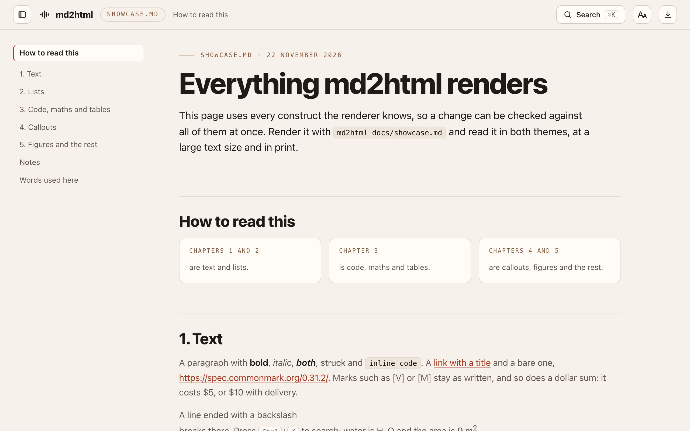
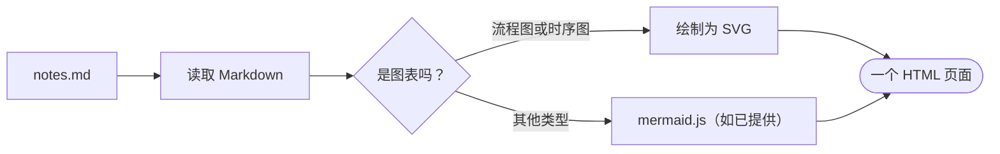
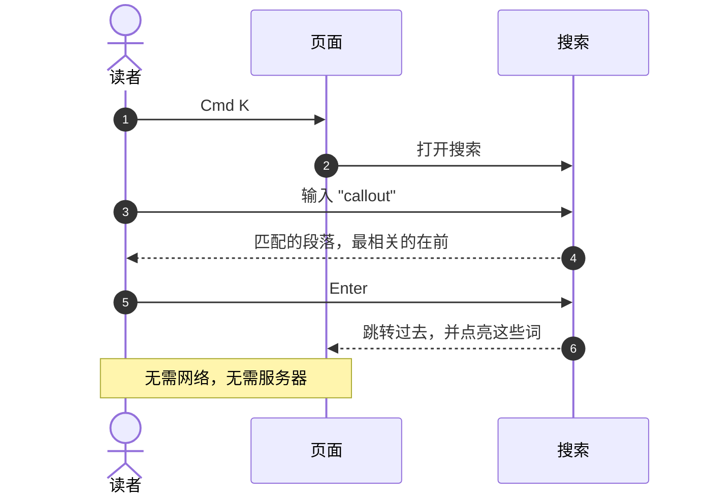
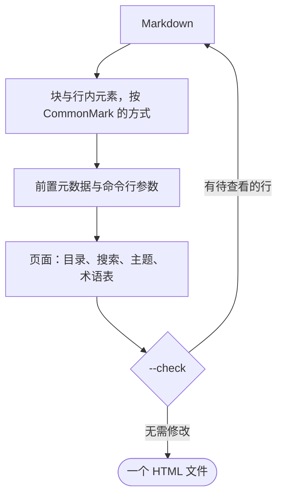

# md2html 的全部功能

md2html 把一个 Markdown 文件变成一个不依赖任何其他东西的网页：不需要服务器，不需要网络，也不从任何地方加载字体或脚本。页面自带目录、搜索、浅色和深色主题、字号、术语表、脚注、可以放大的插图、着色的代码、排版好的数学公式和图表。本页用 Markdown 写成，由 md2html 渲染，所以在你阅读的同时，它描述的每项功能都正在本页上起作用。

## 如何阅读本页

- **第 1 章**介绍 md2html 在哪里运行，以及如何安装它。
- **第 2 章**用一张表列出全部内容。
- **第 3 至 9 章**展示读者能得到什么，以及作者要输入什么才能得到它。
- **第 10 至 12 章**是设置、命令行，以及安全与质量。

---

## 1. 运行环境

| | 在哪里 |
|:--|:--|
| md2html 工具 | macOS（Apple 芯片和 Intel）、Linux 和 Windows，都是同一个 Rust 程序，除标准库之外没有任何依赖；每次改动都会在这三个系统上测试 |
| 它生成的页面 | 当前版本的 Chrome、Edge、Firefox 和 Safari，电脑、平板和手机均可，在线或离线皆可；处处支持屏幕阅读器和键盘 |
| 打开方式 | 网页服务器、共享文件夹、电子邮件附件，或直接从磁盘打开：页面就是一个文件 |
| 打印或另存为 PDF | 任何浏览器都可以，并有页面自己的打印版式；`--pdf` 直接生成 PDF，使用电脑上已有的 Chrome、Chromium 或 Edge |
| 电子阅读器 | `--epub` 生成 EPUB 3，即标准的电子书格式 |
| 页面的语言 | 十七种，包括从右到左书写的语言（第 8 章） |

用 Rust 自己的安装工具，从源代码安装：

```console
$ cargo install --git https://github.com/githubrobbi/md2html md2html --locked
$ md2html notes.md
md2html: notes.md -> notes.html (68504 bytes, 9 glossary terms, 0 of them shared)
```

## 2. 概览

| | md2html |
|:--|:--|
| Markdown | 完整的 CommonMark 0.31.2（它的 652 个测试示例中**通过 652 个**），以及 GitHub 的表格、任务列表、删除线、自动链接、脚注和警报 |
| 输出 | **一个 HTML 文件**，不加载任何东西，读者也无需安装任何东西 |
| 阅读 | 目录、搜索、浅色和深色主题、字号、术语表、脚注、可以放大的插图 |
| 代码、数学公式、图表 | 约二十种语言的代码着色，数学公式以 MathML 呈现，Mermaid 流程图和时序图绘制为 SVG，**全都不需要脚本库** |
| 分享 | 指向任何一章、表格中的一行、插图、图表、代码块或选中段落的链接 |
| 语言 | 页面自身的文字有 **17 种语言**，各个译文之间用切换开关相连，希伯来语和意第绪语从右到左排版 |
| 保存 | 页面本身、带书签的 **PDF**、适用于电子阅读器的 **EPUB** |
| 实时 | 在 Markdown 改变时重新加载、并保留读者位置的页面 |
| 安全 | 绝不从文本中生成脚本；绝不读取文档所在文件夹之外的文件 |
| 无障碍 | 对照 WCAG 2.2 AA 没有发现任何问题，涵盖两种主题和手机宽度 |
| 速度 | 一份 4,000 行的文档，连同图表和数学公式，**不到十分之一秒** |
| 依赖 | **无**：只有 Rust 标准库和 md2html |

## 3. 页面

页面分为三部分：顶部的一条栏、左边的目录，以及正文。

{width=100%}

深色主题跟随系统，或者跟随读者的选择，并且会被记住：

{width=100%}

在手机上，目录收进顶栏的开关后面，页面也不会左右滚动：

{width=34%}

读者可以做的事：

| 想要 | 这样做 |
|:--|:--|
| 查找内容 | 顶栏中的**搜索**，<kbd>⌘</kbd> <kbd>K</kbd>（<kbd>Ctrl</kbd> <kbd>K</kbd>），或 <kbd>/</kbd> |
| 隐藏或显示目录 | 顶栏左边的开关，或 <kbd>⌘</kbd> <kbd>\\</kbd> |
| 调整字号 | 顶栏中的 **Aa**，然后 **−** 和 **+**；或 <kbd>⌘</kbd> <kbd>+</kbd> 和 <kbd>⌘</kbd> <kbd>−</kbd>，范围从 85% 到 200% |
| 切换主题 | **Aa**，然后选择跟随系统、浅色或深色 |
| 放大插图 | 点击它；再点两次会拉得更近；<kbd>Esc</kbd> 让它复原 |
| 阅读脚注或带虚线的词 | 把鼠标停在上面；点击则跳过去，**返回**会带你回来 |
| 分享一章、表格中的一行、一幅插图、一张图表、一个代码块或一段文字 | 标题右边的分享符号，鼠标所在表格行末尾的分享符号，或鼠标所在插图、图表或代码块角上的分享符号，会复制它的链接（在手机上会打开分享面板）；选中一些文字，就会提供一个恰好指向它们的链接 |
| 保存 | 顶栏末端的下载按钮：页面本身（可离线阅读）、打印或另存为 PDF，或者已生成的 PDF 和 EPUB |

字号和主题一起放在 **Aa** 后面；保存页面则有它自己的按钮：

{width=60%}

## 4. 写作

就是普通的 Markdown，而且每种写法作为纯文本读起来也很顺。先在代码块中给出你写的内容，紧随其后的是你得到的结果。

### 强调与链接

```markdown
**粗体**、*斜体*、***两者兼有***、~~删除线~~和`代码`。
一个[链接](https://commonmark.org "CommonMark")，裸链接
https://spec.commonmark.org/0.31.2/ 也可以，还有像 [V] 这样保持原样的标记。
```

**粗体**、*斜体*、***两者兼有***、~~删除线~~和`代码`。一个[链接](https://commonmark.org "CommonMark")，裸链接 https://spec.commonmark.org/0.31.2/ 也可以，还有像 [V] 这样保持原样的标记。

### 列表中的列表

```markdown
1. 第一项，带一个嵌套列表：
   - 一个项目
   - 另一个，带有它自己的列表：
     1. 更深一层
2. 第二项。
- [x] 一个已完成的任务
- [ ] 一个未完成的任务
```

1. 第一项，带一个嵌套列表：
   - 一个项目
   - 另一个，带有它自己的列表：
     1. 更深一层
2. 第二项。

- [x] 一个已完成的任务
- [ ] 一个未完成的任务

### 引用与标注

```markdown
> 普通的引用仍然是引用。

> [!TIP]
> GitHub 的警报都能用：NOTE、TIP、IMPORTANT、WARNING、CAUTION。

> **说明:** 旧的写法也一样可以：一个粗体词加一个冒号。
```

> 普通的引用仍然是引用。

> [!TIP]
> GitHub 的警报都能用：NOTE、TIP、IMPORTANT、WARNING、CAUTION。

> **说明:** 旧的写法也一样可以：一个粗体词加一个冒号。

### 表格

```markdown
| 房间 | 楼层 | 面积（平方英尺） |
|:-----|:----:|-----------------:|
| 客厅 | 一楼 |              312 |
| 阁楼 | 楼上 |              205 |
```

| 房间 | 楼层 | 面积（平方英尺） |
|:-------|:------:|-------------:|
| 客厅 | 一楼 | 312 |
| 阁楼 | 楼上 | 205 |

比栏宽更宽的表格会在栏内滚动，页面本身则从不左右滚动。

### 脚注

```markdown
一个需要出处的说法。[^1]

[^1]: 出处。把鼠标停在编号上，就能在原处读到它。
```

一个需要出处的说法。[^source]

[^source]: 出处。把鼠标停在编号上，就能在原处读到它；点击编号会来到这里，点击**返回**则回到原处。

### 插图与图片

```markdown
{width=60%}

一个图标 {width=18} 嵌在句子当中。
```

{width=60%}

一个图标 {width=18} 嵌在句子当中。

### 小细节

```markdown
按 <kbd>Ctrl</kbd>+<kbd>K</kbd>。水是 H<sub>2</sub>O，房间 9 m<sup>2</sup>。
以反斜杠结尾的一行\
会在那里换行。
```

按 <kbd>Ctrl</kbd>+<kbd>K</kbd>。水是 H<sub>2</sub>O，房间 9 m<sup>2</sup>。以反斜杠结尾的一行\
会在那里换行。

<details>
<summary>点击即可展开的一节</summary>

用 `<details>` 加一个 `<summary>` 写成，里面是普通的 Markdown：**粗体**、一个列表，

- 一
- 二

</details>

#### 第四级标题

第三级以下的标题不会进入目录，这个标题就是如此。

## 5. 代码、数学公式与图表

代码会按 Rust、Python、JavaScript 和 TypeScript、Go、C 和 C++、Java、Kotlin、Swift、C#、shell、SQL、Ruby、Lua、PHP、CSS、HTML、JSON、YAML、TOML、Dockerfile 和 diff 着色，每个代码块都有一个复制按钮。

```rust
/// The whole page from one Markdown text.
fn main() {
    let page = md2html::render("# Hello\n\nWorld.", &Settings::default());
    println!("{} bytes, nothing to fetch", page.len()); // one file
}
```

```python
@cache
def area(w: float, h: float) -> float:
    """The area of a room."""
    return w * h  # square feet
```

```diff
- every quotation a note
+ a quotation is a quotation; a bold first word makes it a note
```

数学公式由浏览器自己排版，使用 MathML，不需要脚本，也不需要下载字体。行内公式：勾股定理是 $a^2 + b^2 = c^2$，欧拉恒等式是 $e^{i\pi} + 1 = 0$；而像 $5 或 $10 这样的金额仍然是钱。独立显示的公式：

$$
\int_0^1 x^2 \, dx = \frac{1}{3} \qquad \sum_{k=1}^{n} k = \frac{n(n+1)}{2} \qquad \sqrt[3]{27} = 3
$$

$$
\begin{pmatrix} a & b \\ c & d \end{pmatrix}
\begin{pmatrix} x \\ y \end{pmatrix}
=
\begin{pmatrix} ax + by \\ cx + dy \end{pmatrix}
\qquad
|x| = \begin{cases} x & x \ge 0 \\ -x & x < 0 \end{cases}
$$

### 图表

Mermaid 流程图或时序图由 md2html 自己绘制，以 SVG 的形式放在页面里：没有脚本，无需下载任何东西，两种主题下都用页面自己的颜色，图中的文字仍然是文字，搜索可以找到。下面是 Markdown 写法：

````markdown

````

它会变成这样：


一张带编号和注释的时序图：



其他类型（饼图、甘特图、类图）由 mermaid.js 绘制，前提是作者让 md2html 指向它的一份副本（`--mermaid-js FILE`）；这个脚本只会进入那一个页面。没有它，这些图仍以代码显示，`--check` 也会指出这一点。

## 6. 术语表、脚注、搜索与插图

名为“术语表”的一章把页面用到的词列成一张表。它不会在原处显示；取而代之的是，每章中每个术语第一次出现时都会变成带虚线的词，鼠标停在上面就会显示解释，点击它则跳到页面底部的条目，那里又能带你回到正在读的那一行。

{width=70%}

脚注也是这样：鼠标停在编号上，就会显示注释内容。

{width=70%}

> [!NOTE]
> 术语表可以在多个页面之间共享：放在 `~/.config/md2html/glossary.md` 的一个文件，其中的词会在这台电脑上渲染的每个页面中被链接。

搜索覆盖页面上的每一个词，包括术语表。结果会显示每个词所在的位置；选中的那一条会在搜索跳转到的地方被点亮。

{width=80%}

{width=80%}

插图在页面上方放大，不会离开页面。如果它比窗口还大，就会跟随指针移动，所以你指向哪里，就能看到哪里。

## 7. 分享与实时页面

每个标题右边都有一个分享符号；每个表格行、插图、图表和代码块在鼠标指向时也会显示一个。点击即可复制恰好指向那个位置的链接，并会提示已复制；在手机上则改为打开系统的分享面板。选中几个词，页面就会提供一个恰好指向它们的链接，打开这个链接，页面就会停在那段文字上，并将其高亮显示。

{width=80%}

页面也可以自己保持最新。`md2html --serve` 在页面编写期间就在这台电脑上显示它们，Markdown 一保存，每个打开的页面都会立即重新加载。用 `--live` 发布的页面有自己的有效期：到期时，页面向自己的服务器请求自身开头的 1 KB，也就是它的指纹所在之处，只有指纹改变了才重新加载。无论哪种方式，读者都停留在原来的位置：同一段落位于同样的高度；如果该段落已经不在了，则回到它之前的那一章；切换到另一种语言时，也以同样的方式保留位置。

## 8. 语言

页面自身的文字（搜索、标注、术语表、日期、每一个按钮）有十七种语言：英语、德语、希伯来语、印尼语、荷兰语、爪哇语、意第绪语、低地德语、法语、意大利语、西班牙语、三种写法的日语（汉字加假名、只用假名、罗马字）、简体字和繁体字的普通话中文，以及粤语。只需在前置元数据中写上 `lang: de` 即可。希伯来语和意第绪语从右到左排版，目录在右边。

译文就是原文旁边的另一个 Markdown 文件，以其语言命名：`capabilities.de.md` 就是德语版的 `capabilities.md`。md2html 会找出现有的各个版本，用顶栏中的切换开关（地球图标）把它们相互链接起来，通过 `hreflang` 告诉浏览器和搜索引擎，并为每个版本配上它自己界面的文字。本页有全部十七种语言版本；地球图标可以在它们之间切换，页面会打开到你正在读的那一段。

每个译文都注明它的原文，并记录原文的指纹，因此页面可以说明哪个版本具有权威性；如果原文在翻译之后有改动，`--check` 也会发现：

```yaml
translated_from: capabilities.md
source_sha256: 5b0c...e1
```

对于还没有人把页面翻译成的语言，读者自己的浏览器可以代为翻译，前提是它具备这项能力（Chrome 的内置翻译器）：翻译在设备本身上完成，因此任何内容都不会离开这台设备，并且会标明这是机器翻译，同时提供返回原文的方式。

## 9. 保存页面

顶栏中的下载按钮提供所有可以保存的东西。图片放在页面里面时（`embed: true`），页面本身就可以离线阅读。打印有自己的版式：控件隐去，每个链接都打印出地址，没有任何内容被分页截断，而且每页都带有标题和页码。

{width=55%}

`--pdf` 用电脑上已有的 Chrome 打印页面：使用页面自己的打印版式，标题成为 PDF 的书签，每页顶部是标题，底部是页码。`--epub` 用同一个页面生成一本适用于电子阅读器的书，包含目录、图片、图表和数学公式，脚注会在提到它们的地方打开；EPUB 由 md2html 自己写出。读者在下载按钮下面可以找到这两者。

## 10. 设置

本页英文原文的 Markdown 文件开头是这样的：

```yaml
---
title: md2html, everything it does
brand: md2html
kicker: Capabilities
version: 0.7.7
date: 2026-11-22
footer: Written in Markdown and rendered by **md2html 0.7.7** itself ...
csp: true      # only this page's own code may run
embed: true    # the screenshots are inside the page
---
```

| 设置 | 作用 |
|:--|:--|
| `title`、`description`、`author` | 标题，以及用于链接预览的 meta 标签 |
| `lang` | 语言：页面自身的文字和日期，可为十七种语言中的任何一种（`ja-Hira` 是只用假名书写的日语，`zh-Hant` 是繁体字中文，`yue` 是粤语） |
| `translated_from`、`source_sha256` | 用于译文：它的原文，以及翻译时原文的指纹 |
| `brand`、`brand_link`、`kicker`、`eyebrow`、`footer` | 顶栏、标题上方的那一行、页脚的小字 |
| `date`、`version` | 标题上方显示的日期和版本 |
| `embed` | 把图片放进页面里，使它成为一个文件 |
| `csp` | 一条 Content-Security-Policy |
| `pdf`、`epub` | 在页面旁边生成它的 PDF 和 EPUB |
| `live` | 页面的有效期（`true` 为两分钟，也可以是秒数）：到期后若页面已改变就重新加载，并保留读者的位置 |
| `large`、`toc`、`math`、`index`、`html`、`css`、`head` | 更大的字号、目录、数学公式、搜索引擎、更丰富的 HTML、额外的样式和 head |

> [!TIP]
> 设置 `lang: de` 后，搜索框显示“Diese Seite durchsuchen”，标注显示“Hinweis”和“Achtung”，日期显示为“22. November 2026”。

## 11. 命令行

```console
$ md2html notes.md
md2html: notes.md -> notes.html (68504 bytes, 9 glossary terms, 0 of them shared)
$ md2html docs/ -o site/ --nav
$ md2html notes.md --check
notes.md:12: a link points at #setup, which is nowhere on the page
notes.md:30: `plan.svg` does not exist next to this page
md2html: 2 to look at
$ cat notes.md | md2html - > notes.html
$ md2html notes.md --pdf --epub
$ md2html notes.md --serve
```

`--check` 不写入任何东西，而是逐行列出作者应该查看的地方，只要有任何问题就以 1 退出：指向页面上不存在的锚点的链接、不存在的文件、缺少注释内容的脚注、被当作文本显示的原始 HTML、比原文更旧的译文。因此它适合作为构建的最后一步。`--watch` 在每次保存时重新渲染，`--nav` 用“上一页”和“下一页”把一个文件夹中的页面链接起来，而指向另一个 Markdown 文件的链接会跳到它的页面。

## 12. 安全、质量与无障碍

> [!WARNING]
> 页面可能是从别人写的 Markdown 渲染出来的。md2html 绝不会从文本中生成脚本：原始 HTML 会按原样显示（少数无害的标签除外），而 `javascript:` 或 `data:` 链接无论怎样拼写都会被丢弃。文档无法让 md2html 读取它所在文件夹之外的文件；任何输入，无论多么恶意，都无法让它卡住或崩溃。

> [!CAUTION]
> `--html` 会让更丰富的 HTML 通过（图片、链接、视频、SVG、布局），但绝不会放过任何能运行的东西：没有脚本、没有事件处理程序、没有框架、没有表单。

每次改动时，都会在 macOS、Linux 和 Windows 上检查以下各项：

- 79 个测试，渲染完整的页面并读回检查，其中包括安全方面和极端输入的用例；
- CommonMark 规范的 652 个示例，通过的数量可以上升，但绝不能下降；
- clippy 最严格的 lint，以及本工具承诺支持构建的最旧 Rust 版本；
- 用 axe-core 按 WCAG 2.2 AA 进行的无障碍审核，涵盖两种主题和手机宽度；
- 在 Chrome 中的一次逐项点击测试，像读者那样用鼠标和键盘使用每一个控件，分别在正常字号和较大字号下进行；
- 实时页面的端到端测试：改动后重新加载、读者的位置得以保留、切换语言后落在同一段落。

md2html 不含任何第三方代码，它的供应链经过锁定和审查：工具链、CI 操作、测试工具。每个页面都以一行不起眼的文字结尾：由 md2html 制作、它的版本号，以及一个指向 md2html 所在之处的链接。

每个页面所走的路径：



---

下面的术语表解释本页用到的词；每个词在上文中都是带虚线的词。

## 术语表

| 术语 | 释义 | 又称 |
|---|---|---|
| Markdown | 带有少量标记的纯文本，用来表示标题、强调、列表和链接，原样即可阅读，也可以转换成页面。 | |
| CommonMark | 如今大多数工具都遵循的 Markdown 规范，每条规则都有对应的测试。 | |
| 目录 | 页面左边的章节列表，由页面的标题生成。 | |
| 标注 | 一个带框的旁注：说明、提示、重要事项、警告或注意事项。 | 警报 |
| 插图 | 单独占一行的图片，下方附有说明文字，点击即可放大。 | |
| 前置元数据 | Markdown 文件最顶部两条 `---` 线之间的设置块。 | |
| MathML | 网页自己的数学语言，由浏览器绘制，无需脚本。 | |
| Content-Security-Policy | 页面中的一条规则，告诉浏览器哪些代码可以运行；在这里，只有页面自己的代码可以运行。 | |
| Mermaid | 一种用于绘制图表的文本语言，写在代码块中；md2html 会绘制它的流程图和时序图。 | |
| WCAG | 《Web 内容无障碍指南》（Web Content Accessibility Guidelines）；AA 级是通常的目标。 | |
| 译文 | 页面在另一种语言中的版本，即原文旁边的一个 Markdown 文件。 | 译本 |
| EPUB | 电子书的标准格式，一种打包好的网页，由电子阅读器进行排版。 | |
