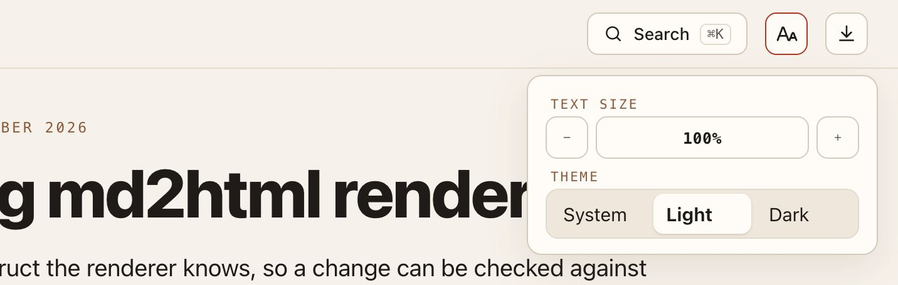
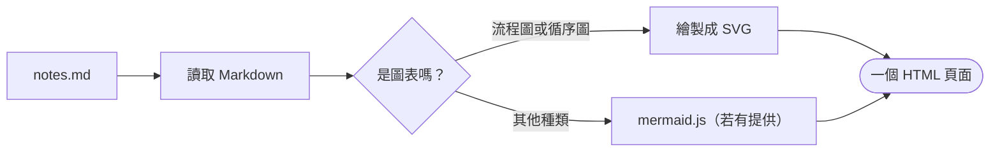
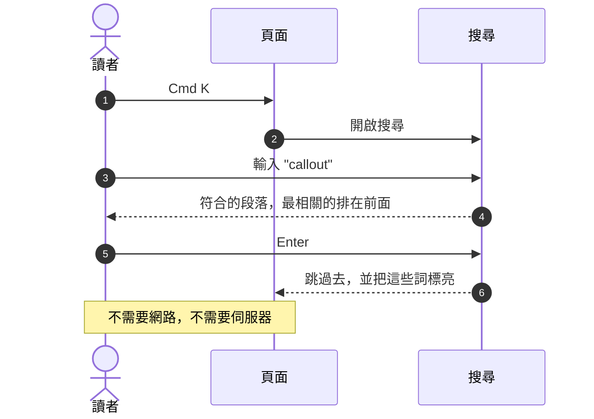
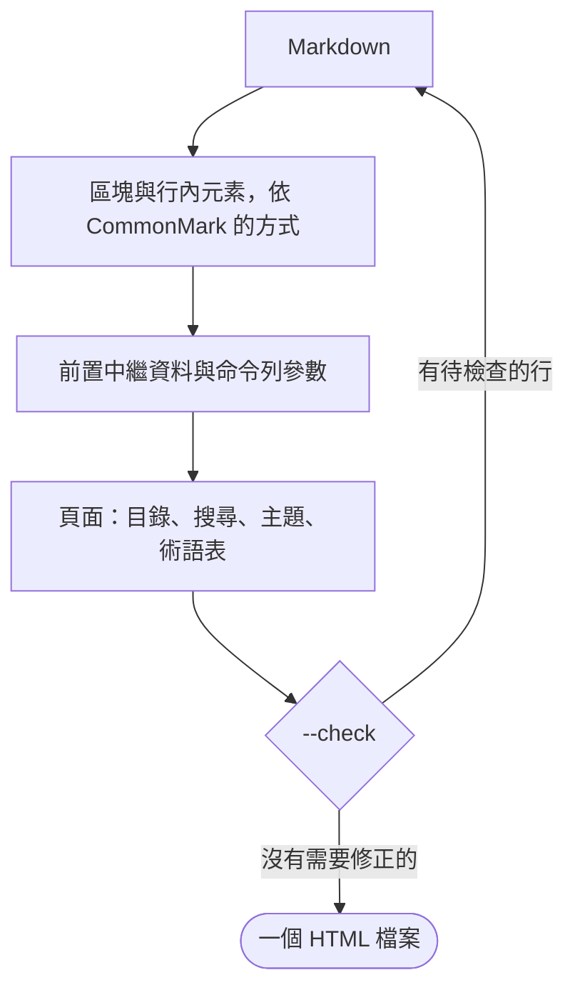

# md2html 的所有功能

md2html 把一個 Markdown 檔案變成一個不需要其他任何東西的網頁：不需要伺服器，不需要網路，也不從任何地方載入字型或指令碼。頁面自備目錄、搜尋、淺色和深色主題、字級、術語表、註腳、可以放大的插圖、上色的程式碼、排版好的數學公式和圖表。本頁以 Markdown 撰寫，由 md2html 渲染，所以在你閱讀的同時，它描述的每項功能都正在本頁上發揮作用。

## 如何閱讀本頁

- **第 1 章**介紹 md2html 在哪裡執行，以及如何安裝。
- **第 2 章**用一張表列出所有內容。
- **第 3 至 9 章**介紹讀者能得到什麼，以及作者要輸入什麼才能得到它。
- **第 10 至 12 章**是設定、命令列，以及安全與品質。

---

## 1. 執行環境

| | 在哪裡 |
|:--|:--|
| md2html 工具 | macOS（Apple 晶片和 Intel）、Linux 和 Windows，都是同一個 Rust 程式，除了標準函式庫之外沒有任何相依套件；每次變更都會在這三個系統上測試 |
| 它產生的頁面 | 目前版本的 Chrome、Edge、Firefox 和 Safari，電腦、平板和手機皆可，連線或離線皆可；處處支援螢幕閱讀器和鍵盤 |
| 開啟方式 | 網頁伺服器、共用資料夾、電子郵件附件，或直接從磁碟開啟：頁面就是一個檔案 |
| 列印或另存為 PDF | 任何瀏覽器都可以，並有頁面自己的列印版面；`--pdf` 會直接產生 PDF，使用電腦上已經安裝的 Chrome、Chromium 或 Edge |
| 電子閱讀器 | `--epub` 會產生 EPUB 3，也就是標準的電子書格式 |
| 頁面的語言 | 十七種，包括由右至左書寫的語言（第 8 章） |

用 Rust 自己的安裝工具，從原始碼安裝：

```console
$ cargo install --git https://github.com/githubrobbi/md2html --tag v0.8.2 md2html --locked
$ md2html notes.md
md2html: notes.md -> notes.html (68504 bytes, 9 glossary terms, 0 of them shared)
```

## 2. 概覽

| | md2html |
|:--|:--|
| Markdown | 完整的 CommonMark 0.31.2（它的 652 個測試範例中**通過 652 個**），以及 GitHub 的表格、待辦清單、刪除線、自動連結、註腳和警示 |
| 輸出 | **一個 HTML 檔案**，不載入任何東西，讀者也不必安裝任何東西 |
| 閱讀 | 目錄、搜尋、淺色和深色主題、字級、術語表、註腳、可以放大的插圖 |
| 程式碼、數學公式、圖表 | 約二十種程式語言的程式碼上色，數學公式以 MathML 呈現，Mermaid 流程圖和循序圖繪製成 SVG，**全都不需要指令碼函式庫** |
| 分享 | 指向任何一章、表格中的一列、插圖、圖表、程式碼區塊或選取段落的連結 |
| 語言 | 頁面本身的介面文字有 **17 種語言**，各份譯文之間以切換開關相連，希伯來文、意第緒文和阿拉伯文由右至左排版 |
| 保存 | 頁面本身、附書籤的 **PDF**、適用於電子閱讀器的 **EPUB** |
| 即時 | 在 Markdown 變更時重新載入、並保留讀者位置的頁面 |
| 安全 | 絕不從文字中產生指令碼；絕不讀取文件所在資料夾以外的檔案 |
| 無障礙 | 依 WCAG 2.2 AA 檢測沒有發現任何問題，涵蓋兩種主題和手機寬度 |
| 速度 | 一份 4,000 行的文件，連同圖表和數學公式，**不到十分之一秒** |
| 相依套件 | **無**：只有 Rust 標準函式庫和 md2html |

## 3. 頁面

頁面分成三部分：頂端列、左側的目錄，以及內文。

{width=100%}

深色主題會跟隨系統，或依讀者的選擇，而且會被記住：

{width=100%}

在手機上，目錄會收進頂端列的開關後面，頁面也不會左右捲動：

{width=34%}

讀者可以做的事：

| 想要 | 這樣做 |
|:--|:--|
| 尋找內容 | 頂端列中的**搜尋**，<kbd>⌘</kbd> <kbd>K</kbd>（<kbd>Ctrl</kbd> <kbd>K</kbd>），或 <kbd>/</kbd> |
| 隱藏或顯示目錄 | 頂端列左側的開關，或 <kbd>⌘</kbd> <kbd>\\</kbd> |
| 調整字級 | 頂端列中的 **Aa**，再按 **−** 和 **+**；或 <kbd>⌘</kbd> <kbd>+</kbd> 和 <kbd>⌘</kbd> <kbd>−</kbd>，範圍從 85% 到 200% |
| 切換主題 | **Aa**，再選擇跟隨系統、淺色或深色 |
| 放大插圖 | 點一下；再點兩下會拉得更近；<kbd>Esc</kbd> 讓它復原 |
| 閱讀註腳或帶虛線的詞 | 把滑鼠停在上面；點一下就跳過去，**返回**會帶你回來 |
| 分享一章、表格中的一列、一幅插圖、一張圖表、一個程式碼區塊或一段文字 | 標題右側的分享符號，滑鼠所在表格列末端的分享符號，或滑鼠所在插圖、圖表或程式碼區塊角落的分享符號，會複製它的連結（在手機上會開啟分享選單）；選取一些文字，就會提供一個正好指向它們的連結 |
| 保存 | 頂端列末端的下載按鈕：頁面本身（可離線閱讀）、列印或另存為 PDF，或是已產生的 PDF 和 EPUB |

字級和主題一起放在 **Aa** 後面；保存頁面則有它自己的按鈕：

{width=60%}

## 4. 撰寫

就是一般的 Markdown，而且每種寫法當成純文字讀起來也很通順。先在程式碼區塊中列出你寫的內容，緊接著是你得到的結果。

### 強調與連結

```markdown
**粗體**、*斜體*、***兩者兼具***、~~刪除線~~和`程式碼`。
一個[連結](https://commonmark.org "CommonMark")，裸網址
https://spec.commonmark.org/0.31.2/ 也行，還有像 [V] 這樣保持原樣的標記。
```

**粗體**、*斜體*、***兩者兼具***、~~刪除線~~和`程式碼`。一個[連結](https://commonmark.org "CommonMark")，裸網址 https://spec.commonmark.org/0.31.2/ 也行，還有像 [V] 這樣保持原樣的標記。

### 清單中的清單

```markdown
1. 第一項，帶一個巢狀清單：
   - 一個項目
   - 另一個，帶有自己的清單：
     1. 更深一層
2. 第二項。
- [x] 一項已完成的工作
- [ ] 一項尚未完成的工作
```

1. 第一項，帶一個巢狀清單：
   - 一個項目
   - 另一個，帶有自己的清單：
     1. 更深一層
2. 第二項。

- [x] 一項已完成的工作
- [ ] 一項尚未完成的工作

### 引文與標註

```markdown
> 一般的引文仍然是引文。

> [!TIP]
> GitHub 的警示都能用：NOTE、TIP、IMPORTANT、WARNING、CAUTION。

> **說明:** 舊的寫法也一樣可以：一個粗體字加一個冒號。
```

> 一般的引文仍然是引文。

> [!TIP]
> GitHub 的警示都能用：NOTE、TIP、IMPORTANT、WARNING、CAUTION。

> **說明:** 舊的寫法也一樣可以：一個粗體字加一個冒號。

### 表格

```markdown
| 房間 | 樓層 | 面積（平方英尺） |
|:-----|:----:|-----------------:|
| 客廳 | 一樓 |              312 |
| 閣樓 | 樓上 |              205 |
```

| 房間 | 樓層 | 面積（平方英尺） |
|:-------|:------:|-------------:|
| 客廳 | 一樓 | 312 |
| 閣樓 | 樓上 | 205 |

比欄寬更寬的表格會在欄內捲動，頁面本身則永遠不會左右捲動。

### 註腳

```markdown
一個需要出處的說法。[^1]

[^1]: 出處。把滑鼠停在編號上，就能在原處讀到它。
```

一個需要出處的說法。[^source]

[^source]: 出處。把滑鼠停在編號上，就能在原處讀到它；點一下編號會來到這裡，點**返回**則回到原處。

### 插圖與圖片

```markdown
{width=60%}

一個圖示 {width=18} 嵌在句子中間。
```

{width=60%}

一個圖示 {width=18} 嵌在句子中間。

### 小細節

```markdown
按 <kbd>Ctrl</kbd>+<kbd>K</kbd>。水是 H<sub>2</sub>O，房間 9 m<sup>2</sup>。
以反斜線結尾的一行\
會在那裡換行。
```

按 <kbd>Ctrl</kbd>+<kbd>K</kbd>。水是 H<sub>2</sub>O，房間 9 m<sup>2</sup>。以反斜線結尾的一行\
會在那裡換行。

<details>
<summary>點一下就會展開的一節</summary>

用 `<details>` 加上一個 `<summary>` 寫成，裡面是一般的 Markdown：**粗體**、一個清單，

- 一
- 二

</details>

#### 第四級標題

第四級及更低層級的標題不會出現在目錄中，這個標題就是如此。

## 5. 程式碼、數學公式與圖表

程式碼會依 Rust、Python、JavaScript 和 TypeScript、Go、C 和 C++、Java、Kotlin、Swift、C#、shell、SQL、Ruby、Lua、PHP、CSS、HTML、JSON、YAML、TOML、Dockerfile 和 diff 上色，每個程式碼區塊都有一個複製按鈕。

```rust
/// The whole page from one Markdown text.
fn main() {
    let page = md2html::render("# Hello\n\nWorld.", &Settings::default());
    println!("{} bytes, nothing to fetch", page.len()); // one file
}
```

```python
@cache
def area(w: float, h: float) -> float:
    """The area of a room."""
    return w * h  # square feet
```

```diff
- every quotation a note
+ a quotation is a quotation; a bold first word makes it a note
```

數學公式由瀏覽器自己排版，使用 MathML，不需要指令碼，也不必下載字型。行內公式：畢氏定理是 $a^2 + b^2 = c^2$，歐拉恆等式是 $e^{i\pi} + 1 = 0$；而像 $5 或 $10 這樣的金額仍然是錢。獨立顯示的公式：

$$
\int_0^1 x^2 \, dx = \frac{1}{3} \qquad \sum_{k=1}^{n} k = \frac{n(n+1)}{2} \qquad \sqrt[3]{27} = 3
$$

$$
\begin{pmatrix} a & b \\ c & d \end{pmatrix}
\begin{pmatrix} x \\ y \end{pmatrix}
=
\begin{pmatrix} ax + by \\ cx + dy \end{pmatrix}
\qquad
|x| = \begin{cases} x & x \ge 0 \\ -x & x < 0 \end{cases}
$$

### 圖表

Mermaid 流程圖或循序圖由 md2html 自己繪製，以 SVG 的形式放在頁面裡：沒有指令碼，不必下載任何東西，兩種主題下都使用頁面自己的顏色，圖中的文字仍然是文字，搜尋找得到。這是 Markdown 寫法：

````markdown

````

它會變成這樣：


一張有編號、附註記的循序圖：



其他種類（圓餅圖、甘特圖、類別圖）由 mermaid.js 繪製，前提是作者讓 md2html 指向它的一份副本（`--mermaid-js FILE`）；這個指令碼只會放進那一個頁面。沒有它，這些圖仍以程式碼顯示，`--check` 也會指出這一點。

## 6. 術語表、註腳、搜尋與插圖

名為「術語表」的一章把頁面用到的詞列成一張表。它不會在原處顯示；取而代之的是，每一章中每個術語第一次出現時都會變成帶虛線的詞，滑鼠停在上面就會顯示說明，點一下則跳到頁面底部的條目，那裡又能帶你回到正在讀的那一行。

{width=70%}

註腳也是這樣：滑鼠停在編號上，就會顯示註腳內容。

{width=70%}

> [!NOTE]
> 術語表可以在多個頁面之間共用：放在 `~/.config/md2html/glossary.md` 的一個檔案，其中的詞會在這台電腦上從檔案渲染的每個頁面中加上連結。

搜尋涵蓋頁面上的每一個詞，包括術語表。結果會顯示每個詞所在的位置；選中的那一筆會在搜尋跳到的地方被標亮。

{width=80%}

{width=80%}

插圖會在頁面上方放大，不會離開頁面。如果它比視窗還大，就會跟著指標移動，所以你指向哪裡，就能看到哪裡。

## 7. 分享與即時頁面

每個標題右側都有一個分享符號；每個表格列、插圖、圖表和程式碼區塊在滑鼠移到上面時也會顯示一個。點一下就會複製正好指向那個位置的連結，並告訴你已經複製；在手機上則改為開啟系統的分享選單。選取幾個字，頁面就會提供一個正好指向它們的連結，開啟這個連結時，頁面會停在那段文字上，並以醒目標示呈現。

{width=80%}

頁面也可以自己保持最新。`md2html --serve` 會在頁面撰寫期間就在這台電腦上顯示它們，Markdown 一存檔，每個開啟的頁面都會立刻重新載入。以 `--live` 發布的頁面有自己的有效期限：到期時，頁面會向自己的伺服器要求自身開頭的 1 KB，也就是它的指紋所在之處，只有指紋變了才重新載入。無論哪一種，讀者都會留在原本的位置：同一個段落位於同樣的高度；如果那個段落已經不在了，就回到它前面的那一章；切換到另一種語言時，也會用同樣的方式保留位置。伺服器只供這台電腦使用：它只回應發給它自己的請求，只提供文件所在的資料夾，遇到無法完整讀取的請求時，會以說明原因的狀態碼回應。

## 8. 語言

頁面本身的介面文字（搜尋、標註、術語表、日期、每一個按鈕）有十七種語言：英文、德文、希伯來文、印尼文、荷蘭文、爪哇文、意第緒文、低地德文、法文、義大利文、西班牙文、三種寫法的日文（漢字加假名、只用假名、羅馬字）、以簡體字和繁體字書寫的華語，以及粵語。只要在前置中繼資料中寫上 `lang: de` 就行了。希伯來文和意第緒文由右至左排版，目錄在右側；阿拉伯文也是如此，介面文字則用英文。

譯文就是原文旁邊的另一個 Markdown 檔案，以它的語言命名：`capabilities.de.md` 就是德文版的 `capabilities.md`。md2html 會找出現有的各個版本，用頂端列中的切換開關（地球圖示）把它們互相連結起來，透過 `hreflang` 告訴瀏覽器和搜尋引擎，並為每個版本配上它自己介面的文字。本頁有全部十七種語言版本；地球圖示可以在它們之間切換，頁面會開在你正在讀的那一段。

每份譯文都會註明它的原文，並記錄原文的指紋，因此頁面可以說明哪個版本才是權威版本；如果原文在翻譯之後有所修改，`--check` 也會察覺：

```yaml
translated_from: capabilities.md
source_sha256: 5b0c...e1
```

對於還沒有人把頁面翻譯過去的語言，讀者自己的瀏覽器可以代為翻譯，前提是它具備這項能力（Chrome 的內建翻譯功能）：翻譯在裝置本身上完成，因此任何內容都不會離開這台裝置，而且會標明這是機器翻譯，並提供回到原文的方式。

## 9. 保存頁面

頂端列中的下載按鈕會列出所有可以保存的東西。圖片放在頁面裡面時（`embed: true`），頁面本身就能離線閱讀。列印有自己的版面：控制項會隱藏，每個連結都會印出網址，沒有任何內容被分頁截斷，而且每頁都附有標題和頁碼。

{width=55%}

`--pdf` 會用電腦上已經安裝的 Chrome 列印頁面：使用頁面自己的列印版面，標題成為 PDF 的書籤，每頁頂端是標題，底部是頁碼。`--epub` 會用同一個頁面製作一本適用於電子閱讀器的書，包含目錄、圖片、圖表和數學公式，註腳會在提到它們的地方開啟；EPUB 由 md2html 自己寫出。讀者在下載按鈕底下可以找到這兩者。

## 10. 設定

本頁英文原文的 Markdown 檔案開頭是這樣的：

```yaml
---
title: md2html, everything it does
description: md2html turns Markdown into one complete, self-contained web page ...
brand: md2html
kicker: Capabilities
version: 0.8.2
date: 2026-11-23
footer: Written in Markdown and rendered by **md2html 0.8.2** itself ...
csp: true      # only this page's own code may run
embed: true    # the screenshots are inside the page
---
```

| 設定 | 作用 |
|:--|:--|
| `title`、`description`、`author` | 標題，以及用於連結預覽的 meta 標籤 |
| `lang` | 語言：頁面本身的介面文字和日期，可為十七種語言中的任何一種（`ja-Hira` 是只用假名書寫的日文，`zh-Hant` 是繁體字中文，`yue` 是粵語） |
| `translated_from`、`source_sha256` | 用於譯文：它的原文，以及翻譯當時原文的指紋 |
| `brand`、`brand_link`、`kicker`、`eyebrow`、`footer` | 頂端列、標題上方的那一行、頁尾的小字 |
| `date`、`version` | 顯示在標題上方的日期和版本 |
| `embed` | 把圖片放進頁面裡，讓它成為單一檔案 |
| `csp` | 一條 Content-Security-Policy |
| `pdf`、`epub` | 在頁面旁邊產生它的 PDF 和 EPUB |
| `live` | 頁面的有效期限（`true` 為兩分鐘，也可以是秒數）：到期後若頁面已變更就重新載入，並保留讀者的位置 |
| `large`、`toc`、`math`、`index`、`html`、`css`、`head` | 較大的字級、目錄、數學公式、搜尋引擎、更豐富的 HTML、額外的樣式和 head |

> [!TIP]
> 設定 `lang: de` 之後，搜尋框會顯示「Diese Seite durchsuchen」，標註會顯示「Hinweis」和「Achtung」，日期則顯示為「23. November 2026」。

## 11. 命令列

```console
$ md2html notes.md
md2html: notes.md -> notes.html (68504 bytes, 9 glossary terms, 0 of them shared)
$ md2html docs/ -o site/ --nav
$ md2html notes.md --check
notes.md:30: `plan.svg` does not exist next to this page
notes.md: a link points at #setup, which is nowhere on the page
md2html: 2 to look at
$ cat notes.md | md2html - > notes.html
$ md2html notes.md --pdf --epub
$ md2html notes.md --serve
```

`--check` 不寫入任何東西，而是列出作者應該檢查的地方，能對應到行的就逐行標出，只要有任何問題就以 1 結束：指向頁面上不存在之錨點的連結、不存在的檔案、缺少內容的註腳、被當成文字顯示的原始 HTML、作者寫的標籤裡沒有可閉合對象的結束標籤或從未閉合的標籤、比原文還舊的譯文。因此它很適合當作建置的最後一步。`--watch` 會在每次存檔時重新渲染，`--nav` 會用「上一頁」和「下一頁」把一個資料夾中的頁面串連起來，而指向另一個 Markdown 檔案的連結會跳到它的頁面。

## 12. 安全、品質與無障礙

> [!WARNING]
> 頁面可能是從別人寫的 Markdown 渲染出來的。md2html 絕不會從文字中產生指令碼：原始 HTML 會照原樣顯示（少數無害的標籤除外，這些標籤會在文章內部成對閉合，因此無法破壞文章之外的頁面），而 `javascript:` 或 `data:` 連結不論怎麼拼寫都會被捨棄。文件無法讓 md2html 讀取其所在資料夾以外的檔案；任何輸入，不論多麼惡意，都無法讓它停擺或當機。

> [!CAUTION]
> `--html` 會讓更豐富的 HTML 通過（圖片、連結、影片、SVG、版面配置），但絕不會放行任何會執行的東西：沒有指令碼、沒有事件處理常式、沒有框架、沒有表單。

每次變更時都會檢查以下各項（測試在 macOS、Linux 和 Windows 上執行，Chrome 中的檢查在 Linux 上執行）：

- 渲染完整頁面再讀回檢查的測試，以及執行程式本身的測試，其中包括安全方面和極端輸入的測試案例；
- CommonMark 規格的 652 個範例，通過的數量可以增加，但絕不能減少；
- clippy 最嚴格的 lint 規則，以及本工具承諾能夠建置的最舊 Rust 版本；
- 用 axe-core 依 WCAG 2.2 AA 進行的無障礙稽核，涵蓋兩種主題和手機寬度；
- 在 Chrome 中的一次逐項點擊測試，像讀者一樣用滑鼠和鍵盤操作每一個控制項，分別在一般字級和較大字級下進行；
- 即時頁面的端對端測試：變更後重新載入、保留讀者的位置、切換語言後停在同一個段落。

md2html 不含任何第三方程式碼，它的供應鏈都經過鎖定和審查：工具鏈、CI 動作、測試工具。每個頁面都以一行低調的文字結尾：由 md2html 製作、它的版本，以及一個連到 md2html 所在之處的連結。

每個頁面所走的路徑：



---

下面的術語表說明本頁用到的詞；每個詞在上文中都是帶虛線的詞。

## 術語表

| 術語 | 釋義 | 又稱 |
|---|---|---|
| Markdown | 帶有少量標記的純文字，用來表示標題、強調、清單和連結，照原樣就能閱讀，也能轉換成頁面。 | |
| CommonMark | 現今大多數工具都遵循的 Markdown 規格，每條規則都有對應的測試。 | |
| 目錄 | 頁面左側的章節清單，由頁面的標題產生。 | |
| 標註 | 一個加框的旁註：說明、提示、重要事項、警告或注意事項。 | 警示 |
| 插圖 | 單獨佔一行的圖片，下方附有說明文字，點一下就能放大。 | |
| 前置中繼資料 | Markdown 檔案最頂端兩條 `---` 線之間的設定區塊。 | |
| MathML | 網頁本身的數學語言，由瀏覽器繪製，不需要指令碼。 | |
| Content-Security-Policy | 頁面中的一條規則，告訴瀏覽器哪些程式碼可以執行；在這裡，只有頁面本身的程式碼可以執行。 | |
| Mermaid | 一種用來繪製圖表的文字語言，寫在程式碼區塊中；md2html 會繪製它的流程圖和循序圖。 | |
| WCAG | 《網頁內容無障礙指引》（Web Content Accessibility Guidelines）；AA 級是一般的目標。 | |
| 譯文 | 頁面在另一種語言中的版本，也就是原文旁邊的一個 Markdown 檔案。 | 譯本 |
| EPUB | 電子書的標準格式，一種封裝好的網頁，由電子閱讀器進行排版。 | |
