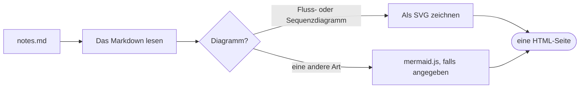
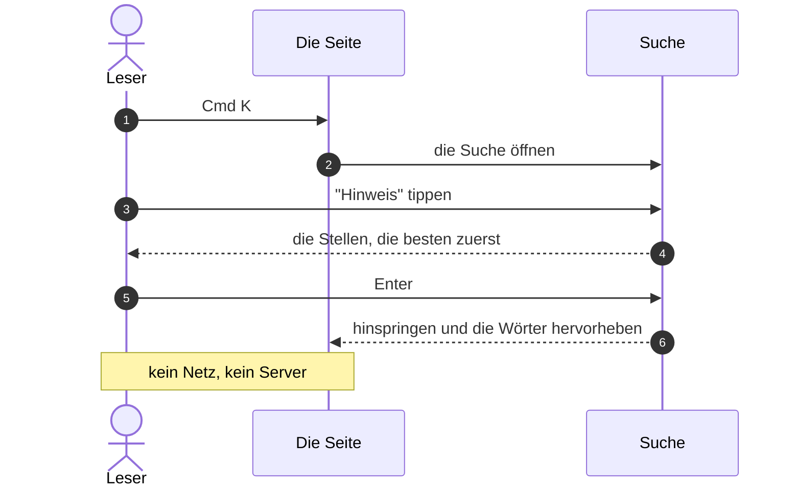
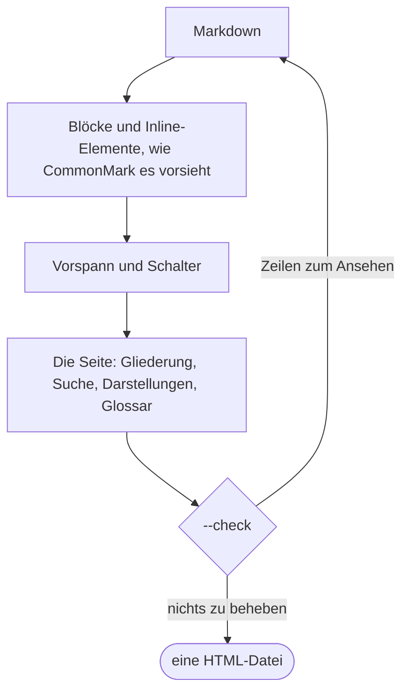

# md2html, alles, was es kann

md2html macht aus einer Markdown-Datei eine HTML-Seite, die sonst nichts braucht: keinen Server, kein Netz, keine Schriften oder Skripte von irgendwoher. Dieser Bericht ist eine solche Seite. Er wurde in Markdown geschrieben und von md2html gerendert, und so ist jede Fähigkeit, die er beschreibt, auch an ihm selbst am Werk: die Gliederung links, die Suche, die beiden Darstellungen, die Textgröße, die Karten unten, die gepunkteten Wörter des Glossars, die Fußnoten, die Abbildungen, die sich vergrößern lassen, farbiger Code und gesetzte Formeln.

## Wie diese Seite zu lesen ist

- **Kapitel 1** ist die ganze Geschichte in einer Tabelle. Zwei Minuten.
- **Kapitel 2 bis 6** zeigen, was man beim Lesen bekommt und was man beim Schreiben dafür tippt.
- **Kapitel 7 und 8** sind die Einstellungen und die Kommandozeile.
- **Kapitel 9 und 10** handeln von Sicherheit und Qualität und davon, wie Version 0.4 entstand.

---

## 1. Auf einen Blick

| | Vorher (0.3) | Jetzt (0.4) |
|:--|:--:|:--:|
| Gelesenes Markdown | eine Teilmenge für das Handbuch | ganz CommonMark, dazu die Erweiterungen von GitHub |
| Bestandene CommonMark-Beispiele | nicht gemessen | **640 von 652** |
| Das 4.265 Zeilen lange docenta-Handbuch | über zwei Minuten | **0,07 Sekunden** |
| Eine Seite voller `[V]`-Zeichen | wuchs auf 38 GB | Millisekunden |
| Befunde zur Barrierefreiheit (axe-core, WCAG 2.2 AA) | Dutzende | **keine**, auf 12 Seiten, hell, dunkel und auf dem Telefon |
| Tests | 10 | 53, dazu die 652 Beispiele der Spezifikation und ein Durchklicken in Chrome |
| Mermaid-Diagramme | als Code gezeigt | **gezeichnet**, ohne Skript |
| Sprachen | Englisch | **17**, mit einem Umschalter zwischen den Übersetzungen, auch von rechts nach links |
| Zum Aufbewahren | die Seite | die Seite, ein **PDF** mit Lesezeichen, ein **EPUB** für E-Reader |
| Laufzeitabhängigkeiten | keine | keine |

Was mit 0.4 kam, als Aufgabenliste:

- [x] ein vollständiger Markdown-Leser, so gebaut, wie es die CommonMark-Spezifikation beschreibt
- [x] Fußnoten, Aufgabenlisten, Durchstreichen, automatische Links, ausgerichtete Tabellen und die fünf Hinweiskästen von GitHub
- [x] farbiger Code in rund zwanzig Sprachen, Formeln als MathML gesetzt
- [x] Einstellungen im Vorspann, und die eigenen Wörter der Seite auf Deutsch
- [x] `--check`, `--watch`, Ordner, stdin, eine zuschaltbare Content-Security-Policy
- [x] eine Prüfung der Barrierefreiheit und ein Durchklicken in der CI
- [x] Mermaid-Flussdiagramme und -Sequenzdiagramme, als SVG gezeichnet, ohne Skript (Kapitel 4)
- [x] dieser Bericht in siebzehn Sprachen, mit einem Umschalter in der Leiste (Kapitel 7)
- [x] die Seite aufbewahrt, gedruckt oder als PDF oder EPUB mitgenommen (Kapitel 2 und 8)

> [!IMPORTANT]
> Jede mit md2html gebaute Seite auf 4sons.com (die Pläne, die Recherchen und die Familienseiten) wurde mit 0.4 neu gebaut und mit der Fassung verglichen, die online war: dieselbe Struktur, oder besser.

## 2. Die Seite

Die Seite hat drei Teile: eine Leiste oben, die Gliederung links und den Text.

{width=100%}

Die dunkle Darstellung folgt dem System oder der Wahl der Lesenden und wird gespeichert:

{width=100%}

Auf dem Telefon klappt die Gliederung hinter den Schalter in der Leiste weg, und nichts scrollt seitwärts:

{width=34%}

Was man beim Lesen tun kann:

| Ziel | So geht es |
|:--|:--|
| Etwas finden | **Suchen** in der Leiste, <kbd>⌘</kbd> <kbd>K</kbd> (<kbd>Strg</kbd> <kbd>K</kbd>) oder <kbd>/</kbd> |
| Die Gliederung aus- oder einblenden | der Schalter links in der Leiste, oder <kbd>⌘</kbd> <kbd>\\</kbd> |
| Die Textgröße ändern | **Aa** in der Leiste, dann **−** und **+**; oder <kbd>⌘</kbd> <kbd>+</kbd> und <kbd>⌘</kbd> <kbd>−</kbd>, von 85 bis 200 Prozent |
| Die Darstellung wechseln | **Aa**, dann System, Hell oder Dunkel |
| Eine Abbildung vergrößern | anklicken; zwei weitere Klicks holen sie näher heran; <kbd>Esc</kbd> stellt sie zurück |
| Eine Fußnote oder ein gepunktetes Wort lesen | mit dem Zeiger darauf ruhen; ein Klick springt hin, und **zurück** führt zurück |
| Ein Kapitel oder eine Stelle teilen | das **#** neben einer Überschrift kopiert ihren Link (ein Telefon öffnet sein Teilen-Menü); Wörter markieren, und ein Link genau zu ihnen wird angeboten |
| Aufbewahren | der Download-Knopf am Ende der Leiste: die Seite selbst (sie lässt sich offline lesen), drucken oder als PDF sichern, oder das PDF und das EPUB, wo sie erstellt wurden |

## 3. Schreiben

Gewöhnliches Markdown, und jedes Konstrukt liest sich auch als reiner Text gut. Was man schreibt, steht zuerst, in einem Codeblock; was man bekommt, folgt danach.

### Hervorhebung und Links

```markdown
**Fett**, *kursiv*, ***beides***, ~~durchgestrichen~~ und `Code`.
Ein [Link](https://commonmark.org "CommonMark"), ein nackter,
https://spec.commonmark.org/0.31.2/, und Zeichen wie [V], die bleiben, wie sie geschrieben sind.
```

**Fett**, *kursiv*, ***beides***, ~~durchgestrichen~~ und `Code`. Ein [Link](https://commonmark.org "CommonMark"), ein nackter, https://spec.commonmark.org/0.31.2/, und Zeichen wie [V], die bleiben, wie sie geschrieben sind.

### Listen in Listen

```markdown
1. Erstens, mit einer verschachtelten Liste:
   - ein Punkt
   - noch einer, mit einer eigenen:
     1. tiefer
2. Zweitens.
```

1. Erstens, mit einer verschachtelten Liste:
   - ein Punkt
   - noch einer, mit einer eigenen:
     1. tiefer
2. Zweitens.

### Zitate und Hinweiskästen

```markdown
> Ein einfaches Zitat bleibt ein Zitat.

> [!TIP]
> Die Hinweiskästen von GitHub funktionieren: NOTE, TIP, IMPORTANT, WARNING, CAUTION.

> **Hinweis:** Auch die ältere Form wird ein Hinweiskasten: ein fettes Wort und ein Doppelpunkt.
```

> Ein einfaches Zitat bleibt ein Zitat.

> [!TIP]
> Die Hinweiskästen von GitHub funktionieren: NOTE, TIP, IMPORTANT, WARNING, CAUTION.

> **Hinweis:** Auch die ältere Form wird ein Hinweiskasten: ein fettes Wort und ein Doppelpunkt.

### Tabellen

```markdown
| Raum       | Etage        | Fläche (sq ft) |
|:-----------|:------------:|---------------:|
| Wohnzimmer | Erdgeschoss  |            312 |
| Dachboden  | Obergeschoss |            205 |
```

| Raum | Etage | Fläche (sq ft) |
|:-------|:------:|-------------:|
| Wohnzimmer | Erdgeschoss | 312 |
| Dachboden | Obergeschoss | 205 |

### Fußnoten

```markdown
Eine Behauptung, die eine Quelle braucht.[^1]

[^1]: Die Quelle. Mit dem Zeiger auf der Zahl ruhen, um sie dort zu lesen.
```

Eine Behauptung, die eine Quelle braucht.[^source]

[^source]: Die Quelle. Mit dem Zeiger auf der Zahl ruhen, um sie dort zu lesen; ein Klick darauf führt hierher, und zurück führt wieder zurück.

### Abbildungen und Bilder

```markdown
{width=60%}

Ein Symbol {width=18} mitten im Satz.
```

{width=60%}

Ein Symbol {width=18} mitten im Satz.

### Kleinigkeiten

```markdown
Drücken Sie <kbd>Strg</kbd>+<kbd>K</kbd>. Wasser ist H<sub>2</sub>O, der Raum 9 m<sup>2</sup>.
Eine Zeile, die auf einem Backslash endet,\
bricht dort um.
```

Drücken Sie <kbd>Strg</kbd>+<kbd>K</kbd>. Wasser ist H<sub>2</sub>O, der Raum 9 m<sup>2</sup>. Eine Zeile, die auf einem Backslash endet,\
bricht dort um.

<details>
<summary>Ein Abschnitt, der sich per Klick öffnet</summary>

Geschrieben als `<details>` mit einem `<summary>`, mit gewöhnlichem Markdown darin: **fett**, eine Liste,

- eins
- zwei

</details>

#### Eine Überschrift der vierten Ebene

Überschriften unterhalb der dritten Ebene bleiben aus der Gliederung heraus, so wie diese hier.

## 4. Code und Formeln

Code wird farbig dargestellt für Rust, Python, JavaScript und TypeScript, Go, C und C++, Java, Kotlin, Swift, C#, die Shell, SQL, Ruby, Lua, PHP, CSS, HTML, JSON, YAML, TOML, Dockerfiles und Diffs, und jeder Block hat einen Knopf zum Kopieren.

```rust
/// The whole page from one Markdown text.
fn main() {
    let page = md2html::render("# Hello\n\nWorld.", &Settings::default());
    println!("{} bytes, nothing to fetch", page.len()); // one file
}
```

```python
@cache
def area(w: float, h: float) -> float:
    """The area of a room."""
    return w * h  # square feet
```

```yaml
title: The plans   # front matter is YAML
lang: de
embed: true
```

Formeln setzt der Browser selbst, als MathML, ohne Skript und ohne Schrift zum Herunterladen. Im Fließtext lautet der Satz des Pythagoras $a^2 + b^2 = c^2$, und die eulersche Identität ist $e^{i\pi} + 1 = 0$; ein Geldbetrag wie $5 oder $10 bleibt Geld. Abgesetzt:

$$
\int_0^1 x^2 \, dx = \frac{1}{3} \qquad \sum_{k=1}^{n} k = \frac{n(n+1)}{2} \qquad \sqrt[3]{27} = 3
$$

$$
\begin{pmatrix} a & b \\ c & d \end{pmatrix}
\begin{pmatrix} x \\ y \end{pmatrix}
=
\begin{pmatrix} ax + by \\ cx + dy \end{pmatrix}
\qquad
|x| = \begin{cases} x & x \ge 0 \\ -x & x < 0 \end{cases}
$$

### Diagramme

Ein Mermaid-Flussdiagramm oder -Sequenzdiagramm zeichnet md2html selbst, als SVG in der Seite: kein Skript, nichts zum Herunterladen, die eigenen Farben der Seite in beiden Darstellungen, und seine Wörter bleiben Wörter, die die Suche findet. Das ist das Markdown:

````markdown

````

Und das wird daraus:



Ein Sequenzdiagramm, nummeriert, mit einer Notiz:



Andere Arten (Tortendiagramme, Gantt-Diagramme, Klassendiagramme) zeichnet mermaid.js, wenn man md2html auf eine Kopie davon verweist (`--mermaid-js FILE`); das Skript kommt dann nur in diese eine Seite. Ohne sie bleiben sie Code, und `--check` sagt das.

## 5. Erklärte Begriffe und Fußnoten

Ein Kapitel namens Glossar enthält die Wörter der Seite als Tabelle. Es wird nicht dort gedruckt, wo es steht: Stattdessen wird die erste Erwähnung jedes Begriffs in jedem Kapitel zu einem gepunkteten Wort, das sich selbst erklärt, wenn der Zeiger darauf ruht, und ein Klick darauf springt zum Eintrag am Fuß der Seite, der zurück zu der Zeile führt, die man gerade gelesen hat.

{width=70%}

Fußnoten funktionieren genauso: Die Zahl erklärt sich selbst, wenn der Zeiger darauf ruht.

{width=70%}

> [!NOTE]
> Ein Glossar lässt sich über mehrere Seiten hinweg teilen: eine Datei unter `~/.config/md2html/glossary.md`, deren Wörter dann auf jeder Seite verlinkt werden, die auf diesem Rechner gerendert wird.

## 6. Suche und Abbildungen

Die Suche umfasst jedes Wort auf der Seite, das Glossar eingeschlossen. Die Treffer zeigen, wo jedes Wort steht; der gewählte wird dort hervorgehoben, wo die Suche landet.

{width=80%}

{width=80%}

Eine Abbildung vergrößert sich über der Seite, ohne sie zu verlassen. Ist sie größer als das Fenster, folgt sie dem Zeiger, sodass man auf das zeigt, was man sehen will.

## 7. Einstellungen

Der Anfang der Markdown-Datei des englischen Originals dieses Berichts lautet:

```yaml
---
title: md2html, everything it does
brand: md2html
kicker: Report
version: 0.7.2
date: 2026-11-22
footer: Written in Markdown and rendered by **md2html 0.7.2** itself ...
csp: true      # only this page's own code may run
embed: true    # the screenshots are inside the page
---
```

| Einstellung | Was sie bewirkt |
|:--|:--|
| `title`, `description`, `author` | der Titel, und die Meta-Tags für Linkvorschauen |
| `lang` | die Sprache: die eigenen Wörter und die Daten der Seite in jeder der siebzehn Sprachen von oben (`ja-Hira` ist Japanisch in Kana, `zh-Hant` Chinesisch in traditionellen Schriftzeichen, `yue` Kantonesisch) |
| `translated_from`, `source_sha256` | für eine Übersetzung: ihr Original, und der Fingerabdruck des Originals zum Zeitpunkt der Übersetzung |
| `brand`, `brand_link`, `kicker`, `eyebrow`, `footer` | die Leiste, die Zeile über dem Titel, das Kleingedruckte |
| `date`, `version` | Datum und Version über dem Titel |
| `embed` | Bilder in der Seite, damit sie eine einzige Datei ist |
| `csp` | eine Content-Security-Policy |
| `pdf`, `epub` | ein PDF und ein EPUB der Seite, daneben |
| `live` | die Lebensdauer der Seite (`true` sind zwei Minuten, sonst eine Zahl von Sekunden): danach lädt sie neu, wenn sie sich geändert hat, und behält die Stelle, an der man liest |
| `large`, `toc`, `math`, `index`, `html`, `css`, `head` | größere Schrift, die Gliederung, Formeln, Suchmaschinen, rohes HTML, zusätzlicher Stil und Head |

> [!TIP]
> Mit `lang: de` sagt die Suche „Diese Seite durchsuchen“, die Hinweiskästen sagen „Hinweis“ und „Achtung“, und das Datum lautet „22. November 2026“. Die Thomas-Seiten auf dieser Website sind auf diese Weise deutsch.

### Sprachen

Diesen Bericht gibt es in siebzehn Sprachen: Englisch, Deutsch, Hebräisch, Indonesisch, Niederländisch, Javanisch, Jiddisch, Plattdeutsch, Französisch, Italienisch, Spanisch, Japanisch in drei Schreibweisen (in Kanji und Kana, nur in Kana und in Rōmaji), Mandarin-Chinesisch in vereinfachten und in traditionellen Schriftzeichen, und Kantonesisch. Der Globus in der Leiste wechselt zwischen ihnen, und die Seite öffnet sich bei dem Kapitel, das man gerade gelesen hat.

Eine Übersetzung ist einfach eine weitere Markdown-Datei neben dem Original, benannt nach ihrer Sprache: `report.de.md` ist das deutsche `report.md`. md2html findet die vorhandenen Fassungen, verlinkt sie miteinander (und teilt das Browsern und Suchmaschinen mit `hreflang` mit) und gibt jeder die Wörter ihrer eigenen Oberfläche: die Suche, die Hinweiskästen, das Glossar, die Daten. Hebräisch und Jiddisch werden von rechts nach links gesetzt, die Gliederung rechts.

Jede Übersetzung nennt ihr Original und hält den Fingerabdruck des Originals fest, sodass die Seite sagen kann, welche Fassung maßgeblich ist, und `--check` bemerkt, wenn sich das Original seit der Übersetzung geändert hat:

```yaml
translated_from: report.md
source_sha256: 5b0c...e1
```

Für eine Sprache, in die noch niemand eine Seite übersetzt hat, kann der Browser der Lesenden sie übersetzen, wo er das kann (der eingebaute Übersetzer von Chrome): auf dem Gerät selbst, sodass nichts von einer Familienseite es verlässt, und als maschinelle Übersetzung gekennzeichnet, mit einem Weg zurück zum Original.

## 8. Die Kommandozeile

```console
$ md2html notes.md
md2html: notes.md -> notes.html (68504 bytes, 9 glossary terms, 0 of them shared)
$ md2html docs/ -o site/ --nav
$ md2html notes.md --check
notes.md:12: a link points at #setup, which is nowhere on the page
notes.md:30: `plan.svg` does not exist next to this page
md2html: 2 to look at
$ cat notes.md | md2html - > notes.html
$ md2html notes.md --pdf --epub
$ md2html notes.md --serve
```

`--check` schreibt nichts, listet Zeile für Zeile auf, was man sich als Autor ansehen sollte, und endet mit 1, wenn es etwas gibt: ein Link auf einen Anker, der nicht auf der Seite steht, eine Datei, die nicht da ist, eine Fußnote ohne ihre Anmerkung, rohes HTML, das als Text gezeigt wird. Das macht es zum letzten Schritt eines Builds oder der Arbeit eines Agenten. `--watch` rendert bei jedem Speichern neu, `--nav` verbindet die Seiten eines Ordners mit Zurück und Weiter, und ein Link auf eine andere Markdown-Datei führt zu deren Seite.

`--pdf` druckt die Seite mit dem Chrome, das schon auf dem Rechner ist: mit ihrem eigenen Drucklayout, den Überschriften als Lesezeichen des PDF, dem Titel oben auf jeder Seite und ihrer Nummer unten. `--epub` macht aus derselben Seite ein Buch für E-Reader, mit Inhaltsverzeichnis, Bildern, Diagrammen und Formeln, und mit Fußnoten, die sich dort öffnen, wo sie erwähnt werden; md2html schreibt es selbst. Beim Lesen findet man beides unter dem Download-Knopf in der Leiste.

`--serve` zeigt die Seiten auf diesem Rechner, während sie geschrieben werden: Jede offene Seite lädt neu, sobald das Markdown gespeichert wird. Eine veröffentlichte Seite mit `--live` hat ihre eigene Lebensdauer; läuft sie ab, fragt sie ihren Server nach ihrem ersten Kilobyte und lädt nur neu, wenn sich das geändert hat. So oder so bleibt man beim Lesen, wo man war: beim selben Absatz auf derselben Höhe oder, wenn er weg ist, beim Kapitel davor.

## 9. Sicherheit, Qualität und Barrierefreiheit

> [!WARNING]
> Eine Seite kann aus Markdown gerendert werden, das jemand anderes geschrieben hat. md2html schreibt nie ein Skript aus dem Text: Rohes HTML wird bis auf ein paar harmlose Tags so gezeigt, wie es geschrieben ist, und `javascript:`- oder `data:`-Links werden verworfen, wie auch immer sie geschrieben sind. Ein Dokument kann md2html nicht dazu bringen, eine Datei außerhalb seines Ordners zu lesen, und keine Eingabe, wie feindselig auch immer, kann es lahmlegen oder abstürzen lassen.

> [!CAUTION]
> `--html` lässt reichhaltigeres HTML durch (Bilder, Links, Video, SVG, Layout), aber nie etwas, das läuft: kein Skript, kein Event-Handler, kein Frame, kein Formular.

Was bei jeder Änderung geprüft wird, auf macOS und Ubuntu:

- 53 Tests, die ganze Seiten rendern und wieder auslesen, die Sicherheitsfälle eingeschlossen;
- die 652 Beispiele der CommonMark-Spezifikation, bei denen die Zahl der bestandenen steigen, aber nie fallen darf;
- die strengsten Lints von clippy und die älteste Rust-Version, auf der sich das Werkzeug bauen lassen soll;
- eine Prüfung der Barrierefreiheit mit axe-core gegen WCAG 2.2 AA, in beiden Darstellungen und in Telefonbreite;
- ein Durchklicken in Chrome, das jedes Bedienelement benutzt: Suche per Tastatur und per Maus, die Darstellung, die Textgröße, die Gliederung, eine Abbildung, eine Fußnote, das Glossar, Kopieren, Drucken.

Der Druck bekommt ein eigenes Layout: Die Bedienelemente fallen weg, jeder Link druckt seine Adresse, nichts wird über eine Seitengrenze hinweg zerschnitten, und die Seiten tragen den Titel und ihre Nummer.

Jede Seite endet mit einer leisen Zeile: erstellt mit md2html, seine Version und ein Link dorthin, wo md2html zu Hause ist.

{width=55%}

## 10. Wie 0.4 entstand

Es begann mit Recherche: was die besten Markdown-Renderer tun, was die Webstandards von einer Seite verlangen und wie das Werkzeug auf diesem Rechner benutzt wird, was sich als der nützlichste Teil herausstellte. Vier Seiten-Builds auf 4sons.com schrieben die Ausgabe von md2html nach dem Rendern um, um die Marke, die Sprache, die Fußzeile und mehr zu ändern. Jede dieser Umschreibungen wurde zu einer Einstellung, und die Builds wurden Seite für Seite gegen die neue Version neu gebaut.

Die Änderungen, als Diff der Regeln, denen der Renderer folgt:

```diff
- a handbook subset, anything else shown as written
+ all of CommonMark, and anything else shown as written
- every quotation a note
+ a quotation is a quotation; a bold first word makes it a note
- the page's words in English
+ the page's words in English or German
```

Was 0.5 seitdem hinzugefügt hat: Diagramme. Der Weg, den jede Seite hier nimmt:



---

Das Glossar unten erklärt die Wörter, die dieser Bericht verwendet; jedes war oben ein gepunktetes Wort.

## Glossar

| Begriff | Bedeutung | Auch |
|---|---|---|
| Markdown | Reiner Text mit leichten Zeichen für Überschriften, Hervorhebung, Listen und Links, lesbar, wie er ist, und in eine Seite umwandelbar. | |
| CommonMark | Die Spezifikation von Markdown, der die meisten Werkzeuge heute folgen, mit einem Test für jede Regel. | |
| Gliederung | Die Liste der Kapitel links auf der Seite, aus ihren Überschriften gebildet. | |
| Hinweiskasten | Ein umrahmter Einschub: ein Hinweis, ein Tipp, etwas Wichtiges, eine Warnung oder ein Aufruf zur Vorsicht. | Hinweiskästen |
| Abbildung | Ein Bild auf einer eigenen Zeile, mit seiner Bildunterschrift darunter, das sich per Klick vergrößert. | Abbildungen |
| Vorspann | Der Block mit Einstellungen zwischen zwei `---`-Zeilen ganz oben in einer Markdown-Datei. | |
| MathML | Die eigene Sprache des Webs für Formeln, vom Browser ohne Skript gezeichnet. | |
| Content-Security-Policy | Eine Regel in der Seite, die dem Browser sagt, welcher Code laufen darf; hier nur der eigene der Seite. | |
| Mermaid | Eine Textsprache für Diagramme, in einem Codeblock geschrieben; md2html zeichnet ihre Flussdiagramme und Sequenzdiagramme. | |
| WCAG | Die Web Content Accessibility Guidelines, die Richtlinien für barrierefreie Webinhalte; Stufe AA ist das übliche Ziel. | |
| Übersetzung | Eine Fassung einer Seite in einer anderen Sprache, eine Markdown-Datei neben dem Original. | Übersetzungen |
