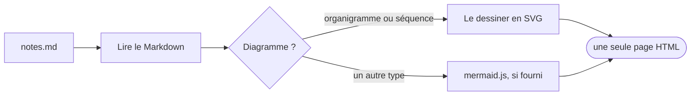
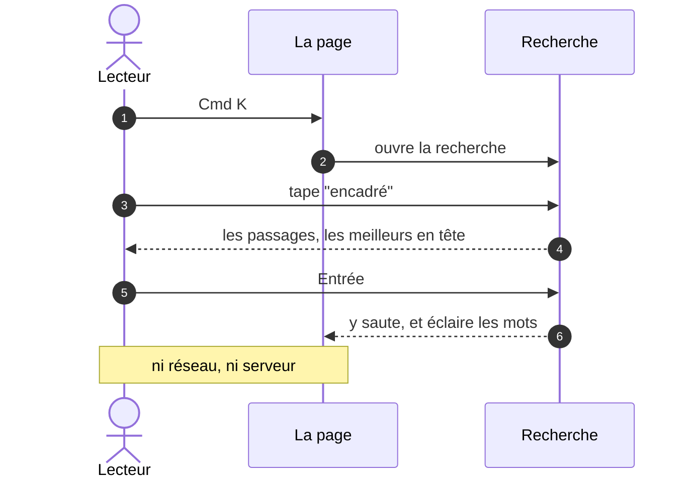
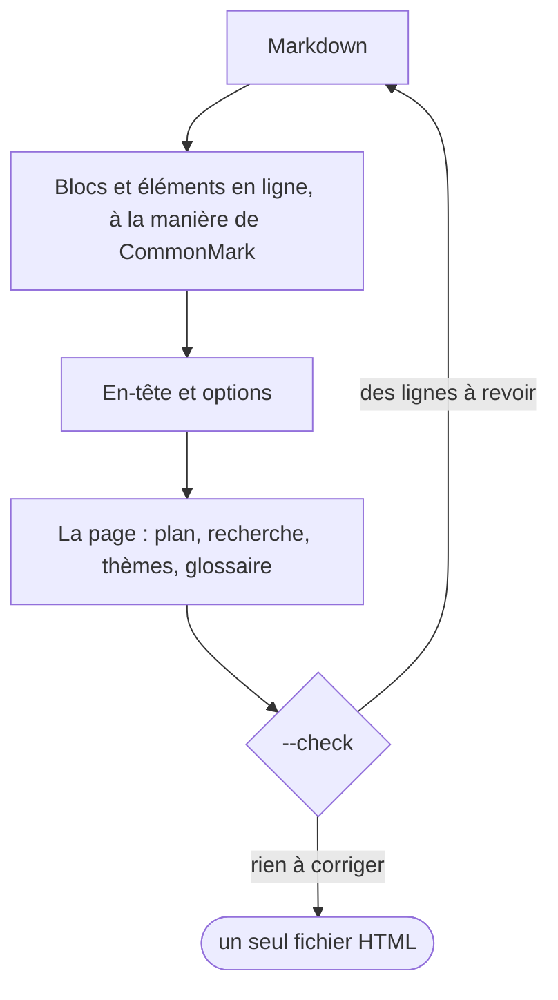

# md2html, tout ce qu'il fait

md2html transforme un fichier Markdown en une seule page HTML qui n'a besoin de rien d'autre : ni serveur, ni réseau, ni polices ou scripts venus d'ailleurs. Ce rapport est une telle page. Il a été écrit en Markdown et rendu par md2html, si bien que chaque capacité qu'il décrit est aussi à l'œuvre sur lui : le plan à gauche, la recherche, les deux thèmes, la taille du texte, les cartes ci-dessous, les mots soulignés de pointillés du glossaire, les notes de bas de page, les figures qui s'agrandissent, le code coloré et les maths composées.

## Comment lire ceci

- **Chapitre 1** raconte toute l'histoire en un tableau. Deux minutes.
- **Chapitres 2 à 6** montrent ce qu'obtient un lecteur, et ce qu'un auteur tape pour l'obtenir.
- **Chapitres 7 et 8** présentent les réglages et la ligne de commande.
- **Chapitres 9 et 10** traitent de la sécurité et de la qualité, et de la façon dont la version 0.4 est née.

---

## 1. En un coup d'œil

| | Avant (0.3) | Maintenant (0.4) |
|:--|:--:|:--:|
| Markdown lu | un sous-ensemble taillé pour le manuel | tout CommonMark, et les ajouts de GitHub |
| Exemples CommonMark réussis | non mesuré | **640 sur 652** |
| Le manuel docenta de 4 265 lignes | plus de deux minutes | **0,07 seconde** |
| Une page pleine de marques `[V]` | grimpait jusqu'à 38 Go | quelques millisecondes |
| Constats d'accessibilité (axe-core, WCAG 2.2 AA) | des dizaines | **aucun**, sur 12 pages, en clair, en sombre et sur téléphone |
| Tests | 10 | 53, plus les 652 exemples de la spécification et un parcours au clic dans Chrome |
| Diagrammes Mermaid | affichés comme du code | **dessinés**, sans script |
| Langues | anglais | **17**, avec un sélecteur entre les traductions, écriture de droite à gauche comprise |
| À conserver | la page | la page, un **PDF** avec signets, un **EPUB** pour liseuses |
| Dépendances à l'exécution | aucune | aucune |

Ce qu'a apporté la 0.4, sous forme de liste de tâches :

- [x] un lecteur Markdown complet, construit comme le décrit la spécification CommonMark
- [x] notes de bas de page, listes de tâches, texte barré, liens automatiques, tableaux alignés et les cinq alertes de GitHub
- [x] du code coloré dans une vingtaine de langages, des maths composées en MathML
- [x] des réglages dans l'en-tête, et les mots propres à la page en allemand
- [x] `--check`, `--watch`, les dossiers, stdin, une Content-Security-Policy sur option
- [x] un audit d'accessibilité et un parcours au clic dans la CI
- [x] les organigrammes et les diagrammes de séquence Mermaid, dessinés en SVG sans script (chapitre 4)
- [x] ce rapport en dix-sept langues, avec un sélecteur dans la barre (chapitre 7)
- [x] la page conservée, imprimée, ou emportée en PDF ou en EPUB (chapitres 2 et 8)

> [!IMPORTANT]
> Chaque page de 4sons.com construite avec md2html (les pages du projet de maison, la recherche et les pages de la famille) a été reconstruite avec la 0.4 et comparée à la version en ligne : la même structure, ou mieux.

## 2. La page

La page a trois parties : une barre en haut, le plan à gauche, et le texte.

{width=100%}

Le thème sombre suit le système, ou le choix du lecteur, et il est mémorisé :

{width=100%}

Sur un téléphone, le plan se replie derrière l'interrupteur de la barre, et rien ne défile de côté :

{width=34%}

Ce que peut faire un lecteur :

| Pour | Faire ceci |
|:--|:--|
| Trouver quelque chose | **Rechercher** dans la barre, <kbd>⌘</kbd> <kbd>K</kbd> (<kbd>Ctrl</kbd> <kbd>K</kbd>), ou <kbd>/</kbd> |
| Masquer ou afficher le plan | l'interrupteur à gauche de la barre, ou <kbd>⌘</kbd> <kbd>\\</kbd> |
| Changer la taille du texte | **Aa** dans la barre, puis **−** et **+** ; ou <kbd>⌘</kbd> <kbd>+</kbd> et <kbd>⌘</kbd> <kbd>−</kbd>, de 85 à 200 pour cent |
| Changer de thème | **Aa**, puis Système, Clair ou Sombre |
| Agrandir une figure | cliquez dessus ; deux clics de plus la rapprochent ; <kbd>Échap</kbd> la remet en place |
| Lire une note de bas de page ou un mot souligné de pointillés | posez le pointeur dessus ; cliquez pour y aller, et **retour** vous ramène |
| La conserver | **Aa**, puis la page elle-même (elle se lit hors ligne), imprimer ou enregistrer en PDF, ou le PDF et l'EPUB là où ils ont été produits |

## 3. Écrire

Du Markdown ordinaire, et chaque construction se lit bien aussi en texte brut. Ce que vous écrivez vient d'abord, dans un bloc de code ; ce que vous obtenez le suit.

### Emphase et liens

```markdown
**Gras**, *italique*, ***les deux***, ~~barré~~ et `code`.
Un [lien](https://commonmark.org "CommonMark"), un lien nu,
https://spec.commonmark.org/0.31.2/, et des marques comme [V] qui restent telles qu'écrites.
```

**Gras**, *italique*, ***les deux***, ~~barré~~ et `code`. Un [lien](https://commonmark.org "CommonMark"), un lien nu, https://spec.commonmark.org/0.31.2/, et des marques comme [V] qui restent telles qu'écrites.

### Listes dans des listes

```markdown
1. D'abord, avec une liste imbriquée :
   - une puce
   - une autre, avec la sienne :
     1. plus profond
2. Ensuite.
```

1. D'abord, avec une liste imbriquée :
   - une puce
   - une autre, avec la sienne :
     1. plus profond
2. Ensuite.

### Citations et encadrés

```markdown
> Une simple citation reste une citation.

> [!TIP]
> Les alertes de GitHub fonctionnent : NOTE, TIP, IMPORTANT, WARNING, CAUTION.

> **Remarque:** l'ancienne forme aussi : un mot en gras suivi de deux-points en fait un encadré.
```

> Une simple citation reste une citation.

> [!TIP]
> Les alertes de GitHub fonctionnent : NOTE, TIP, IMPORTANT, WARNING, CAUTION.

> **Remarque:** l'ancienne forme aussi : un mot en gras suivi de deux-points en fait un encadré.

### Tableaux

```markdown
| Pièce     | Étage           | Surface (pi²) |
|:----------|:---------------:|--------------:|
| Séjour    | rez-de-chaussée |           312 |
| Mezzanine | étage           |           205 |
```

| Pièce | Étage | Surface (pi²) |
|:-------|:------:|-------------:|
| Séjour | rez-de-chaussée | 312 |
| Mezzanine | étage | 205 |

### Notes de bas de page

```markdown
Une affirmation qui demande une source.[^1]

[^1]: La source. Posez le pointeur sur le numéro pour la lire sur place.
```

Une affirmation qui demande une source.[^source]

[^source]: La source. Posez le pointeur sur le numéro pour la lire sur place ; cliquez dessus pour venir ici, et retour pour y revenir.

### Figures et images

```markdown
{width=60%}

Une icône {width=18} au milieu d'une phrase.
```

{width=60%}

Une icône {width=18} au milieu d'une phrase.

### Petites choses

```markdown
Appuyez sur <kbd>Ctrl</kbd>+<kbd>K</kbd>. L'eau, c'est H<sub>2</sub>O, la pièce fait 9 m<sup>2</sup>.
Une ligne qui finit par une barre oblique inverse\
s'interrompt là.
```

Appuyez sur <kbd>Ctrl</kbd>+<kbd>K</kbd>. L'eau, c'est H<sub>2</sub>O, la pièce fait 9 m<sup>2</sup>. Une ligne qui finit par une barre oblique inverse\
s'interrompt là.

<details>
<summary>Une section qui s'ouvre d'un clic</summary>

Écrite comme `<details>` avec un `<summary>`, avec du Markdown ordinaire à l'intérieur : du **gras**, une liste,

- un
- deux

</details>

#### Un titre de quatrième niveau

Les titres au-dessous du troisième niveau restent hors du plan, comme celui-ci.

## 4. Code et maths

Le code est coloré pour Rust, Python, JavaScript et TypeScript, Go, C et C++, Java, Kotlin, Swift, C#, le shell, SQL, Ruby, Lua, PHP, CSS, HTML, JSON, YAML, TOML, les Dockerfiles et les diffs, et chaque bloc a un bouton de copie.

```rust
/// The whole page from one Markdown text.
fn main() {
    let page = md2html::render("# Hello\n\nWorld.", &Settings::default());
    println!("{} bytes, nothing to fetch", page.len()); // one file
}
```

```python
@cache
def area(w: float, h: float) -> float:
    """The area of a room."""
    return w * h  # square feet
```

```yaml
title: The plans   # front matter is YAML
lang: de
embed: true
```

Les maths sont composées par le navigateur lui-même, en MathML, sans script ni police à télécharger. Dans le texte, le théorème de Pythagore s'écrit $a^2 + b^2 = c^2$, et l'identité d'Euler $e^{i\pi} + 1 = 0$ ; un montant comme $5 ou $10 reste de l'argent. En bloc :

$$
\int_0^1 x^2 \, dx = \frac{1}{3} \qquad \sum_{k=1}^{n} k = \frac{n(n+1)}{2} \qquad \sqrt[3]{27} = 3
$$

$$
\begin{pmatrix} a & b \\ c & d \end{pmatrix}
\begin{pmatrix} x \\ y \end{pmatrix}
=
\begin{pmatrix} ax + by \\ cx + dy \end{pmatrix}
\qquad
|x| = \begin{cases} x & x \ge 0 \\ -x & x < 0 \end{cases}
$$

### Diagrammes

Un organigramme ou un diagramme de séquence Mermaid est dessiné par md2html lui-même, en SVG dans la page : aucun script, rien à télécharger, les couleurs de la page dans les deux thèmes, et ses mots restent des mots que la recherche trouve. Voici le Markdown :

````markdown

````

Et voici ce qu'il devient :


Un diagramme de séquence, numéroté, avec une note :



Les autres types (camemberts, diagrammes de Gantt, diagrammes de classes) sont dessinés par mermaid.js quand l'auteur indique à md2html où en trouver une copie (`--mermaid-js FILE`) ; le script n'entre alors que dans cette page-là. Sans lui, ils restent du code, et `--check` le signale.

## 5. Le glossaire et les notes de bas de page

Un chapitre intitulé Glossaire réunit les mots de la page dans un tableau. Il n'apparaît pas là où il est écrit : à la place, la première mention de chaque terme dans chaque chapitre devient un mot souligné de pointillés qui s'explique au survol, et un clic dessus mène à l'entrée en bas de page, qui ramène à la ligne que vous lisiez.

{width=70%}

Les notes de bas de page fonctionnent de la même façon : le numéro s'explique au survol.

{width=70%}

> [!NOTE]
> Un glossaire peut être partagé entre plusieurs pages : un seul fichier, `~/.config/md2html/glossary.md`, dont les mots se lient alors sur chaque page rendue sur cette machine.

## 6. Recherche et figures

La recherche couvre chaque mot de la page, glossaire compris. Les résultats montrent où se trouve chaque mot ; celui qu'on choisit est éclairé là où la recherche arrive.

{width=80%}

{width=80%}

Une figure s'agrandit par-dessus la page sans la quitter. Plus grande que la fenêtre, elle suit le pointeur : on pointe ce qu'on veut voir.

## 7. Réglages

Le haut du fichier Markdown original de ce rapport se lit ainsi :

```yaml
---
title: md2html, everything it does
brand: md2html
kicker: Report
version: 0.6.0
date: 2026-11-22
footer: Written in Markdown and rendered by **md2html 0.6.0** itself ...
csp: true      # only this page's own code may run
embed: true    # the screenshots are inside the page
---
```

| Réglage | Ce qu'il fait |
|:--|:--|
| `title`, `description`, `author` | le titre, et les balises meta des aperçus de liens |
| `lang` | la langue : les mots propres à la page et les dates dans chacune des dix-sept ci-dessus (`ja-Hira` est le japonais en kana, `zh-Hant` le chinois en caractères traditionnels, `yue` le cantonais) |
| `translated_from`, `source_sha256` | pour une traduction : son original, et l'empreinte de l'original au moment de la traduction |
| `brand`, `brand_link`, `kicker`, `eyebrow`, `footer` | la barre, la ligne au-dessus du titre, les mentions en petits caractères |
| `date`, `version` | la date et la version affichées au-dessus du titre |
| `embed` | les images dans la page, pour qu'elle tienne en un seul fichier |
| `csp` | une Content-Security-Policy |
| `pdf`, `epub` | un PDF et un EPUB de la page, à côté d'elle |
| `large`, `toc`, `math`, `index`, `html`, `css`, `head` | des caractères plus grands, le plan, les maths, les moteurs de recherche, le HTML brut, du style et un head en plus |

> [!TIP]
> Avec `lang: de`, la recherche dit « Diese Seite durchsuchen », les encadrés disent « Hinweis » et « Achtung », et la date s'écrit « 22. November 2026 ». Les pages Thomas de ce site sont en allemand de cette façon.

### Langues

Ce rapport existe en dix-sept langues : anglais, allemand, hébreu, indonésien, néerlandais, javanais, yiddish, bas allemand, français, italien, espagnol, japonais écrit de trois façons (en kanji et kana, en kana seuls, et en rōmaji), chinois mandarin en caractères simplifiés et en caractères traditionnels, et cantonais. Le globe dans la barre passe de l'une à l'autre, et la page s'ouvre au chapitre que vous lisiez.

Une traduction est simplement un autre fichier Markdown à côté de l'original, nommé d'après sa langue : `report.de.md` est le `report.md` allemand. md2html trouve les versions présentes, les relie entre elles (et l'indique aux navigateurs et aux moteurs de recherche avec `hreflang`), et donne à chacune les mots de sa propre interface : la recherche, les encadrés, le glossaire, les dates. L'hébreu et le yiddish se lisent de droite à gauche, le plan à droite.

Chaque traduction nomme son original et consigne l'empreinte de l'original, si bien que la page peut dire quelle version fait foi, et `--check` remarque quand l'original a changé depuis la traduction :

```yaml
translated_from: report.md
source_sha256: 5b0c...e1
```

Pour une langue dans laquelle personne n'a traduit une page, le navigateur du lecteur peut la traduire lui-même, s'il en a la capacité (le traducteur intégré de Chrome) : sur l'appareil même, pour que rien d'une page familiale n'en sorte, avec la mention d'une traduction automatique et un moyen de revenir à l'original.

## 8. La ligne de commande

```console
$ md2html notes.md
md2html: notes.md -> notes.html (68504 bytes, 9 glossary terms, 0 of them shared)
$ md2html docs/ -o site/ --nav
$ md2html notes.md --check
notes.md:12: a link points at #setup, which is nowhere on the page
notes.md:30: `plan.svg` does not exist next to this page
md2html: 2 to look at
$ cat notes.md | md2html - > notes.html
$ md2html notes.md --pdf --epub
```

`--check` n'écrit rien et liste ce qu'un auteur devrait examiner, ligne par ligne, et sort avec le code 1 dès qu'il y a quelque chose : un lien vers une ancre absente de la page, un fichier qui n'est pas là, une note de bas de page sans sa note, du HTML brut affiché comme du texte. Cela en fait la dernière étape d'une construction, ou du travail d'un agent. `--watch` refait le rendu à chaque enregistrement, `--nav` relie les pages d'un dossier par précédent et suivant, et un lien vers un autre fichier Markdown mène à sa page.

`--pdf` imprime la page avec le Chrome déjà présent sur l'ordinateur : sa propre mise en page d'impression, les intertitres comme signets du PDF, le titre en tête de chaque page et son numéro en pied de page. `--epub` fait de la même page un livre pour liseuses, avec sa table des matières, ses images, ses diagrammes et ses maths, et des notes de bas de page qui s'ouvrent là où elles sont appelées ; md2html l'écrit lui-même. Le lecteur trouve les deux sous **Aa**.

## 9. Sécurité, qualité et accessibilité

> [!WARNING]
> Une page peut être rendue à partir d'un Markdown écrit par quelqu'un d'autre. md2html n'écrit jamais de script à partir du texte : le HTML brut est affiché tel qu'écrit, à part quelques balises inoffensives, et les liens `javascript:` ou `data:` sont supprimés, quelle que soit leur graphie.

> [!CAUTION]
> `--html` laisse passer le HTML brut. Ne l'utilisez que pour un Markdown de confiance.

Ce qui est vérifié, à chaque modification, sur macOS et Ubuntu :

- 53 tests qui rendent des pages entières et les relisent, dont les cas de sécurité ;
- les 652 exemples de la spécification CommonMark, dont le nombre de réussites peut monter mais jamais baisser ;
- les lints les plus stricts de clippy, et la plus ancienne version de Rust sur laquelle l'outil promet de compiler ;
- un audit d'accessibilité avec axe-core selon WCAG 2.2 AA, dans les deux thèmes et à la largeur d'un téléphone ;
- un parcours au clic dans Chrome qui utilise chaque commande : la recherche au clavier et à la souris, le thème, la taille du texte, le plan, une figure, une note de bas de page, le glossaire, la copie, l'impression.

L'impression a sa propre mise en page : les commandes disparaissent, chaque lien imprime son adresse, rien n'est coupé d'une page à l'autre, et les pages portent le titre et leur numéro.

Chaque page se termine par une ligne discrète : réalisé avec md2html, sa version, et un lien vers l'endroit où vit md2html.

{width=55%}

## 10. Comment est née la 0.4

Tout a commencé par des recherches : ce que font les meilleurs moteurs de rendu Markdown, ce que les standards du web demandent à une page, et comment l'outil est utilisé sur cette machine, ce qui s'est révélé le plus utile. Quatre chaînes de construction de pages sur 4sons.com retouchaient la sortie de md2html après le rendu, pour changer la marque, la langue, le pied de page et d'autres choses. Chacune de ces retouches est devenue un réglage, et les pages ont été reconstruites avec la nouvelle version, une à une.

Les changements, sous forme de diff des règles que suit le moteur de rendu :

```diff
- a handbook subset, anything else shown as written
+ all of CommonMark, and anything else shown as written
- every quotation a note
+ a quotation is a quotation; a bold first word makes it a note
- the page's words in English
+ the page's words in English or German
```

Ce que la 0.5 a ajouté depuis : les diagrammes. Le chemin que suit chaque page ici :



---

Le glossaire ci-dessous explique les mots qu'emploie ce rapport ; chacun était plus haut un mot souligné de pointillés.

## Glossaire

| Terme | Sens | Aussi |
|---|---|---|
| Markdown | Du texte brut avec de légères marques pour les titres, l'emphase, les listes et les liens, lisible tel quel et convertible en page. | |
| CommonMark | La spécification de Markdown que suivent aujourd'hui la plupart des outils, avec un test pour chaque règle. | |
| plan | La liste des chapitres à gauche de la page, tirée de ses titres. | |
| encadré | Un aparté dans un cadre : une remarque, un conseil, quelque chose d'important, un avertissement ou une mise en garde. | encadrés, alertes |
| figure | Une image sur une ligne à elle seule, avec sa légende dessous, agrandie d'un clic. | figures |
| en-tête | Le bloc de réglages entre deux lignes `---` tout en haut d'un fichier Markdown. | |
| MathML | Le langage propre au web pour les maths, dessiné par le navigateur sans script. | |
| Content-Security-Policy | Une règle dans la page qui dit au navigateur quel code peut s'exécuter ; ici, seulement celui de la page. | |
| Mermaid | Un langage textuel pour les diagrammes, écrit dans un bloc de code ; md2html dessine ses organigrammes et ses diagrammes de séquence. | |
| WCAG | Les règles pour l'accessibilité des contenus web (Web Content Accessibility Guidelines) ; le niveau AA est la cible habituelle. | |
| traduction | Une version d'une page dans une autre langue, un fichier Markdown à côté de l'original. | traductions |
