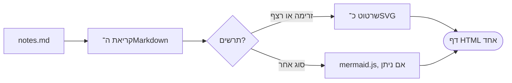
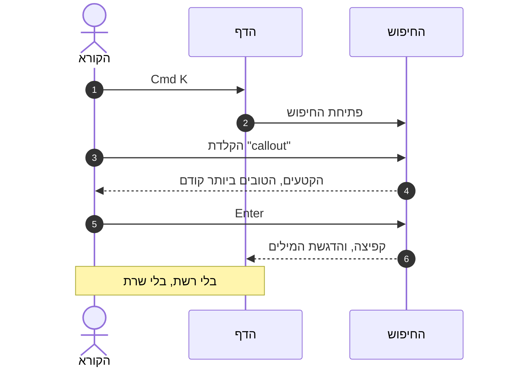
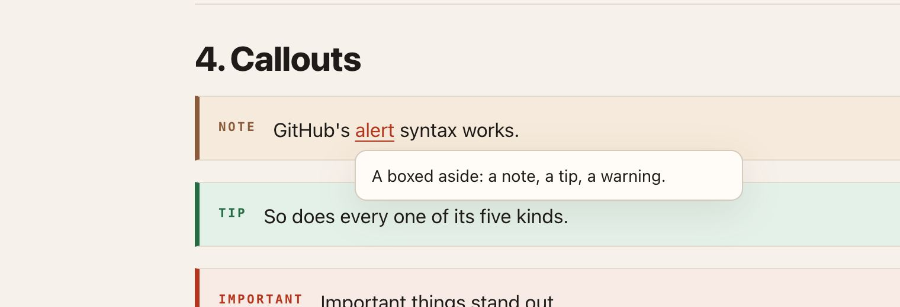
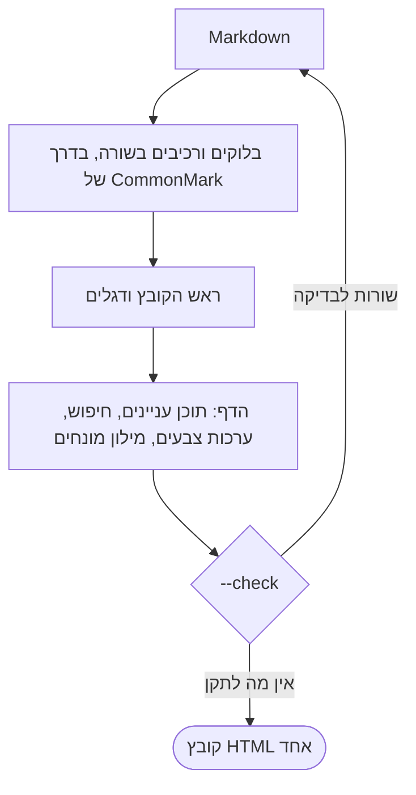

# md2html, כל מה שהוא עושה

md2html הופך קובץ Markdown לדף HTML אחד שאינו צריך שום דבר נוסף: בלי שרת, בלי רשת, בלי גופנים או סקריפטים מאיפשהו. הדוח הזה הוא דף כזה. הוא נכתב ב־Markdown והופק על ידי md2html, כך שכל יכולת שהוא מתאר פועלת גם עליו: תוכן העניינים בצד, החיפוש, שתי ערכות הצבעים, גודל הטקסט, הכרטיסים שלמטה, המילים המנוקדות של מילון המונחים, הערות השוליים, האיורים שמוגדלים, קוד צבוע ומתמטיקה מסודרת.

## איך לקרוא את זה

- **פרק 1** הוא כל הסיפור בטבלה אחת. שתי דקות.
- **פרקים 2 עד 6** מראים מה הקורא מקבל, ומה הכותב מקליד כדי לקבל את זה.
- **פרקים 7 ו־8** הם ההגדרות ושורת הפקודה.
- **פרקים 9 ו־10** הם בטיחות ואיכות, ואיך נולדה גרסה 0.4.

---

## 1. במבט אחד

| | לפני (0.3) | עכשיו (0.4) |
|:--|:--:|:--:|
| קריאת Markdown | תת־קבוצה לצורכי המדריך | כל CommonMark, והתוספות של GitHub |
| דוגמאות CommonMark שעוברות | לא נמדד | **640 מתוך 652** |
| המדריך של docenta, 4,265 שורות | יותר משתי דקות | **0.07 שניות** |
| דף מלא בסימני `[V]` | גדל ל־38 GB | אלפיות שנייה |
| ממצאי נגישות (axe-core, WCAG 2.2 AA) | עשרות | **אין**, ב־12 דפים, בהיר, כהה וטלפון |
| בדיקות | 10 | 53, ועוד 652 הדוגמאות של המפרט ומעבר לחיצות ב־Chrome |
| תרשימי Mermaid | מוצגים כקוד | **משורטטים**, בלי סקריפט |
| שפות | אנגלית | **17**, עם מתג בין התרגומים, כולל מימין לשמאל |
| לשמירה | הדף | הדף, **PDF** עם סימניות, **EPUB** לקוראים אלקטרוניים |
| תלויות בזמן ריצה | אין | אין |

מה הגיע עם 0.4, כרשימת משימות:

- [x] קורא Markdown מלא, שבנוי כפי שמפרט CommonMark מתאר
- [x] הערות שוליים, רשימות משימות, קו חוצה, קישורים אוטומטיים, טבלאות מיושרות וחמש ההתראות של GitHub
- [x] קוד צבוע בכעשרים שפות, מתמטיקה מסודרת כ־MathML
- [x] הגדרות בראש הקובץ, ומילות הדף עצמו בגרמנית
- [x] `--check`, `--watch`, תיקיות, stdin, ו־Content-Security-Policy לבחירה
- [x] בדיקת נגישות ומעבר לחיצות ב־CI
- [x] תרשימי זרימה ותרשימי רצף של Mermaid, משורטטים כ־SVG בלי סקריפט (פרק 4)
- [x] הדוח הזה בשבע־עשרה שפות, עם מתג בסרגל (פרק 7)
- [x] הדף נשמר, מודפס, או נלקח איתכם כ־PDF או כ־EPUB (פרקים 2 ו־8)

> [!IMPORTANT]
> כל דף ב־4sons.com שנבנה עם md2html (התוכניות, המחקר ודפי המשפחה) נבנה מחדש עם 0.4 והושווה לגרסה שהייתה באוויר: אותו מבנה, או טוב יותר.

## 2. הדף

לדף שלושה חלקים: סרגל לאורך החלק העליון, תוכן העניינים בצד, והטקסט.

{width=100%}

ערכת הצבעים הכהה הולכת לפי המערכת, או לפי בחירת הקורא, ונשמרת:

{width=100%}

בטלפון תוכן העניינים מתקפל אל מאחורי המתג שבסרגל, ושום דבר לא נגלל הצידה:

{width=34%}

מה הקורא יכול לעשות:

| כדי | עושים כך |
|:--|:--|
| למצוא משהו | **חיפוש** בסרגל, <kbd>⌘</kbd> <kbd>K</kbd> (<kbd>Ctrl</kbd> <kbd>K</kbd>), או <kbd>/</kbd> |
| להסתיר או להציג את תוכן העניינים | המתג שבתחילת הסרגל, או <kbd>⌘</kbd> <kbd>\\</kbd> |
| לשנות את גודל הטקסט | **Aa** בסרגל, ואז **−** ו־**+**; או <kbd>⌘</kbd> <kbd>+</kbd> ו־<kbd>⌘</kbd> <kbd>−</kbd>, מ־85 עד 200 אחוז |
| לשנות את ערכת הצבעים | **Aa**, ואז מערכת, בהירה או כהה |
| להגדיל איור | לוחצים עליו; עוד שתי לחיצות מקרבות אותו; <kbd>Esc</kbd> מחזיר אותו למקומו |
| לקרוא הערת שוליים או מילה מנוקדת | מצביעים עליה; לחיצה מובילה אליה, ו**חזרה** מחזירה |
| לשתף פרק, שורה בטבלה או קטע | סמל השיתוף שאחרי כותרת, או שבסוף שורת הטבלה שהסמן מצביע עליה, מעתיק את הקישור אליה (בטלפון נפתח דף השיתוף); מסמנים מילים, ומוצע קישור בדיוק אליהן |
| לשמור את הדף | כפתור ההורדה בסוף הסרגל: הדף עצמו (אפשר לקרוא אותו ללא חיבור), הדפסה או שמירה כ־PDF, או ה־PDF וה־EPUB היכן שהופקו |

## 3. כתיבה

Markdown רגיל, וכל מבנה נקרא היטב גם כטקסט פשוט. מה שכותבים מופיע קודם, בבלוק קוד; מה שמקבלים בא אחריו.

### הדגשה וקישורים

```markdown
**מודגש**, *נטוי*, ***שניהם***, ~~מחוק~~ ו־`קוד`.
[קישור](https://commonmark.org "CommonMark"), קישור חשוף,
https://spec.commonmark.org/0.31.2/, וסימנים כמו [V] שנשארים כפי שנכתבו.
```

**מודגש**, *נטוי*, ***שניהם***, ~~מחוק~~ ו־`קוד`. [קישור](https://commonmark.org "CommonMark"), קישור חשוף, https://spec.commonmark.org/0.31.2/, וסימנים כמו [V] שנשארים כפי שנכתבו.

### רשימות בתוך רשימות

```markdown
1. ראשון, עם רשימה מקוננת:
   - תבליט
   - עוד אחד, עם רשימה משלו:
     1. עמוק יותר
2. שני.
```

1. ראשון, עם רשימה מקוננת:
   - תבליט
   - עוד אחד, עם רשימה משלו:
     1. עמוק יותר
2. שני.

### ציטוטים ותיבות הערה

```markdown
> ציטוט רגיל נשאר ציטוט.

> [!TIP]
> ההתראות של GitHub עובדות: NOTE, TIP, IMPORTANT, WARNING, CAUTION.

> **הערה:** כך גם הצורה הישנה, מילה מודגשת ונקודתיים.
```

> ציטוט רגיל נשאר ציטוט.

> [!TIP]
> ההתראות של GitHub עובדות: NOTE, TIP, IMPORTANT, WARNING, CAUTION.

> **הערה:** כך גם הצורה הישנה, מילה מודגשת ונקודתיים.

### טבלאות

```markdown
| חדר      | קומה   | שטח (רגל רבועה) |
|:---------|:------:|----------------:|
| סלון     | קרקע   |             312 |
| עליית גג | עליונה |             205 |
```

| חדר | קומה | שטח (רגל רבועה) |
|:---------|:------:|----------------:|
| סלון | קרקע | 312 |
| עליית גג | עליונה | 205 |

### הערות שוליים

```markdown
טענה שצריכה מקור.[^1]

[^1]: המקור. הצביעו על המספר כדי לקרוא אותו שם.
```

טענה שצריכה מקור.[^source]

[^source]: המקור. הצביעו על המספר כדי לקרוא אותו שם; לחצו עליו כדי להגיע לכאן, ועל חזרה כדי לשוב.

### איורים ותמונות

```markdown
{width=60%}

סמל {width=18} בתוך משפט.
```

{width=60%}

סמל {width=18} בתוך משפט.

### דברים קטנים

```markdown
לחצו <kbd>Ctrl</kbd>+<kbd>K</kbd>. מים הם H<sub>2</sub>O, החדר 9 m<sup>2</sup>.
שורה שמסתיימת בלוכסן הפוך\
נשברת שם.
```

לחצו <kbd>Ctrl</kbd>+<kbd>K</kbd>. מים הם H<sub>2</sub>O, החדר 9 m<sup>2</sup>. שורה שמסתיימת בלוכסן הפוך\
נשברת שם.

<details>
<summary>קטע שנפתח בלחיצה</summary>

נכתב כ־`<details>` עם `<summary>`, ובתוכו Markdown רגיל: **מודגש**, רשימה,

- אחת
- שתיים

</details>

#### כותרת ברמה הרביעית

כותרות מתחת לרמה השלישית נשארות מחוץ לתוכן העניינים, כמו זו.

## 4. קוד ומתמטיקה

הקוד צבוע עבור Rust, Python, JavaScript ו־TypeScript, Go, C ו־C++, Java, Kotlin, Swift, C#, ה־shell, SQL, Ruby, Lua, PHP, CSS, HTML, JSON, YAML, TOML, קובצי Dockerfile ו־diff, ולכל בלוק יש כפתור העתקה.

```rust
/// The whole page from one Markdown text.
fn main() {
    let page = md2html::render("# Hello\n\nWorld.", &Settings::default());
    println!("{} bytes, nothing to fetch", page.len()); // one file
}
```

```python
@cache
def area(w: float, h: float) -> float:
    """The area of a room."""
    return w * h  # square feet
```

```yaml
title: The plans   # front matter is YAML
lang: de
embed: true
```

המתמטיקה מסודרת על ידי הדפדפן עצמו, כ־MathML, בלי סקריפט ובלי גופן להורדה. בתוך השורה, משפט פיתגורס הוא $a^2 + b^2 = c^2$, וזהות אוילר היא $e^{i\pi} + 1 = 0$; סכום בדולרים כמו $5 או $10 נשאר כסף. כנוסחה נפרדת:

$$
\int_0^1 x^2 \, dx = \frac{1}{3} \qquad \sum_{k=1}^{n} k = \frac{n(n+1)}{2} \qquad \sqrt[3]{27} = 3
$$

$$
\begin{pmatrix} a & b \\ c & d \end{pmatrix}
\begin{pmatrix} x \\ y \end{pmatrix}
=
\begin{pmatrix} ax + by \\ cx + dy \end{pmatrix}
\qquad
|x| = \begin{cases} x & x \ge 0 \\ -x & x < 0 \end{cases}
$$

### תרשימים

תרשים זרימה או תרשים רצף של Mermaid משורטט על ידי md2html עצמו, כ־SVG בתוך הדף: בלי סקריפט, בלי שום הורדה, בצבעי הדף עצמו בשתי ערכות הצבעים, והמילים שבו נשארות מילים שהחיפוש מוצא. זה ה־Markdown:

````markdown

````

וזה מה שנוצר ממנו:


תרשים רצף, ממוספר, עם הערה:



סוגים אחרים (תרשימי עוגה, תרשימי גאנט, תרשימי מחלקות) משורטטים על ידי mermaid.js כשהכותב מפנה את md2html לעותק שלו (`--mermaid-js FILE`); הסקריפט נכנס אז לדף הזה בלבד. בלעדיו הם נשארים כקוד, ו־`--check` אומר זאת.

## 5. מילון המונחים והערות השוליים

פרק בשם „מילון מונחים” מחזיק את מילות הדף כטבלה. הוא אינו מודפס במקום שבו הוא עומד: במקום זאת, האזכור הראשון של כל מונח בכל פרק הופך למילה מנוקדת שמסבירה את עצמה כשמצביעים עליה, ולחיצה עליה קופצת לערך שבתחתית הדף, שמוביל בחזרה לשורה שקראתם.

{width=70%}

הערות השוליים עובדות באותו אופן: המספר מסביר את עצמו כשמצביעים עליו.

{width=70%}

> [!NOTE]
> מילון מונחים יכול להיות משותף לכמה דפים: קובץ אחד ב־`~/.config/md2html/glossary.md`, שהמילים שלו מקושרות אז בכל דף שמופק במחשב הזה.

## 6. חיפוש ואיורים

החיפוש מכסה כל מילה בדף, כולל מילון המונחים. התוצאות מראות היכן עומדת כל מילה; זו שנבחרה מודגשת במקום שאליו החיפוש מגיע.

{width=80%}

{width=80%}

איור מוגדל מעל הדף בלי לעזוב אותו. כשהוא גדול מהחלון, הוא עוקב אחרי הסמן, כך שמצביעים על מה שרוצים לראות.

## 7. הגדרות

ראש הקובץ, בקובץ ה־Markdown של הדוח הזה עצמו, נראה כך:

```yaml
---
title: md2html, everything it does
brand: md2html
kicker: Report
version: 0.7.5
date: 2026-11-22
footer: Written in Markdown and rendered by **md2html 0.7.5** itself ...
csp: true      # only this page's own code may run
embed: true    # the screenshots are inside the page
---
```

| הגדרה | מה היא עושה |
|:--|:--|
| `title`, `description`, `author` | הכותרת, ותגי ה־meta לתצוגה מקדימה של קישורים |
| `lang` | השפה: מילות הדף עצמו והתאריכים בכל אחת משבע־עשרה השפות שלמעלה (`ja-Hira` היא יפנית בקאנה, `zh-Hant` סינית בסימנים מסורתיים, `yue` קנטונזית) |
| `translated_from`, `source_sha256` | לתרגום: המקור שלו, וטביעת האצבע של המקור בזמן שתורגם |
| `brand`, `brand_link`, `kicker`, `eyebrow`, `footer` | הסרגל, השורה שמעל הכותרת, האותיות הקטנות |
| `date`, `version` | התאריך והגרסה שמוצגים מעל הכותרת |
| `embed` | תמונות בתוך הדף, כך שהוא קובץ אחד |
| `csp` | Content-Security-Policy |
| `pdf`, `epub` | PDF ו־EPUB של הדף, לצדו |
| `live` | זמן החיים של הדף (`true` הוא שתי דקות, או מספר שניות): אחריו הוא נטען מחדש אם השתנה, והקורא נשאר במקומו |
| `large`, `toc`, `math`, `index`, `html`, `css`, `head` | אותיות גדולות יותר, תוכן העניינים, מתמטיקה, מנועי חיפוש, HTML גולמי, עיצוב נוסף ו־head |

> [!TIP]
> עם `lang: de` החיפוש אומר "Diese Seite durchsuchen", כל תיבת הערה אומרת "Hinweis" או "Achtung", והתאריך נכתב "22. November 2026". דפי תומס באתר הזה כתובים כך בגרמנית.

### שפות

הדוח הזה קיים בשבע־עשרה שפות: אנגלית, גרמנית, עברית, אינדונזית, הולנדית, ג׳אווית, יידיש, גרמנית תחתית, צרפתית, איטלקית, ספרדית, יפנית שנכתבת בשלוש דרכים (בקאנג׳י ובקאנה, בקאנה בלבד, וברומאג׳י), סינית מנדרינית בסימנים מפושטים ובסימנים מסורתיים, וקנטונזית. הגלובוס שבסרגל עובר ביניהן, והדף נפתח בפרק שקראתם.

תרגום הוא פשוט קובץ Markdown נוסף לצד המקור, שנקרא על שם שפתו: `report.de.md` הוא `report.md` בגרמנית. md2html מוצא את הגרסאות הקיימות, מקשר אותן זו לזו (ומודיע לדפדפנים ולמנועי חיפוש באמצעות `hreflang`), ונותן לכל אחת את המילים של הממשק שלה: החיפוש, תיבות ההערה, מילון המונחים, התאריכים. עברית ויידיש מוצגות מימין לשמאל, ותוכן העניינים מימין.

כל תרגום מציין את המקור שלו ורושם את טביעת האצבע של המקור, כך שהדף יכול לומר איזו גרסה היא המחייבת, ו־`--check` מבחין כשהמקור השתנה מאז שנעשה התרגום:

```yaml
translated_from: report.md
source_sha256: 5b0c...e1
```

לשפה שאיש לא תרגם אליה את הדף, הדפדפן של הקורא עצמו יכול לתרגם אותו, אם יש לו היכולת הזו (המתרגם המובנה של Chrome): במכשיר עצמו, כך ששום דבר מדף משפחתי לא יוצא ממנו, ועם תווית של תרגום מכונה ודרך חזרה למקור.

## 8. שורת הפקודה

```console
$ md2html notes.md
md2html: notes.md -> notes.html (68504 bytes, 9 glossary terms, 0 of them shared)
$ md2html docs/ -o site/ --nav
$ md2html notes.md --check
notes.md:12: a link points at #setup, which is nowhere on the page
notes.md:30: `plan.svg` does not exist next to this page
md2html: 2 to look at
$ cat notes.md | md2html - > notes.html
$ md2html notes.md --pdf --epub
$ md2html notes.md --serve
```

`--check` לא כותב דבר ומפרט את מה שהכותב צריך לבדוק, שורה אחר שורה, ויוצא עם 1 כשיש משהו: קישור לעוגן שאינו בדף, קובץ שאינו קיים, הערת שוליים בלי ההערה שלה, HTML גולמי שמוצג כטקסט. כך הוא נעשה השלב האחרון של בנייה, או של עבודת סוכן. `--watch` מפיק מחדש בכל שמירה, `--nav` מקשר את דפי התיקייה עם הקודם והבא, וקישור לקובץ Markdown אחר מוביל לדף שלו.

`--pdf` מדפיס את הדף בעזרת ה־Chrome שכבר נמצא במחשב: בפריסת ההדפסה של הדף עצמו, הכותרות כסימניות של ה־PDF, הכותרת בראש כל עמוד ומספרו בתחתיתו. `--epub` יוצר מאותו דף ספר לקוראים אלקטרוניים, עם תוכן העניינים, התמונות, התרשימים והמתמטיקה שלו, והערות שוליים שנפתחות במקום שבו הן מוזכרות; md2html כותב אותו בעצמו. הקורא מוצא את שניהם תחת כפתור ההורדה שבסרגל.

`--serve` מציג את הדפים במחשב הזה בזמן שהם נכתבים: כל דף פתוח נטען מחדש ברגע שה־Markdown נשמר. לדף שפורסם עם `--live` יש זמן חיים משלו; כשהוא נגמר, הדף מבקש מהשרת שלו את הקילובייט הראשון של עצמו ונטען מחדש רק אם הוא השתנה. בשני המקרים הקורא נשאר במקום שבו היה: באותה פסקה ובאותו גובה, או, אם היא איננה עוד, בפרק שלפניה.

## 9. בטיחות, איכות ונגישות

> [!WARNING]
> אפשר להפיק דף מ־Markdown שמישהו אחר כתב. md2html לעולם אינו כותב סקריפט מתוך הטקסט: HTML גולמי מוצג כפי שנכתב, מלבד כמה תגים לא מזיקים, וקישורי `javascript:` או `data:` מושמטים, בכל צורת כתיבה. מסמך אינו יכול לגרום ל־md2html לקרוא קובץ מחוץ לתיקייה שלו, ושום קלט, עוין ככל שיהיה, אינו יכול לתקוע אותו או לגרום לו לקרוס.

> [!CAUTION]
> `--html` מעביר HTML עשיר יותר (תמונות, קישורים, וידאו, SVG, פריסה), אבל לעולם לא משהו שרץ: לא סקריפט, לא מטפל אירועים, לא מסגרת, לא טופס.

מה נבדק, בכל שינוי, ב־macOS וב־Ubuntu:

- 53 בדיקות שמפיקות דפים שלמים וקוראות אותם בחזרה, ובהן מקרי האבטחה;
- 652 הדוגמאות של מפרט CommonMark, שמספר העוברות מהן יכול לעלות אך לעולם לא לרדת;
- כללי ה־lint המחמירים ביותר של clippy, וגרסת Rust הישנה ביותר שהכלי מבטיח להיבנות בה;
- בדיקת נגישות עם axe-core מול WCAG 2.2 AA, בשתי ערכות הצבעים וברוחב של טלפון;
- מעבר לחיצות ב־Chrome שמפעיל כל פקד: חיפוש במקלדת ובעכבר, ערכת הצבעים, גודל הטקסט, תוכן העניינים, איור, הערת שוליים, מילון המונחים, העתקה, הדפסה.

להדפסה יש פריסה משלה: הפקדים נעלמים, כל קישור מודפס עם הכתובת שלו, שום דבר לא נחתך בין עמודים, והעמודים נושאים את הכותרת ואת המספר שלהם.

כל דף מסתיים בשורה שקטה אחת: נוצר באמצעות md2html, הגרסה שלו, וקישור למקום שבו md2html נמצא.

{width=55%}

## 10. איך נולדה גרסה 0.4

זה התחיל במחקר: מה עושים ממירי ה־Markdown הטובים ביותר, מה תקני האינטרנט דורשים מדף, ואיך הכלי משמש במחשב הזה, וזה התברר כחלק המועיל ביותר. ארבעה תהליכי בנייה של דפים ב־4sons.com שכתבו מחדש את הפלט של md2html אחרי ההפקה, כדי לשנות את המותג, את השפה, את הכותרת התחתונה ועוד. כל שכתוב כזה הפך להגדרה, ותהליכי הבנייה הורצו מחדש מול הגרסה החדשה, דף אחר דף.

השינויים, כ־diff של הכללים שהממיר פועל לפיהם:

```diff
- a handbook subset, anything else shown as written
+ all of CommonMark, and anything else shown as written
- every quotation a note
+ a quotation is a quotation; a bold first word makes it a note
- the page's words in English
+ the page's words in English or German
```

מה ש־0.5 הוסיפה מאז: תרשימים. הדרך שעובר כל דף כאן:



---

מילון המונחים שלהלן מסביר את המילים שהדוח הזה משתמש בהן; כל אחת מהן הייתה מילה מנוקדת למעלה.

## מילון מונחים

| מונח | פירוש | גם |
|---|---|---|
| Markdown | טקסט פשוט עם סימנים קלים לכותרות, להדגשה, לרשימות ולקישורים, קריא כמות שהוא וניתן להמרה לדף. | |
| CommonMark | המפרט של Markdown שרוב הכלים פועלים לפיו כיום, עם בדיקה לכל כלל. | |
| תוכן העניינים | רשימת הפרקים בצד הדף, הבנויה מהכותרות שלו. | לתוכן העניינים, ותוכן העניינים |
| תיבת הערה | הערת צד ממוסגרת: הערה, עצה, משהו חשוב, אזהרה או קריאה לזהירות. | תיבות הערה, תיבות ההערה, ותיבות הערה, ההתראות, התראות |
| איור | תמונה בשורה משלה, עם כיתוב מתחתיה, שמוגדלת בלחיצה. | איורים, האיור, האיורים, ואיורים |
| ראש הקובץ | בלוק ההגדרות שבין שתי שורות `---` בראשו של קובץ Markdown. | בראש הקובץ |
| MathML | השפה של האינטרנט עצמו למתמטיקה, שהדפדפן משרטט בלי סקריפט. | |
| Content-Security-Policy | כלל בדף שאומר לדפדפן איזה קוד מותר להריץ; כאן, רק הקוד של הדף עצמו. | |
| Mermaid | שפת טקסט לתרשימים, שנכתבת בבלוק קוד; md2html משרטט את תרשימי הזרימה ותרשימי הרצף שלה. | |
| WCAG | הנחיות הנגישות לתוכן אינטרנט (Web Content Accessibility Guidelines); רמה AA היא היעד המקובל. | |
| תרגום | גרסה של דף בשפה אחרת, קובץ Markdown לצד המקור. | תרגומים, התרגום, התרגומים, לתרגום |
