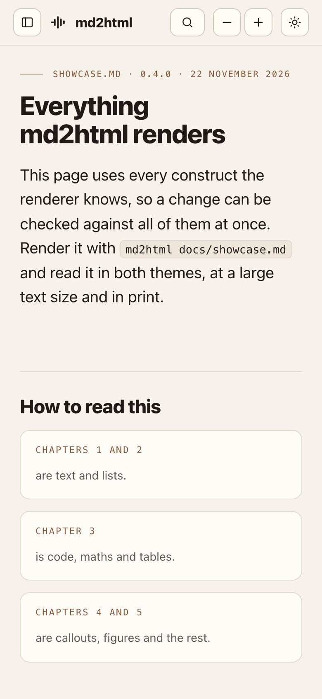
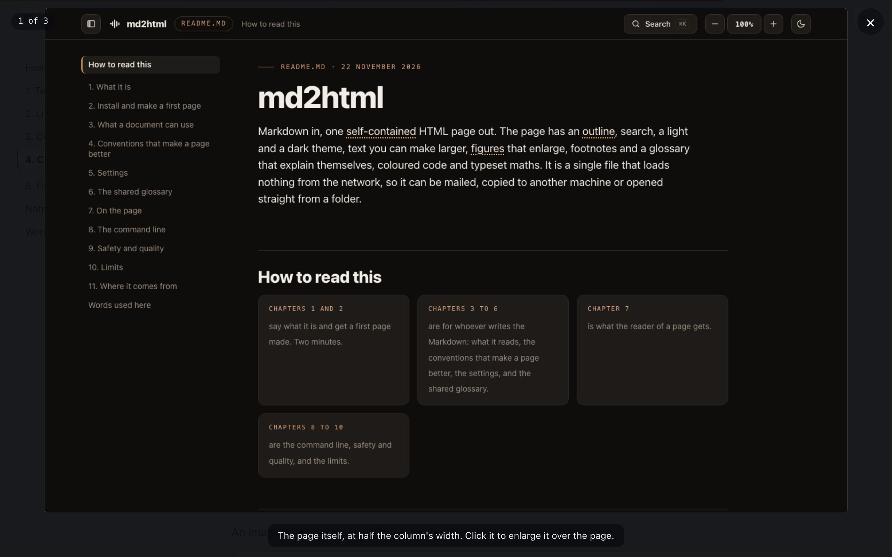
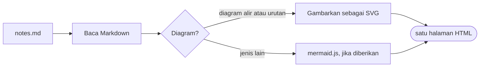
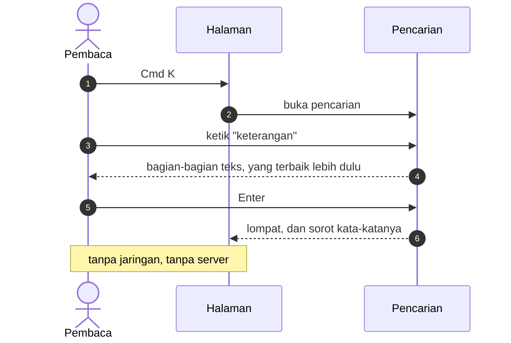
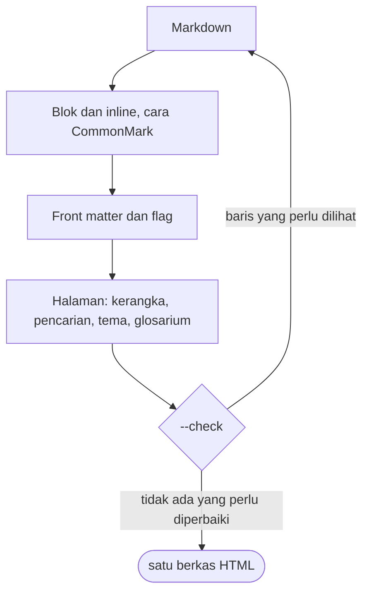

# md2html, semua yang bisa dilakukannya

md2html mengubah sebuah berkas Markdown menjadi satu halaman HTML yang tidak membutuhkan apa pun lagi: tanpa server, tanpa jaringan, tanpa font atau skrip dari mana pun. Laporan ini adalah halaman seperti itu. Laporan ini ditulis dalam Markdown dan dirender oleh md2html, sehingga setiap kemampuan yang dijelaskannya juga bekerja di sini: kerangka di sebelah kiri, pencarian, dua tema, ukuran teks, kartu-kartu di bawah, kata-kata bergaris titik dari glosarium, catatan kaki, gambar yang bisa diperbesar, kode berwarna, dan rumus matematika yang tersusun rapi.

## Cara membaca halaman ini

- **Bab 1** adalah seluruh cerita dalam satu tabel. Dua menit.
- **Bab 2 sampai 6** menunjukkan apa yang didapat pembaca, dan apa yang diketik penulis untuk mendapatkannya.
- **Bab 7 dan 8** adalah pengaturan dan baris perintah.
- **Bab 9 dan 10** adalah keamanan dan mutu, serta bagaimana versi 0.4 terwujud.

---

## 1. Sekilas

| | Sebelumnya (0.3) | Sekarang (0.4) |
|:--|:--:|:--:|
| Markdown yang dibaca | sebagian kecil, secukupnya untuk buku panduan | seluruh CommonMark, dan tambahan dari GitHub |
| Contoh CommonMark yang lolos | tidak diukur | **640 dari 652** |
| Buku panduan docenta yang 4.265 baris | lebih dari dua menit | **0,07 detik** |
| Halaman penuh tanda `[V]` | membengkak hingga 38 GB | hitungan milidetik |
| Temuan aksesibilitas (axe-core, WCAG 2.2 AA) | puluhan | **tidak ada**, pada 12 halaman, terang, gelap, dan ponsel |
| Pengujian | 10 | 53, ditambah 652 contoh spesifikasi dan uji klik di Chrome |
| Diagram Mermaid | ditampilkan sebagai kode | **digambar**, tanpa skrip |
| Bahasa | Inggris | **17**, dengan pengalih di antara terjemahan, termasuk yang dari kanan ke kiri |
| Untuk disimpan | halaman | halaman, **PDF** dengan penanda, **EPUB** untuk pembaca e-book |
| Dependensi saat dijalankan | tidak ada | tidak ada |

Yang datang bersama 0.4, sebagai daftar tugas:

- [x] pembaca Markdown yang lengkap, dibangun seperti yang dijelaskan spesifikasi CommonMark
- [x] catatan kaki, daftar tugas, coretan, tautan otomatis, tabel dengan perataan, dan lima alert GitHub
- [x] kode berwarna dalam sekitar dua puluh bahasa, matematika yang disusun sebagai MathML
- [x] pengaturan di front matter, dan kata-kata halaman itu sendiri dalam bahasa Jerman
- [x] `--check`, `--watch`, folder, stdin, Content-Security-Policy yang bisa diaktifkan
- [x] audit aksesibilitas dan uji klik di CI
- [x] diagram alir dan diagram urutan Mermaid, digambar sebagai SVG tanpa skrip (bab 4)
- [x] laporan ini dalam tujuh belas bahasa, dengan pengalih di bilah atas (bab 7)
- [x] halaman yang disimpan, dicetak, atau dibawa sebagai PDF atau EPUB (bab 2 dan 8)

> [!IMPORTANT]
> Setiap halaman di 4sons.com yang dibuat dengan md2html (rencana, riset, dan halaman keluarga) dibangun ulang dengan 0.4 dan dibandingkan dengan versi yang sedang tayang: strukturnya sama, atau lebih baik.

## 2. Halaman

Halaman ini terdiri dari tiga bagian: bilah di sepanjang bagian atas, kerangka di sebelah kiri, dan teks.

{width=100%}

Tema gelap mengikuti sistem, atau pilihan pembaca, dan pilihan itu diingat:

{width=100%}

Di ponsel, kerangka terlipat di balik tombol pengalih di bilah, dan tidak ada yang bergulir ke samping:

{width=34%}

Yang bisa dilakukan pembaca:

| Untuk | Lakukan ini |
|:--|:--|
| Mencari sesuatu | **Cari** di bilah, <kbd>⌘</kbd> <kbd>K</kbd> (<kbd>Ctrl</kbd> <kbd>K</kbd>), atau <kbd>/</kbd> |
| Menyembunyikan atau menampilkan kerangka | tombol pengalih di sebelah kiri bilah, atau <kbd>⌘</kbd> <kbd>\\</kbd> |
| Mengubah ukuran teks | **Aa** di bilah, lalu **−** dan **+**; atau <kbd>⌘</kbd> <kbd>+</kbd> dan <kbd>⌘</kbd> <kbd>−</kbd>, dari 85 sampai 200 persen |
| Mengganti tema | **Aa**, lalu Sistem, Terang, atau Gelap |
| Memperbesar gambar | klik gambarnya; dua klik lagi membawanya lebih dekat; <kbd>Esc</kbd> mengembalikannya |
| Membaca catatan kaki atau kata bergaris titik | arahkan penunjuk ke atasnya; klik untuk menuju ke sana, dan **kembali** membawa Anda pulang |
| Membagikan bab atau kutipan | **#** di samping judul menyalin tautannya (ponsel membuka lembar berbaginya); pilih beberapa kata, dan tautan tepat ke kata-kata itu ditawarkan |
| Menyimpannya | tombol unduh di ujung bilah: halaman itu sendiri (bisa dibaca offline), cetak atau simpan sebagai PDF, atau PDF dan EPUB bila keduanya dibuat |

## 3. Menulis

Markdown biasa, dan setiap bentuknya juga enak dibaca sebagai teks polos. Yang Anda tulis tampil lebih dulu, dalam blok kode; hasilnya menyusul sesudahnya.

### Penekanan dan tautan

```markdown
**Tebal**, *miring*, ***keduanya***, ~~dicoret~~ dan `kode`.
Sebuah [tautan](https://commonmark.org "CommonMark"), tautan polos,
https://spec.commonmark.org/0.31.2/, dan tanda seperti [V] yang tetap seperti ditulis.
```

**Tebal**, *miring*, ***keduanya***, ~~dicoret~~ dan `kode`. Sebuah [tautan](https://commonmark.org "CommonMark"), tautan polos, https://spec.commonmark.org/0.31.2/, dan tanda seperti [V] yang tetap seperti ditulis.

### Daftar di dalam daftar

```markdown
1. Pertama, dengan daftar bersarang:
   - sebuah butir
   - satu lagi, dengan daftarnya sendiri:
     1. lebih dalam
2. Kedua.
```

1. Pertama, dengan daftar bersarang:
   - sebuah butir
   - satu lagi, dengan daftarnya sendiri:
     1. lebih dalam
2. Kedua.

### Kutipan dan kotak keterangan

```markdown
> Kutipan biasa tetap menjadi kutipan.

> [!TIP]
> Alert GitHub berfungsi: NOTE, TIP, IMPORTANT, WARNING, CAUTION.

> **Catatan:** begitu juga bentuk yang lebih lama, sebuah kata tebal dan titik dua.
```

> Kutipan biasa tetap menjadi kutipan.

> [!TIP]
> Alert GitHub berfungsi: NOTE, TIP, IMPORTANT, WARNING, CAUTION.

> **Catatan:** begitu juga bentuk yang lebih lama, sebuah kata tebal dan titik dua.

### Tabel

```markdown
| Ruang      | Lantai | Luas (kaki persegi) |
|:-----------|:------:|--------------------:|
| Ruang tamu | bawah  |                 312 |
| Loteng     | atas   |                 205 |
```

| Ruang | Lantai | Luas (kaki persegi) |
|:-------|:------:|-------------:|
| Ruang tamu | bawah | 312 |
| Loteng | atas | 205 |

### Catatan kaki

```markdown
Sebuah klaim yang membutuhkan sumber.[^1]

[^1]: Sumbernya. Arahkan penunjuk ke angkanya untuk membacanya di sana.
```

Sebuah klaim yang membutuhkan sumber.[^source]

[^source]: Sumbernya. Arahkan penunjuk ke angkanya untuk membacanya di sana; klik angkanya untuk datang ke sini, dan kembali untuk pulang.

### Gambar dan citra

```markdown
{width=60%}

Sebuah ikon {width=18} di dalam kalimat.
```

{width=60%}

Sebuah ikon {width=18} di dalam kalimat.

### Hal-hal kecil

```markdown
Tekan <kbd>Ctrl</kbd>+<kbd>K</kbd>. Air adalah H<sub>2</sub>O, ruangannya 9 m<sup>2</sup>.
Baris yang diakhiri garis miring terbalik\
terputus di situ.
```

Tekan <kbd>Ctrl</kbd>+<kbd>K</kbd>. Air adalah H<sub>2</sub>O, ruangannya 9 m<sup>2</sup>. Baris yang diakhiri garis miring terbalik\
terputus di situ.

<details>
<summary>Bagian yang terbuka dengan satu klik</summary>

Ditulis sebagai `<details>` dengan `<summary>`, berisi Markdown biasa: **tebal**, sebuah daftar,

- satu
- dua

</details>

#### Judul tingkat keempat

Judul di bawah tingkat ketiga tidak masuk ke kerangka, seperti judul ini.

## 4. Kode dan matematika

Kode diberi warna untuk Rust, Python, JavaScript dan TypeScript, Go, C dan C++, Java, Kotlin, Swift, C#, shell, SQL, Ruby, Lua, PHP, CSS, HTML, JSON, YAML, TOML, Dockerfile, dan diff, dan setiap blok punya tombol salin.

```rust
/// The whole page from one Markdown text.
fn main() {
    let page = md2html::render("# Hello\n\nWorld.", &Settings::default());
    println!("{} bytes, nothing to fetch", page.len()); // one file
}
```

```python
@cache
def area(w: float, h: float) -> float:
    """The area of a room."""
    return w * h  # square feet
```

```yaml
title: The plans   # front matter is YAML
lang: de
embed: true
```

Matematika disusun oleh peramban itu sendiri, sebagai MathML, tanpa skrip dan tanpa font yang perlu diunduh. Di dalam baris, teorema Pythagoras adalah $a^2 + b^2 = c^2$, dan identitas Euler adalah $e^{i\pi} + 1 = 0$; jumlah uang seperti $5 atau $10 tetap menjadi uang. Ditampilkan tersendiri:

$$
\int_0^1 x^2 \, dx = \frac{1}{3} \qquad \sum_{k=1}^{n} k = \frac{n(n+1)}{2} \qquad \sqrt[3]{27} = 3
$$

$$
\begin{pmatrix} a & b \\ c & d \end{pmatrix}
\begin{pmatrix} x \\ y \end{pmatrix}
=
\begin{pmatrix} ax + by \\ cx + dy \end{pmatrix}
\qquad
|x| = \begin{cases} x & x \ge 0 \\ -x & x < 0 \end{cases}
$$

### Diagram

Diagram alir atau diagram urutan Mermaid digambar oleh md2html sendiri, sebagai SVG di dalam halaman: tanpa skrip, tanpa ada yang perlu diunduh, dengan warna halaman itu sendiri di kedua tema, dan kata-katanya tetap berupa kata yang bisa ditemukan oleh pencarian. Ini Markdown-nya:

````markdown

````

Dan inilah hasilnya:



Sebuah diagram urutan, bernomor, dengan catatan:



Jenis lain (diagram lingkaran, diagram Gantt, diagram kelas) digambar oleh mermaid.js bila penulis menunjukkan sebuah salinannya kepada md2html (`--mermaid-js FILE`); skrip itu lalu hanya masuk ke halaman tersebut. Tanpa itu, diagram-diagram tersebut tetap berupa kode, dan `--check` memberitahukannya.

## 5. Tentang glosarium dan catatan kaki

Bab yang bernama Glosarium memuat kata-kata halaman dalam bentuk tabel. Bab itu tidak dicetak di tempatnya: sebagai gantinya, sebutan pertama setiap istilah di setiap bab menjadi kata bergaris titik yang menjelaskan dirinya sendiri saat penunjuk berada di atasnya, dan satu klik padanya melompat ke entrinya di bagian bawah, yang membawa Anda kembali ke baris yang sedang Anda baca.

{width=70%}

Catatan kaki bekerja dengan cara yang sama: angkanya menjelaskan dirinya sendiri saat penunjuk berada di atasnya.

{width=70%}

> [!NOTE]
> Glosarium bisa dipakai bersama oleh banyak halaman: satu berkas di `~/.config/md2html/glossary.md`, yang kata-katanya lalu menjadi tautan di setiap halaman yang dirender di mesin itu.

## 6. Pencarian dan gambar

Pencarian mencakup setiap kata di halaman, termasuk glosarium. Hasilnya menunjukkan letak setiap kata; yang dipilih disorot di tempat pencarian mendarat.

{width=80%}

{width=80%}

Gambar membesar di atas halaman tanpa meninggalkannya. Jika lebih besar dari jendela, gambar mengikuti penunjuk, sehingga Anda tinggal menunjuk apa yang ingin Anda lihat.

## 7. Pengaturan

Bagian atas berkas Markdown asli laporan ini berbunyi:

```yaml
---
title: md2html, everything it does
brand: md2html
kicker: Report
version: 0.7.0
date: 2026-11-22
footer: Written in Markdown and rendered by **md2html 0.7.0** itself ...
csp: true      # only this page's own code may run
embed: true    # the screenshots are inside the page
---
```

| Pengaturan | Fungsinya |
|:--|:--|
| `title`, `description`, `author` | judul, dan tag meta untuk pratinjau tautan |
| `lang` | bahasa: kata-kata dan tanggal halaman itu sendiri dalam salah satu dari tujuh belas bahasa di atas (`ja-Hira` adalah bahasa Jepang dalam kana, `zh-Hant` bahasa Tionghoa dalam aksara tradisional, `yue` bahasa Kanton) |
| `translated_from`, `source_sha256` | untuk terjemahan: aslinya, dan sidik jari aslinya saat diterjemahkan |
| `brand`, `brand_link`, `kicker`, `eyebrow`, `footer` | bilah, baris di atas judul, tulisan kecil di bagian bawah |
| `date`, `version` | tanggal dan versi yang tampil di atas judul |
| `embed` | gambar di dalam halaman, sehingga cukup satu berkas |
| `csp` | sebuah Content-Security-Policy |
| `pdf`, `epub` | PDF dan EPUB dari halaman itu, di sampingnya |
| `live` | masa hidup halaman (`true` berarti dua menit, atau sejumlah detik): setelah itu halaman dimuat ulang bila berubah, dan pembaca tetap di tempatnya |
| `large`, `toc`, `math`, `index`, `html`, `css`, `head` | huruf lebih besar, kerangka, matematika, mesin pencari, HTML mentah, gaya dan head tambahan |

> [!TIP]
> Dengan `lang: de` pencarian bertuliskan "Diese Seite durchsuchen", kotak keterangan bertuliskan "Hinweis" dan "Achtung", dan tanggal terbaca "22. November 2026". Halaman-halaman Thomas di situs ini berbahasa Jerman dengan cara ini.

### Bahasa

Laporan ini tersedia dalam tujuh belas bahasa: Inggris, Jerman, Ibrani, Indonesia, Belanda, Jawa, Yiddish, Jerman Rendah, Prancis, Italia, Spanyol, Jepang yang ditulis dengan tiga cara (dengan kanji dan kana, dengan kana saja, dan dengan rōmaji), Mandarin dengan aksara sederhana dan dengan aksara tradisional, dan Kanton. Bola dunia di bilah berpindah di antara bahasa-bahasa itu, dan halaman terbuka di bab yang sedang Anda baca.

Sebuah terjemahan hanyalah berkas Markdown lain di samping aslinya, yang dinamai menurut bahasanya: `report.de.md` adalah `report.md` versi Jerman. md2html menemukan versi-versi yang ada, menautkannya satu sama lain (dan memberi tahu peramban serta mesin pencari dengan `hreflang`), dan memberi masing-masing kata-kata antarmukanya sendiri: pencarian, kotak keterangan, glosarium, tanggal. Ibrani dan Yiddish disusun dari kanan ke kiri, dengan kerangka di sebelah kanan.

Setiap terjemahan menyebut aslinya dan mencatat sidik jari aslinya, sehingga halaman bisa mengatakan versi mana yang berlaku, dan `--check` menyadari bila aslinya sudah berubah sejak terjemahan dibuat:

```yaml
translated_from: report.md
source_sha256: 5b0c...e1
```

Untuk bahasa yang belum pernah diterjemahkan oleh siapa pun, peramban milik pembaca sendiri bisa menerjemahkan halamannya, bila peramban itu memiliki kemampuan tersebut (penerjemah bawaan Chrome): di perangkat itu sendiri, sehingga tidak ada apa pun dari halaman keluarga yang keluar darinya, dan diberi label sebagai terjemahan mesin dengan jalan kembali ke aslinya.

## 8. Baris perintah

```console
$ md2html notes.md
md2html: notes.md -> notes.html (68504 bytes, 9 glossary terms, 0 of them shared)
$ md2html docs/ -o site/ --nav
$ md2html notes.md --check
notes.md:12: a link points at #setup, which is nowhere on the page
notes.md:30: `plan.svg` does not exist next to this page
md2html: 2 to look at
$ cat notes.md | md2html - > notes.html
$ md2html notes.md --pdf --epub
$ md2html notes.md --serve
```

`--check` tidak menulis apa pun dan mendaftar apa yang perlu diperhatikan penulis, baris demi baris, lalu keluar dengan kode 1 bila ada sesuatu: tautan ke jangkar yang tidak ada di halaman, berkas yang tidak ada, catatan kaki tanpa catatannya, HTML mentah yang ditampilkan sebagai teks. Karena itu `--check` cocok menjadi langkah terakhir sebuah build, atau pekerjaan sebuah agen. `--watch` merender ulang setiap kali berkas disimpan, `--nav` menautkan halaman-halaman dalam satu folder dengan sebelumnya dan berikutnya, dan tautan ke berkas Markdown lain menuju halamannya.

`--pdf` mencetak halaman dengan Chrome yang sudah ada di komputer: tata letak cetaknya sendiri, judul-judul bagian sebagai penanda PDF, judul halaman di bagian atas setiap halaman dan nomornya di bagian bawah. `--epub` membuat buku untuk pembaca e-book dari halaman yang sama, dengan daftar isi, gambar, diagram, dan matematikanya, serta catatan kaki yang terbuka di tempat catatan itu disebut; md2html menulisnya sendiri. Pembaca menemukan keduanya di bawah tombol unduh di bilah.

`--serve` menampilkan halaman di komputer ini selagi ditulis: setiap halaman yang terbuka dimuat ulang begitu berkas Markdown-nya disimpan. Halaman yang diterbitkan dengan `--live` punya masa hidupnya sendiri; bila masa itu habis, halaman meminta kilobyte pertama dirinya kepada servernya dan hanya dimuat ulang bila bagian itu berubah. Bagaimanapun juga, pembaca tetap di tempatnya: di paragraf yang sama pada ketinggian yang sama, atau, bila paragraf itu sudah tidak ada, di bab sebelumnya.

## 9. Keamanan, mutu, dan aksesibilitas

> [!WARNING]
> Sebuah halaman bisa dirender dari Markdown yang ditulis orang lain. md2html tidak pernah menulis skrip dari teksnya: HTML mentah ditampilkan seperti ditulis kecuali beberapa tag yang tidak berbahaya, dan tautan `javascript:` atau `data:` dibuang, bagaimanapun ejaannya. Sebuah dokumen tidak bisa membuat md2html membaca berkas di luar foldernya, dan tidak ada masukan, seberbahaya apa pun, yang bisa membuatnya macet atau mogok.

> [!CAUTION]
> `--html` meloloskan HTML yang lebih kaya (gambar, tautan, video, SVG, tata letak), tetapi tidak pernah apa pun yang dijalankan: tanpa skrip, tanpa penangan peristiwa, tanpa frame, tanpa formulir.

Yang diperiksa, pada setiap perubahan, di macOS dan Ubuntu:

- 53 pengujian yang merender halaman utuh lalu membacanya kembali, termasuk kasus-kasus keamanan;
- 652 contoh dari spesifikasi CommonMark, yang jumlah lolosnya boleh naik tetapi tidak pernah turun;
- lint clippy yang paling ketat, dan versi Rust tertua yang dijanjikan alat ini untuk bisa dibangun;
- audit aksesibilitas dengan axe-core terhadap WCAG 2.2 AA, di kedua tema dan selebar layar ponsel;
- uji klik di Chrome yang memakai setiap kontrol: pencarian dengan papan ketik dan tetikus, tema, ukuran teks, kerangka, gambar, catatan kaki, glosarium, salin, cetak.

Cetakan mendapat tata letaknya sendiri: tombol-tombol menghilang, setiap tautan mencetak alamatnya, tidak ada yang terpotong di antara dua halaman, dan setiap halaman memuat judul dan nomornya.

Setiap halaman diakhiri dengan satu baris yang tenang: dibuat dengan md2html, versinya, dan tautan ke tempat md2html berada.

{width=55%}

## 10. Bagaimana 0.4 terwujud

Semuanya berawal dari riset: apa yang dilakukan perender Markdown terbaik, apa yang dituntut standar web dari sebuah halaman, dan bagaimana alat ini dipakai di mesin ini, yang ternyata menjadi bagian paling berguna. Empat proses pembuatan halaman di 4sons.com menulis ulang keluaran md2html setelah dirender, untuk mengganti merek, bahasa, footer, dan lain-lain. Setiap penulisan ulang itu menjadi sebuah pengaturan, dan proses-proses itu dibangun ulang dengan versi baru, halaman demi halaman.

Perubahannya, sebagai diff dari aturan yang diikuti perender:

```diff
- a handbook subset, anything else shown as written
+ all of CommonMark, and anything else shown as written
- every quotation a note
+ a quotation is a quotation; a bold first word makes it a note
- the page's words in English
+ the page's words in English or German
```

Yang ditambahkan 0.5 sejak itu: diagram. Jalur yang ditempuh setiap halaman di sini:



---

Glosarium di bawah ini menjelaskan kata-kata yang dipakai laporan ini; masing-masing tadi adalah kata bergaris titik di atas.

## Glosarium

| Istilah | Arti | Juga |
|---|---|---|
| Markdown | Teks polos dengan tanda-tanda ringan untuk judul, penekanan, daftar, dan tautan, enak dibaca apa adanya dan bisa diubah menjadi halaman. | |
| CommonMark | Spesifikasi Markdown yang kini diikuti sebagian besar alat, dengan pengujian untuk setiap aturan. | |
| kerangka | Daftar bab di sebelah kiri halaman, yang dibuat dari judul-judulnya. | |
| kotak keterangan | Catatan sampingan dalam kotak: catatan, tips, hal yang penting, peringatan, atau imbauan untuk berhati-hati. | alert |
| gambar | Citra di barisnya sendiri, dengan keterangan di bawahnya, yang diperbesar dengan satu klik. | |
| front matter | Blok pengaturan di antara dua baris `---` di bagian paling atas berkas Markdown. | |
| MathML | Bahasa web sendiri untuk matematika, yang digambar oleh peramban tanpa skrip. | |
| Content-Security-Policy | Aturan di dalam halaman yang memberi tahu peramban kode mana yang boleh berjalan; di sini, hanya kode halaman itu sendiri. | |
| Mermaid | Bahasa teks untuk diagram, ditulis dalam blok kode; md2html menggambar diagram alir dan diagram urutannya. | |
| WCAG | Web Content Accessibility Guidelines, pedoman aksesibilitas konten web; level AA adalah target yang lazim. | |
| terjemahan | Versi sebuah halaman dalam bahasa lain, berupa berkas Markdown di samping aslinya. | |
