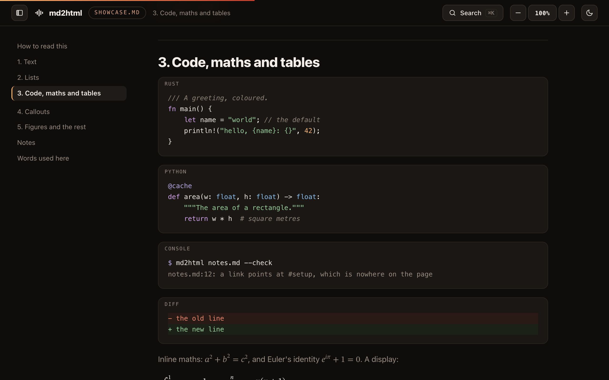
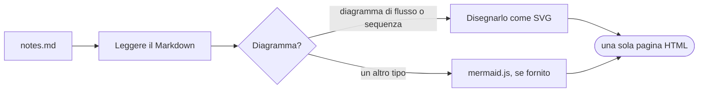
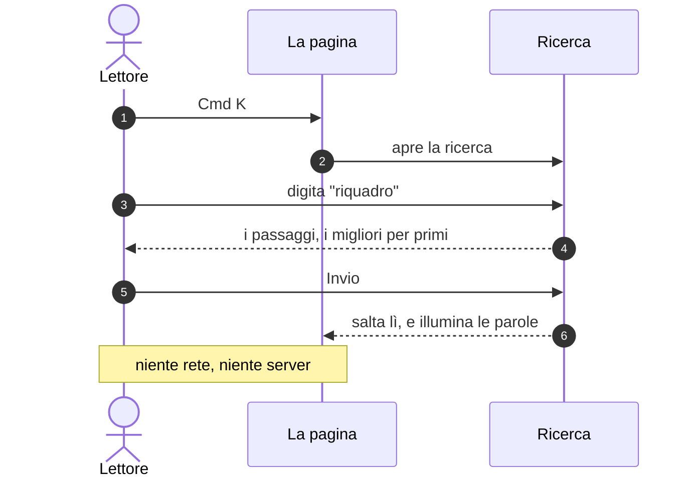
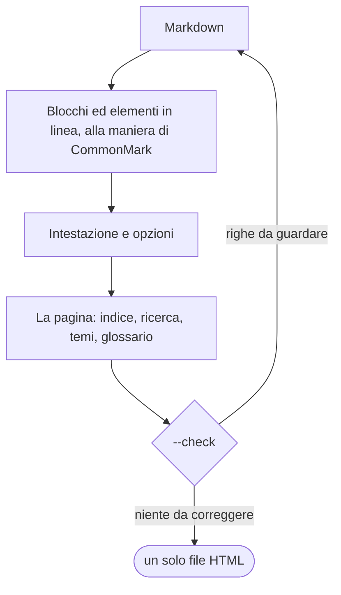

# md2html, tutto ciò che fa

md2html trasforma un file Markdown in una sola pagina HTML che non ha bisogno d'altro: niente server, niente rete, nessun font o script presi da altrove. Questo rapporto è una pagina così. È stato scritto in Markdown e generato da md2html, quindi ogni capacità che descrive è all'opera anche qui: l'indice a sinistra, la ricerca, i due temi, la dimensione del testo, le schede qui sotto, le parole sottolineate a puntini del glossario, le note a piè di pagina, le figure che si ingrandiscono, il codice colorato e la matematica composta.

## Come leggere questa pagina

- **Capitolo 1** è tutta la storia in una tabella. Due minuti.
- **Capitoli da 2 a 6** mostrano cosa ottiene chi legge, e cosa scrive chi scrive per ottenerlo.
- **Capitoli 7 e 8** sono le impostazioni e la riga di comando.
- **Capitoli 9 e 10** sono sicurezza e qualità, e come è nata la versione 0.4.

---

## 1. In breve

| | Prima (0.3) | Ora (0.4) |
|:--|:--:|:--:|
| Markdown letto | un sottoinsieme su misura per il manuale | tutto CommonMark, e le aggiunte di GitHub |
| Esempi CommonMark superati | non misurato | **640 su 652** |
| Il manuale docenta di 4.265 righe | oltre due minuti | **0,07 secondi** |
| Una pagina piena di segni `[V]` | cresceva fino a 38 GB | millisecondi |
| Rilievi di accessibilità (axe-core, WCAG 2.2 AA) | decine | **nessuno**, su 12 pagine, in chiaro, in scuro e su telefono |
| Test | 10 | 53, più i 652 esempi della specifica e un giro di clic in Chrome |
| Diagrammi Mermaid | mostrati come codice | **disegnati**, senza script |
| Lingue | inglese | **17**, con un selettore tra le traduzioni, scrittura da destra a sinistra compresa |
| Da conservare | la pagina | la pagina, un **PDF** con segnalibri, un **EPUB** per e-reader |
| Dipendenze a runtime | nessuna | nessuna |

Cosa è arrivato con la 0.4, come elenco di attività:

- [x] un lettore Markdown completo, costruito come lo descrive la specifica CommonMark
- [x] note a piè di pagina, elenchi di attività, testo barrato, link automatici, tabelle allineate e i cinque alert di GitHub
- [x] codice colorato in una ventina di linguaggi, matematica composta in MathML
- [x] impostazioni nell'intestazione, e le parole proprie della pagina in tedesco
- [x] `--check`, `--watch`, cartelle, stdin, una Content-Security-Policy a richiesta
- [x] un audit di accessibilità e un giro di clic nella CI
- [x] diagrammi di flusso e diagrammi di sequenza Mermaid, disegnati come SVG senza script (capitolo 4)
- [x] questo rapporto in diciassette lingue, con un selettore nella barra (capitolo 7)
- [x] la pagina conservata, stampata, o portata con sé come PDF o EPUB (capitoli 2 e 8)

> [!IMPORTANT]
> Ogni pagina di 4sons.com costruita con md2html (i progetti, le ricerche e le pagine di famiglia) è stata rigenerata con la 0.4 e confrontata con la versione online: la stessa struttura, o migliore.

## 2. La pagina

La pagina ha tre parti: una barra in alto, l'indice a sinistra e il testo.

{width=100%}

Il tema scuro segue il sistema, o la scelta di chi legge, e viene ricordato:

{width=100%}

Su un telefono l'indice si ripiega dietro l'interruttore nella barra, e nulla scorre di lato:

{width=34%}

Cosa può fare chi legge:

| Per | Fare così |
|:--|:--|
| Trovare qualcosa | **Cerca** nella barra, <kbd>⌘</kbd> <kbd>K</kbd> (<kbd>Ctrl</kbd> <kbd>K</kbd>), o <kbd>/</kbd> |
| Nascondere o mostrare l'indice | l'interruttore a sinistra della barra, o <kbd>⌘</kbd> <kbd>\\</kbd> |
| Cambiare la dimensione del testo | **Aa** nella barra, poi **−** e **+**; o <kbd>⌘</kbd> <kbd>+</kbd> e <kbd>⌘</kbd> <kbd>−</kbd>, da 85 a 200 per cento |
| Cambiare tema | **Aa**, poi Sistema, Chiaro o Scuro |
| Ingrandire una figura | cliccarla; altri due clic la avvicinano; <kbd>Esc</kbd> la rimette a posto |
| Leggere una nota o una parola sottolineata a puntini | posarci sopra il puntatore; un clic per andarci, e **indietro** riporta lì |
| Condividere un capitolo o un passaggio | il **#** accanto a un titolo ne copia il link (un telefono apre il suo menu di condivisione); selezionare delle parole, e viene offerto un link proprio a quelle |
| Conservarla | il pulsante di download in fondo alla barra: la pagina stessa (si legge offline), stampa o salva come PDF, oppure il PDF e l'EPUB dove sono stati creati |

## 3. Scrivere

Markdown ordinario, e ogni costrutto si legge bene anche come testo semplice. Quello che si scrive viene prima, in un blocco di codice; quello che si ottiene lo segue.

### Enfasi e link

```markdown
**Grassetto**, *corsivo*, ***entrambi***, ~~barrato~~ e `code`.
Un [link](https://commonmark.org "CommonMark"), uno scritto per esteso,
https://spec.commonmark.org/0.31.2/, e segni come [V] che restano come sono scritti.
```

**Grassetto**, *corsivo*, ***entrambi***, ~~barrato~~ e `code`. Un [link](https://commonmark.org "CommonMark"), uno scritto per esteso, https://spec.commonmark.org/0.31.2/, e segni come [V] che restano come sono scritti.

### Elenchi dentro elenchi

```markdown
1. Primo, con un elenco annidato:
   - un punto
   - un altro, con il suo:
     1. più in fondo
2. Secondo.
```

1. Primo, con un elenco annidato:
   - un punto
   - un altro, con il suo:
     1. più in fondo
2. Secondo.

### Citazioni e riquadri

```markdown
> Una semplice citazione resta una citazione.

> [!TIP]
> Gli alert di GitHub funzionano: NOTE, TIP, IMPORTANT, WARNING, CAUTION.

> **Nota:** anche la forma più vecchia: una parola in grassetto seguita dai due punti ne fa un riquadro.
```

> Una semplice citazione resta una citazione.

> [!TIP]
> Gli alert di GitHub funzionano: NOTE, TIP, IMPORTANT, WARNING, CAUTION.

> **Nota:** anche la forma più vecchia: una parola in grassetto seguita dai due punti ne fa un riquadro.

### Tabelle

```markdown
| Stanza    | Piano     | Superficie (ft²) |
|:----------|:---------:|-----------------:|
| Soggiorno | terra     |              312 |
| Soppalco  | superiore |              205 |
```

| Stanza | Piano | Superficie (ft²) |
|:-------|:------:|-------------:|
| Soggiorno | terra | 312 |
| Soppalco | superiore | 205 |

### Note a piè di pagina

```markdown
Un'affermazione che ha bisogno di una fonte.[^1]

[^1]: La fonte. Posare il puntatore sul numero per leggerla lì.
```

Un'affermazione che ha bisogno di una fonte.[^source]

[^source]: La fonte. Posare il puntatore sul numero per leggerla lì; un clic per venire qui, e indietro per tornare.

### Figure e immagini

```markdown
{width=60%}

Un'icona {width=18} dentro una frase.
```

{width=60%}

Un'icona {width=18} dentro una frase.

### Piccole cose

```markdown
Premere <kbd>Ctrl</kbd>+<kbd>K</kbd>. L'acqua è H<sub>2</sub>O, la stanza misura 9 m<sup>2</sup>.
Una riga che finisce con una barra rovesciata\
va a capo lì.
```

Premere <kbd>Ctrl</kbd>+<kbd>K</kbd>. L'acqua è H<sub>2</sub>O, la stanza misura 9 m<sup>2</sup>. Una riga che finisce con una barra rovesciata\
va a capo lì.

<details>
<summary>Una sezione che si apre con un clic</summary>

Scritta come `<details>` con un `<summary>`, con Markdown ordinario all'interno: **grassetto**, un elenco,

- uno
- due

</details>

#### Un titolo di quarto livello

I titoli sotto il terzo livello restano fuori dall'indice, come questo.

## 4. Codice e matematica

Il codice è colorato per Rust, Python, JavaScript e TypeScript, Go, C e C++, Java, Kotlin, Swift, C#, la shell, SQL, Ruby, Lua, PHP, CSS, HTML, JSON, YAML, TOML, i Dockerfile e i diff, e ogni blocco ha un pulsante per copiarlo.

```rust
/// The whole page from one Markdown text.
fn main() {
    let page = md2html::render("# Hello\n\nWorld.", &Settings::default());
    println!("{} bytes, nothing to fetch", page.len()); // one file
}
```

```python
@cache
def area(w: float, h: float) -> float:
    """The area of a room."""
    return w * h  # square feet
```

```yaml
title: The plans   # front matter is YAML
lang: de
embed: true
```

La matematica è composta dal browser stesso, come MathML, senza script e senza font da scaricare. Nel testo, il teorema di Pitagora è $a^2 + b^2 = c^2$, e l'identità di Euler è $e^{i\pi} + 1 = 0$; una somma in dollari come $5 o $10 resta denaro. Su righe a sé:

$$
\int_0^1 x^2 \, dx = \frac{1}{3} \qquad \sum_{k=1}^{n} k = \frac{n(n+1)}{2} \qquad \sqrt[3]{27} = 3
$$

$$
\begin{pmatrix} a & b \\ c & d \end{pmatrix}
\begin{pmatrix} x \\ y \end{pmatrix}
=
\begin{pmatrix} ax + by \\ cx + dy \end{pmatrix}
\qquad
|x| = \begin{cases} x & x \ge 0 \\ -x & x < 0 \end{cases}
$$

### Diagrammi

Un diagramma di flusso o di sequenza Mermaid è disegnato da md2html stesso, come SVG dentro la pagina: niente script, niente da scaricare, i colori della pagina in entrambi i temi, e le sue parole restano parole che la ricerca trova. Questo è il Markdown:

````markdown

````

E questo è ciò che diventa:


Un diagramma di sequenza, numerato, con una nota:



Gli altri tipi (grafici a torta, diagrammi di Gantt, diagrammi delle classi) sono disegnati da mermaid.js quando l'autore indica a md2html una sua copia (`--mermaid-js FILE`); lo script entra allora solo in quella pagina. Senza, restano codice, e `--check` lo segnala.

## 5. Il glossario e le note a piè di pagina

Un capitolo chiamato Glossario raccoglie le parole della pagina in una tabella. Non compare dove si trova: invece, la prima menzione di ogni termine in ogni capitolo diventa una parola sottolineata a puntini che si spiega al passaggio del puntatore, e un clic su di essa porta alla voce in fondo, che riporta alla riga che si stava leggendo.

{width=70%}

Le note a piè di pagina funzionano allo stesso modo: il numero si spiega al passaggio del puntatore.

{width=70%}

> [!NOTE]
> Un glossario può essere condiviso tra più pagine: un solo file in `~/.config/md2html/glossary.md`, le cui parole diventano allora link in ogni pagina generata su quella macchina.

## 6. Ricerca e figure

La ricerca copre ogni parola della pagina, glossario compreso. I risultati mostrano dove si trova ogni parola; quella scelta viene illuminata dove la ricerca arriva.

{width=80%}

{width=80%}

Una figura si ingrandisce sopra la pagina senza lasciarla. Se è più grande della finestra, segue il puntatore, così si punta ciò che si vuole vedere.

## 7. Impostazioni

L'inizio del file Markdown originale di questo rapporto recita:

```yaml
---
title: md2html, everything it does
brand: md2html
kicker: Report
version: 0.7.3
date: 2026-11-22
footer: Written in Markdown and rendered by **md2html 0.7.3** itself ...
csp: true      # only this page's own code may run
embed: true    # the screenshots are inside the page
---
```

| Impostazione | Cosa fa |
|:--|:--|
| `title`, `description`, `author` | il titolo, e i meta tag per le anteprime dei link |
| `lang` | la lingua: le parole proprie della pagina e le date in una qualsiasi delle diciassette qui sopra (`ja-Hira` è il giapponese in kana, `zh-Hant` il cinese in caratteri tradizionali, `yue` il cantonese) |
| `translated_from`, `source_sha256` | per una traduzione: il suo originale, e l'impronta dell'originale al momento della traduzione |
| `brand`, `brand_link`, `kicker`, `eyebrow`, `footer` | la barra, la riga sopra il titolo, le note in piccolo |
| `date`, `version` | la data e la versione mostrate sopra il titolo |
| `embed` | le immagini dentro la pagina, così che sia un solo file |
| `csp` | una Content-Security-Policy |
| `pdf`, `epub` | un PDF e un EPUB della pagina, accanto a essa |
| `live` | il tempo di vita della pagina (`true` sono due minuti, oppure un numero di secondi): poi si ricarica se è cambiata, mantenendo il punto in cui si trova il lettore |
| `large`, `toc`, `math`, `index`, `html`, `css`, `head` | caratteri più grandi, l'indice, la matematica, i motori di ricerca, l'HTML grezzo, stile e head aggiuntivi |

> [!TIP]
> Con `lang: de` la ricerca dice «Diese Seite durchsuchen», i riquadri dicono «Hinweis» e «Achtung», e la data si legge «22. November 2026». Le pagine di Thomas su questo sito sono in tedesco in questo modo.

### Lingue

Questo rapporto esiste in diciassette lingue: inglese, tedesco, ebraico, indonesiano, olandese, giavanese, yiddish, basso tedesco, francese, italiano, spagnolo, giapponese scritto in tre modi (in kanji e kana, solo in kana, e in rōmaji), cinese mandarino in caratteri semplificati e in caratteri tradizionali, e cantonese. Il globo nella barra passa dall'una all'altra, e la pagina si apre al capitolo che si stava leggendo.

Una traduzione è semplicemente un altro file Markdown accanto all'originale, che prende il nome dalla sua lingua: `report.de.md` è il `report.md` tedesco. md2html trova le versioni presenti, le collega tra loro (e lo comunica a browser e motori di ricerca con `hreflang`), e dà a ciascuna le parole della sua interfaccia: la ricerca, i riquadri, il glossario, le date. L'ebraico e lo yiddish sono impaginati da destra a sinistra, con l'indice a destra.

Ogni traduzione nomina il suo originale e registra l'impronta dell'originale, così la pagina può dire quale versione fa fede, e `--check` si accorge quando l'originale è cambiato dopo la traduzione:

```yaml
translated_from: report.md
source_sha256: 5b0c...e1
```

Per una lingua in cui nessuno ha tradotto una pagina, il browser di chi legge può tradurla da sé, se ne è capace (il traduttore integrato di Chrome): sul dispositivo stesso, così che nulla di una pagina di famiglia ne esca, con l'indicazione che si tratta di una traduzione automatica e un modo per tornare all'originale.

## 8. La riga di comando

```console
$ md2html notes.md
md2html: notes.md -> notes.html (68504 bytes, 9 glossary terms, 0 of them shared)
$ md2html docs/ -o site/ --nav
$ md2html notes.md --check
notes.md:12: a link points at #setup, which is nowhere on the page
notes.md:30: `plan.svg` does not exist next to this page
md2html: 2 to look at
$ cat notes.md | md2html - > notes.html
$ md2html notes.md --pdf --epub
$ md2html notes.md --serve
```

`--check` non scrive nulla ed elenca ciò che un autore dovrebbe guardare, riga per riga, ed esce con 1 quando c'è qualcosa: un link a un'ancora che non è nella pagina, un file che non c'è, una nota a piè di pagina senza il suo testo, HTML grezzo mostrato come testo. Questo ne fa l'ultimo passo di una build, o del lavoro di un agente. `--watch` rigenera a ogni salvataggio, `--nav` collega le pagine di una cartella con precedente e successiva, e un link a un altro file Markdown porta alla sua pagina.

`--pdf` stampa la pagina con il Chrome già presente sul computer: la sua impaginazione di stampa, i titoli come segnalibri del PDF, il titolo in testa a ogni pagina e il suo numero in fondo. `--epub` crea dalla stessa pagina un libro per e-reader, con il suo indice, le immagini, i diagrammi e la matematica, e note a piè di pagina che si aprono dove sono citate; md2html lo scrive da sé. Il lettore li trova entrambi sotto il pulsante di download nella barra.

`--serve` mostra le pagine su questo computer mentre vengono scritte: ogni pagina aperta si ricarica nel momento in cui il Markdown viene salvato. Una pagina pubblicata con `--live` ha un suo tempo di vita; quando scade, chiede al suo server il primo kilobyte di sé e si ricarica solo se è cambiato. In entrambi i casi il lettore resta dov'era: allo stesso paragrafo alla stessa altezza o, se non c'è più, al capitolo che lo precede.

## 9. Sicurezza, qualità e accessibilità

> [!WARNING]
> Una pagina può essere generata da Markdown scritto da qualcun altro. md2html non scrive mai uno script a partire dal testo: l'HTML grezzo viene mostrato come è scritto, tranne pochi tag innocui, e i link `javascript:` o `data:` vengono scartati, comunque siano scritti. Un documento non può far leggere a md2html un file fuori dalla sua cartella, e nessun input, per quanto ostile, può bloccarlo o farlo andare in crash.

> [!CAUTION]
> `--html` lascia passare un HTML più ricco (immagini, link, video, SVG, impaginazione), ma mai nulla che venga eseguito: niente script, niente gestori di eventi, niente frame, niente moduli.

Cosa viene controllato, a ogni modifica, su macOS e Ubuntu:

- 53 test che generano pagine intere e le rileggono, tra cui i casi di sicurezza;
- i 652 esempi della specifica CommonMark, il cui numero di esempi superati può salire ma mai scendere;
- i lint più severi di clippy, e la versione più vecchia di Rust su cui lo strumento promette di compilare;
- un audit di accessibilità con axe-core rispetto a WCAG 2.2 AA, in entrambi i temi e alla larghezza di un telefono;
- un giro di clic in Chrome che usa ogni controllo: la ricerca da tastiera e con il mouse, il tema, la dimensione del testo, l'indice, una figura, una nota a piè di pagina, il glossario, la copia, la stampa.

La stampa ha una sua impaginazione: i controlli spariscono, ogni link stampa il suo indirizzo, nulla viene tagliato tra una pagina e l'altra, e le pagine portano il titolo e il loro numero.

Ogni pagina termina con una sola riga discreta: realizzato con md2html, la sua versione, e un link al luogo in cui si trova md2html.

{width=55%}

## 10. Come è nata la 0.4

È cominciata con una ricerca: cosa fanno i migliori renderer Markdown, cosa chiedono gli standard del web a una pagina, e come viene usato lo strumento su questa macchina, che si è rivelata la parte più utile. Quattro build di pagine su 4sons.com riscrivevano l'output di md2html dopo la generazione, per cambiare il marchio, la lingua, il piè di pagina e altro. Ognuna di quelle riscritture è diventata un'impostazione, e le build sono state rifatte con la nuova versione, pagina per pagina.

Le modifiche, come diff delle regole che il renderer segue:

```diff
- a handbook subset, anything else shown as written
+ all of CommonMark, and anything else shown as written
- every quotation a note
+ a quotation is a quotation; a bold first word makes it a note
- the page's words in English
+ the page's words in English or German
```

Cosa ha aggiunto la 0.5 da allora: i diagrammi. Il percorso che fa ogni pagina qui:



---

Il glossario qui sotto spiega le parole che usa questo rapporto; ognuna era più sopra una parola sottolineata a puntini.

## Glossario

| Termine | Significato | Anche |
|---|---|---|
| Markdown | Testo semplice con segni leggeri per titoli, enfasi, elenchi e link, leggibile così com'è e convertibile in una pagina. | |
| CommonMark | La specifica di Markdown che oggi segue la maggior parte degli strumenti, con un test per ogni regola. | |
| indice | L'elenco dei capitoli a sinistra della pagina, ricavato dai suoi titoli. | |
| riquadro | Un inciso incorniciato: una nota, un suggerimento, qualcosa di importante, un avviso o un'avvertenza. | riquadri, alert |
| figura | Un'immagine su una riga a sé, con la didascalia sotto, ingrandita con un clic. | figure |
| intestazione | Il blocco di impostazioni tra due righe `---` in cima a un file Markdown. | |
| MathML | La lingua propria del web per la matematica, disegnata dal browser senza script. | |
| Content-Security-Policy | Una regola nella pagina che dice al browser quale codice può essere eseguito; qui, solo quello della pagina. | |
| Mermaid | Un linguaggio testuale per diagrammi, scritto in un blocco di codice; md2html ne disegna i diagrammi di flusso e di sequenza. | |
| WCAG | Le linee guida per l'accessibilità dei contenuti web (Web Content Accessibility Guidelines); il livello AA è l'obiettivo abituale. | |
| traduzione | Una versione di una pagina in un'altra lingua, un file Markdown accanto all'originale. | traduzioni |
