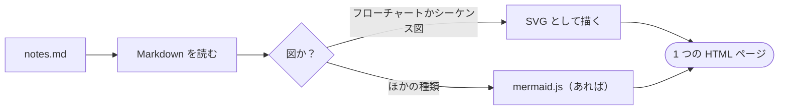
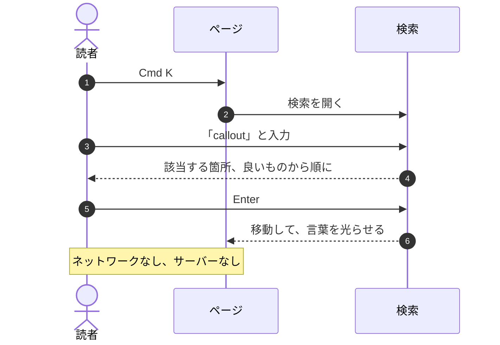
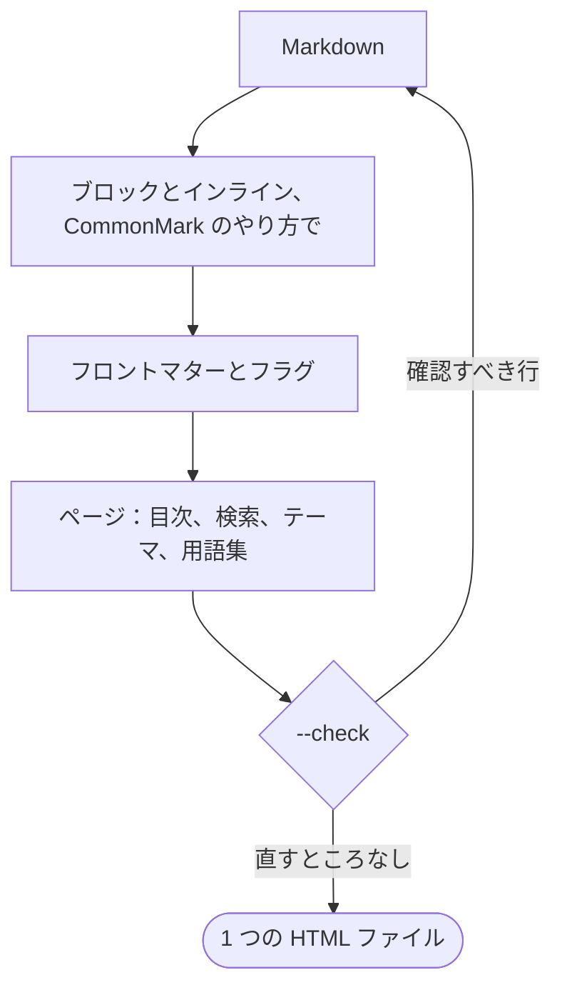

# md2html にできること、そのすべて

md2html は Markdown ファイルを、ほかに何も必要としない 1 つの HTML ページに変換します。サーバーもネットワークもいらず、フォントやスクリプトをどこかから読み込むこともありません。この報告書もそうしたページです。Markdown で書き、md2html で変換したので、ここで説明している機能はすべてこのページでも働いています。左の目次、検索、2 つのテーマ、文字の大きさ、下のカード、用語集の点線付きの語、脚注、拡大できる図版、色分けされたコード、組版された数式です。

## このページの読み方

- **1 章**は全体を 1 つの表にまとめたものです。2 分で読めます。
- **2〜6 章**では、読む人に何が見えるか、そして書く人がそのために何を書けばよいかを示します。
- **7 章と 8 章**は設定とコマンドラインです。
- **9 章と 10 章**は安全性と品質、そしてバージョン 0.4 ができるまでの話です。

---

## 1. 概要

| | 以前（0.3） | 現在（0.4） |
|:--|:--:|:--:|
| 読める Markdown | ハンドブック用の一部 | CommonMark のすべてと、GitHub による拡張 |
| 合格した CommonMark の例 | 未計測 | **652 件中 640 件** |
| 4,265 行の docenta ハンドブック | 2 分以上 | **0.07 秒** |
| `[V]` 記号だらけのページ | 38 GB まで膨れ上がった | 数ミリ秒 |
| アクセシビリティの指摘（axe-core、WCAG 2.2 AA） | 数十件 | 12 ページ、ライト・ダーク・スマートフォンで **ゼロ** |
| テスト | 10 | 53、加えて仕様の 652 の例と Chrome でのクリックテスト |
| Mermaid の図 | コードのまま表示 | スクリプトなしで **描画** |
| 言語 | 英語 | **17**、翻訳どうしの切り替え付き、右から左に書く言語も含む |
| 保存 | ページ | ページ、しおり付きの **PDF**、電子書籍リーダー用の **EPUB** |
| 実行時の依存関係 | なし | なし |

0.4 で加わったものを、タスクリストで示します。

- [x] CommonMark の仕様が説明するとおりに組み立てた、完全な Markdown の読み取り
- [x] 脚注、タスクリスト、取り消し線、自動リンク、列をそろえた表、GitHub の 5 種類のアラート
- [x] 約 20 の言語のコードの色分けと、MathML による数式の組版
- [x] フロントマターでの設定と、ページ自身の文言のドイツ語化
- [x] `--check`、`--watch`、フォルダー、標準入力、必要なときに有効にできる Content-Security-Policy
- [x] アクセシビリティの監査と、CI でのクリックテスト
- [x] スクリプトなしで SVG として描く、Mermaid のフローチャートとシーケンス図（4 章）
- [x] 17 の言語で読めるこの報告書と、バーの切り替え（7 章）
- [x] ページの保存と印刷、PDF や EPUB としての持ち出し（2 章と 8 章）

> [!IMPORTANT]
> 4sons.com にある md2html で作ったページ（計画、調査、家族のページ）は、すべて 0.4 で作り直し、公開中の版と比べました。構造は同じか、より良くなっています。

## 2. ページ

ページは 3 つの部分からなります。上端のバー、左の目次、そして本文です。

{width=100%}

ダークテーマはシステムの設定か読者の選択に従い、その選択は記憶されます。

{width=100%}

スマートフォンでは、目次はバーのスイッチの奥にたたまれ、横にスクロールするものはありません。

{width=34%}

読者ができること:

| したいこと | 操作 |
|:--|:--|
| 何かを探す | バーの **検索**、<kbd>⌘</kbd> <kbd>K</kbd>（<kbd>Ctrl</kbd> <kbd>K</kbd>）、または <kbd>/</kbd> |
| 目次を隠す・表示する | バーの左にあるスイッチ、または <kbd>⌘</kbd> <kbd>\\</kbd> |
| 文字の大きさを変える | バーの **Aa** から **−** と **+**。または <kbd>⌘</kbd> <kbd>+</kbd> と <kbd>⌘</kbd> <kbd>−</kbd>。85 から 200 パーセントまで |
| テーマを変える | **Aa** から、システム、ライト、ダーク |
| 図版を拡大する | クリックします。さらに 2 回クリックすると近づき、<kbd>Esc</kbd> で元に戻ります |
| 脚注や点線付きの語を読む | ポインタを置きます。クリックするとそこへ移動し、**戻る** で戻ります |
| 章、表の行、図版、ダイアグラム、コードブロック、一節を共有する | 見出しの右側、ポインタの下にある表の行の末尾、またはポインタの下にある図版、ダイアグラム、コードブロックの隅の共有記号で、そのリンクをコピーします（スマートフォンでは共有シートが開きます）。語句を選択すると、ちょうどその部分へのリンクが提案されます |
| 保存する | バーの最後にあるダウンロードボタンから、このページそのもの（オフラインで読めます）、印刷または PDF として保存、あるいは作成されていれば PDF と EPUB |

## 3. 書き方

普通の Markdown です。どの書き方も、そのままテキストとして読んでも読みやすくなっています。まず書く内容をコードブロックで示し、その後に結果を示します。

### 強調とリンク

```markdown
**太字**、*斜体*、***両方***、~~取り消し線~~、`コード`。
[リンク](https://commonmark.org "CommonMark")、[V] のように書いたままになる記号、
そしてむき出しのリンク https://spec.commonmark.org/0.31.2/
```

**太字**、*斜体*、***両方***、~~取り消し線~~、`コード`。[リンク](https://commonmark.org "CommonMark")、[V] のように書いたままになる記号、そしてむき出しのリンク https://spec.commonmark.org/0.31.2/

### リストの中のリスト

```markdown
1. 1 つ目。中にリストがあります:
   - 箇条書き
   - もう 1 つ。これにもリストがあります:
     1. さらに深く
2. 2 つ目。
```

1. 1 つ目。中にリストがあります:
   - 箇条書き
   - もう 1 つ。これにもリストがあります:
     1. さらに深く
2. 2 つ目。

### 引用とコールアウト

```markdown
> 普通の引用は引用のままです。

> [!TIP]
> GitHub のアラートが使えます。NOTE、TIP、IMPORTANT、WARNING、CAUTION。

> **メモ:** 古い形式、つまり太字の語とコロンも使えます。
```

> 普通の引用は引用のままです。

> [!TIP]
> GitHub のアラートが使えます。NOTE、TIP、IMPORTANT、WARNING、CAUTION。

> **メモ:** 古い形式、つまり太字の語とコロンも使えます。

### 表

```markdown
| 部屋     | 階   | 面積（平方フィート） |
|:---------|:----:|---------------------:|
| リビング | 1 階 |                  312 |
| ロフト   | 2 階 |                  205 |
```

| 部屋 | 階 | 面積（平方フィート） |
|:-------|:------:|-------------:|
| リビング | 1 階 | 312 |
| ロフト | 2 階 | 205 |

### 脚注

```markdown
出典が必要な主張です。[^1]

[^1]: 出典です。番号にポインタを置くと、そこで読めます。
```

出典が必要な主張です。[^source]

[^source]: 出典です。番号にポインタを置くと、そこで読めます。クリックするとここへ移動し、「戻る」で元の場所に戻ります。

### 図版と画像

```markdown
{width=60%}

文の中のアイコン {width=18} です。
```

{width=60%}

文の中のアイコン {width=18} です。

### 細かいこと

```markdown
<kbd>Ctrl</kbd>+<kbd>K</kbd> を押します。水は H<sub>2</sub>O、部屋は 9 m<sup>2</sup>。
バックスラッシュで終わる行は\
そこで改行されます。
```

<kbd>Ctrl</kbd>+<kbd>K</kbd> を押します。水は H<sub>2</sub>O、部屋は 9 m<sup>2</sup>。バックスラッシュで終わる行は\
そこで改行されます。

<details>
<summary>クリックすると開くセクション</summary>

`<details>` と `<summary>` で書き、中は普通の Markdown です。**太字**、リスト、

- 1 つ目
- 2 つ目

</details>

#### 第 4 レベルの見出し

第 3 レベルより下の見出しは、この見出しのように目次に入りません。

## 4. コードと数式

コードは Rust、Python、JavaScript と TypeScript、Go、C と C++、Java、Kotlin、Swift、C#、シェル、SQL、Ruby、Lua、PHP、CSS、HTML、JSON、YAML、TOML、Dockerfile、diff で色分けされ、どのブロックにもコピーボタンが付きます。

```rust
/// The whole page from one Markdown text.
fn main() {
    let page = md2html::render("# Hello\n\nWorld.", &Settings::default());
    println!("{} bytes, nothing to fetch", page.len()); // one file
}
```

```python
@cache
def area(w: float, h: float) -> float:
    """The area of a room."""
    return w * h  # square feet
```

```yaml
title: The plans   # front matter is YAML
lang: de
embed: true
```

数式はブラウザ自身が MathML として組版します。スクリプトも、ダウンロードするフォントもいりません。文中では、ピタゴラスの定理は $a^2 + b^2 = c^2$、オイラーの等式は $e^{i\pi} + 1 = 0$ となります。$5 や $10 のような金額はお金のままです。別の行に立てると次のようになります。

$$
\int_0^1 x^2 \, dx = \frac{1}{3} \qquad \sum_{k=1}^{n} k = \frac{n(n+1)}{2} \qquad \sqrt[3]{27} = 3
$$

$$
\begin{pmatrix} a & b \\ c & d \end{pmatrix}
\begin{pmatrix} x \\ y \end{pmatrix}
=
\begin{pmatrix} ax + by \\ cx + dy \end{pmatrix}
\qquad
|x| = \begin{cases} x & x \ge 0 \\ -x & x < 0 \end{cases}
$$

### ダイアグラム

Mermaid のフローチャートやシーケンス図は、md2html 自身がページの中に SVG として描きます。スクリプトも、ダウンロードするものもなく、どちらのテーマでもページ自身の色を使います。図の中の言葉は言葉のままなので、検索で見つかります。Markdown はこう書きます。

````markdown

````

そして、こうなります。


番号とメモの付いたシーケンス図です。



ほかの種類（円グラフ、ガントチャート、クラス図）は、作者が md2html に mermaid.js のコピーを指定したとき（`--mermaid-js FILE`）に、mermaid.js が描きます。そのとき、スクリプトはそのページにだけ入ります。指定がなければコードのまま残り、`--check` がそれを知らせます。

## 5. 用語集と脚注

「用語集」という名前の章には、ページの言葉が表としてまとめられています。この表はその場所には表示されません。代わりに、各章でそれぞれの用語が最初に出てくるところが点線付きの語になり、ポインタを置くと意味が表示されます。クリックするとページの末尾の項目へ移動し、そこから読んでいた行へ戻れます。

{width=70%}

脚注も同じように働きます。番号にポインタを置くと、内容が表示されます。

{width=70%}

> [!NOTE]
> 用語集は複数のページで共有できます。`~/.config/md2html/glossary.md` という 1 つのファイルに書くと、その言葉は、そのマシンで変換するすべてのページでリンクになります。

## 6. 検索と図版

検索は、用語集も含めてページのすべての言葉が対象です。結果にはそれぞれの言葉がどこにあるかが表示され、選んだ結果は移動した先で光ります。

{width=80%}

{width=80%}

図版は、ページを離れずにページの上で拡大されます。ウィンドウより大きいときはポインタの動きについてくるので、見たいところを指すだけです。

## 7. 設定

この報告書の英語の原文の Markdown ファイルは、先頭がこうなっています。

```yaml
---
title: md2html, everything it does
brand: md2html
kicker: Report
version: 0.7.6
date: 2026-11-22
footer: Written in Markdown and rendered by **md2html 0.7.6** itself ...
csp: true      # only this page's own code may run
embed: true    # the screenshots are inside the page
---
```

| 設定 | 働き |
|:--|:--|
| `title`, `description`, `author` | タイトルと、リンクのプレビュー用のメタタグ |
| `lang` | 言語。ページ自身の文言と日付を、上の 17 の言語のどれにでもします（`ja-Hira` はかなだけの日本語、`zh-Hant` は繁体字の中国語、`yue` は広東語） |
| `translated_from`, `source_sha256` | 翻訳の場合に、その原文と、翻訳した時点の原文のフィンガープリント |
| `brand`, `brand_link`, `kicker`, `eyebrow`, `footer` | バー、タイトルの上の行、末尾の小さな文字 |
| `date`, `version` | タイトルの上に表示する日付とバージョン |
| `embed` | 画像をページの中に入れて、1 つのファイルにする |
| `csp` | Content-Security-Policy |
| `pdf`, `epub` | ページの横に置く、そのページの PDF と EPUB |
| `live` | ページの有効期間（`true` は 2 分、または秒数）。期間が過ぎると、変わっていれば読み込み直し、読者の位置はそのまま |
| `large`, `toc`, `math`, `index`, `html`, `css`, `head` | 大きな文字、目次、数式、検索エンジン、生の HTML、追加のスタイルと head |

> [!TIP]
> `lang: de` にすると、検索欄には「Diese Seite durchsuchen」、コールアウトには「Hinweis」や「Achtung」と表示され、日付は「22. November 2026」になります。このサイトのトーマスのページは、この方法でドイツ語になっています。

### 言語

この報告書は 17 の言語で読めます。英語、ドイツ語、ヘブライ語、インドネシア語、オランダ語、ジャワ語、イディッシュ語、低地ドイツ語、フランス語、イタリア語、スペイン語、3 通りの書き方の日本語（漢字かな交じり、かなのみ、ローマ字）、簡体字と繁体字の中国語（普通話）、そして広東語です。バーの地球儀で切り替えられ、ページは読んでいた章で開きます。

翻訳は、原文の隣に置いた、言語の名前を付けた別の Markdown ファイルにすぎません。`report.de.md` は `report.md` のドイツ語版です。md2html はそこにある版を見つけて互いにリンクし（ブラウザと検索エンジンには `hreflang` で知らせます）、それぞれにその言語の画面の文言を与えます。検索、コールアウト、用語集、日付です。ヘブライ語とイディッシュ語は右から左に組まれ、目次は右側に来ます。

それぞれの翻訳には原文の名前と原文のフィンガープリントが記録されるので、ページはどの版が正式なものかを示せます。また、翻訳したあとで原文が変わると、`--check` がそれに気づきます。

```yaml
translated_from: report.md
source_sha256: 5b0c...e1
```

まだ誰もページを翻訳していない言語については、読者のブラウザにその機能があれば（Chrome に組み込まれた翻訳機能）、ブラウザが翻訳できます。翻訳は端末の中で行われるので、家族のページの内容が外に出ることはありません。機械翻訳であることが示され、原文に戻る方法も付きます。

## 8. コマンドライン

```console
$ md2html notes.md
md2html: notes.md -> notes.html (68504 bytes, 9 glossary terms, 0 of them shared)
$ md2html docs/ -o site/ --nav
$ md2html notes.md --check
notes.md:12: a link points at #setup, which is nowhere on the page
notes.md:30: `plan.svg` does not exist next to this page
md2html: 2 to look at
$ cat notes.md | md2html - > notes.html
$ md2html notes.md --pdf --epub
$ md2html notes.md --serve
```

`--check` は何も書き出さず、作者が確認すべき点を行ごとに一覧にし、何かあれば終了コード 1 で終わります。ページにないアンカーへのリンク、存在しないファイル、注のない脚注、テキストとして表示されてしまう生の HTML などです。そのため、ビルドやエージェントの作業の最後の手順に向いています。`--watch` は保存するたびに変換し直し、`--nav` はフォルダーの中のページを「前へ」と「次へ」でつなぎます。別の Markdown ファイルへのリンクは、そのページへのリンクになります。

`--pdf` は、コンピューターにすでにある Chrome でページを印刷します。ページ自身の印刷用レイアウトで、見出しは PDF のしおりになり、各ページの上にタイトル、下にページ番号が入ります。`--epub` は同じページから電子書籍リーダー用の本を作ります。目次、画像、図、数式が入り、脚注は言及された場所で開きます。EPUB は md2html が自分で書き出します。読者は両方をバーのダウンロードボタンの中に見つけられます。

`--serve` は、書いている間、このコンピューター上でページを表示します。Markdown を保存した瞬間に、開いているページがすべて読み込み直されます。`--live` 付きで公開したページには、それ自身の有効期間があります。期間が切れると、ページは自分のサーバーに自分自身の最初の 1 キロバイトを問い合わせ、それが変わっていたときだけ読み込み直します。どちらの場合も、読者はいた場所にとどまります。同じ段落が同じ高さに来るか、その段落がなくなっていれば、その前の章に戻ります。

## 9. 安全性、品質、アクセシビリティ

> [!WARNING]
> ページは、他の人が書いた Markdown から変換されることもあります。md2html が本文からスクリプトを書き出すことはありません。生の HTML は、いくつかの無害なタグを除いて書かれたとおりに表示され、`javascript:` や `data:` のリンクは、どのような綴りで書かれていても取り除かれます。文書が md2html に、そのフォルダーの外にあるファイルを読ませることはできません。また、どれほど悪意のある入力でも、md2html を止めたりクラッシュさせたりすることはできません。

> [!CAUTION]
> `--html` を付けると、より豊かな HTML（画像、リンク、動画、SVG、レイアウト）が通りますが、実行されるものは決して通りません。スクリプトも、イベントハンドラーも、フレームも、フォームも通りません。

変更のたびに、macOS と Ubuntu で確認していること:

- ページ全体を変換して読み返す 53 のテスト。セキュリティのケースも含みます。
- CommonMark の仕様にある 652 の例。合格する数は増えることはあっても、減ることはありません。
- clippy の最も厳しい lint と、このツールがビルドできると約束している最も古い Rust。
- axe-core による WCAG 2.2 AA のアクセシビリティの監査。両方のテーマで、スマートフォンの幅でも行います。
- Chrome ですべての操作を試すクリックテスト。キーボードとマウスでの検索、テーマ、文字の大きさ、目次、図版、脚注、用語集、コピー、印刷です。

印刷には専用のレイアウトがあります。操作部分は消え、すべてのリンクはアドレスが印刷され、ページの境目で切れるものはなく、各ページにはタイトルとページ番号が入ります。

どのページも、控えめな 1 行で終わります。md2html で作成したこと、そのバージョン、そして md2html の置き場所へのリンクです。

{width=55%}

## 10. 0.4 ができるまで

始まりは調査でした。優れた Markdown レンダラーが何をしているか、ウェブの標準がページに何を求めているか、そしてこのマシンでツールがどう使われているか。最後のものが最も役に立つとわかりました。4sons.com の 4 つのページのビルドが、変換のあとで md2html の出力を書き換え、ブランド、言語、フッターなどを変えていたのです。そうした書き換えはそれぞれ設定になり、ビルドは新しい版に合わせて 1 ページずつ作り直されました。

変換の規則がどう変わったかを、diff で示します。

```diff
- a handbook subset, anything else shown as written
+ all of CommonMark, and anything else shown as written
- every quotation a note
+ a quotation is a quotation; a bold first word makes it a note
- the page's words in English
+ the page's words in English or German
```

その後 0.5 で加わったのは、ダイアグラムです。ここにあるどのページもたどる道筋はこうです。



---

下の用語集では、この報告書で使っている言葉を説明します。どれも、上では点線付きの語になっていたものです。

## 用語集

| 用語 | 意味 | 別名 |
|---|---|---|
| Markdown | 見出し、強調、リスト、リンクを軽い記号で表すプレーンテキスト。そのままで読め、ページに変換することもできます。 | |
| CommonMark | 今ではほとんどのツールが従っている Markdown の仕様で、規則ごとにテストがあります。 | |
| 目次 | ページの左にある章の一覧で、見出しから作られます。 | |
| コールアウト | 枠で囲んだ補足。メモ、ヒント、重要なこと、警告、注意のいずれかです。 | アラート |
| 図版 | 1 行を占める画像で、下にキャプションが付き、クリックすると拡大します。 | |
| フロントマター | Markdown ファイルのいちばん上の、2 本の `---` の行の間にある設定のブロック。 | |
| MathML | ウェブ自身の数式の言語で、ブラウザがスクリプトなしで描きます。 | |
| Content-Security-Policy | どのコードの実行を許すかをブラウザに伝える、ページの中の規則。ここではページ自身のコードだけです。 | |
| Mermaid | コードブロックに書く、図のためのテキストの言語。md2html はそのフローチャートとシーケンス図を描きます。 | |
| WCAG | Web Content Accessibility Guidelines（ウェブコンテンツのアクセシビリティのガイドライン）。ふつうの目標はレベル AA です。 | |
| 翻訳 | ページを別の言語で書いた版で、原文の隣に置く Markdown ファイルです。 | |
