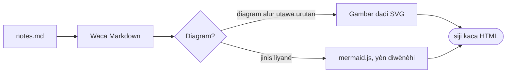
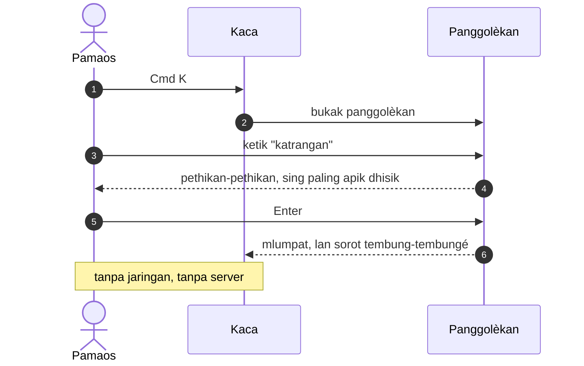
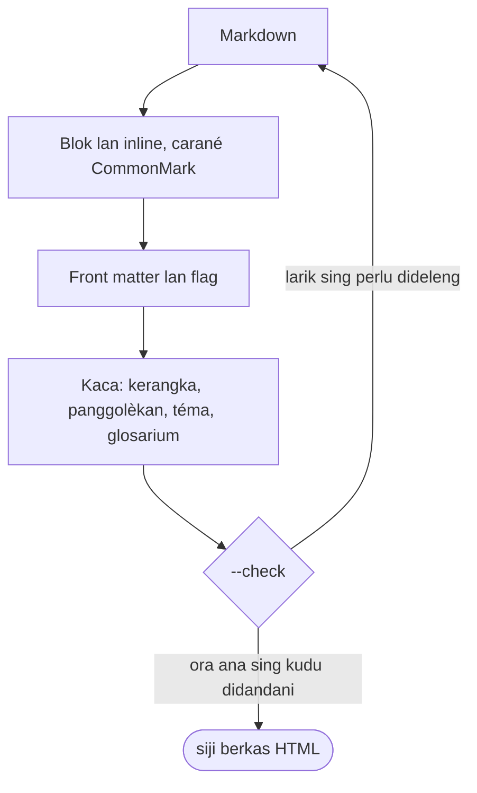

# md2html, kabèh sing bisa dilakoni

md2html ngowahi berkas Markdown dadi siji kaca HTML sing ora butuh apa-apa manèh: tanpa server, tanpa jaringan, tanpa font utawa skrip saka ngendi waé. Laporan iki salah siji kaca kaya ngono. Laporan iki ditulis nganggo Markdown lan dirender déning md2html, dadi saben kabisan sing diandharaké uga makarya ing kéné: kerangka ing sisih kiwa, panggolèkan, rong téma, ukuran teks, kertu-kertu ing ngisor, tembung-tembung saka glosarium sing digaris titik, cathetan sikil, gambar sing bisa digedhèkaké, kode sing diwarnani lan rumus matématika sing disusun rapi.

## Carané maca kaca iki

- **Bab 1** iku kabèh critané ing siji tabel. Rong menit.
- **Bab 2 nganti 6** nuduhaké apa sing ditampa pamaos, lan apa sing diketik panyerat supaya olèh iku.
- **Bab 7 lan 8** yaiku setèlan lan baris printah.
- **Bab 9 lan 10** yaiku keamanan lan mutu, uga kepriyé vèrsi 0.4 dumadi.

---

## 1. Sakilas

| | Sadurungé (0.3) | Saiki (0.4) |
|:--|:--:|:--:|
| Markdown sing diwaca | mung sapérangan, cukup kanggo buku panuntun | kabèh CommonMark, lan tambahan saka GitHub |
| Conto CommonMark sing lulus | ora diukur | **640 saka 652** |
| Buku panuntun docenta sing 4.265 larik | luwih saka rong menit | **0,07 detik** |
| Kaca kebak tandha `[V]` | mbengkak nganti 38 GB | mung milidetik |
| Temuan aksesibilitas (axe-core, WCAG 2.2 AA) | puluhan | **ora ana**, ing 12 kaca, padhang, peteng lan HP |
| Uji | 10 | 53, ditambah 652 conto spésifikasi lan uji klik ing Chrome |
| Diagram Mermaid | dituduhaké minangka kode | **digambar**, tanpa skrip |
| Basa | Inggris | **17**, kanthi saklar ing antarané terjemahan, kalebu sing saka tengen menyang kiwa |
| Kanggo disimpen | kaca | kaca, **PDF** nganggo tetenger, **EPUB** kanggo e-reader |
| Dependensi nalika mlaku | ora ana | ora ana |

Sing teka bebarengan karo 0.4, minangka daftar tugas:

- [x] pamaca Markdown sing jangkep, digawé kaya sing diandharaké spésifikasi CommonMark
- [x] cathetan sikil, daftar tugas, coretan, pranala otomatis, tabel sing ditata rata lan limang alert GitHub
- [x] kode sing diwarnani ing kira-kira rong puluh basa, matématika sing disusun minangka MathML
- [x] setèlan ing front matter, lan tembung-tembungé kaca dhéwé ing basa Jerman
- [x] `--check`, `--watch`, folder, stdin, Content-Security-Policy sing bisa diuripaké
- [x] audit aksesibilitas lan uji klik ing CI
- [x] diagram alur lan diagram urutan Mermaid, digambar minangka SVG tanpa skrip (bab 4)
- [x] laporan iki ing pitulas basa, kanthi saklar ing bilah ndhuwur (bab 7)
- [x] kaca sing disimpen, dicithak, utawa digawa minangka PDF utawa EPUB (bab 2 lan 8)

> [!IMPORTANT]
> Saben kaca ing 4sons.com sing digawé nganggo md2html (rancangan, riset lan kaca-kaca kulawarga) digawé ulang nganggo 0.4 lan dibandhingaké karo vèrsi sing lagi tayang: strukturé padha, utawa luwih apik.

## 2. Kaca

Kaca iki ana telung bagéan: bilah ing sadawané pucuk, kerangka ing sisih kiwa, lan teks.

{width=100%}

Téma peteng manut sistem, utawa pilihané pamaos, lan pilihan iku dieling-eling:

{width=100%}

Ing HP, kerangka lempit ing mburiné saklar ing bilah, lan ora ana sing gulung mangiwa-manengen:

{width=34%}

Sing bisa ditindakaké pamaos:

| Kanggo | Carané |
|:--|:--|
| Nggolèki samubarang | **Golèk** ing bilah, <kbd>⌘</kbd> <kbd>K</kbd> (<kbd>Ctrl</kbd> <kbd>K</kbd>), utawa <kbd>/</kbd> |
| Ndhelikaké utawa nuduhaké kerangka | saklar ing sisih kiwa bilah, utawa <kbd>⌘</kbd> <kbd>\\</kbd> |
| Ngowahi ukuran teks | **Aa** ing bilah, banjur **−** lan **+**; utawa <kbd>⌘</kbd> <kbd>+</kbd> lan <kbd>⌘</kbd> <kbd>−</kbd>, saka 85 nganti 200 persen |
| Ngganti téma | **Aa**, banjur Sistem, Padhang utawa Peteng |
| Nggedhèkaké gambar | klik gambaré; rong klik manèh nggawa luwih cedhak; <kbd>Esc</kbd> mbalèkaké |
| Maos cathetan sikil utawa tembung sing digaris titik | dèlèhaké penunjuk ing ndhuwuré; klik kanggo mrana, lan **bali** nggawa panjenengan wangsul |
| Mbagi bab, larik tabel, utawa pethikan | simbol bagi ing sisih tengen irah-irahan, utawa ing pungkasan larik tabel ing sangisoré penunjuk, nyalin pranalané (HP mbukak menu baginé); pilih sawetara tembung, lan pranala persis menyang tembung-tembung kuwi bakal ditawakaké |
| Nyimpen | tombol undhuh ing pungkasané bilah: kaca kuwi dhéwé (bisa diwaca tanpa internet), cithak utawa simpen dadi PDF, utawa PDF lan EPUB yèn wis digawé |

## 3. Nulis

Markdown biasa, lan saben wanguné uga kepénak diwaca minangka teks polos. Sing panjenengan serat ana ing ngarep, ing blok kode; asilé ngetutaké ing sawisé.

### Penegasan lan pranala

```markdown
**Kandel**, *miring*, ***loro-loroné***, ~~dicorèt~~ lan `kode`.
Siji [pranala](https://commonmark.org "CommonMark"), siji sing gundhul,
https://spec.commonmark.org/0.31.2/, lan tandha kaya [V] sing tetep kaya ditulis.
```

**Kandel**, *miring*, ***loro-loroné***, ~~dicorèt~~ lan `kode`. Siji [pranala](https://commonmark.org "CommonMark"), siji sing gundhul, https://spec.commonmark.org/0.31.2/, lan tandha kaya [V] sing tetep kaya ditulis.

### Daftar ing jero daftar

```markdown
1. Kapisan, kanthi daftar ing jeroné:
   - siji butir
   - siji manèh, kanthi daftaré dhéwé:
     1. luwih jero
2. Kapindho.
```

1. Kapisan, kanthi daftar ing jeroné:
   - siji butir
   - siji manèh, kanthi daftaré dhéwé:
     1. luwih jero
2. Kapindho.

### Kutipan lan kothak katrangan

```markdown
> Kutipan biasa tetep dadi kutipan.

> [!TIP]
> Alert GitHub bisa mlaku: NOTE, TIP, IMPORTANT, WARNING, CAUTION.

> **Cathetan:** semono uga wangun sing luwih lawas, siji tembung kandel lan titik loro.
```

> Kutipan biasa tetep dadi kutipan.

> [!TIP]
> Alert GitHub bisa mlaku: NOTE, TIP, IMPORTANT, WARNING, CAUTION.

> **Cathetan:** semono uga wangun sing luwih lawas, siji tembung kandel lan titik loro.

### Tabel

```markdown
| Ruangan    | Tingkat | Jembar (kaki persegi) |
|:-----------|:-------:|----------------------:|
| Ruang tamu | ngisor  |                   312 |
| Loteng     | ndhuwur |                   205 |
```

| Ruangan | Tingkat | Jembar (kaki persegi) |
|:-------|:------:|-------------:|
| Ruang tamu | ngisor | 312 |
| Loteng | ndhuwur | 205 |

### Cathetan sikil

```markdown
Pratélan sing butuh sumber.[^1]

[^1]: Sumberé. Dèlèhaké penunjuk ing nomeré kanggo maos ing kono.
```

Pratélan sing butuh sumber.[^source]

[^source]: Sumberé. Dèlèhaké penunjuk ing nomeré kanggo maos ing kono; klik nomeré kanggo teka mréné, lan bali kanggo wangsul.

### Gambar lan citra

```markdown
{width=60%}

Siji ikon {width=18} ing tengah ukara.
```

{width=60%}

Siji ikon {width=18} ing tengah ukara.

### Prekara-prekara cilik

```markdown
Pencet <kbd>Ctrl</kbd>+<kbd>K</kbd>. Banyu iku H<sub>2</sub>O, kamaré 9 m<sup>2</sup>.
Larik sing dipungkasi garis miring walik\
pedhot ing kono.
```

Pencet <kbd>Ctrl</kbd>+<kbd>K</kbd>. Banyu iku H<sub>2</sub>O, kamaré 9 m<sup>2</sup>. Larik sing dipungkasi garis miring walik\
pedhot ing kono.

<details>
<summary>Bagéan sing kabukak kanthi sepisan klik</summary>

Ditulis minangka `<details>` karo `<summary>`, isiné Markdown biasa: **kandel**, siji daftar,

- siji
- loro

</details>

#### Irah-irahan tingkat papat

Irah-irahan ing ngisor tingkat telu ora mlebu kerangka, kaya irah-irahan iki.

## 4. Kode lan matématika

Kode diwarnani kanggo Rust, Python, JavaScript lan TypeScript, Go, C lan C++, Java, Kotlin, Swift, C#, shell, SQL, Ruby, Lua, PHP, CSS, HTML, JSON, YAML, TOML, Dockerfile lan diff, lan saben blok duwé tombol salin.

```rust
/// The whole page from one Markdown text.
fn main() {
    let page = md2html::render("# Hello\n\nWorld.", &Settings::default());
    println!("{} bytes, nothing to fetch", page.len()); // one file
}
```

```python
@cache
def area(w: float, h: float) -> float:
    """The area of a room."""
    return w * h  # square feet
```

```yaml
title: The plans   # front matter is YAML
lang: de
embed: true
```

Matématika disusun déning peramban dhéwé, minangka MathML, tanpa skrip lan tanpa font sing kudu diundhuh. Ing jero larik, téoréma Pythagoras yaiku $a^2 + b^2 = c^2$, lan idhèntitas Euler yaiku $e^{i\pi} + 1 = 0$; cacahing dhuwit kaya $5 utawa $10 tetep dadi dhuwit. Ditampilaké dhéwé:

$$
\int_0^1 x^2 \, dx = \frac{1}{3} \qquad \sum_{k=1}^{n} k = \frac{n(n+1)}{2} \qquad \sqrt[3]{27} = 3
$$

$$
\begin{pmatrix} a & b \\ c & d \end{pmatrix}
\begin{pmatrix} x \\ y \end{pmatrix}
=
\begin{pmatrix} ax + by \\ cx + dy \end{pmatrix}
\qquad
|x| = \begin{cases} x & x \ge 0 \\ -x & x < 0 \end{cases}
$$

### Diagram

Diagram alur utawa diagram urutan Mermaid digambar déning md2html dhéwé, minangka SVG ing jero kaca: tanpa skrip, ora ana sing kudu diundhuh, nganggo werna kaca dhéwé ing loro téma, lan tembung-tembungé tetep tembung sing bisa ditemokaké panggolèkan. Iki Markdown-é:

````markdown

````

Lan iki dadiné:


Diagram urutan, nganggo nomer, kanthi cathetan:



Jinis liyané (diagram pai, diagram Gantt, diagram kelas) digambar déning mermaid.js yèn panyerat nuduhaké salinané marang md2html (`--mermaid-js FILE`); skrip iku banjur mung mlebu ing kaca kasebut. Tanpa iku, diagram-diagram kuwi tetep dadi kode, lan `--check` ngandhakaké.

## 5. Babagan glosarium lan cathetan sikil

Bab sing jenengé Glosarium nyimpen tembung-tembungé kaca minangka tabel. Bab iku ora dicithak ing panggonané: minangka gantiné, sebutan kapisan saben istilah ing saben bab dadi tembung sing digaris titik sing nerangaké awaké dhéwé yèn penunjuk ana ing ndhuwuré, lan yèn diklik mlumpat menyang entriné ing ngisor, sing nggawa panjenengan wangsul menyang larik sing lagi panjenengan waos.

{width=70%}

Cathetan sikil makarya kanthi cara sing padha: nomeré nerangaké awaké dhéwé yèn penunjuk ana ing ndhuwuré.

{width=70%}

> [!NOTE]
> Glosarium bisa dienggo bebarengan déning akèh kaca: siji berkas ing `~/.config/md2html/glossary.md`, sing tembung-tembungé banjur dadi pranala ing saben kaca sing dirender ing mesin kuwi.

## 6. Panggolèkan lan gambar

Panggolèkan nyakup saben tembung ing kaca, kalebu glosarium. Asilé nuduhaké ing ngendi saben tembung ana; sing dipilih disorot ing panggonan panggolèkan mandheg.

{width=80%}

{width=80%}

Gambar digedhèkaké ing ndhuwur kaca tanpa ninggal kaca. Yèn luwih gedhé tinimbang jendhéla, gambar ngetutaké penunjuk, dadi panjenengan cukup nuding apa sing kersa panjenengan pirsani.

## 7. Setèlan

Pucuké berkas Markdown asli laporan iki unié:

```yaml
---
title: md2html, everything it does
brand: md2html
kicker: Report
version: 0.7.5
date: 2026-11-22
footer: Written in Markdown and rendered by **md2html 0.7.5** itself ...
csp: true      # only this page's own code may run
embed: true    # the screenshots are inside the page
---
```

| Setèlan | Gunané |
|:--|:--|
| `title`, `description`, `author` | irah-irahan, lan tag meta kanggo pratinjau pranala |
| `lang` | basa: tembung-tembung lan tanggal kaca dhéwé ing salah siji saka pitulas basa ing ndhuwur (`ja-Hira` iku basa Jepang ing kana, `zh-Hant` basa Tionghoa ing aksara tradhisional, `yue` basa Kanton) |
| `translated_from`, `source_sha256` | kanggo terjemahan: asliné, lan sidik driji asliné nalika diterjemahaké |
| `brand`, `brand_link`, `kicker`, `eyebrow`, `footer` | bilah, larik ing ndhuwur irah-irahan, tulisan cilik ing ngisor |
| `date`, `version` | tanggal lan vèrsi sing katon ing ndhuwur irah-irahan |
| `embed` | gambar ing jero kaca, dadi cukup siji berkas |
| `csp` | siji Content-Security-Policy |
| `pdf`, `epub` | PDF lan EPUB saka kaca kuwi, ing sandhingé |
| `live` | umur kaca (`true` tegesé rong menit, utawa sawetara detik): sawisé kuwi kaca dimuat manèh yèn owah, lan pamaca tetep ana ing panggonané |
| `large`, `toc`, `math`, `index`, `html`, `css`, `head` | aksara luwih gedhé, kerangka, matématika, mesin panggolèk, HTML mentah, gaya lan head tambahan |

> [!TIP]
> Nganggo `lang: de` panggolèkan muni "Diese Seite durchsuchen", kothak katrangan muni "Hinweis" lan "Achtung", lan tanggalé kawaca "22. November 2026". Kaca-kaca Thomas ing situs iki nganggo basa Jerman kanthi cara iki.

### Basa

Laporan iki ana ing pitulas basa: Inggris, Jerman, Ibrani, Indonésia, Walanda, Jawa, Yiddish, Jerman Ngisor, Prancis, Italia, Spanyol, Jepang sing ditulis nganggo telung cara (nganggo kanji lan kana, mung nganggo kana, lan nganggo rōmaji), Mandarin nganggo aksara prasaja lan nganggo aksara tradhisional, lan Kanton. Bola donya ing bilah ngalih ing antarané basa-basa kuwi, lan kaca kabukak ing bab sing lagi panjenengan waos.

Terjemahan iku mung berkas Markdown liya ing sandhingé asliné, dijenengi miturut basané: `report.de.md` iku `report.md` ing basa Jerman. md2html nemokaké vèrsi-vèrsi sing ana, nggandhèngaké siji lan sijiné (lan ngabari peramban lan mesin panggolèk nganggo `hreflang`), lan mènèhi saben vèrsi tembung-tembung antarmukané dhéwé: panggolèkan, kothak katrangan, glosarium, tanggal. Ibrani lan Yiddish ditata saka tengen menyang kiwa, kerangkané ing sisih tengen.

Saben terjemahan nyebut asliné lan nyathet sidik driji asliné, dadi kaca bisa ngandhakaké vèrsi endi sing dadi pathokan, lan `--check` ngerti yèn asliné wis owah wiwit terjemahan digawé:

```yaml
translated_from: report.md
source_sha256: 5b0c...e1
```

Kanggo basa sing durung ana sing nerjemahaké kaca iku, peramban duwèké pamaos dhéwé bisa nerjemahaké, yèn peramban iku duwé kabisan kasebut (penerjemah gawan Chrome): ing piranti iku dhéwé, dadi ora ana sathithik waé isi kaca kulawarga sing metu saka kono, lan diwènèhi label minangka terjemahan mesin kanthi dalan bali menyang asliné.

## 8. Baris printah

```console
$ md2html notes.md
md2html: notes.md -> notes.html (68504 bytes, 9 glossary terms, 0 of them shared)
$ md2html docs/ -o site/ --nav
$ md2html notes.md --check
notes.md:12: a link points at #setup, which is nowhere on the page
notes.md:30: `plan.svg` does not exist next to this page
md2html: 2 to look at
$ cat notes.md | md2html - > notes.html
$ md2html notes.md --pdf --epub
$ md2html notes.md --serve
```

`--check` ora nulis apa-apa lan nyathet apa sing perlu digatèkaké panyerat, larik siji mbaka siji, lan metu nganggo kode 1 yèn ana apa-apa: pranala menyang jangkar sing ora ana ing kaca, berkas sing ora ana, cathetan sikil tanpa cathetané, HTML mentah sing dituduhaké minangka teks. Mulané `--check` cocog dadi langkah pungkasan saka build, utawa saka gawéané agèn. `--watch` ngrender manèh saben berkas disimpen, `--nav` nggandhèngaké kaca-kaca ing siji folder nganggo sadurungé lan sabanjuré, lan pranala menyang berkas Markdown liya tumuju menyang kacané.

`--pdf` nyithak kaca nganggo Chrome sing wis ana ing komputer: tata letak cithakané dhéwé, irah-irahan bab minangka tetenger PDF, irah-irahan kaca ing pucuk saben kaca lan nomeré ing ngisor. `--epub` nggawé buku kanggo e-reader saka kaca sing padha, kanthi daftar isi, gambar, diagram lan matématikané, lan cathetan sikil sing kabukak ing panggonan sing nyebut; md2html nulis dhéwé. Pamaca nemokaké loro-loroné ing sangisoré tombol undhuh ing bilah.

`--serve` nuduhaké kaca-kaca ing komputer iki salawasé lagi ditulis: saben kaca sing kabukak dimuat manèh nalika berkas Markdown-é disimpen. Kaca sing diterbitaké nganggo `--live` duwé umur dhéwé; yèn umuré entèk, kaca kuwi njaluk kilobyte kapisan saka awaké dhéwé marang server-é lan mung dimuat manèh yèn bagéan kuwi owah. Apa waé carané, pamaca tetep ana ing panggonané: ing paragraf sing padha ing dhuwur sing padha, utawa, yèn paragraf kuwi wis ora ana, ing bab sadurungé.

## 9. Keamanan, mutu lan aksesibilitas

> [!WARNING]
> Kaca bisa dirender saka Markdown sing ditulis wong liya. md2html ora tau nulis skrip saka teks: HTML mentah dituduhaké kaya sing ditulis kajaba sawetara tag sing ora mbebayani, lan pranala `javascript:` utawa `data:` dibuwang, kepiyé waé carané nulis. Dokumen ora bisa nggawé md2html maca berkas ing njaba folderé, lan ora ana input, sanajan sing paling ala, sing bisa nggawé macet utawa mogok.

> [!CAUTION]
> `--html` nglilani HTML sing luwih sugih liwat (gambar, pranala, video, SVG, tata letak), nanging ora tau apa waé sing dilakokaké: ora ana skrip, ora ana penangan prastawa, ora ana frame, ora ana formulir.

Sing dipriksa, ing saben owah-owahan, ing macOS lan Ubuntu:

- 53 uji sing ngrender kaca wutuh lan maca manèh asilé, kasus-kasus keamanan kalebu ing kono;
- 652 conto saka spésifikasi CommonMark, sing cacahé sing lulus olèh mundhak nanging ora tau mudhun;
- lint clippy sing paling ketat, lan vèrsi Rust paling lawas sing dijanjèkaké piranti iki isih bisa kanggo mbangun;
- audit aksesibilitas nganggo axe-core tumrap WCAG 2.2 AA, ing loro téma lan ing ambané layar HP;
- uji klik ing Chrome sing nganggo saben kontrol: panggolèkan nganggo papan ketik lan mouse, téma, ukuran teks, kerangka, gambar, cathetan sikil, glosarium, salin, cithak.

Cithakan olèh tata letak dhéwé: tombol-tombol ilang, saben pranala nyithak alamaté, ora ana sing kepotong ing antarané rong kaca, lan saben kaca nggawa irah-irahan lan nomeré.

Saben kaca dipungkasi siji larik sing anteng: digawé nganggo md2html, vèrsiné, lan pranala menyang panggonané md2html.

{width=55%}

## 10. Kepriyé 0.4 dumadi

Kabèh diwiwiti saka riset: apa sing ditindakaké piranti render Markdown sing paling apik, apa sing dikarepaké standar wèb saka sawijining kaca, lan kepriyé piranti iki dienggo ing mesin iki, sing jebul dadi bagéan sing paling migunani. Papat proses gawé kaca ing 4sons.com nulis ulang asilé md2html sawisé dirender, kanggo ngganti merek, basa, footer lan liya-liyané. Saben panulisan ulang kuwi dadi siji setèlan, lan proses-proses kuwi digawé ulang nganggo vèrsi anyar, kaca siji mbaka siji.

Owah-owahané, minangka diff saka aturan sing dituruti piranti render:

```diff
- a handbook subset, anything else shown as written
+ all of CommonMark, and anything else shown as written
- every quotation a note
+ a quotation is a quotation; a bold first word makes it a note
- the page's words in English
+ the page's words in English or German
```

Sing ditambahaké 0.5 wiwit kuwi: diagram. Dalan sing diliwati saben kaca ing kéné:



---

Glosarium ing ngisor iki nerangaké tembung-tembung sing dienggo laporan iki; saben tembung mau dadi tembung sing digaris titik ing ndhuwur.

## Glosarium

| Istilah | Teges | Uga |
|---|---|---|
| Markdown | Teks polos kanthi tandha-tandha entèng kanggo irah-irahan, penegasan, daftar lan pranala, kepénak diwaca kaya apa anané lan bisa diowahi dadi kaca. | |
| CommonMark | Spésifikasi Markdown sing saiki dianut akèh-akèhé piranti, kanthi uji kanggo saben aturan. | |
| kerangka | Daftar bab ing sisih kiwa kaca, digawé saka irah-irahané. | kerangkané |
| kothak katrangan | Katrangan sisihan ing jero kothak: cathetan, pitutur, prekara sing wigati, pènget utawa ati-ati. | alert |
| gambar | Citra ing lariké dhéwé, kanthi katrangan ing ngisoré, digedhèkaké yèn diklik. | gambaré |
| front matter | Blok setèlan ing antarané rong larik `---` ing pucuk banget berkas Markdown. | |
| MathML | Basané wèb dhéwé kanggo matématika, digambar déning peramban tanpa skrip. | |
| Content-Security-Policy | Aturan ing jero kaca sing ngandhani peramban kode endi sing olèh mlaku; ing kéné, mung kodené kaca dhéwé. | |
| Mermaid | Basa teks kanggo diagram, ditulis ing blok kode; md2html nggambar diagram alur lan diagram urutané. | |
| WCAG | Web Content Accessibility Guidelines, pedoman aksesibilitas isi wèb; tingkat AA iku target sing lumrah. | |
| terjemahan | Vèrsi kaca ing basa liya, awujud berkas Markdown ing sandhingé asliné. | |
