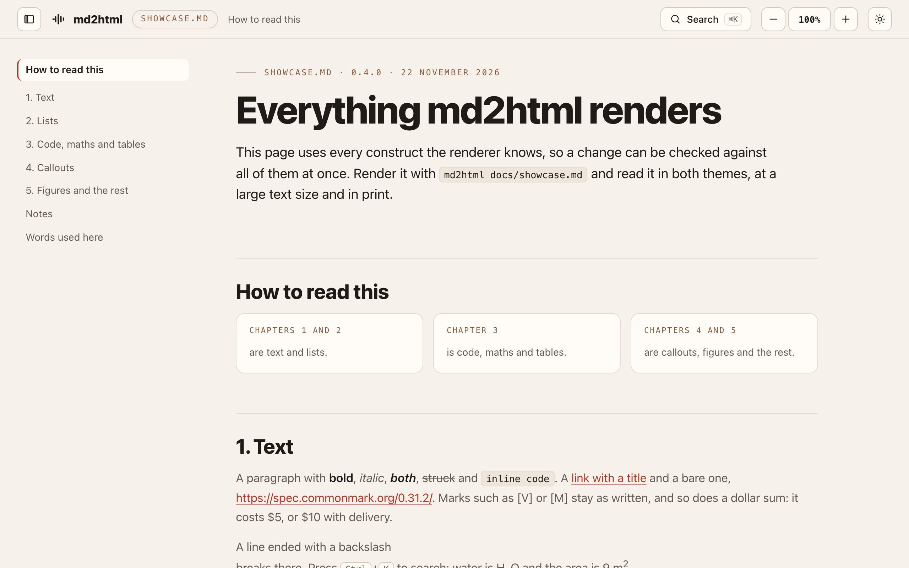
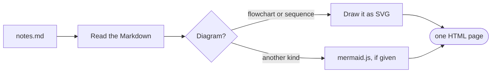
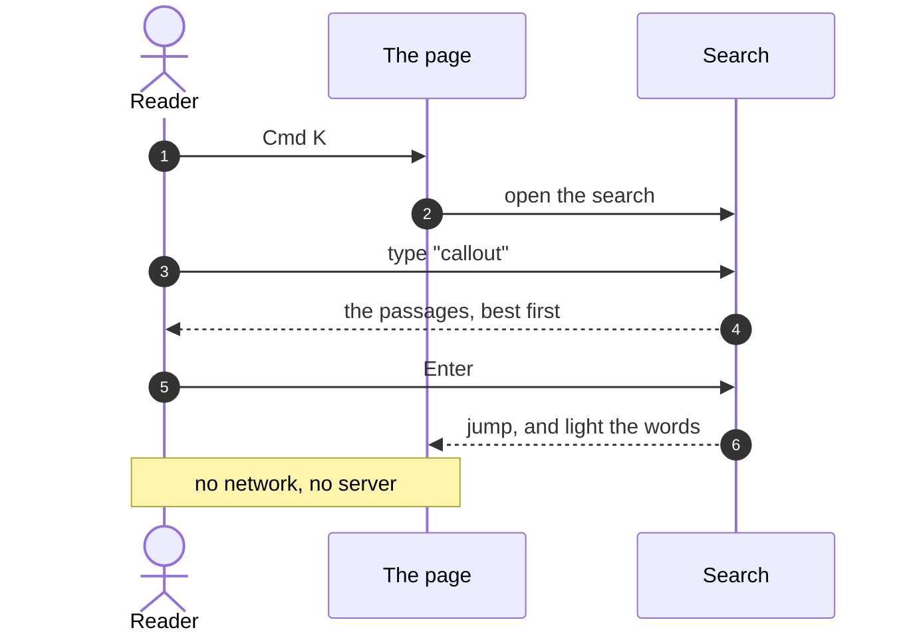
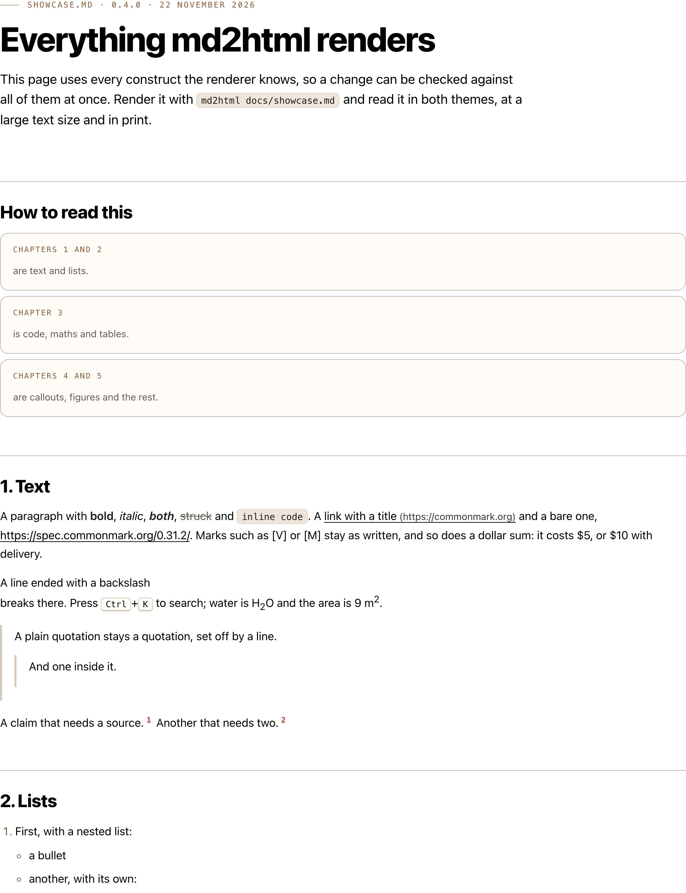
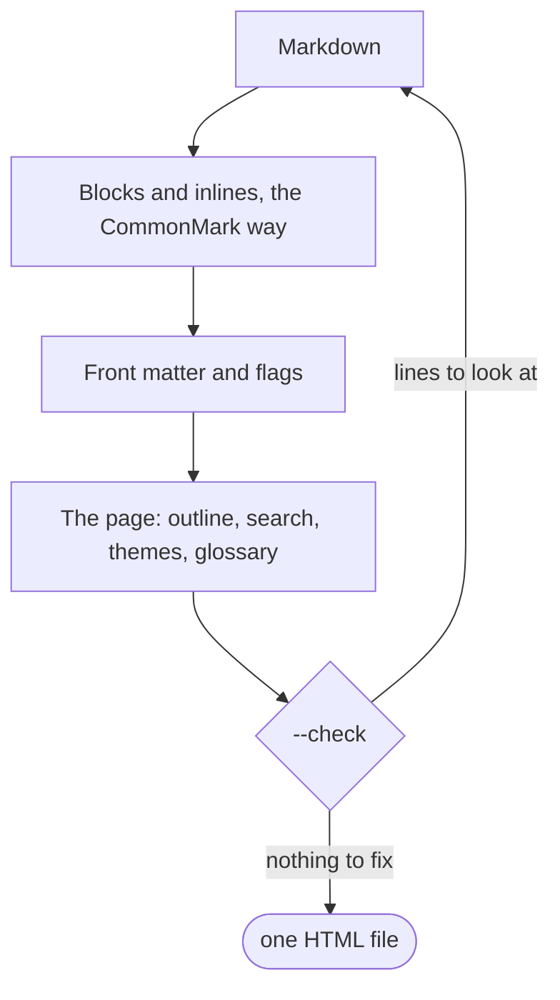

# md2html, everything it does

md2html turns a Markdown file into one HTML page that needs nothing else: no server, no network, no fonts or scripts from anywhere. This report is such a page. It was written in Markdown and rendered by md2html, so every capability it describes is also at work on it: the outline at the left, search, the two themes, the text size, the cards below, the glossary's dotted words, the footnotes, the figures that enlarge, coloured code and typeset maths.

## How to read this

- **Chapter 1** is the whole story in one table. Two minutes.
- **Chapters 2 to 6** show what a reader gets, and what a writer types to get it.
- **Chapters 7 and 8** are the settings and the command line.
- **Chapters 9 and 10** are safety and quality, and how version 0.4 came about.

---

## 1. At a glance

| | Before (0.3) | Now (0.4) |
|:--|:--:|:--:|
| Markdown read | a handbook subset | all of CommonMark, and GitHub's additions |
| CommonMark examples passing | not measured | **640 of 652** |
| The 4,265-line docenta handbook | over two minutes | **0.07 seconds** |
| A page full of `[V]` marks | grew to 38 GB | milliseconds |
| Accessibility findings (axe-core, WCAG 2.2 AA) | dozens | **none**, on 12 pages, light, dark and phone |
| Tests | 10 | 53, plus the 652 spec examples and a click-through in Chrome |
| Mermaid diagrams | shown as code | **drawn**, without a script |
| Languages | English | **17**, with a switch between translations, right to left included |
| To keep | the page | the page, a **PDF** with bookmarks, an **EPUB** for e-readers |
| Runtime dependencies | none | none |

What came with 0.4, as a task list:

- [x] a full Markdown reader, built the way the CommonMark specification describes
- [x] footnotes, task lists, strikethrough, autolinks, aligned tables and GitHub's five alerts
- [x] code coloured in some twenty languages, maths typeset as MathML
- [x] settings in front matter, and the page's own words in German
- [x] `--check`, `--watch`, folders, stdin, an opt-in Content-Security-Policy
- [x] an accessibility audit and a click-through in CI
- [x] Mermaid flowcharts and sequence diagrams, drawn as SVG without a script (chapter 4)
- [x] this report in seventeen languages, with a switch in the bar (chapter 7)
- [x] the page kept, printed, or taken along as a PDF or an EPUB (chapters 2 and 8)

> [!IMPORTANT]
> Every page on 4sons.com built with md2html (the plans, the research and the family pages) was rebuilt with 0.4 and compared with the version that was live: the same structure, or better.

## 2. The page

The page has three parts: a bar along the top, the outline at the left, and the text.

{width=100%}

The dark theme follows the system, or the reader's choice, and is remembered:

{width=100%}

On a phone the outline folds away behind the switch in the bar, and nothing scrolls sideways:

{width=34%}

What a reader can do:

| To | Do this |
|:--|:--|
| Find something | **Search** in the bar, <kbd>⌘</kbd> <kbd>K</kbd> (<kbd>Ctrl</kbd> <kbd>K</kbd>), or <kbd>/</kbd> |
| Hide or show the outline | the switch at the left of the bar, or <kbd>⌘</kbd> <kbd>\\</kbd> |
| Change the text size | **Aa** in the bar, then **−** and **+**; or <kbd>⌘</kbd> <kbd>+</kbd> and <kbd>⌘</kbd> <kbd>−</kbd>, from 85 to 200 percent |
| Change the theme | **Aa**, then System, Light or Dark |
| Enlarge a figure | click it; two more clicks bring it closer; <kbd>Esc</kbd> puts it back |
| Read a footnote or a dotted word | rest on it; click to go to it, and **back** returns |
| Share a chapter, a table row or a passage | the share symbol to the right of a heading, or at the end of the table row under the pointer, copies its link (a phone opens its share sheet); select words, and a link to exactly them is offered |
| Keep it | the download button at the end of the bar: the page itself (it reads offline), print or save as PDF, or the PDF and the EPUB where they were made |

## 3. Writing

Ordinary Markdown, and each construct reads well as plain text too. What you write comes first, in a code block; what you get follows it.

### Emphasis and links

```markdown
**Bold**, *italic*, ***both***, ~~struck~~ and `code`.
A [link](https://commonmark.org "CommonMark"), a bare one,
https://spec.commonmark.org/0.31.2/, and marks like [V] that stay as written.
```

**Bold**, *italic*, ***both***, ~~struck~~ and `code`. A [link](https://commonmark.org "CommonMark"), a bare one, https://spec.commonmark.org/0.31.2/, and marks like [V] that stay as written.

### Lists inside lists

```markdown
1. First, with a nested list:
   - a bullet
   - another, with its own:
     1. deeper
2. Second.
```

1. First, with a nested list:
   - a bullet
   - another, with its own:
     1. deeper
2. Second.

### Quotes and callouts

```markdown
> A plain quotation stays a quotation.

> [!TIP]
> GitHub's alerts work: NOTE, TIP, IMPORTANT, WARNING, CAUTION.

> **Note:** so does the older form, a bold word and a colon.
```

> A plain quotation stays a quotation.

> [!TIP]
> GitHub's alerts work: NOTE, TIP, IMPORTANT, WARNING, CAUTION.

> **Note:** so does the older form, a bold word and a colon.

### Tables

```markdown
| Room   | Floor  | Area (sq ft) |
|:-------|:------:|-------------:|
| Living | ground |          312 |
| Loft   | upper  |          205 |
```

| Room | Floor | Area (sq ft) |
|:-------|:------:|-------------:|
| Living | ground | 312 |
| Loft | upper | 205 |

### Footnotes

```markdown
A claim that needs a source.[^1]

[^1]: The source. Rest on the number to read it there.
```

A claim that needs a source.[^source]

[^source]: The source. Rest on the number to read it there; click it to come here, and back to return.

### Figures and images

```markdown
{width=60%}

An icon {width=18} inside a sentence.
```

{width=60%}

An icon {width=18} inside a sentence.

### Small things

```markdown
Press <kbd>Ctrl</kbd>+<kbd>K</kbd>. Water is H<sub>2</sub>O, the room 9 m<sup>2</sup>.
A line ending in a backslash\
breaks there.
```

Press <kbd>Ctrl</kbd>+<kbd>K</kbd>. Water is H<sub>2</sub>O, the room 9 m<sup>2</sup>. A line ending in a backslash\
breaks there.

<details>
<summary>A section that opens on a click</summary>

Written as `<details>` with a `<summary>`, with ordinary Markdown inside: **bold**, a list,

- one
- two

</details>

#### A fourth-level heading

Headings below the third level stay out of the outline, as this one does.

## 4. Code and maths

Code is coloured for Rust, Python, JavaScript and TypeScript, Go, C and C++, Java, Kotlin, Swift, C#, the shell, SQL, Ruby, Lua, PHP, CSS, HTML, JSON, YAML, TOML, Dockerfiles and diffs, and every block has a copy button.

```rust
/// The whole page from one Markdown text.
fn main() {
    let page = md2html::render("# Hello\n\nWorld.", &Settings::default());
    println!("{} bytes, nothing to fetch", page.len()); // one file
}
```

```python
@cache
def area(w: float, h: float) -> float:
    """The area of a room."""
    return w * h  # square feet
```

```yaml
title: The plans   # front matter is YAML
lang: de
embed: true
```

Maths is typeset by the browser itself, as MathML, with no script and no font to download. Inline, the theorem of Pythagoras is $a^2 + b^2 = c^2$, and Euler's identity is $e^{i\pi} + 1 = 0$; a dollar amount such as $5 or $10 stays money. Displayed:

$$
\int_0^1 x^2 \, dx = \frac{1}{3} \qquad \sum_{k=1}^{n} k = \frac{n(n+1)}{2} \qquad \sqrt[3]{27} = 3
$$

$$
\begin{pmatrix} a & b \\ c & d \end{pmatrix}
\begin{pmatrix} x \\ y \end{pmatrix}
=
\begin{pmatrix} ax + by \\ cx + dy \end{pmatrix}
\qquad
|x| = \begin{cases} x & x \ge 0 \\ -x & x < 0 \end{cases}
$$

### Diagrams

A Mermaid flowchart or sequence diagram is drawn by md2html itself, as SVG inside the page: no script, nothing to download, the page's own colours in both themes, and its words stay words that search finds. This is the Markdown:

````markdown

````

And this is what it becomes:



A sequence diagram, numbered, with a note:



Other kinds (pie charts, Gantt charts, class diagrams) are drawn by mermaid.js when the author points md2html at a copy of it (`--mermaid-js FILE`); the script then goes into that page only. Without it, they stay as code, and `--check` says so.

## 5. The glossary and the footnotes

A chapter called Glossary holds the page's words as a table. It is not printed where it stands: instead, the first mention of each term in every chapter becomes a dotted word that explains itself on hover, and a click on it jumps to the entry at the foot, which leads back to the line you were reading.

{width=70%}

Footnotes work the same way: the number explains itself on hover.

{width=70%}

> [!NOTE]
> A glossary can be shared across pages: one file at `~/.config/md2html/glossary.md`, whose words then link on every page rendered on that machine.

## 6. Search and figures

Search covers every word on the page, the glossary included. The results show where each word stands; the chosen one is lit where the search lands.

{width=80%}

{width=80%}

A figure enlarges over the page without leaving it. Larger than the window, it follows the pointer, so you point at what you want to see.

## 7. Settings

The top of this report's own Markdown file reads:

```yaml
---
title: md2html, everything it does
brand: md2html
kicker: Report
version: 0.7.5
date: 2026-11-22
footer: Written in Markdown and rendered by **md2html 0.7.5** itself ...
csp: true      # only this page's own code may run
embed: true    # the screenshots are inside the page
---
```

| Setting | What it does |
|:--|:--|
| `title`, `description`, `author` | the title, and the meta tags for link previews |
| `lang` | the language: the page's own words and dates in any of the seventeen above (`ja-Hira` is Japanese in kana, `zh-Hant` Chinese in traditional characters, `yue` Cantonese) |
| `translated_from`, `source_sha256` | for a translation: its original, and the original's fingerprint when it was translated |
| `brand`, `brand_link`, `kicker`, `eyebrow`, `footer` | the bar, the line above the title, the fine print |
| `date`, `version` | the date and version shown above the title |
| `embed` | images inside the page, so it is one file |
| `csp` | a Content-Security-Policy |
| `pdf`, `epub` | a PDF and an EPUB of the page, beside it |
| `live` | the page's time to live (`true` is two minutes, or a number of seconds): then it reloads if it changed, keeping the reader's place |
| `large`, `toc`, `math`, `index`, `html`, `css`, `head` | larger type, the outline, maths, search engines, raw HTML, extra style and head |

> [!TIP]
> With `lang: de` the search says "Diese Seite durchsuchen", the callouts say "Hinweis" and "Achtung", and the date reads "22. November 2026". The Thomas pages on this site are German this way.

### Languages

This report exists in seventeen languages: English, German, Hebrew, Indonesian, Dutch, Javanese, Yiddish, Low German, French, Italian, Spanish, Japanese written three ways (in kanji and kana, in kana alone, and in rōmaji), Mandarin Chinese in simplified and in traditional characters, and Cantonese. The globe in the bar switches between them, and the page opens at the chapter you were reading.

A translation is simply another Markdown file beside the original, named for its language: `report.de.md` is the German `report.md`. md2html finds the versions there are, links them to each other (and tells browsers and search engines with `hreflang`), and gives each the words of its own interface: the search, the callouts, the glossary, the dates. Hebrew and Yiddish are laid out right to left, the outline on the right.

Each translation names its original and records the original's fingerprint, so the page can say which version is the authoritative one, and `--check` notices when the original has changed since the translation was made:

```yaml
translated_from: report.md
source_sha256: 5b0c...e1
```

For a language nobody has translated a page into, the reader's own browser can translate it, where it has that ability (Chrome's built-in translator): on the device itself, so that nothing of a family page leaves it, and labelled as a machine translation with a way back to the original.

## 8. The command line

```console
$ md2html notes.md
md2html: notes.md -> notes.html (68504 bytes, 9 glossary terms, 0 of them shared)
$ md2html docs/ -o site/ --nav
$ md2html notes.md --check
notes.md:12: a link points at #setup, which is nowhere on the page
notes.md:30: `plan.svg` does not exist next to this page
md2html: 2 to look at
$ cat notes.md | md2html - > notes.html
$ md2html notes.md --pdf --epub
$ md2html notes.md --serve
```

`--check` writes nothing and lists what an author should look at, line by line, and exits 1 when there is anything: a link to an anchor that is not on the page, a file that is not there, a footnote without its note, raw HTML shown as text. That makes it the last step of a build, or of an agent's work. `--watch` renders again on every save, `--nav` links the pages of a folder with previous and next, and a link to another Markdown file goes to its page.

`--pdf` prints the page with the Chrome already on the computer: its own print layout, the headings as the PDF's bookmarks, the title at the head of each page and its number at the foot. `--epub` makes a book for e-readers from the same page, with its contents, images, diagrams and maths, and footnotes that open where they are mentioned; md2html writes it itself. The reader finds both under the download button in the bar.

`--serve` shows the pages on this computer while they are written: every open page reloads the moment the Markdown is saved. A published page with `--live` has its own time to live; when it runs out, it asks its server for the first kilobyte of itself and reloads only if that changed. Either way the reader stays where they were: the same paragraph at the same height, or, if it is gone, the chapter before it.

## 9. Safety, quality and accessibility

> [!WARNING]
> A page can be rendered from Markdown someone else wrote. md2html never writes a script from the text: raw HTML is shown as written except a few harmless tags, and `javascript:` or `data:` links are dropped, however they are spelled. A document cannot make md2html read a file outside its folder, and no input, however hostile, can stall it or make it crash.

> [!CAUTION]
> `--html` lets richer HTML through (images, links, video, SVG, layout), but never anything that runs: no script, no event handler, no frame, no form.

What is checked, on every change, on macOS and Ubuntu:

- 53 tests that render whole pages and read them back, the security cases among them;
- the 652 examples of the CommonMark specification, of which the count passing may rise but never fall;
- clippy's strictest lints, and the oldest Rust the tool promises to build on;
- an accessibility audit with axe-core against WCAG 2.2 AA, in both themes and at phone width;
- a click-through in Chrome that uses every control: search by keyboard and by mouse, the theme, the text size, the outline, a figure, a footnote, the glossary, copy, print.

Print gets its own layout: the controls drop away, every link prints its address, nothing is cut across a page, and the pages carry the title and their number.

Every page ends with one quiet line: made with md2html, its version, and a link to where md2html lives.

{width=55%}

## 10. How 0.4 came about

It began with research: what the best Markdown renderers do, what the web standards ask of a page, and how the tool is used on this machine, which turned out to be the most useful part. Four page builds on 4sons.com rewrote md2html's output after rendering, to change the brand, the language, the footer and more. Each of those rewrites became a setting, and the builds were rebuilt against the new version page by page.

The changes, as a diff of the rules the renderer follows:

```diff
- a handbook subset, anything else shown as written
+ all of CommonMark, and anything else shown as written
- every quotation a note
+ a quotation is a quotation; a bold first word makes it a note
- the page's words in English
+ the page's words in English or German
```

What 0.5 added since: diagrams. The path every page here takes:



---

The glossary below explains the words this report uses; each was a dotted word above.

## Glossary

| Term | Meaning | Also |
|---|---|---|
| Markdown | Plain text with light marks for headings, emphasis, lists and links, readable as it is and convertible to a page. | |
| CommonMark | The specification of Markdown that most tools now follow, with a test for every rule. | |
| outline | The list of chapters at the left of the page, made from its headings. | |
| callout | A boxed aside: a note, a tip, something important, a warning or a caution. | callouts, alert, alerts |
| figure | An image on a line of its own, with its caption under it, enlarged on a click. | figures |
| front matter | The block of settings between two `---` lines at the very top of a Markdown file. | |
| MathML | The web's own language for maths, drawn by the browser without a script. | |
| Content-Security-Policy | A rule in the page that tells the browser which code may run; here, only the page's own. | |
| Mermaid | A text language for diagrams, written in a code block; md2html draws its flowcharts and sequence diagrams. | |
| WCAG | The Web Content Accessibility Guidelines; level AA is the usual target. | |
| translation | A version of a page in another language, a Markdown file beside the original. | translations |
