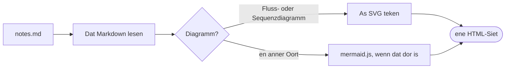
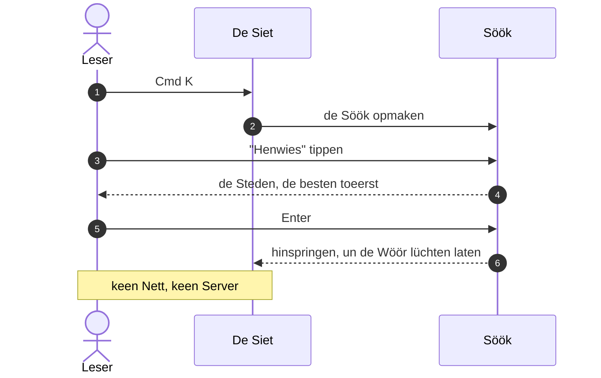
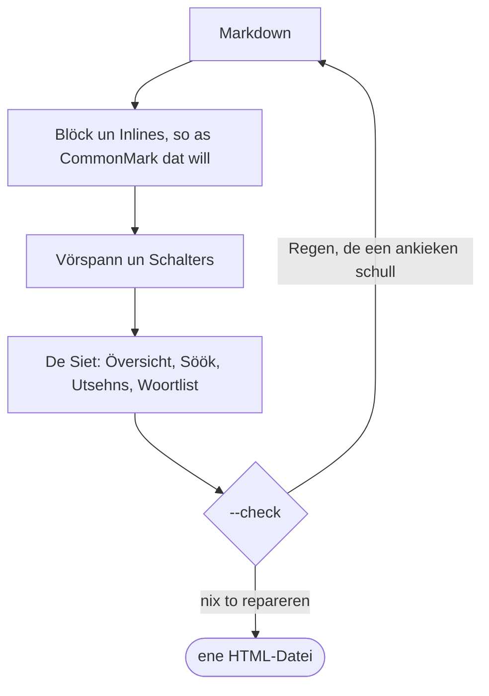

# md2html, allens, wat dat kann

md2html maakt ut en Markdown-Datei ene HTML-Siet, de nix anners bruukt: keen Server, keen Nett, keen Schriften oder Skripten vun jichtenswo. Disse Bericht is so ene Siet. He is in Markdown schreven un vun md2html rendert, un so is allens, wat he beschrifft, ok an em sülvst an't Wark: de Översicht links, de Söök, de twee Utsehns, de Schriftgrött, de Korten hierünner, de Wöör mit Pünkten ut de Woortlist, de Anmarken, de Biller, de sik grötter maken laat, bunten Code un sett Formels.

## So leest een dat

- **Kapitel 1** is de hele Geschicht in een Tabell. Twee Minuten.
- **Kapitel 2 bet 6** wiest, wat en Leser kriggt, un wat en Schriever dorför tippen mutt.
- **Kapitel 7 un 8** sünd de Instellens un de Befehlsreeg.
- **Kapitel 9 un 10** gaht över Sekerheit un Qualität, un wo de Version 0.4 tostannen keem.

---

## 1. Op een Blick

| | Vörher (0.3) | Nu (0.4) |
|:--|:--:|:--:|
| Wat vun Markdown leest warrt | en Deel, jüst noog för dat Handbook | heel CommonMark, un dat, wat GitHub dorto doon hett |
| CommonMark-Bispelen, de dörgaht | nich meten | **640 vun 652** |
| Dat docenta-Handbook mit 4.265 Regen | över twee Minuten | **0,07 Sekunnen** |
| En Siet vull vun `[V]`-Tekens | wuss op 38 GB | Millisekunnen |
| Funnen to Barrierefreeheit (axe-core, WCAG 2.2 AA) | Dutzende | **keen**, op 12 Sieden, hell, düster un op'n Telefon |
| Tests | 10 | 53, dorto de 652 Bispelen ut de Spezifikatschoon un en Dörklicken in Chrome |
| Mermaid-Diagramms | as Code wiest | **teekent**, ahn Skript |
| Spraken | Engelsch | **17**, mit en Schalter twischen de Översettens, ok vun rechts na links |
| To'n Behollen | de Siet | de Siet, en **PDF** mit Leestekens, en **EPUB** för E-Reader |
| Afhangigkeiten to de Looptiet | keen | keen |

Wat mit 0.4 keem, as Opgavenlist:

- [x] en kumpletten Markdown-Leser, so boot, as de CommonMark-Spezifikatschoon dat beschrifft
- [x] Anmarken, Opgavenlisten, Dörstreken, Autolinks, utricht Tabellen un de fief Henwieskastens vun GitHub
- [x] bunten Code in so üm un bi twintig Spraken, Formels as MathML sett
- [x] Instellens in'n Vörspann, un de Siet ehr egen Wöör op Düütsch
- [x] `--check`, `--watch`, Ornders, stdin, en Content-Security-Policy, de een tostellen kann
- [x] en Pröven op Barrierefreeheit un en Dörklicken in de CI
- [x] Mermaid-Flussdiagramms un -Sequenzdiagramms, as SVG teekent, ahn Skript (Kapitel 4)
- [x] disse Bericht in söventein Spraken, mit en Schalter in de Leist (Kapitel 7)
- [x] de Siet behollen, druckt oder as PDF oder EPUB mitnahmen (Kapitel 2 un 8)

> [!IMPORTANT]
> Elk Siet op 4sons.com, de mit md2html boot is (de Plaans, de Recherchen un de Familiensieden), is mit 0.4 nee boot un mit de Version verglieken worrn, de online weer: desülvige Struktur, oder beter.

## 2. De Siet

De Siet hett dree Delen: en Leist baven, de Översicht links un den Text.

{width=100%}

Dat düstere Utsehn richt sik na dat System oder na dat, wat de Leser utwählt, un dat warrt sik markt:

{width=100%}

Op'n Telefon klappt de Översicht achter den Schalter in de Leist weg, un nix rullt na de Siet:

{width=34%}

Wat en Leser doon kann:

| Wat | So geiht dat |
|:--|:--|
| Wat finnen | **Söken** in de Leist, <kbd>⌘</kbd> <kbd>K</kbd> (<kbd>Strg</kbd> <kbd>K</kbd>) oder <kbd>/</kbd> |
| De Översicht wegdoon oder wiesen | de Schalter links in de Leist, oder <kbd>⌘</kbd> <kbd>\\</kbd> |
| De Schriftgrött ännern | **Aa** in de Leist, denn **−** un **+**; oder <kbd>⌘</kbd> <kbd>+</kbd> un <kbd>⌘</kbd> <kbd>−</kbd>, vun 85 bet 200 Perzent |
| Dat Utsehn wesseln | **Aa**, denn System, Hell oder Düster |
| En Bild grötter maken | dor op klicken; noch twee Klicks haalt dat neger ran; <kbd>Esc</kbd> sett dat trüch |
| En Anmarken oder en Woort mit Pünkten lesen | mit den Wieser dor op blieven; en Klick springt dorhen, un **trüch** bringt een trüch |
| En Kapitel oder en Stee delen | dat **#** blangen en Överschrift kopeert ehr Link (en Telefon maakt sien Deel-Menü op); Wöör markeren, un en Link jüst to de Wöör warrt anbaden |
| Behollen | de Knoop för't Dalladen an't Enn vun de Leist: de Siet sülvst (se lett sik ahn Internet lesen), drucken oder as PDF spiekern, oder dat PDF un dat EPUB, wo se maakt worrn sünd |

## 3. Schrieven

Normaal Markdown, un elk Stück lett sik ok as blanke Text good lesen. Wat een schrifft, steiht toeerst, in en Codeblock; wat een dorvun kriggt, kummt dorna.

### Rutheven un Links

```markdown
**Fett**, *schreeg*, ***beids***, ~~dörstreken~~ un `Code`.
En [Link](https://commonmark.org "CommonMark"), en blanken,
https://spec.commonmark.org/0.31.2/, un Tekens as [V], de blievt, as se schreven sünd.
```

**Fett**, *schreeg*, ***beids***, ~~dörstreken~~ un `Code`. En [Link](https://commonmark.org "CommonMark"), en blanken, https://spec.commonmark.org/0.31.2/, un Tekens as [V], de blievt, as se schreven sünd.

### Listen in Listen

```markdown
1. Eerstens, mit en List dorin:
   - en Punkt
   - noch een, mit sien egen:
     1. deper
2. Tweetens.
```

1. Eerstens, mit en List dorin:
   - en Punkt
   - noch een, mit sien egen:
     1. deper
2. Tweetens.

### Zitaten un Henwieskastens

```markdown
> En eenfach Zitat blifft en Zitat.

> [!TIP]
> De Henwieskastens vun GitHub gaht: NOTE, TIP, IMPORTANT, WARNING, CAUTION.

> **Henwies:** Ok de öllere Form warrt en Henwieskasten: en fett Woort un en Dubbelpunkt.
```

> En eenfach Zitat blifft en Zitat.

> [!TIP]
> De Henwieskastens vun GitHub gaht: NOTE, TIP, IMPORTANT, WARNING, CAUTION.

> **Henwies:** Ok de öllere Form warrt en Henwieskasten: en fett Woort un en Dubbelpunkt.

### Tabellen

```markdown
| Ruum  | Stockwark | Grött (sq ft) |
|:------|:---------:|--------------:|
| Stuuv | ünnen     |           312 |
| Böön  | baven     |           205 |
```

| Ruum | Stockwark | Grött (sq ft) |
|:-------|:------:|-------------:|
| Stuuv | ünnen | 312 |
| Böön | baven | 205 |

### Anmarken

```markdown
En Behaupten, de en Born bruukt.[^1]

[^1]: De Born. Mit den Wieser op de Tall blieven, denn leest een ehr dor.
```

En Behaupten, de en Born bruukt.[^source]

[^source]: De Born. Mit den Wieser op de Tall blieven, denn leest een ehr dor; en Klick dor op bringt een hierher, un trüch geiht dat wedder torüch.

### Biller un Grafiken

```markdown
{width=60%}

En Symbol {width=18} merrn in'n Satz.
```

{width=60%}

En Symbol {width=18} merrn in'n Satz.

### Lütt Kraam

```markdown
Drück <kbd>Strg</kbd>+<kbd>K</kbd>. Water is H<sub>2</sub>O, de Ruum 9 m<sup>2</sup>.
En Reeg, de mit en Backslash ophöört,\
breekt dor üm.
```

Drück <kbd>Strg</kbd>+<kbd>K</kbd>. Water is H<sub>2</sub>O, de Ruum 9 m<sup>2</sup>. En Reeg, de mit en Backslash ophöört,\
breekt dor üm.

<details>
<summary>En Afsnitt, de bi'n Klick opgeiht</summary>

Schreven as `<details>` mit en `<summary>`, mit normaal Markdown dorin: **fett**, en List,

- een
- twee

</details>

#### En Överschrift op de veerte Ebeen

Överschriften ünner de drüdde Ebeen blievt ut de Översicht rut, so as disse hier.

## 4. Code un Formels

Code warrt bunt maakt för Rust, Python, JavaScript un TypeScript, Go, C un C++, Java, Kotlin, Swift, C#, de Shell, SQL, Ruby, Lua, PHP, CSS, HTML, JSON, YAML, TOML, Dockerfiles un Diffs, un elk Block hett en Knoop to'n Koperen.

```rust
/// The whole page from one Markdown text.
fn main() {
    let page = md2html::render("# Hello\n\nWorld.", &Settings::default());
    println!("{} bytes, nothing to fetch", page.len()); // one file
}
```

```python
@cache
def area(w: float, h: float) -> float:
    """The area of a room."""
    return w * h  # square feet
```

```yaml
title: The plans   # front matter is YAML
lang: de
embed: true
```

Formels sett de Browser sülvst, as MathML, ahn Skript un ahn Schrift, de een dalladen mutt. In'n Text is de Satz vun Pythagoras $a^2 + b^2 = c^2$, un Euler sien Identität is $e^{i\pi} + 1 = 0$; en Geldbedrag as $5 oder $10 blifft Geld. As egen Block:

$$
\int_0^1 x^2 \, dx = \frac{1}{3} \qquad \sum_{k=1}^{n} k = \frac{n(n+1)}{2} \qquad \sqrt[3]{27} = 3
$$

$$
\begin{pmatrix} a & b \\ c & d \end{pmatrix}
\begin{pmatrix} x \\ y \end{pmatrix}
=
\begin{pmatrix} ax + by \\ cx + dy \end{pmatrix}
\qquad
|x| = \begin{cases} x & x \ge 0 \\ -x & x < 0 \end{cases}
$$

### Diagramms

En Mermaid-Flussdiagramm oder -Sequenzdiagramm teekent md2html sülvst, as SVG binnen in de Siet: keen Skript, nix to'n Dalladen, de Siet ehr egen Klören in beide Utsehns, un sien Wöör blievt Wöör, de de Söök finnt. Dit is dat Markdown:

````markdown

````

Un dit warrt dorut:



En Sequenzdiagramm, nummereert, mit en Notiz:



Anner Oorten (Tortendiagramms, Gantt-Diagramms, Klassendiagramms) teekent mermaid.js, wenn een md2html op en Kopie dorvun wiest (`--mermaid-js FILE`); dat Skript kummt denn blots in disse ene Siet. Ahn dat blievt se Code, un `--check` seggt dat.

## 5. Verklaarte Wöör un Anmarken

En Kapitel mit den Naam Woortlist höllt de Siet ehr Wöör as Tabell. Dat warrt nich dor druckt, wo dat steiht: Statts dat warrt dat eerste Mal, dat en Woort in en Kapitel vörkummt, to en Woort mit Pünkten, dat sik sülvst verklaart, wenn de Wieser dor op liggt, un en Klick dor op springt na'n Indrag ünnen an de Siet, de een wedder na de Reeg bringt, de een jüst leest hett.

{width=70%}

Anmarken gaht jüst so: De Tall verklaart sik sülvst, wenn de Wieser dor op liggt.

{width=70%}

> [!NOTE]
> En Woortlist kann för mehr as een Siet gellen: ene Datei ünner `~/.config/md2html/glossary.md`, un ehr Wöör warrt denn op elk Siet verlinkt, de op dissen Reekner rendert warrt.

## 6. Söök un Biller

De Söök geiht över elk Woort op de Siet, de Woortlist mit. De Funnen wiest, wo elk Woort steiht; dat utwählte lücht dor op, wo de Söök ankummt.

{width=80%}

{width=80%}

En Bild warrt över de Siet grötter, ahn dat een ehr verlaten mutt. Is dat grötter as dat Finster, folgt dat den Wieser, so dat een op dat wiest, wat een sehn will.

## 7. Instellens

Baven in de Markdown-Datei vun dat engelsche Original vun dissen Bericht steiht:

```yaml
---
title: md2html, everything it does
brand: md2html
kicker: Report
version: 0.7.4
date: 2026-11-22
footer: Written in Markdown and rendered by **md2html 0.7.4** itself ...
csp: true      # only this page's own code may run
embed: true    # the screenshots are inside the page
---
```

| Instellen | Wat dat deit |
|:--|:--|
| `title`, `description`, `author` | de Titel, un de Meta-Tags för de Vörschau vun Links |
| `lang` | de Spraak: de Siet ehr egen Wöör un de Datums in elk vun de söventein Spraken vun baven (`ja-Hira` is Japaansch in Kana, `zh-Hant` Chineesch in traditschonelle Schriftteken, `yue` Kantoneesch) |
| `translated_from`, `source_sha256` | för en Översetten: dat Original, un de Fingerafdruck vun't Original to de Tiet, as översett worrn is |
| `brand`, `brand_link`, `kicker`, `eyebrow`, `footer` | de Leist, de Reeg över den Titel, dat Lüttgedruckte |
| `date`, `version` | Datum un Version över den Titel |
| `embed` | Biller binnen in de Siet, so dat se ene Datei is |
| `csp` | en Content-Security-Policy |
| `pdf`, `epub` | en PDF un en EPUB vun de Siet, blangen ehr |
| `live` | de Levenstiet vun de Siet (`true` sünd twee Minuten, anners en Tall vun Sekunnen): denn laadt se nee, wenn se sik ännert hett, un wer leest, blifft an desülvige Steed |
| `large`, `toc`, `math`, `index`, `html`, `css`, `head` | gröttere Schrift, de Översicht, Formels, Söökmaschinen, HTML so as schreven, extra Stil un Head |

> [!TIP]
> Mit `lang: de` seggt de Söök „Diese Seite durchsuchen“, de Henwieskastens seggt „Hinweis“ un „Achtung“, un dat Datum lett „22. November 2026“. De Thomas-Sieden op disse Websteed sünd op disse Wies düütsch.

### Spraken

Dissen Bericht gifft dat in söventein Spraken: Engelsch, Düütsch, Hebrääsch, Indonesisch, Nedderlannsch, Javaansch, Jiddisch, Plattdüütsch, Franzöösch, Italieensch, Spaansch, Japaansch op dree Oorten schreven (in Kanji un Kana, blots in Kana un in Rōmaji), Mandarin-Chineesch in vereenfachte un in traditschonelle Schriftteken, un Kantoneesch. De Globus in de Leist wesselt twischen ehr, un de Siet geiht bi dat Kapitel op, dat een jüst leest hett.

En Översetten is eenfach noch en Markdown-Datei blangen dat Original, nöömt na ehr Spraak: `report.de.md` is dat düütsche `report.md`. md2html finnt de Versionen, de dor sünd, verlinkt se mitenanner (un seggt dat Browsers un Söökmaschinen mit `hreflang`) un gifft elk de Wöör för ehr egen Bedeenen: de Söök, de Henwieskastens, de Woortlist, de Datums. Hebrääsch un Jiddisch warrt vun rechts na links sett, de Översicht rechts.

Elk Översetten nöömt ehr Original un schrifft den Fingerafdruck vun't Original op, so dat de Siet seggen kann, welk Version de gellt, un `--check` marken deit, wenn dat Original sik ännert hett, siet dat översett worrn is:

```yaml
translated_from: report.md
source_sha256: 5b0c...e1
```

För en Spraak, in de noch nüms en Siet översett hett, kann de Browser vun'n Leser ehr översetten, wenn he dat kann (de inboote Översetter vun Chrome): op dat Reedschap sülvst, so dat nix vun en Familiensiet dor rutgeiht, un kenntlich maakt as Maschien-Översetten, mit en Weg trüch na dat Original.

## 8. De Befehlsreeg

```console
$ md2html notes.md
md2html: notes.md -> notes.html (68504 bytes, 9 glossary terms, 0 of them shared)
$ md2html docs/ -o site/ --nav
$ md2html notes.md --check
notes.md:12: a link points at #setup, which is nowhere on the page
notes.md:30: `plan.svg` does not exist next to this page
md2html: 2 to look at
$ cat notes.md | md2html - > notes.html
$ md2html notes.md --pdf --epub
$ md2html notes.md --serve
```

`--check` schrifft nix, list Reeg för Reeg op, wat en Schriever sik ankieken schull, un höört mit 1 op, wenn dor wat is: en Link na en Anker, de nich op de Siet is, en Datei, de nich dor is, en Anmarken ahn ehrn Text, HTML, dat as Text wiest warrt. Dormit is dat de letzte Schritt vun en Build, oder vun de Arbeit vun en Agent. `--watch` rendert bi elk Spiekern nee, `--nav` verbinnt de Sieden vun en Ornder mit vörige un neegste, un en Link na en anner Markdown-Datei geiht na ehr Siet.

`--pdf` druckt de Siet mit dat Chrome, wat al op'n Reekner is: ehr egen Layout för't Drucken, de Överschriften as de Leestekens vun't PDF, de Titel baven op elk Siet un ehr Nummer nerrn. `--epub` maakt ut desülvige Siet en Book för E-Reader, mit Inholtsverteken, Biller, Diagramms un Formels, un mit Anmarkens, de dor opgaht, wo se nöömt warrt; md2html schrifft dat sülvst. Wer leest, finnt beide ünner den Knoop för't Dalladen in de Leist.

`--serve` wiest de Sieden op dissen Reekner, wieldess se schreven warrt: elk open Siet laadt nee, sowie dat Markdown spiekert warrt. En Siet, de rutbröcht is, hett mit `--live` ehr egen Levenstiet; is de üm, fraagt se ehrn Server na dat eerste Kilobyte vun sik sülvst un laadt blots nee, wenn sik dat ännert hett. So oder so blifft, wer leest, dor, wo he weer: bi densülvigen Afsatz op desülvige Hööch oder, wenn de weg is, bi dat Kapitel dorvör.

## 9. Sekerheit, Qualität un Barrierefreeheit

> [!WARNING]
> En Siet kann ut Markdown rendert warrn, dat en anner schreven hett. md2html schrifft nie en Skript ut den Text: HTML in'n Text warrt so wiest, as dat schreven is, bet op en poor harmlose Tags, un `javascript:`- oder `data:`-Links warrt wegdaan, egaal wo se schreven sünd. En Dokument kann md2html nich dorto bringen, en Datei buten sien Ordner to lesen, un keen Ingaav, egaal wo bösaardig, kann dat lahmleggen oder afstörten laten.

> [!CAUTION]
> `--html` lett rieker HTML dör (Biller, Links, Video, SVG, Layout), man nie wat, dat loppt: keen Skript, keen Event-Handler, keen Frame, keen Formular.

Wat bi elk Ännern pröövt warrt, op macOS un Ubuntu:

- 53 Tests, de hele Sieden rendert un wedder leest, de Sekerheitsfäll dormang;
- de 652 Bispelen vun de CommonMark-Spezifikatschoon, un de Tall vun de, de dörgaht, dörv stiegen, man nie fallen;
- de strengsten Lints vun clippy, un dat öllste Rust, op dat sik dat Warktüüch boen laten schall;
- en Pröven op Barrierefreeheit mit axe-core gegen WCAG 2.2 AA, in beide Utsehns un in Telefonbreed;
- en Dörklicken in Chrome, dat elk Knoop bruukt: Söök mit Tastatur un mit Muus, dat Utsehn, de Schriftgrött, de Översicht, en Bild, en Anmarken, de Woortlist, Koperen, Drucken.

För't Drucken gifft dat en egen Layout: De Knööp fallt weg, elk Link druckt sien Adress, nix warrt över en Siet weg dörsneden, un de Sieden dreegt den Titel un ehr Nummer.

Elk Siet hört mit en stille Reeg op: maakt mit md2html, sien Version, un en Link dorhen, wo md2html tohuus is.

{width=55%}

## 10. Wo 0.4 tostannen keem

Dat fung mit Recherche an: wat de besten Markdown-Renderer doot, wat de Webstandards vun en Siet verlangt, un wo dat Warktüüch op dissen Reekner bruukt warrt, un dat weer, as sik rutstellt hett, de nüttlichste Deel. Veer Sieden-Builds op 4sons.com hebbt de Utgaav vun md2html na't Rendern ümschreven, üm den Markennaam, de Spraak, de Footreeg un mehr to ännern. Elk vun disse Ümschrieven is en Instellen worrn, un de Builds sünd Siet för Siet gegen de nee Version nee boot worrn.

De Ännerns, as Diff vun de Regeln, de de Renderer folgt:

```diff
- a handbook subset, anything else shown as written
+ all of CommonMark, and anything else shown as written
- every quotation a note
+ a quotation is a quotation; a bold first word makes it a note
- the page's words in English
+ the page's words in English or German
```

Wat 0.5 siet de Tiet dorto daan hett: Diagramms. De Weg, den elk Siet hier nimmt:



---

De Woortlist hierünner verklaart de Wöör, de disse Bericht bruukt; elk weer baven en Woort mit Pünkten.

## Woortlist

| Woort | Bedüden | Ook |
|---|---|---|
| Markdown | Blanke Text mit lütte Tekens för Överschriften, Rutheven, Listen un Links, de een so lesen kann, as he is, un de sik to en Siet maken lett. | |
| CommonMark | De Spezifikatschoon vun Markdown, de de mehrsten Warktüüch nu folgt, mit en Test för elk Regel. | |
| Översicht | De List vun de Kapitels links op de Siet, maakt ut ehr Överschriften. | |
| Henwieskasten | En Kasten an de Siet: en Henwies, en Tipp, wat Wichtiges, en Wohrschau oder en Vörsicht. | Henwieskastens |
| Bild | En Grafik op en egen Reeg, mit ehr Ünnerschrift dorünner, de bi'n Klick grötter warrt. | Biller |
| Vörspann | De Block mit Instellens twischen twee `---`-Regen ganz baven in en Markdown-Datei. | |
| MathML | De egen Spraak vun't Web för Formels, de de Browser ahn Skript teekent. | |
| Content-Security-Policy | En Regel in de Siet, de den Browser seggt, welk Code lopen dörv; hier blots de vun de Siet sülvst. | |
| Mermaid | En Textspraak för Diagramms, in en Codeblock schreven; md2html teekent ehr Flussdiagramms un Sequenzdiagramms. | |
| WCAG | De Web Content Accessibility Guidelines, de Regeln för Barrierefreeheit in't Web; de Stuuf AA is dat gewöhnliche Teel. | |
| Översetten | En Version vun en Siet in en anner Spraak, en Markdown-Datei blangen dat Original. | Översettens |
