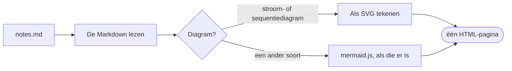
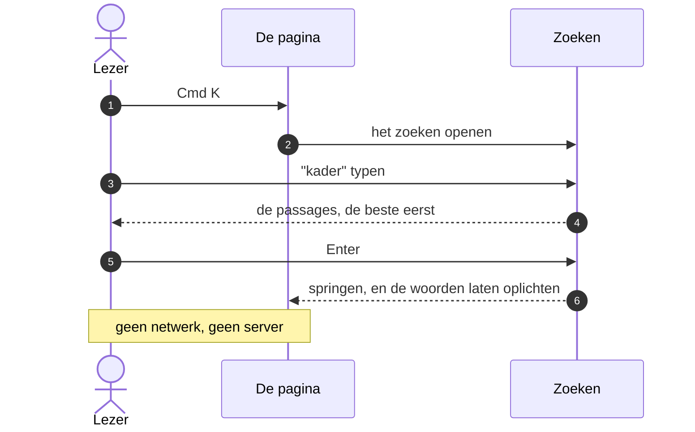
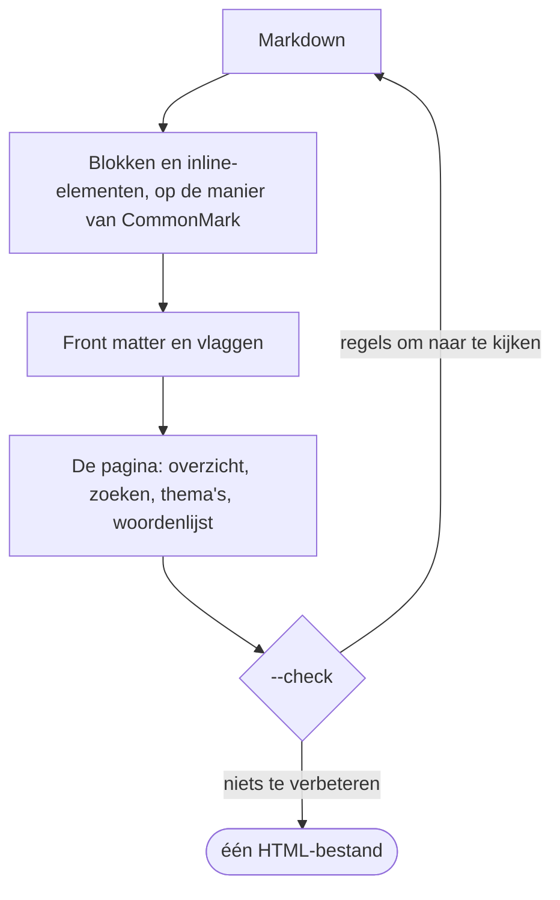

# md2html, alles wat het doet

md2html maakt van een Markdown-bestand één HTML-pagina die verder niets nodig heeft: geen server, geen netwerk, geen lettertypen of scripts van elders. Dit rapport is zo'n pagina. Het is in Markdown geschreven en door md2html omgezet, dus elke mogelijkheid die het beschrijft, is er ook zelf aan het werk: het overzicht links, het zoeken, de twee thema's, de tekstgrootte, de kaarten hieronder, de gestippelde woorden van de woordenlijst, de voetnoten, de figuren die groter worden, gekleurde code en netjes gezette wiskunde.

## Hoe u dit leest

- **Hoofdstuk 1** is het hele verhaal in één tabel. Twee minuten.
- **Hoofdstukken 2 tot en met 6** laten zien wat een lezer krijgt, en wat een schrijver typt om dat te krijgen.
- **Hoofdstukken 7 en 8** gaan over de instellingen en de opdrachtregel.
- **Hoofdstukken 9 en 10** gaan over veiligheid en kwaliteit, en over hoe versie 0.4 tot stand kwam.

---

## 1. In één oogopslag

| | Vroeger (0.3) | Nu (0.4) |
|:--|:--:|:--:|
| Gelezen Markdown | een deel, genoeg voor een handboek | heel CommonMark, plus de toevoegingen van GitHub |
| Geslaagde CommonMark-voorbeelden | niet gemeten | **640 van 652** |
| Het docenta-handboek van 4.265 regels | ruim twee minuten | **0,07 seconden** |
| Een pagina vol `[V]`-tekens | groeide tot 38 GB | milliseconden |
| Toegankelijkheidsbevindingen (axe-core, WCAG 2.2 AA) | tientallen | **geen**, op 12 pagina's, licht, donker en op een telefoon |
| Tests | 10 | 53, plus de 652 voorbeelden uit de specificatie en een doorklikronde in Chrome |
| Mermaid-diagrammen | als code getoond | **getekend**, zonder script |
| Talen | Engels | **17**, met een schakelaar tussen vertalingen, van rechts naar links inbegrepen |
| Om te bewaren | de pagina | de pagina, een **PDF** met bladwijzers, een **EPUB** voor e-readers |
| Afhankelijkheden bij uitvoering | geen | geen |

Wat er met 0.4 bij kwam, als takenlijst:

- [x] een volledige Markdown-lezer, gebouwd zoals de CommonMark-specificatie het beschrijft
- [x] voetnoten, takenlijsten, doorhalen, automatische links, uitgelijnde tabellen en de vijf meldingen van GitHub
- [x] code gekleurd in een stuk of twintig talen, wiskunde gezet als MathML
- [x] instellingen in de front matter, en de eigen woorden van de pagina in het Duits
- [x] `--check`, `--watch`, mappen, stdin, een Content-Security-Policy die u zelf aanzet
- [x] een toegankelijkheidsaudit en een doorklikronde in de CI
- [x] stroomdiagrammen en sequentiediagrammen van Mermaid, getekend als SVG zonder script (hoofdstuk 4)
- [x] dit rapport in zeventien talen, met een schakelaar in de balk (hoofdstuk 7)
- [x] de pagina bewaard, afgedrukt of meegenomen als PDF of als EPUB (hoofdstukken 2 en 8)

> [!IMPORTANT]
> Elke pagina op 4sons.com die met md2html is gemaakt (de plannen, het onderzoek en de familiepagina's) is opnieuw gebouwd met 0.4 en vergeleken met de versie die online stond: dezelfde structuur, of beter.

## 2. De pagina

De pagina heeft drie delen: een balk bovenaan, het overzicht links, en de tekst.

{width=100%}

Het donkere thema volgt het systeem, of de keuze van de lezer, en wordt onthouden:

{width=100%}

Op een telefoon klapt het overzicht weg achter de schakelaar in de balk, en schuift niets zijwaarts:

{width=34%}

Wat een lezer kan doen:

| Om | Doe dit |
|:--|:--|
| iets te vinden | **Zoeken** in de balk, <kbd>⌘</kbd> <kbd>K</kbd> (<kbd>Ctrl</kbd> <kbd>K</kbd>), of <kbd>/</kbd> |
| het overzicht te verbergen of te tonen | de schakelaar links in de balk, of <kbd>⌘</kbd> <kbd>\\</kbd> |
| de tekstgrootte te wijzigen | **Aa** in de balk, dan **−** en **+**; of <kbd>⌘</kbd> <kbd>+</kbd> en <kbd>⌘</kbd> <kbd>−</kbd>, van 85 tot 200 procent |
| het thema te wijzigen | **Aa**, dan Systeem, Licht of Donker |
| een figuur te vergroten | klik erop; nog twee klikken brengen hem dichterbij; <kbd>Esc</kbd> zet hem terug |
| een voetnoot of een gestippeld woord te lezen | laat de aanwijzer erop rusten; klik om ernaartoe te gaan, en **terug** brengt u terug |
| een hoofdstuk, een tabelrij of een passage te delen | het deelsymbool rechts naast een kop, of aan het eind van de tabelrij onder de aanwijzer, kopieert de link ernaar (een telefoon opent het deelmenu); selecteer woorden, en een link naar precies die woorden wordt aangeboden |
| de pagina te bewaren | de downloadknop aan het eind van de balk: de pagina zelf (die offline te lezen is), afdrukken of als PDF bewaren, of de PDF en de EPUB waar die gemaakt zijn |

## 3. Schrijven

Gewone Markdown, en elke constructie leest ook als platte tekst goed. Wat u schrijft staat eerst, in een codeblok; wat u krijgt volgt erna.

### Nadruk en links

```markdown
**Vet**, *cursief*, ***allebei***, ~~doorgehaald~~ en `code`.
Een [link](https://commonmark.org "CommonMark"), een kale,
https://spec.commonmark.org/0.31.2/, en tekens zoals [V] die blijven zoals ze geschreven zijn.
```

**Vet**, *cursief*, ***allebei***, ~~doorgehaald~~ en `code`. Een [link](https://commonmark.org "CommonMark"), een kale, https://spec.commonmark.org/0.31.2/, en tekens zoals [V] die blijven zoals ze geschreven zijn.

### Lijsten in lijsten

```markdown
1. Ten eerste, met een geneste lijst:
   - een punt
   - nog een, met een eigen lijst:
     1. dieper
2. Ten tweede.
```

1. Ten eerste, met een geneste lijst:
   - een punt
   - nog een, met een eigen lijst:
     1. dieper
2. Ten tweede.

### Citaten en kaders

```markdown
> Een gewoon citaat blijft een citaat.

> [!TIP]
> De meldingen van GitHub werken: NOTE, TIP, IMPORTANT, WARNING, CAUTION.

> **Opmerking:** de oudere vorm van een kader werkt ook, een vet woord en een dubbele punt.
```

> Een gewoon citaat blijft een citaat.

> [!TIP]
> De meldingen van GitHub werken: NOTE, TIP, IMPORTANT, WARNING, CAUTION.

> **Opmerking:** de oudere vorm van een kader werkt ook, een vet woord en een dubbele punt.

### Tabellen

```markdown
| Ruimte    | Verdieping   | Oppervlakte (ft²) |
|:----------|:------------:|------------------:|
| Woonkamer | begane grond |               312 |
| Zolder    | boven        |               205 |
```

| Ruimte | Verdieping | Oppervlakte (ft²) |
|:----------|:------------:|------------------:|
| Woonkamer | begane grond | 312 |
| Zolder | boven | 205 |

### Voetnoten

```markdown
Een bewering die een bron nodig heeft.[^1]

[^1]: De bron. Laat de aanwijzer op het nummer rusten om haar daar te lezen.
```

Een bewering die een bron nodig heeft.[^source]

[^source]: De bron. Laat de aanwijzer op het nummer rusten om haar daar te lezen; klik erop om hierheen te komen, en op terug om terug te gaan.

### Figuren en afbeeldingen

```markdown
{width=60%}

Een pictogram {width=18} midden in een zin.
```

{width=60%}

Een pictogram {width=18} midden in een zin.

### Kleine dingen

```markdown
Druk op <kbd>Ctrl</kbd>+<kbd>K</kbd>. Water is H<sub>2</sub>O, de kamer is 9 m<sup>2</sup>.
Een regel die eindigt op een backslash\
breekt daar af.
```

Druk op <kbd>Ctrl</kbd>+<kbd>K</kbd>. Water is H<sub>2</sub>O, de kamer is 9 m<sup>2</sup>. Een regel die eindigt op een backslash\
breekt daar af.

<details>
<summary>Een sectie die met een klik opengaat</summary>

Geschreven als `<details>` met een `<summary>`, met gewone Markdown erin: **vet**, een lijst,

- een
- twee

</details>

#### Een kop van het vierde niveau

Koppen onder het derde niveau blijven buiten het overzicht, zoals deze.

## 4. Code en wiskunde

Code wordt gekleurd voor Rust, Python, JavaScript en TypeScript, Go, C en C++, Java, Kotlin, Swift, C#, de shell, SQL, Ruby, Lua, PHP, CSS, HTML, JSON, YAML, TOML, Dockerfiles en diffs, en elk blok heeft een kopieerknop.

```rust
/// The whole page from one Markdown text.
fn main() {
    let page = md2html::render("# Hello\n\nWorld.", &Settings::default());
    println!("{} bytes, nothing to fetch", page.len()); // one file
}
```

```python
@cache
def area(w: float, h: float) -> float:
    """The area of a room."""
    return w * h  # square feet
```

```yaml
title: The plans   # front matter is YAML
lang: de
embed: true
```

Wiskunde wordt door de browser zelf gezet, als MathML, zonder script en zonder lettertype om te downloaden. In de lopende tekst luidt de stelling van Pythagoras $a^2 + b^2 = c^2$, en de identiteit van Euler $e^{i\pi} + 1 = 0$; een bedrag in dollars zoals $5 of $10 blijft geld. Apart weergegeven:

$$
\int_0^1 x^2 \, dx = \frac{1}{3} \qquad \sum_{k=1}^{n} k = \frac{n(n+1)}{2} \qquad \sqrt[3]{27} = 3
$$

$$
\begin{pmatrix} a & b \\ c & d \end{pmatrix}
\begin{pmatrix} x \\ y \end{pmatrix}
=
\begin{pmatrix} ax + by \\ cx + dy \end{pmatrix}
\qquad
|x| = \begin{cases} x & x \ge 0 \\ -x & x < 0 \end{cases}
$$

### Diagrammen

Een stroomdiagram of sequentiediagram van Mermaid tekent md2html zelf, als SVG in de pagina: geen script, niets te downloaden, de eigen kleuren van de pagina in beide thema's, en de woorden blijven woorden die het zoeken vindt. Dit is de Markdown:

````markdown

````

En dit wordt het:



Een sequentiediagram, genummerd, met een notitie:



Andere soorten (cirkeldiagrammen, Gantt-diagrammen, klassendiagrammen) worden door mermaid.js getekend als de auteur md2html naar een kopie ervan verwijst (`--mermaid-js FILE`); het script komt dan alleen in die pagina. Zonder blijven ze code, en `--check` meldt dat.

## 5. De woordenlijst en de voetnoten

Een hoofdstuk met de naam Woordenlijst bevat de woorden van de pagina als tabel. Het wordt niet getoond waar het staat: in plaats daarvan wordt de eerste vermelding van elke term in elk hoofdstuk een gestippeld woord dat zichzelf uitlegt als u de aanwijzer erop laat rusten, en een klik erop springt naar het item onderaan, dat u terugbrengt naar de regel die u aan het lezen was.

{width=70%}

Voetnoten werken net zo: het nummer legt zichzelf uit als u erop rust.

{width=70%}

> [!NOTE]
> Een woordenlijst kan door meerdere pagina's worden gedeeld: één bestand op `~/.config/md2html/glossary.md`, waarvan de woorden dan een link krijgen op elke pagina die op die machine wordt omgezet.

## 6. Zoeken en figuren

Het zoeken omvat elk woord op de pagina, de woordenlijst inbegrepen. De resultaten laten zien waar elk woord staat; het gekozen woord licht op waar het zoeken uitkomt.

{width=80%}

{width=80%}

Een figuur wordt groter boven de pagina, zonder die te verlaten. Is hij groter dan het venster, dan volgt hij de aanwijzer, zodat u aanwijst wat u wilt zien.

## 7. Instellingen

Het begin van het oorspronkelijke Markdown-bestand van dit rapport luidt:

```yaml
---
title: md2html, everything it does
brand: md2html
kicker: Report
version: 0.7.5
date: 2026-11-22
footer: Written in Markdown and rendered by **md2html 0.7.5** itself ...
csp: true      # only this page's own code may run
embed: true    # the screenshots are inside the page
---
```

| Instelling | Wat het doet |
|:--|:--|
| `title`, `description`, `author` | de titel, en de metatags voor linkvoorbeelden |
| `lang` | de taal: de eigen woorden en datums van de pagina in elk van de zeventien hierboven (`ja-Hira` is Japans in kana, `zh-Hant` Chinees in traditionele karakters, `yue` Kantonees) |
| `translated_from`, `source_sha256` | voor een vertaling: het origineel, en de vingerafdruk van het origineel op het moment van vertalen |
| `brand`, `brand_link`, `kicker`, `eyebrow`, `footer` | de balk, de regel boven de titel, de kleine lettertjes |
| `date`, `version` | de datum en de versie boven de titel |
| `embed` | afbeeldingen in de pagina, zodat het één bestand is |
| `csp` | een Content-Security-Policy |
| `pdf`, `epub` | een PDF en een EPUB van de pagina, ernaast |
| `live` | de levensduur van de pagina (`true` is twee minuten, of een aantal seconden): daarna laadt ze opnieuw als ze veranderd is, en houdt ze de plek van de lezer vast |
| `large`, `toc`, `math`, `index`, `html`, `css`, `head` | grotere letters, het overzicht, wiskunde, zoekmachines, ruwe HTML, extra stijl en head |

> [!TIP]
> Met `lang: de` zegt het zoeken "Diese Seite durchsuchen", zeggen de kaders "Hinweis" en "Achtung", en luidt de datum "22. November 2026". De Thomas-pagina's op deze site zijn op die manier Duits.

### Talen

Dit rapport bestaat in zeventien talen: Engels, Duits, Hebreeuws, Indonesisch, Nederlands, Javaans, Jiddisch, Nederduits, Frans, Italiaans, Spaans, Japans op drie manieren geschreven (in kanji en kana, alleen in kana, en in rōmaji), Mandarijn-Chinees in vereenvoudigde en in traditionele karakters, en Kantonees. De wereldbol in de balk wisselt ertussen, en de pagina opent bij het hoofdstuk dat u aan het lezen was.

Een vertaling is gewoon een ander Markdown-bestand naast het origineel, genoemd naar de taal: `report.de.md` is de Duitse `report.md`. md2html vindt de versies die er zijn, linkt ze aan elkaar (en laat het browsers en zoekmachines weten met `hreflang`), en geeft elke versie de woorden van haar eigen interface: het zoeken, de kaders, de woordenlijst, de datums. Hebreeuws en Jiddisch worden van rechts naar links opgemaakt, met het overzicht rechts.

Elke vertaling noemt haar origineel en legt de vingerafdruk van dat origineel vast, zodat de pagina kan zeggen welke versie de geldende is, en `--check` merkt het op als het origineel is veranderd sinds de vertaling werd gemaakt:

```yaml
translated_from: report.md
source_sha256: 5b0c...e1
```

Voor een taal waarin niemand een pagina heeft vertaald, kan de eigen browser van de lezer haar vertalen, als die dat kan (de ingebouwde vertaler van Chrome): op het apparaat zelf, zodat niets van een familiepagina het apparaat verlaat, en aangeduid als machinevertaling, met een weg terug naar het origineel.

## 8. De opdrachtregel

```console
$ md2html notes.md
md2html: notes.md -> notes.html (68504 bytes, 9 glossary terms, 0 of them shared)
$ md2html docs/ -o site/ --nav
$ md2html notes.md --check
notes.md:12: a link points at #setup, which is nowhere on the page
notes.md:30: `plan.svg` does not exist next to this page
md2html: 2 to look at
$ cat notes.md | md2html - > notes.html
$ md2html notes.md --pdf --epub
$ md2html notes.md --serve
```

`--check` schrijft niets en somt regel voor regel op waar een auteur naar moet kijken, en eindigt met code 1 als er iets is: een link naar een anker dat niet op de pagina staat, een bestand dat er niet is, een voetnoot zonder noot, ruwe HTML die als tekst wordt getoond. Daarmee is het de laatste stap van een build, of van het werk van een agent. `--watch` zet opnieuw om bij elke keer opslaan, `--nav` verbindt de pagina's van een map met vorige en volgende, en een link naar een ander Markdown-bestand gaat naar de bijbehorende pagina.

`--pdf` drukt de pagina af met de Chrome die al op de computer staat: in haar eigen afdrukopmaak, met de koppen als bladwijzers van de PDF, de titel boven aan elke pagina en het paginanummer onderaan. `--epub` maakt van dezelfde pagina een boek voor e-readers, met inhoudsopgave, afbeeldingen, diagrammen en wiskunde, en met voetnoten die opengaan waar ze genoemd worden; md2html schrijft het zelf. De lezer vindt beide onder de downloadknop in de balk.

`--serve` toont de pagina's op deze computer terwijl ze geschreven worden: elke open pagina laadt opnieuw zodra het Markdown-bestand wordt opgeslagen. Een gepubliceerde pagina met `--live` heeft haar eigen levensduur; als die verstrijkt, vraagt ze haar server om de eerste kilobyte van zichzelf en laadt ze alleen opnieuw als die veranderd is. Hoe dan ook blijft de lezer waar die was: bij dezelfde alinea op dezelfde hoogte, of, als die weg is, bij het hoofdstuk ervoor.

## 9. Veiligheid, kwaliteit en toegankelijkheid

> [!WARNING]
> Een pagina kan worden omgezet uit Markdown die iemand anders heeft geschreven. md2html maakt nooit een script van de tekst: ruwe HTML wordt getoond zoals hij geschreven is, op een paar onschuldige tags na, en links met `javascript:` of `data:` vallen weg, hoe ze ook gespeld zijn. Een document kan md2html geen bestand buiten zijn map laten lezen, en geen enkele invoer, hoe vijandig ook, kan het laten vastlopen of laten crashen.

> [!CAUTION]
> `--html` laat rijkere HTML door (afbeeldingen, links, video, SVG, opmaak), maar nooit iets dat draait: geen script, geen event-handler, geen frame, geen formulier.

Wat er bij elke wijziging wordt gecontroleerd, op macOS en Ubuntu:

- 53 tests die hele pagina's omzetten en weer teruglezen, de veiligheidsgevallen daaronder;
- de 652 voorbeelden van de CommonMark-specificatie, waarvan het aantal geslaagde mag stijgen maar nooit dalen;
- de strengste lints van clippy, en de oudste Rust waarop de tool belooft te bouwen;
- een toegankelijkheidsaudit met axe-core volgens WCAG 2.2 AA, in beide thema's en op telefoonbreedte;
- een doorklikronde in Chrome die elk bedieningselement gebruikt: zoeken met toetsenbord en met muis, het thema, de tekstgrootte, het overzicht, een figuur, een voetnoot, de woordenlijst, kopiëren, afdrukken.

Afdrukken krijgt een eigen opmaak: de bedieningselementen verdwijnen, elke link drukt zijn adres af, niets wordt over een paginagrens heen doorgesneden, en de pagina's dragen de titel en hun nummer.

Elke pagina eindigt met één rustige regel: gemaakt met md2html, de versie, en een link naar waar md2html woont.

{width=55%}

## 10. Hoe 0.4 tot stand kwam

Het begon met onderzoek: wat de beste Markdown-renderers doen, wat de webstandaarden van een pagina vragen, en hoe de tool op deze machine wordt gebruikt, wat het nuttigste deel bleek te zijn. Vier paginabuilds op 4sons.com herschreven de uitvoer van md2html na het omzetten, om het merk, de taal, de voettekst en meer te veranderen. Elk van die herschrijvingen werd een instelling, en de builds werden pagina voor pagina opnieuw gebouwd met de nieuwe versie.

De wijzigingen, als diff van de regels die de omzetter volgt:

```diff
- a handbook subset, anything else shown as written
+ all of CommonMark, and anything else shown as written
- every quotation a note
+ a quotation is a quotation; a bold first word makes it a note
- the page's words in English
+ the page's words in English or German
```

Wat 0.5 er sindsdien aan toevoegde: diagrammen. De weg die elke pagina hier aflegt:



---

De woordenlijst hieronder legt de woorden uit die dit rapport gebruikt; elk ervan was hierboven een gestippeld woord.

## Woordenlijst

| Term | Betekenis | Ook |
|---|---|---|
| Markdown | Platte tekst met lichte markeringen voor koppen, nadruk, lijsten en links, leesbaar zoals hij is en om te zetten naar een pagina. | |
| CommonMark | De specificatie van Markdown die de meeste tools nu volgen, met een test voor elke regel. | |
| overzicht | De lijst met hoofdstukken links op de pagina, gemaakt uit de koppen. | |
| kader | Een omkaderde kanttekening: een opmerking, een tip, iets belangrijks, een waarschuwing of een let-op. | kaders, melding, meldingen |
| figuur | Een afbeelding op een eigen regel, met het onderschrift eronder, die met een klik groter wordt. | figuren |
| front matter | Het blok instellingen tussen twee `---`-regels helemaal bovenaan een Markdown-bestand. | |
| MathML | De eigen taal van het web voor wiskunde, door de browser getekend zonder script. | |
| Content-Security-Policy | Een regel in de pagina die de browser vertelt welke code mag draaien; hier alleen de eigen code van de pagina. | |
| Mermaid | Een teksttaal voor diagrammen, geschreven in een codeblok; md2html tekent er de stroomdiagrammen en sequentiediagrammen van. | |
| WCAG | De Web Content Accessibility Guidelines, de richtlijnen voor toegankelijke webinhoud; niveau AA is het gebruikelijke doel. | |
| vertaling | Een versie van een pagina in een andere taal, een Markdown-bestand naast het origineel. | vertalingen |
