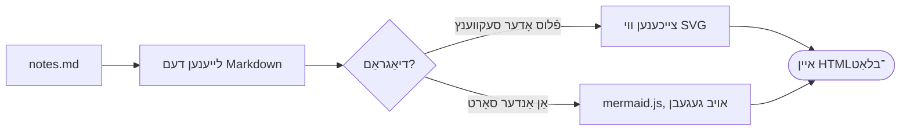
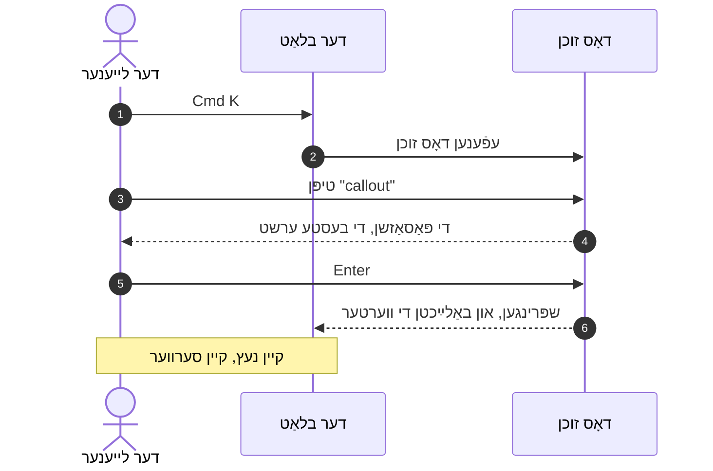
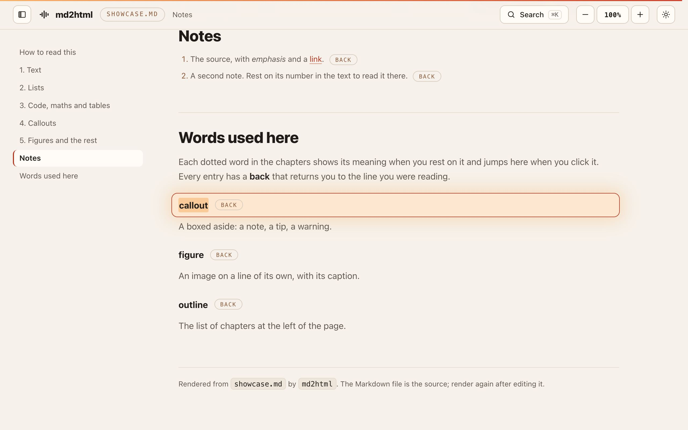
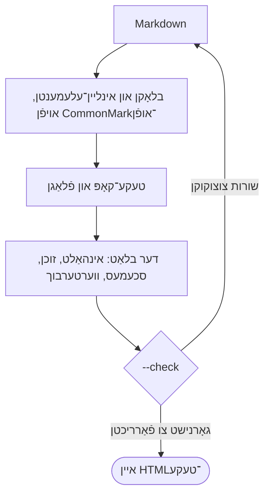

# md2html, אַלץ וואָס עס טוט

md2html מאַכט פֿון אַ Markdown־טעקע איין HTML־בלאַט וואָס דאַרף גאָרנישט מער: קיין סערווער, קיין נעץ, קיין שריפֿטן אָדער סקריפּטן פֿון ערגעץ. דער באַריכט איז אַזאַ בלאַט. ער איז געשריבן אין Markdown און אויסגעשטעלט פֿון md2html, אַזוי אַז יעדע מעגלעכקייט וואָס ער באַשרײַבט אַרבעט אויך אויף אים: דער אינהאַלט אין דער זײַט, דאָס זוכן, די צוויי קאָליר־סכעמעס, די גרייס פֿונעם טעקסט, די קאַרטלעך אונטן, די פּינטלדיקע ווערטער פֿונעם ווערטערבוך, די פֿוסנאָטן, די אילוסטראַציעס וואָס לאָזן זיך פֿאַרגרעסערן, קאָלירטער קאָד און געזעצטע מאַטעמאַטיק.

## ווי צו לייענען דאָס

- **קאַפּיטל 1** איז די גאַנצע געשיכטע אין איין טאַבעלע. צוויי מינוט.
- **קאַפּיטלען 2 ביז 6** ווײַזן וואָס אַ לייענער באַקומט, און וואָס אַ שרײַבער טיפּט כּדי עס צו באַקומען.
- **קאַפּיטלען 7 און 8** זענען די באַשטימונגען און די באַפֿעל־שורה.
- **קאַפּיטלען 9 און 10** זענען זיכערקייט און קוואַליטעט, און ווי ווערסיע 0.4 איז געקומען צו שטאַנד.

---

## 1. מיט איין בליק

| | פֿריִער (0.3) | איצט (0.4) |
|:--|:--:|:--:|
| Markdown וואָס ווערט געלייענט | אַ טייל, גענוג פֿאַרן האַנטבוך | גאַנץ CommonMark, און די צוגאָבן פֿון GitHub |
| CommonMark־בײַשפּילן וואָס גייען דורך | נישט געמאָסטן | **640 פֿון 652** |
| דאָס האַנטבוך פֿון docenta, 4,265 שורות | איבער צוויי מינוט | **0.07 סעקונדעס** |
| אַ בלאַט פֿול מיט `[V]`־צייכנס | געוואַקסן ביז 38 GB | מיליסעקונדעס |
| צוטריטלעכקייט־פּראָבלעמען (axe-core, WCAG 2.2 AA) | צענדליקער | **קיין איינע**, אויף 12 בלעטער, ליכטיק, טונקל און טעלעפֿאָן |
| טעסטן | 10 | 53, פּלוס די 652 בײַשפּילן פֿון דער ספּעציפֿיקאַציע און אַ דורכקליקן אין Chrome |
| Mermaid־דיאַגראַמען | געוויזן ווי קאָד | **געצייכנט**, אָן אַ סקריפּט |
| שפּראַכן | ענגליש | **17**, מיט אַ שאַלטער צווישן די איבערזעצונגען, אויך פֿון רעכטס צו לינקס |
| אָפּצוהיטן | דער בלאַט | דער בלאַט, אַ **PDF** מיט בוכצייכנס, אַן **EPUB** פֿאַר עלעקטראָנישע לייענערס |
| אָפּהענגיקייטן בײַם לויפֿן | קיינע | קיינע |

וואָס איז געקומען מיט 0.4, ווי אַ רשימה אויפֿגאַבעס:

- [x] אַ פֿולער Markdown־לייענער, געבויט אַזוי ווי די CommonMark־ספּעציפֿיקאַציע באַשרײַבט
- [x] פֿוסנאָטן, אויפֿגאַבע־רשימות, דורכגעשטראָכענער טעקסט, אויטאָמאַטישע לינקען, אויסגעגליכענע טאַבעלעס און די פֿינף אַלערטן פֿון GitHub
- [x] קאָד קאָלירט אין אַ צוואַנציק שפּראַכן, מאַטעמאַטיק געזעצט ווי MathML
- [x] באַשטימונגען אינעם טעקע־קאָפּ, און דעם בלאַטס אייגענע ווערטער אויף דײַטש
- [x] `--check`, `--watch`, אָרדנערס, stdin, אַ Content-Security-Policy לויט ווילן
- [x] אַ צוטריטלעכקייט־אָפּשאַצונג און אַ דורכקליקן אין CI
- [x] Mermaid־פֿלוסדיאַגראַמען און סעקווענץ־דיאַגראַמען, געצייכנט ווי SVG אָן אַ סקריפּט (קאַפּיטל 4)
- [x] דער באַריכט אין זיבעצן שפּראַכן, מיט אַ שאַלטער אינעם פּאַס (קאַפּיטל 7)
- [x] דער בלאַט אָפּגעהיט, געדרוקט, אָדער מיטגענומען ווי אַ PDF אָדער אַן EPUB (קאַפּיטלען 2 און 8)

> [!IMPORTANT]
> יעדער בלאַט אויף 4sons.com וואָס איז געבויט מיט md2html (די פּלענער, די פֿאָרשונג און די משפּחה־בלעטער) איז איבערגעבויט געוואָרן מיט 0.4 און פֿאַרגליכן מיט דער ווערסיע וואָס איז געווען אָנליין: די זעלבע סטרוקטור, אָדער בעסער.

## 2. דער בלאַט

דער בלאַט האָט דרײַ טיילן: אַ פּאַס איבערן שפּיץ, דער אינהאַלט אין דער זײַט, און דער טעקסט.

{width=100%}

די טונקעלע סכעמע גייט נאָך דער סיסטעם, אָדער נאָך דעם לייענערס ברירה, און ווערט געדענקט:

{width=100%}

אויף אַ טעלעפֿאָן באַהאַלט זיך דער אינהאַלט הינטערן שאַלטער אינעם פּאַס, און גאָרנישט סקראָלט אין דער זײַט:

{width=34%}

וואָס אַ לייענער קען טאָן:

| כּדי | טוט אַזוי |
|:--|:--|
| געפֿינען עפּעס | **זוכן** אינעם פּאַס, <kbd>⌘</kbd> <kbd>K</kbd> (<kbd>Ctrl</kbd> <kbd>K</kbd>), אָדער <kbd>/</kbd> |
| באַהאַלטן אָדער ווײַזן דעם אינהאַלט | דער שאַלטער בײַם אָנהייב פֿונעם פּאַס, אָדער <kbd>⌘</kbd> <kbd>\\</kbd> |
| ענדערן די גרייס פֿונעם טעקסט | **Aa** אינעם פּאַס, דערנאָך **−** און **+**; אָדער <kbd>⌘</kbd> <kbd>+</kbd> און <kbd>⌘</kbd> <kbd>−</kbd>, פֿון 85 ביז 200 פּראָצענט |
| ענדערן די קאָליר־סכעמע | **Aa**, דערנאָך סיסטעם, ליכטיק אָדער טונקל |
| פֿאַרגרעסערן אַן אילוסטראַציע | קליקט אויף איר; נאָך צוויי קליקן ברענגען זי נעענטער; <kbd>Esc</kbd> שטעלט זי צוריק |
| לייענען אַ פֿוסנאָטע אָדער אַ פּינטלדיק וואָרט | האַלט דעם טײַטל דערויף; קליקט כּדי צו גיין אַהין, און **צוריק** ברענגט צוריק |
| טיילן אַ קאַפּיטל, אַ שורה אין אַ טאַבעלע אָדער אַ פּאַסאַזש | דער טייל־צייכן נאָך אַ קעפּל, אָדער בײַם סוף פֿון דער שורה אין דער טאַבעלע אונטערן טײַטל, קאָפּירט דעם לינק דערצו (אַ טעלעפֿאָן עפֿנט זײַן טייל־מעניו); קלײַבט אויס ווערטער, און עס ווערט פֿאָרגעלייגט אַ לינק פּונקט צו זיי |
| אָפּהיטן דעם בלאַט | דער אַראָפּלאָד־קנעפּל אויפֿן סוף פֿונעם פּאַס: דער בלאַט אַליין (מע קען אים לייענען אָן אינטערנעץ), דרוקן אָדער אָפּהיטן ווי PDF, אָדער דער PDF און דער EPUB וווּ זיי זענען געמאַכט געוואָרן |

## 3. שרײַבן

געוויינטלעך Markdown, און יעדע קאָנסטרוקציע לייענט זיך גוט אויך ווי פּשוטער טעקסט. וואָס איר שרײַבט קומט ערשט, אין אַ קאָד־בלאָק; וואָס איר באַקומט קומט דערנאָך.

### באַטאָנונג און לינקען

```markdown
**פֿעט**, *קורסיוו*, ***ביידע***, ~~דורכגעשטראָכן~~ און `קאָד`.
אַ [לינק](https://commonmark.org "CommonMark"), אַ נאַקעטער,
https://spec.commonmark.org/0.31.2/, און צייכנס ווי [V] וואָס בלײַבן ווי געשריבן.
```

**פֿעט**, *קורסיוו*, ***ביידע***, ~~דורכגעשטראָכן~~ און `קאָד`. אַ [לינק](https://commonmark.org "CommonMark"), אַ נאַקעטער, https://spec.commonmark.org/0.31.2/, און צייכנס ווי [V] וואָס בלײַבן ווי געשריבן.

### רשימות אין רשימות

```markdown
1. ערשטנס, מיט אַן אַרײַנגעלייגטער רשימה:
   - אַ פּונקט
   - נאָך איינער, מיט אַן אייגענער:
     1. טיפֿער
2. צווייטנס.
```

1. ערשטנס, מיט אַן אַרײַנגעלייגטער רשימה:
   - אַ פּונקט
   - נאָך איינער, מיט אַן אייגענער:
     1. טיפֿער
2. צווייטנס.

### ציטאַטן און באַמערקונג־קעסטלעך

```markdown
> אַ פּשוטער ציטאַט בלײַבט אַ ציטאַט.

> [!TIP]
> די אַלערטן פֿון GitHub אַרבעטן: NOTE, TIP, IMPORTANT, WARNING, CAUTION.

> **באַמערקונג:** אַזוי אויך די עלטערע פֿאָרם, אַ פֿעט וואָרט מיט אַ צווייפּינטל.
```

> אַ פּשוטער ציטאַט בלײַבט אַ ציטאַט.

> [!TIP]
> די אַלערטן פֿון GitHub אַרבעטן: NOTE, TIP, IMPORTANT, WARNING, CAUTION.

> **באַמערקונג:** אַזוי אויך די עלטערע פֿאָרם, אַ פֿעט וואָרט מיט אַ צווייפּינטל.

### טאַבעלעס

```markdown
| צימער      | שטאָק    | שטח (קוואַדראַט־פֿוס) |
|:-----------|:-------:|---------------------:|
| וווינצימער | פּאַרטער |                  312 |
| בוידעם     | אויבן   |                  205 |
```

| צימער | שטאָק | שטח (קוואַדראַט־פֿוס) |
|:-----------|:-------:|---------------------:|
| וווינצימער | פּאַרטער | 312 |
| בוידעם | אויבן | 205 |

### פֿוסנאָטן

```markdown
אַ טענה וואָס דאַרף אַ מקור.[^1]

[^1]: דער מקור. האַלט דעם טײַטל אויפֿן נומער כּדי אים דאָרט צו לייענען.
```

אַ טענה וואָס דאַרף אַ מקור.[^source]

[^source]: דער מקור. האַלט דעם טײַטל אויפֿן נומער כּדי אים דאָרט צו לייענען; קליקט אויף אים כּדי צו קומען אַהער, און אויף צוריק כּדי זיך אומצוקערן.

### אילוסטראַציעס און בילדער

```markdown
{width=60%}

אַן איקאָן {width=18} אין מיטן אַ זאַץ.
```

{width=60%}

אַן איקאָן {width=18} אין מיטן אַ זאַץ.

### קליינע זאַכן

```markdown
דריקט <kbd>Ctrl</kbd>+<kbd>K</kbd>. וואַסער איז H<sub>2</sub>O, דער צימער 9 m<sup>2</sup>.
אַ שורה וואָס ענדיקט זיך מיט אַ צוריקשטריך\
ברעכט זיך דאָרט.
```

דריקט <kbd>Ctrl</kbd>+<kbd>K</kbd>. וואַסער איז H<sub>2</sub>O, דער צימער 9 m<sup>2</sup>. אַ שורה וואָס ענדיקט זיך מיט אַ צוריקשטריך\
ברעכט זיך דאָרט.

<details>
<summary>אַן אָפּטייל וואָס עפֿנט זיך מיט אַ קליק</summary>

געשריבן ווי `<details>` מיט אַ `<summary>`, מיט געוויינטלעך Markdown אינעווייניק: **פֿעט**, אַ רשימה,

- איינס
- צוויי

</details>

#### אַ קעפּל אויפֿן פֿערטן ניוואָ

קעפּלעך אונטערן דריטן ניוואָ בלײַבן אַרויס פֿונעם אינהאַלט, ווי דאָס דאָזיקע.

## 4. קאָד און מאַטעמאַטיק

קאָד ווערט קאָלירט פֿאַר Rust, Python, JavaScript און TypeScript, Go, C און C++, Java, Kotlin, Swift, C#, דעם shell, SQL, Ruby, Lua, PHP, CSS, HTML, JSON, YAML, TOML, Dockerfiles און diffs, און יעדער בלאָק האָט אַ קנעפּל צום קאָפּירן.

```rust
/// The whole page from one Markdown text.
fn main() {
    let page = md2html::render("# Hello\n\nWorld.", &Settings::default());
    println!("{} bytes, nothing to fetch", page.len()); // one file
}
```

```python
@cache
def area(w: float, h: float) -> float:
    """The area of a room."""
    return w * h  # square feet
```

```yaml
title: The plans   # front matter is YAML
lang: de
embed: true
```

מאַטעמאַטיק ווערט געזעצט פֿונעם בלעטערער אַליין, ווי MathML, אָן אַ סקריפּט און אָן אַ שריפֿט צום אַראָפּלאָדן. אין דער שורה איז פּיטאַגאָראַסעס טעאָרעם $a^2 + b^2 = c^2$, און אוילערס אידענטיטעט איז $e^{i\pi} + 1 = 0$; אַ סומע דאָלאַרן ווי $5 אָדער $10 בלײַבט געלט. באַזונדער אויסגעשטעלט:

$$
\int_0^1 x^2 \, dx = \frac{1}{3} \qquad \sum_{k=1}^{n} k = \frac{n(n+1)}{2} \qquad \sqrt[3]{27} = 3
$$

$$
\begin{pmatrix} a & b \\ c & d \end{pmatrix}
\begin{pmatrix} x \\ y \end{pmatrix}
=
\begin{pmatrix} ax + by \\ cx + dy \end{pmatrix}
\qquad
|x| = \begin{cases} x & x \ge 0 \\ -x & x < 0 \end{cases}
$$

### דיאַגראַמען

אַ Mermaid־פֿלוסדיאַגראַם אָדער סעקווענץ־דיאַגראַם ווערט געצייכנט פֿון md2html אַליין, ווי SVG אינעם בלאַט: אָן אַ סקריפּט, גאָרנישט צום אַראָפּלאָדן, אין דעם בלאַטס אייגענע קאָלירן אין ביידע סכעמעס, און זײַנע ווערטער בלײַבן ווערטער וואָס דאָס זוכן געפֿינט. דאָס איז דער Markdown:

````markdown

````

און דאָס ווערט דערפֿון:



אַ סעקווענץ־דיאַגראַם, נומערירט, מיט אַ באַמערקונג:



אַנדערע סאָרטן (קרײַז־דיאַגראַמען, גאַנט־דיאַגראַמען, קלאַס־דיאַגראַמען) ווערן געצייכנט פֿון mermaid.js ווען דער מחבר ווײַזט md2html אויף אַ קאָפּיע דערפֿון (`--mermaid-js FILE`); דער סקריפּט קומט דעמאָלט אַרײַן נאָר אין יענעם בלאַט. אָן אים בלײַבן זיי ווי קאָד, און `--check` זאָגט עס.

## 5. די טערמינען און די פֿוסנאָטן

אַ קאַפּיטל מיטן נאָמען „ווערטערבוך“ האַלט די ווערטער פֿונעם בלאַט ווי אַ טאַבעלע. עס ווערט נישט געדרוקט וווּ עס שטייט: אַנשטאָט דעם ווערט די ערשטע דערמאָנונג פֿון יעדן טערמין אין יעדן קאַפּיטל אַ פּינטלדיק וואָרט וואָס דערקלערט זיך אַליין ווען מע האַלט דעם טײַטל דערויף, און אַ קליק דערויף שפּרינגט צום אַרײַנטראָג אונטן, וואָס פֿירט צוריק צו דער שורה וואָס איר האָט געלייענט.

{width=70%}

פֿוסנאָטן אַרבעטן אויפֿן זעלביקן אופֿן: דער נומער דערקלערט זיך אַליין ווען מע האַלט דעם טײַטל דערויף.

{width=70%}

> [!NOTE]
> אַ ווערטערבוך קען זײַן געמיינזאַם פֿאַר עטלעכע בלעטער: איין טעקע אין `~/.config/md2html/glossary.md`, וועמענס ווערטער ווערן דעמאָלט פֿאַרלינקט אויף יעדן בלאַט וואָס ווערט אויסגעשטעלט אויף יענעם קאָמפּיוטער.

## 6. זוכן און אילוסטראַציעס

דאָס זוכן דעקט יעדעס וואָרט אויפֿן בלאַט, אַרײַנגערעכנט דאָס ווערטערבוך. די רעזולטאַטן ווײַזן וווּ יעדעס וואָרט שטייט; דאָס אויסגעקליבענע ווערט באַלויכטן וווּ דאָס זוכן לאַנדט.

{width=80%}

{width=80%}

אַן אילוסטראַציע ווערט פֿאַרגרעסערט איבערן בלאַט אָן אים צו פֿאַרלאָזן. ווען זי איז גרעסער ווי דאָס פֿענצטער, גייט זי נאָך דעם טײַטל, אַזוי אַז איר ווײַזט אויף דעם וואָס איר ווילט זען.

## 7. באַשטימונגען

דער טעקע־קאָפּ פֿון דעם באַריכטס אייגענער Markdown־טעקע זעט אויס אַזוי:

```yaml
---
title: md2html, everything it does
brand: md2html
kicker: Report
version: 0.7.5
date: 2026-11-22
footer: Written in Markdown and rendered by **md2html 0.7.5** itself ...
csp: true      # only this page's own code may run
embed: true    # the screenshots are inside the page
---
```

| באַשטימונג | וואָס זי טוט |
|:--|:--|
| `title`, `description`, `author` | דער טיטל, און די meta־טעגן פֿאַר פֿאָרויסווײַזן פֿון לינקען |
| `lang` | די שפּראַך: דעם בלאַטס אייגענע ווערטער און דאַטעס אויף יעדער פֿון די זיבעצן שפּראַכן אויבן (`ja-Hira` איז יאַפּאַניש אין קאַנאַ, `zh-Hant` כינעזיש מיט טראַדיציאָנעלע צייכנס, `yue` קאַנטאָנעזיש) |
| `translated_from`, `source_sha256` | פֿאַר אַן איבערזעצונג: איר אָריגינאַל, און דעם אָריגינאַלס פֿינגערדרוק ווען זי איז איבערגעזעצט געוואָרן |
| `brand`, `brand_link`, `kicker`, `eyebrow`, `footer` | דער פּאַס, די שורה איבערן טיטל, דער קליינער שריפֿט |
| `date`, `version` | די דאַטע און די ווערסיע וואָס ווערן געוויזן איבערן טיטל |
| `embed` | בילדער אינעם בלאַט, אַזוי אַז ער איז איין טעקע |
| `csp` | אַ Content-Security-Policy |
| `pdf`, `epub` | אַ PDF און אַן EPUB פֿונעם בלאַט, לעבן אים |
| `live` | דעם בלאַטס לעבנסצײַט (`true` איז צוויי מינוט, אָדער אַ צאָל סעקונדעס): דערנאָך לאָדט ער זיך איבער אויב ער האָט זיך געביטן, און דער לייענער בלײַבט אויף זײַן אָרט |
| `large`, `toc`, `math`, `index`, `html`, `css`, `head` | גרעסערע אותיות, דער אינהאַלט, מאַטעמאַטיק, זוך־מאַשינען, רוי HTML, עקסטרע סטיל און head |

> [!TIP]
> מיט `lang: de` זאָגט דאָס זוכן "Diese Seite durchsuchen", די באַמערקונג־קעסטלעך זאָגן "Hinweis" און "Achtung", און די דאַטע לייענט זיך "22. November 2026". די בלעטער פֿון טאָמאַס אויף דעם וועבזײַטל זענען אויף אַזאַ אופֿן אויף דײַטש.

### שפּראַכן

דער באַריכט עקזיסטירט אין זיבעצן שפּראַכן: ענגליש, דײַטש, העברעיִש, אינדאָנעזיש, האָלענדיש, יאַוואַניש, ייִדיש, נידערדײַטש, פֿראַנצייזיש, איטאַליעניש, שפּאַניש, יאַפּאַניש געשריבן אויף דרײַ אופֿנים (מיט קאַנדזשי און קאַנאַ, מיט קאַנאַ אַליין, און אין ראָמאַדזשי), מאַנדאַרין־כינעזיש מיט פֿאַרפּשוטע און מיט טראַדיציאָנעלע צייכנס, און קאַנטאָנעזיש. די ערדקויל אינעם פּאַס שאַלט צווישן זיי, און דער בלאַט עפֿנט זיך בײַם קאַפּיטל וואָס איר האָט געלייענט.

אַן איבערזעצונג איז פּשוט נאָך אַ Markdown־טעקע לעבן דעם אָריגינאַל, אָנגערופֿן נאָך איר שפּראַך: `report.de.md` איז דער דײַטשער `report.md`. md2html געפֿינט די ווערסיעס וואָס זענען דאָ, פֿאַרבינדט זיי איינע מיט דער אַנדערער (און לאָזט וויסן בלעטערערס און זוך־מאַשינען מיט `hreflang`), און גיט יעדער איינער די ווערטער פֿון איר אייגענעם אינטערפֿייס: דאָס זוכן, די באַמערקונג־קעסטלעך, דאָס ווערטערבוך, די דאַטעס. העברעיִש און ייִדיש ווערן אויסגעלייגט פֿון רעכטס צו לינקס, מיטן אינהאַלט אויף דער רעכטער זײַט.

יעדע איבערזעצונג נעמט אָן איר אָריגינאַל און פֿאַרשרײַבט דעם אָריגינאַלס פֿינגערדרוק, אַזוי אַז דער בלאַט קען זאָגן וועלכע ווערסיע איז די גילטיקע, און `--check` באַמערקט ווען דער אָריגינאַל האָט זיך געביטן זינט די איבערזעצונג איז געמאַכט געוואָרן:

```yaml
translated_from: report.md
source_sha256: 5b0c...e1
```

פֿאַר אַ שפּראַך וואָס קיינער האָט נישט איבערגעזעצט אַ בלאַט אויף איר, קען דער לייענערס אייגענער בלעטערער אים איבערזעצן, וווּ ער האָט די פֿעיִקייט (דער אײַנגעבויטער איבערזעצער פֿון Chrome): אויפֿן אַפּאַראַט גופֿא, אַזוי אַז גאָרנישט פֿון אַ משפּחה־בלאַט גייט פֿון אים אַרויס, און באַצייכנט ווי אַ מאַשין־איבערזעצונג מיט אַ וועג צוריק צום אָריגינאַל.

## 8. די באַפֿעל־שורה

```console
$ md2html notes.md
md2html: notes.md -> notes.html (68504 bytes, 9 glossary terms, 0 of them shared)
$ md2html docs/ -o site/ --nav
$ md2html notes.md --check
notes.md:12: a link points at #setup, which is nowhere on the page
notes.md:30: `plan.svg` does not exist next to this page
md2html: 2 to look at
$ cat notes.md | md2html - > notes.html
$ md2html notes.md --pdf --epub
$ md2html notes.md --serve
```

`--check` שרײַבט גאָרנישט און רעכנט אויס וואָס אַ מחבר דאַרף זיך צוקוקן, שורה נאָך שורה, און ענדיקט מיט 1 ווען עס איז דאָ עפּעס: אַ לינק צו אַן אַנקער וואָס איז נישטאָ אויפֿן בלאַט, אַ טעקע וואָס איז נישטאָ, אַ פֿוסנאָטע אָן איר הערה, רוי HTML געוויזן ווי טעקסט. דערמיט ווערט עס דער לעצטער שריט פֿון אַ בוי, אָדער פֿון אַן אַגענטס אַרבעט. `--watch` שטעלט אויס ווידער בײַ יעדן אָפּהיטן, `--nav` פֿאַרבינדט די בלעטער פֿון אַן אָרדנער מיט פֿריִערדיק און קומענדיק, און אַ לינק צו אַן אַנדער Markdown־טעקע פֿירט צו איר בלאַט.

`--pdf` דרוקט דעם בלאַט מיטן Chrome וואָס איז שוין אויפֿן קאָמפּיוטער: מיט זײַן אייגענעם דרוק־אויסלייג, די קעפּלעך ווי די בוכצייכנס פֿונעם PDF, דער טיטל אויבן אויף יעדן בלאַט און זײַן נומער אונטן. `--epub` מאַכט פֿון דעם זעלביקן בלאַט אַ בוך פֿאַר עלעקטראָנישע לייענערס, מיט זײַן אינהאַלט, בילדער, דיאַגראַמען און מאַטעמאַטיק, און פֿוסנאָטן וואָס עפֿענען זיך דאָרט וווּ מע דערמאָנט זיי; md2html שרײַבט אים אַליין. דער לייענער געפֿינט ביידע אונטערן אַראָפּלאָד־קנעפּל אינעם פּאַס.

`--serve` ווײַזט די בלעטער אויף דעם קאָמפּיוטער בשעת מע שרײַבט זיי: יעדער אָפֿענער בלאַט לאָדט זיך איבער אין דעם מאָמענט וואָס דער Markdown ווערט אָפּגעהיט. אַ פֿאַרעפֿנטלעכטער בלאַט מיט `--live` האָט זײַן אייגענע לעבנסצײַט; ווען זי לויפֿט אויס, בעט ער בײַ זײַן סערווער דעם ערשטן קילאָבײַט פֿון זיך אַליין און לאָדט זיך איבער נאָר אויב דאָס האָט זיך געביטן. סײַ ווי סײַ בלײַבט דער לייענער וווּ ער איז געווען: בײַ דעם זעלביקן פּאַראַגראַף אויף דער זעלביקער הייך, אָדער, אויב ער איז מער נישטאָ, בײַם קאַפּיטל פֿאַר אים.

## 9. זיכערקייט, קוואַליטעט און צוטריטלעכקייט

> [!WARNING]
> אַ בלאַט קען ווערן אויסגעשטעלט פֿון Markdown וואָס עמעצער אַנדערש האָט געשריבן. md2html שרײַבט קיין מאָל נישט קיין סקריפּט פֿונעם טעקסט: רוי HTML ווערט געוויזן ווי געשריבן, אַחוץ עטלעכע אומשעדלעכע טעגן, און לינקען מיט `javascript:` אָדער `data:` ווערן אַוועקגעוואָרפֿן, ווי אַזוי מע זאָל זיי נישט אויסלייגן. אַ דאָקומענט קען נישט מאַכן, אַז md2html זאָל לייענען אַ טעקע אַרויס פֿון זײַן אָרדנער, און קיין שום אַרײַנגאַב, ווי פֿײַנדלעך זי זאָל נישט זײַן, קען אים נישט פֿאַרגליווערן אָדער ברענגען צו אַ קראַך.

> [!CAUTION]
> `--html` לאָזט דורך רײַכער HTML (בילדער, לינקען, ווידעאָ, SVG, אויסלייג), אָבער קיין מאָל נישט עפּעס וואָס לויפֿט: קיין סקריפּט, קיין געשעעניש־באַהאַנדלער, קיין ראַם, קיין פֿאָרמולאַר.

וואָס ווערט געפּרוּווט, בײַ יעדער ענדערונג, אויף macOS און Ubuntu:

- 53 טעסטן וואָס שטעלן אויס גאַנצע בלעטער און לייענען זיי צוריק, צווישן זיי די זיכערקייט־פֿאַלן;
- די 652 בײַשפּילן פֿון דער CommonMark־ספּעציפֿיקאַציע, פֿון וועלכע די צאָל וואָס גייען דורך מעג שטײַגן אָבער קיין מאָל נישט פֿאַלן;
- די שטרענגסטע lints פֿון clippy, און די עלטסטע Rust וואָס דער געצײַג זאָגט צו זיך צו בויען דערמיט;
- אַ צוטריטלעכקייט־אָפּשאַצונג מיט axe-core קעגן WCAG 2.2 AA, אין ביידע סכעמעס און אין דער ברייט פֿון אַ טעלעפֿאָן;
- אַ דורכקליקן אין Chrome וואָס ניצט יעדן קנעפּל: זוכן מיט דער קלאַוויאַטור און מיט דער מויז, די קאָליר־סכעמע, די גרייס פֿונעם טעקסט, דער אינהאַלט, אַן אילוסטראַציע, אַ פֿוסנאָטע, דאָס ווערטערבוך, קאָפּירן, דרוקן.

דרוקן באַקומט אַן אייגענעם אויסלייג: די קנעפּלעך פֿאַלן אַוועק, יעדער לינק דרוקט זײַן אַדרעס, גאָרנישט ווערט צעשניטן צווישן בלעטער, און די בלעטער טראָגן דעם טיטל און זייער נומער.

יעדער בלאַט ענדיקט זיך מיט איין שטילער שורה: געמאַכט מיט md2html, זײַן ווערסיע, און אַ לינק צו דעם אָרט וווּ md2html וווינט.

{width=55%}

## 10. ווי 0.4 איז געקומען צו שטאַנד

עס האָט זיך אָנגעהויבן מיט פֿאָרשונג: וואָס די בעסטע Markdown־איבערמאַכערס טוען, וואָס די וועב־סטאַנדאַרטן פֿאָדערן פֿון אַ בלאַט, און ווי מע ניצט דעם געצײַג אויף דעם קאָמפּיוטער, וואָס האָט זיך אַרויסגעוויזן ווי דער נוצלעכסטער טייל. פֿיר בלאַט־בויען אויף 4sons.com האָבן איבערגעשריבן דעם רעזולטאַט פֿון md2html נאָכן אויסשטעלן, כּדי צו ענדערן דעם בראַנד, די שפּראַך, דעם פֿוסטעקסט און נאָך. יעדע פֿון די איבערשרײַבונגען איז געוואָרן אַ באַשטימונג, און די בויען זענען איבערגעבויט געוואָרן קעגן דער נײַער ווערסיע, בלאַט נאָך בלאַט.

די ענדערונגען, ווי אַ diff פֿון די כּללים וואָס דער איבערמאַכער פֿאָלגט:

```diff
- a handbook subset, anything else shown as written
+ all of CommonMark, and anything else shown as written
- every quotation a note
+ a quotation is a quotation; a bold first word makes it a note
- the page's words in English
+ the page's words in English or German
```

וואָס 0.5 האָט זינט דעמאָלט צוגעגעבן: דיאַגראַמען. דער וועג וואָס יעדער בלאַט דאָ גייט:



---

דאָס ווערטערבוך אונטן דערקלערט די ווערטער וואָס דער באַריכט ניצט; יעדעס איז אויבן געווען אַ פּינטלדיק וואָרט.

## ווערטערבוך

| טערמין | באַטײַט | אויך |
|---|---|---|
| Markdown | פּשוטער טעקסט מיט לײַכטע צייכנס פֿאַר קעפּלעך, באַטאָנונג, רשימות און לינקען, וואָס מע קען לייענען ווי ער איז און איבערמאַכן אין אַ בלאַט. | |
| CommonMark | די ספּעציפֿיקאַציע פֿון Markdown וואָס רובֿ געצײַגן פֿאָלגן הײַנט, מיט אַ טעסט פֿאַר יעדן כּלל. | |
| אינהאַלט | די רשימה קאַפּיטלען אין דער זײַט פֿונעם בלאַט, געמאַכט פֿון זײַנע קעפּלעך. | |
| באַמערקונג־קעסטל | אַן אָפּגעראַמטע זײַט־באַמערקונג: אַ באַמערקונג, אַן עצה, עפּעס וויכטיקס, אַ וואָרענונג אָדער אַ ווערטל זיך צו היטן. | באַמערקונג־קעסטלעך, אַלערט, אַלערטן |
| אילוסטראַציע | אַ בילד אויף אַן אייגענער שורה, מיט זײַן אונטערשריפֿט אונטן, וואָס ווערט פֿאַרגרעסערט מיט אַ קליק. | אילוסטראַציעס |
| טעקע־קאָפּ | דער בלאָק באַשטימונגען צווישן צוויי `---`־שורות גאָר אויבן אין אַ Markdown־טעקע. | |
| MathML | דעם וועבס אייגענע שפּראַך פֿאַר מאַטעמאַטיק, געצייכנט פֿונעם בלעטערער אָן אַ סקריפּט. | |
| Content-Security-Policy | אַ כּלל אינעם בלאַט וואָס זאָגט דעם בלעטערער וועלכער קאָד טאָר לויפֿן; דאָ, נאָר דעם בלאַטס אייגענער. | |
| Mermaid | אַ טעקסט־שפּראַך פֿאַר דיאַגראַמען, געשריבן אין אַ קאָד־בלאָק; md2html צייכנט אירע פֿלוסדיאַגראַמען און סעקווענץ־דיאַגראַמען. | |
| WCAG | די Web Content Accessibility Guidelines, די כּללים פֿאַר צוטריטלעכקייט פֿון וועב־אינהאַלט; דער ניוואָ AA איז דער געוויינטלעכער ציל. | |
| איבערזעצונג | אַ ווערסיע פֿון אַ בלאַט אין אַן אַנדער שפּראַך, אַ Markdown־טעקע לעבן דעם אָריגינאַל. | איבערזעצונגען |
