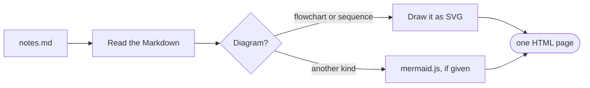
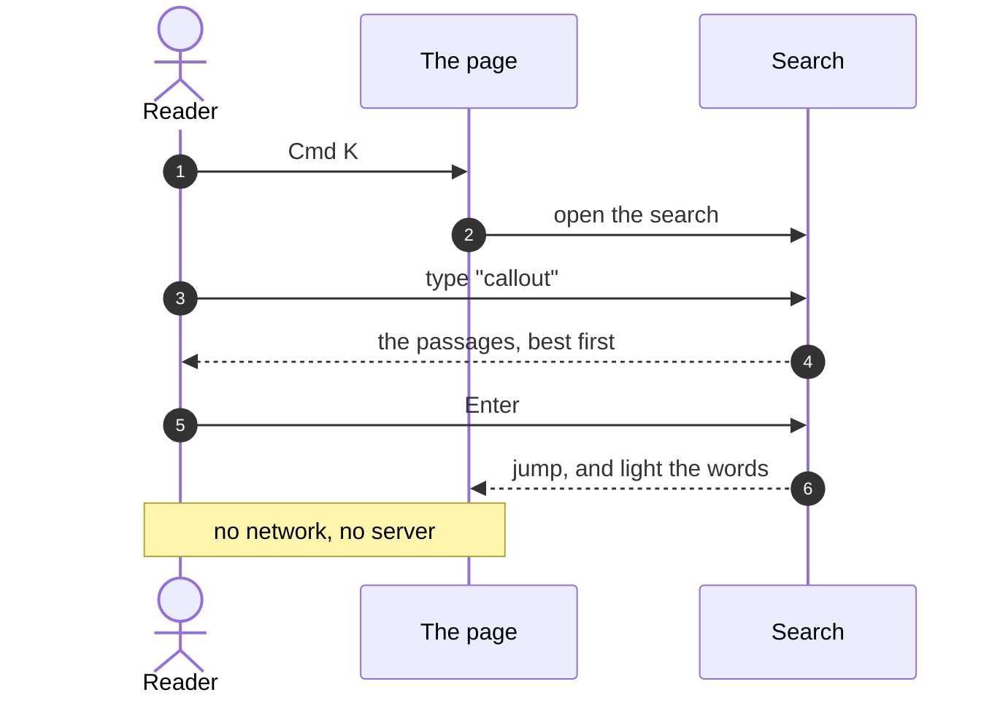
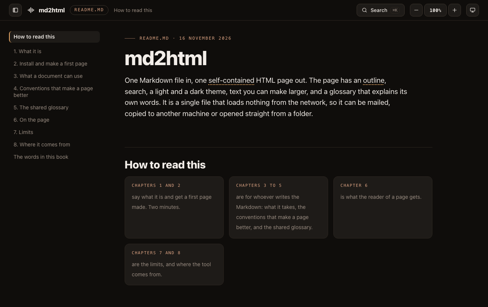

# Everything md2html renders

This page uses every construct the renderer knows, so a change can be checked against all of them at once. Render it with `md2html docs/showcase.md` and read it in both themes, at a large text size and in print.

## How to read this

- **Chapters 1 and 2** are text and lists.
- **Chapter 3** is code, maths and tables.
- **Chapters 4 and 5** are callouts, figures and the rest.

## 1. Text

A paragraph with **bold**, *italic*, ***both***, ~~struck~~ and `inline code`. A [link with a title](https://commonmark.org "CommonMark") and a bare one, https://spec.commonmark.org/0.31.2/. Marks such as [V] or [M] stay as written, and so does a dollar sum: it costs $5, or $10 with delivery.

A line ended with a backslash\
breaks there. Press <kbd>Ctrl</kbd>+<kbd>K</kbd> to search; water is H<sub>2</sub>O and the area is 9 m<sup>2</sup>.

> A plain quotation stays a quotation, set off by a line.
>
> > And one inside it.

A claim that needs a source.[^source] Another that needs two.[^second]

[^source]: The source, with *emphasis* and a [link](https://example.com).
[^second]: A second note. Rest on its number in the text to read it there.

## 2. Lists

1. First, with a nested list:
   - a bullet
   - another, with its own:
     1. deeper
     2. and deeper
2. Second, with a paragraph after a blank line.

   The paragraph belongs to the second item.
3. Third.

A task list:

- [x] write the Markdown
- [x] render it
- [ ] read it in print

## 3. Code, maths and tables

```rust
/// A greeting, coloured.
fn main() {
    let name = "world"; // the default
    println!("hello, {name}: {}", 42);
}
```

```python
@cache
def area(w: float, h: float) -> float:
    """The area of a rectangle."""
    return w * h  # square metres
```

```console
$ md2html notes.md --check
notes.md:12: a link points at #setup, which is nowhere on the page
```

```diff
- the old line
+ the new line
```

Inline maths: $a^2 + b^2 = c^2$, and Euler's identity $e^{i\pi} + 1 = 0$. A display:

$$
\int_0^1 x^2 \, dx = \frac{1}{3} \qquad \sum_{k=1}^{n} k = \frac{n(n+1)}{2}
$$

$$
\begin{pmatrix} a & b \\ c & d \end{pmatrix}
\begin{pmatrix} x \\ y \end{pmatrix}
=
\begin{pmatrix} ax + by \\ cx + dy \end{pmatrix}
$$

A flowchart and a sequence diagram, drawn by md2html itself:





| Room | Floor | Area (sq ft) | Done |
|:-----|:-----:|-------------:|:----:|
| Living room | ground | 312 | yes |
| Bath 1 | ground | 48 | no |
| Loft | upper | 205 | no |

## 4. Callouts

> [!NOTE]
> GitHub's alert syntax works.

> [!TIP]
> So does every one of its five kinds.

> [!IMPORTANT]
> Important things stand out.

> [!WARNING]
> Warnings are red.

> [!CAUTION]
> And caution is the strongest.

> **Note:** The older form, a bold word and a colon, still works.

## 5. Figures and the rest

{width=50%}

An image inside a sentence {width=20} sits on the line.

<details>
<summary>A section that opens on a click</summary>

Its content is ordinary Markdown, with **bold** and a list:

- one
- two

</details>

---

The glossary below explains its words wherever the chapters use them: the outline, a callout, a figure.

## Glossary

| Term | Meaning | Also |
|---|---|---|
| outline | The list of chapters at the left of the page. | contents |
| callout | A boxed aside: a note, a tip, a warning. | callouts, alert |
| figure | An image on a line of its own, with its caption. | figures |
